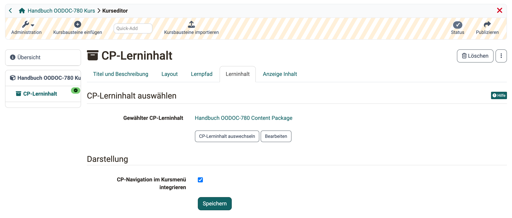
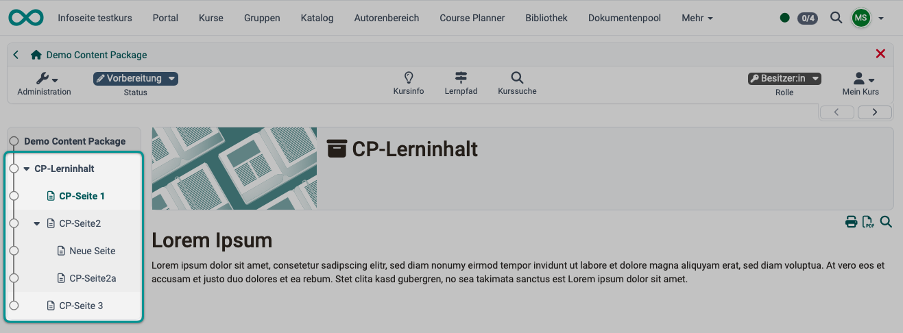
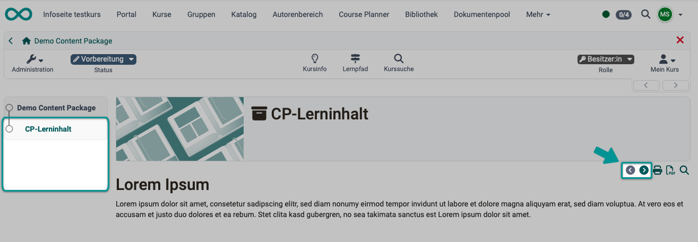

# Kursbaustein "CP-Lerninhalt" {: #CP_learning_content}

## Steckbrief

Name | CP-Lerninhalt
---------|----------
Icon | :o_icon_o_cp_icon:
Verfügbar seit | Neuauflage mit Release 16.2
Funktionsgruppe | Wissensvermittlung
Verwendungszweck | Anzeige von Lerninhalt im IMS-CP-Format
Bewertbar | nein
Spezialität / Hinweis |

Nutzen Sie den Kursbaustein "CP-Lerninhalt", um einen Lerninhalt im IMS-CP-Format (IMS-CP Version 1.1.2) in Ihren Kurs einzubinden. Das CP erstellen Sie entweder direkt in OpenOlat, wie es die Anleitung "[Wie erstelle ich ein Content Package?](../../manual_how-to/content_package/content_package.de.md)" erklärt, oder ausserhalb von OpenOlat.

Den Kursbaustein konfigurieren Sie im Kurseditor in den Tabs "Lerninhalt" und "Anzeige Inhalt": 
`Kurs > Administration > Kurseditor > Kursbaustein "CP-Lerninhalt"`

## Tab Lerninhalt :octicons-tag-16:{ title="Neuauflage ab Release 16.2" } {: #tab_learning_content}

Im Kurseditor erscheint der Kursbaustein "CP-Lerninhalt" als einzelner Kursbaustein. Seinen Inhalt, das Content Package, erstellen, bearbeiten oder ersetzen Sie im Tab "Lerninhalt".

{ class="shadow lightbox" title="Tab Lerninhalt des Kursbausteins im Kurseditor · 2026.11.09" }

Ein Content Package besteht meist aus mehreren Seiten. Ist die Option "CP-Navigation im Kursmenü integrieren" eingeschaltet, zeigt OpenOlat die Struktur dieser Seiten direkt im Kursmenü. 
Ohne diese Option sehen Teilnehmer:innen die Struktur nicht. Nach dem Öffnen des Kursbausteins blättern sie mit den Pfeilen rechts oben im Inhalt durch die Seiten des CP.

{ class="lightbox" title="Kursmenü mit integrierter CP-Navigation" }

{ class="lightbox" title="Kursbaustein CP-Lerninhalt ohne CP-Navigation im Kursmenü" }

[Zum Seitenanfang ^](#CP_learning_content)

## Tab Anzeige Inhalt [:octicons-tag-16:{ title="ab Release 9.0.0 (OO-619)" }](https://track.frentix.com/issue/OO-619){:target="_blank"} {: #tab_display_content}

Im Tab "Anzeige Inhalt" legen Sie fest, wie OpenOlat die Seiten des Content Packages im Kurs anzeigt, zum Beispiel ob das Layout des Kurses auf die Seiten angewendet wird und wie hoch die Anzeigefläche ist. So passt der CP-Lerninhalt optisch zum Kurs, oder er erscheint unverändert so, wie er erstellt wurde.

#### Standardwerte übernehmen {: #use_standard_configuration}

Die Anzeige eines CP-Lerninhalts legen Sie an zwei Orten fest: in den Einstellungen der Lernressource im [Tab "Layout"](CP_Administration/index.de.md#tab_layout) und hier im Kursbaustein. Mit "Standardwerte übernehmen" wählen Sie, welche Einstellungen im Kurs gelten:

* **Aus Layouteinstellungen der Lernressource übernehmen:** Der Kursbaustein zeigt den CP-Lerninhalt so, wie es in den Einstellungen der Lernressource festgelegt ist. Die Felder darunter zeigen diese Werte und lassen sich hier nicht ändern.
* **Anpassen:** Sie legen die Felder darunter für diesen Kursbaustein selbst fest. Die Einstellungen gelten nur hier, die Lernressource und andere Kurse, die sie verwenden, bleiben unverändert.

Sieht ein CP-Lerninhalt im Kurs anders aus als beim direkten Öffnen der Lernressource, prüfen Sie diese Auswahl: Mit "Anpassen" gelten im Kurs eigene Werte. Das Feld "Standardwerte übernehmen" erscheint, sobald der Kursbaustein einen CP-Lerninhalt eingebunden hat.

#### Weitere Felder {: #display_fields}

Darunter folgen dieselben Felder wie im Tab "Anzeige Inhalt" des Kursbausteins "HTML-Seite": "Anzeigemodus", "JavaScript hinzufügen", "Glossarbegriffe einbinden", "Höhe Anzeigefläche", "Layout anpassen", "Zeichensatz Inhalt" und "Zeichensatz Javascript". Die Felder beschreibt der Abschnitt [Tab Anzeige Inhalt](Course_Element_HTML_Page.de.md#layout).

[Zum Seitenanfang ^](#CP_learning_content)

## Weiterführende Informationen {: #further_information}

**Auf dieser Seite erwähnt** 
[Wie erstelle ich ein Content Package? (Schritt-für-Schritt-Anleitung) >](../../manual_how-to/content_package/content_package.de.md) 
[CP-Lerninhalt: Administration >](CP_Administration/index.de.md) 
[Kursbaustein "HTML-Seite" >](Course_Element_HTML_Page.de.md)

**Weiterführend** 
[Erstellen und Bearbeiten eines Content Packages >](../learningresources/CP_Editor.de.md)

[Zum Seitenanfang ^](#CP_learning_content)
