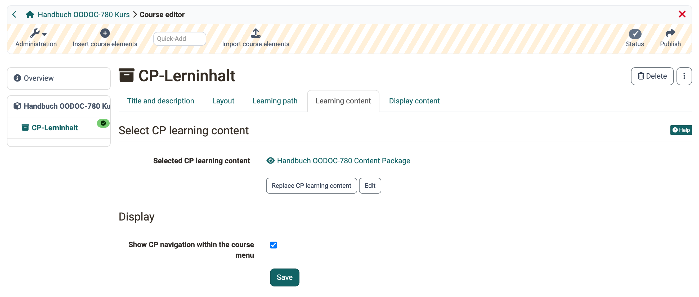
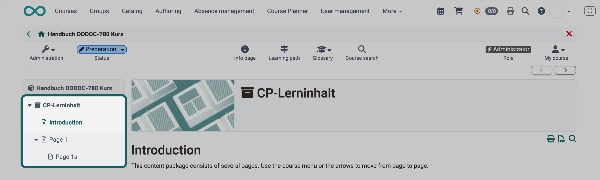
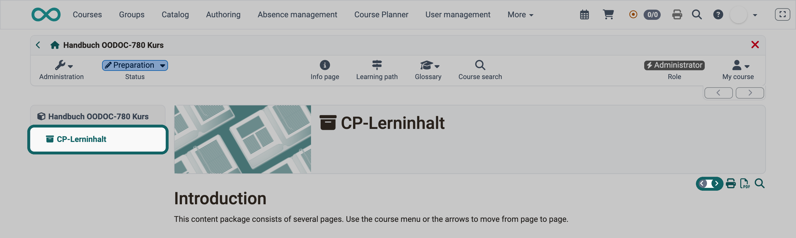

# Course Element "CP learning content" {: #CP_learning_content}

## Profile

Name | CP learning content
---------|----------
Icon | :o_icon_o_cp_icon:
Available since | New edition with release 16.2
Functional group | Knowledge transfer
Purpose | Display learning content in IMS CP format
Assessable | no
Specialty / Note | 

Use the "CP learning content" course element to embed learning content in the IMS-CP format (IMS-CP Version 1.1.2) into your course. You create the CP either directly in OpenOlat, as explained in the guide "[How do I create a Content Package?](../../manual_how-to/content_package/content_package.md)", or outside of OpenOlat.

You configure the course element in the course editor in the tabs "Learning content" and "Display content": 
`Course > Administration > Course editor > Course element "CP learning content"`

## Tab Learning content :octicons-tag-16:{ title="New edition from Release 16.2" } {: #tab_learning_content}

In the course editor, the "CP learning content" course element appears as a single course element. You create, edit or replace its content, the content package, in the "Learning content" tab.

{ class="shadow lightbox" title="Tab Learning content of the course element in the course editor · 2026.11.09" }

A content package usually consists of several pages. If the option "Show CP navigation within the course menu" is switched on, OpenOlat shows the structure of these pages directly in the course menu. 
Without this option, participants do not see the structure. After opening the course element, they page through the CP pages with the arrows at the top right of the content.

{ class="shadow lightbox" title="Course menu with integrated CP navigation · 2026.11.09" }

{ class="shadow lightbox" title="Course element CP learning content without CP navigation in the course menu · 2026.11.09" }

[To the top of the page ^](#CP_learning_content)

## Tab Display content [:octicons-tag-16:{ title="from Release 9.0.0 (OO-619)" }](https://track.frentix.com/issue/OO-619){:target="_blank"} {: #tab_display_content}

In the "Display content" tab, you define how OpenOlat displays the pages of the content package in the course, for example whether the course layout is applied to the pages and how high the display area is. This way, the CP learning content matches the course visually, or it appears unchanged as it was created.

#### Use standard configuration {: #use_standard_configuration}

You define the display of a CP learning content in two places: in the settings of the learning resource in the [tab "Layout"](CP_Administration/index.md#tab_layout) and here in the course element. With "Use standard configuration" you choose which settings apply in the course:

* **Use from learning resource layout configuration:** The course element shows the CP learning content as defined in the settings of the learning resource. The fields below show these values and cannot be changed here.
* **Modify:** You set the fields below yourself for this course element. The settings only apply here; the learning resource and other courses that use it remain unchanged.

If a CP learning content looks different in the course than when the learning resource is opened directly, check this selection: with "Modify", the course uses its own values. The field "Use standard configuration" appears as soon as the course element has embedded a CP learning content.

#### Further fields {: #display_fields}

Below follow the same fields as in the "Display content" tab of the course element "HTML page": "Display mode", "Embed Javascript library", "Embed glossary terms", "Display height", "Adapt layout", "Content character set" and "Javascript character set". The fields are described in the section [Tab Display content](Course_Element_HTML_Page.md#layout).

[To the top of the page ^](#CP_learning_content)

## Further information {: #further_information}

**Mentioned on this page** 
[How do I create a content package? (Step-by-step instruction) >](../../manual_how-to/content_package/content_package.md) 
[CP learning content: Administration >](CP_Administration/index.md) 
[Course Element "HTML page" >](Course_Element_HTML_Page.md)

**Further reading** 
[Creating and editing a content package >](../learningresources/CP_Editor.md)

[To the top of the page ^](#CP_learning_content)
