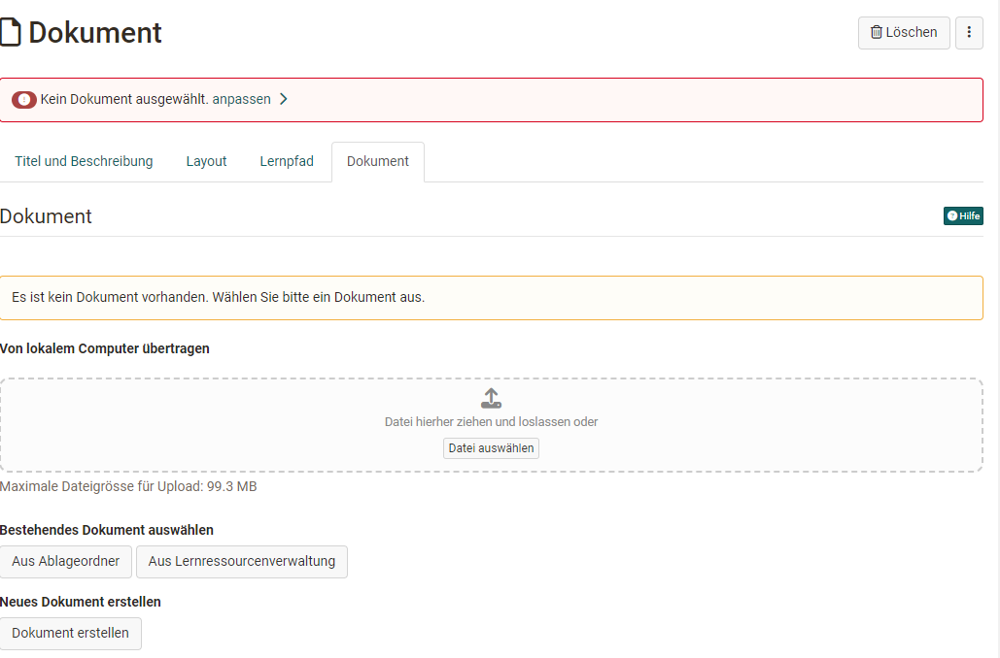
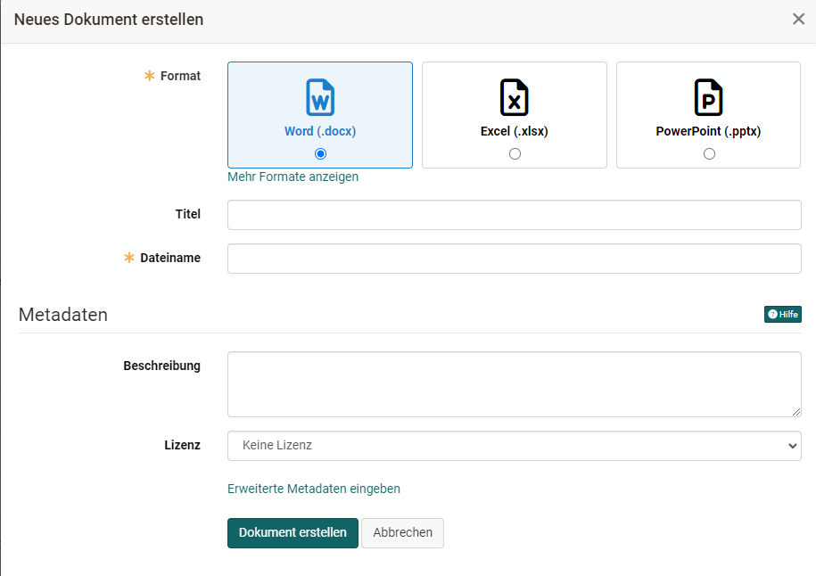
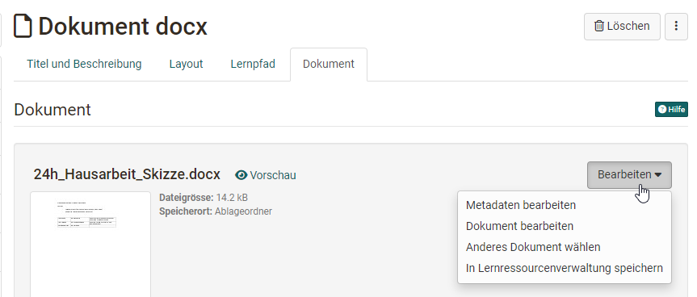

# Kursbaustein "Dokument" {: #document}

## Steckbrief

Name | Dokument
---------|----------
Icon | :o_icon_o_filetype_file:
Verfügbar seit | Release 15.3
Funktionsgruppe | Wissensvermittlung
Verwendungszweck | Bereitstellung verschiedener Dokumente, auch zur gemeinsamen Bearbeitung
Bewertbar | nein
Spezialität / Hinweis | Für Office-Dokumente sind entsprechende Lizenzen zur Bearbeitung erforderlich

Mit dem Kursbaustein "Dokument" binden Sie eine Datei in den Kurs ein, etwa eine PDF-Datei, ein Bild oder ein Office-Dokument. Die Teilnehmenden sehen den Inhalt direkt im Kurs. Als Besitzer:in des Kurses richten Sie den Kursbaustein im Kurseditor ein: `Kurs > Administration > Kurseditor`.

### Für welche Dateitypen ist der Kursbaustein gedacht? [:octicons-tag-16:{ title="ab Release 15.3 (OO-4801)" }](https://track.frentix.com/issue/OO-4801){:target="_blank"}

Der Kursbaustein eignet sich für PDF-Dateien und für Bilder im Format JPG oder PNG. Office-Dokumente (Word, Excel, PowerPoint) und draw.io Diagramme [:octicons-tag-16:{ title="ab Release 18.1 (OO-7090)" }](https://track.frentix.com/issue/OO-7090){:target="_blank"} binden Sie ein, wenn Systemadministrator:innen die passenden Editoren in der System-Administration aktiviert haben: Office-Dokumente unter `Administration > Externe Werkzeuge > Dokumenteneditoren`, draw.io Diagramme unter `Administration > Externe Werkzeuge > draw.io`. Die Einstellungen beschreibt die Seite [Externe Werkzeuge](../../manual_admin/administration/External_Tools_-_Administration/index.de.md#dokumenteneditoren) im Administrationshandbuch.

OpenOlat zeigt PDF-Dateien in einem integrierten PDF-Viewer (pdf.js) an [:octicons-tag-16:{ title="ab Release 18.1 (OO-6996)" }](https://track.frentix.com/issue/OO-6996){:target="_blank"}. Grosse PDF-Dateien lädt er stufenweise, sofern die Datei das unterstützt. Der PDF-Viewer ist schreibgeschützt: Zum Bearbeiten braucht es einen separaten Editor.

!!! info "Wichtig"

    Für Video-Dateien gibt es den [Kursbaustein "Video"](../learningresources/Course_Element_Video.de.md), für HTML-Dateien den [Kursbaustein "HTML-Seite"](../learningresources/Course_Element_HTML_Page.de.md). Laden Sie im Kursbaustein "Dokument" eine solche Datei hoch oder wählen Sie sie aus dem Ablageordner, bindet OpenOlat sie nicht ein und verweist mit einer Meldung auf den passenden Kursbaustein. Ist in der Serverkonfiguration eine [Inhaltsdomäne](../basic_concepts/Content_Domain.de.md) (separate Adresse für Inhalte) eingerichtet, liefert OpenOlat die Datei im Kursbaustein "HTML-Seite" darüber aus. Skripte in der Datei erhalten so keinen Zugriff auf die OpenOlat-Sitzung, also auf die Anmeldung der Person, die die Seite öffnet. [:octicons-tag-16:{ title="ab Release 21.0 (OO-7612)" }](https://track.frentix.com/issue/OO-7612){:target="_blank"}

### Wie kommen die Dateien in den Kursbaustein?

Sie richten den Kursbaustein im Kurseditor im Tab "Dokument" ein. Eine Datei kommt auf drei Wegen in den Kursbaustein: Sie laden sie hoch, Sie verknüpfen eine bestehende Datei, oder Sie erstellen eine neue.

{ class="lightbox" title="Tab Dokument im Kurseditor" }

#### Datei hochladen

Sie laden eine Datei auf einem von zwei Wegen hoch:

* **Vom eigenen Computer**: Im Bereich "Von lokalem Computer übertragen" klicken Sie auf "Datei auswählen" oder ziehen die Datei per Drag & Drop in das Feld.
* **Als Lernressource**: Unter "Bestehendes Dokument auswählen" klicken Sie auf "Aus Lernressourcenverwaltung" und dann auf "Datei importieren". Die Datei wird damit zur Lernressource, und der Kursbaustein zeigt sie an.

#### Datei verknüpfen

Unter "Bestehendes Dokument auswählen" wählen Sie eine Datei, die schon vorhanden ist:

* **Aus Ablageordner**: eine Datei, die im Ablageordner des Kurses liegt.
* **Aus Lernressourcenverwaltung**: eine Datei, die als Lernressource hochgeladen ist.

#### Datei erstellen

Für eine neue Datei klicken Sie auf "Dokument erstellen" und wählen im Dialog "Neues Dokument erstellen" das Format.

{ class="lightbox" title="Dialog Dokument erstellen" }

Alternativ erstellen Sie die Datei als Lernressource: Klicken Sie auf "Aus Lernressourcenverwaltung" und dann auf "Erstellen".

Haben Systemadministrator:innen draw.io in der System-Administration aktiviert, erstellen Sie im Kursbaustein auch draw.io Diagramme für die Teilnehmenden. Klicken Sie dafür auf "Dokument erstellen", dann auf "Mehr Formate anzeigen", und wählen Sie "Diagramm" oder "Whiteboard".

Mehrere Personen können ein draw.io Diagramm gleichzeitig öffnen und bearbeiten [:octicons-tag-16:{ title="ab Release 18.1 (OO-7091)" }](https://track.frentix.com/issue/OO-7091){:target="_blank"}. Die Änderungen erscheinen in Echtzeit bei allen. Damit eignet sich der Kursbaustein "Dokument" mit draw.io für Gruppenarbeiten.

!!! info "Wichtig"

    Arbeiten viele Personen gleichzeitig am Diagramm, kann die Synchronisation kurz aussetzen. Laden Sie das Dokument dann neu, um die Verbindung wiederherzustellen.

### Höhe der Vorschau konfigurieren [:octicons-tag-16:{ title="ab Release 15.4 (OO-5116)" }](https://track.frentix.com/issue/OO-5116){:target="_blank"}

Im Tab "Dokument" des Kurseditors legen Sie im Feld "Höhe Anzeigefläche" fest, wie hoch die Vorschau des Dokuments ist. Standardmässig ist "Automatisch" eingestellt: Das Dokument nutzt den verfügbaren Platz auf der Seite. Bei manchen Formaten, etwa PowerPoint, entstehen dabei schwarze Ränder. Mit einer festen Höhe passen Sie die Darstellung gezielt an.

### Dokument-Anzeige im Lightbox-Modus [:octicons-tag-16:{ title="ab Release 18.1 (OO-6957)" }](https://track.frentix.com/issue/OO-6957){:target="_blank"}

Öffnen Sie ein Dokument, ein Bild oder ein Video zur Ansicht, zeigt OpenOlat es im Lightbox-Modus an: als Fenster über der aktuellen Seite, ohne ein neues Browserfenster zu öffnen. Zum Bearbeiten öffnet sich das Dokument in einem separaten Fenster.

### Änderungen vornehmen

Ein eingebundenes Dokument können Sie später bearbeiten, seine Metadaten ändern oder es ganz austauschen. Im Tab "Dokument" öffnet der Button "Bearbeiten" dafür ein Menü. Welche Einträge es zeigt, hängt vom Dateityp ab.

{ class="lightbox" title="Detailansicht eines Dokuments" }

### Dokument entfernen

Ein Dokument lässt sich im Kursbaustein nicht löschen, nur austauschen. Ein anderes Dokument wählen Sie im Kurseditor im Tab "Dokument": `Bearbeiten > Anderes Dokument wählen`. Soll im Kurs gar kein Dokument mehr erscheinen, löschen Sie den ganzen Kursbaustein in `Kurs > Administration > Kurseditor` und publizieren Sie den Kurs, siehe [Löschen, Verschieben und Kopieren von Kursbausteinen](Deleting_Moving_and_Copying_Course_Elements.de.md).

Die Datei selbst bleibt dabei erhalten. Wo sie liegt, zeigt die Angabe "Speicherort" unter dem Dokument im Tab "Dokument":

* **Ablageordner**: Hier liegen hochgeladene, neu erstellte und aus dem Ablageordner gewählte Dateien. Sie löschen die Datei in `Kurs > Administration > Dateien > Ablageordner`, siehe [Ablageordner](Storage_folder.de.md).
* **Lernressourcenverwaltung**: Die Datei ist eine eigene Lernressource. Sie löschen sie wie jede Lernressource, siehe [Löschen (eines Kurses/einer Lernressource)](Course_Delete.de.md).

!!! info "Wichtig"

    Löschen Sie die Datei erst, wenn kein Kursbaustein sie mehr anzeigt. Sonst sehen die Teilnehmenden im Kursbaustein den Hinweis "Kein Dokument".

### Berechtigungen konfigurieren

Ist ein Dokument mit dem Kursbaustein verbunden, legen Sie im Tab "Dokument" im Abschnitt "Berechtigungen" fest, welche Rollen das Dokument bearbeiten und herunterladen dürfen. Dafür setzen Sie in den Zeilen "Bearbeiten" und "Herunterladen" je Rolle ein Häkchen. Zur Wahl stehen Besitzer:innen, Betreuer:innen, Teilnehmer:innen und Gäste. Ohne Änderung dürfen nur Besitzer:innen das Dokument bearbeiten, herunterladen dürfen es alle Rollen. Die Zeile "Bearbeiten" erscheint nur, wenn für das Dokument ein Dokumenteneditor verfügbar ist.

Wer das Dokument zuletzt bearbeitet hat, zeigt nach dem Download das Feld "Geändert durch" im Dialog "Metadaten". Den Dialog öffnen Sie im Tab "Dokument": `Bearbeiten > Metadaten bearbeiten`.

Mit diesen Berechtigungen setzen Sie unterschiedliche Szenarien um, auch solche für die Zusammenarbeit.

!!! info "Wichtig"

    Ist das Herunterladen für eine Rolle nicht erlaubt, deaktiviert OpenOlat für diese Rolle auch das Drucken: Die Drucken-Schaltfläche und der Menüeintrag im PDF-Viewer erscheinen nicht [:octicons-tag-16:{ title="ab Release 20.3.4 (OO-9530)" }](https://track.frentix.com/issue/OO-9530){:target="_blank"}.

## Weiterführende Informationen {: #further_information}

**Auf dieser Seite erwähnt** 
[Externe Werkzeuge: Übersicht >](../../manual_admin/administration/External_Tools_-_Administration/index.de.md) 
[Kursbaustein "Video" >](../learningresources/Course_Element_Video.de.md) 
[Kursbaustein "HTML-Seite" >](../learningresources/Course_Element_HTML_Page.de.md) 
[Inhaltsdomäne >](../basic_concepts/Content_Domain.de.md) 
[Löschen, Verschieben und Kopieren von Kursbausteinen >](Deleting_Moving_and_Copying_Course_Elements.de.md) 
[Ablageordner >](Storage_folder.de.md) 
[Löschen (eines Kurses/einer Lernressource) >](Course_Delete.de.md)

**Weiterführend** 
[Kursbausteine im Überblick >](Course_Elements/index.de.md) 
[Kursbaustein "Ordner" >](Course_Element_Folder.de.md)

[Zum Seitenanfang ^](#document)
