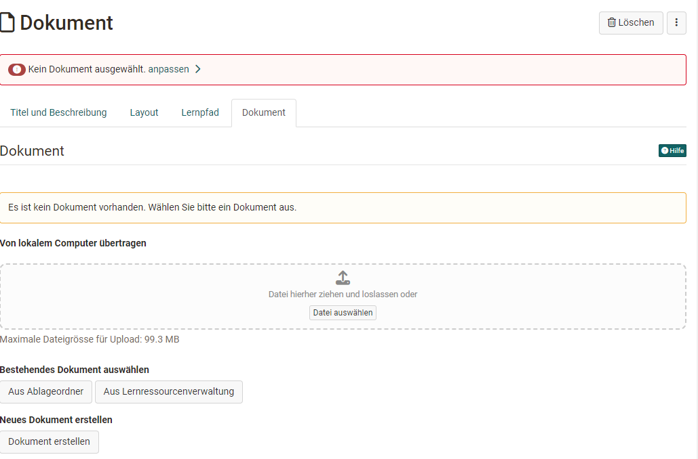
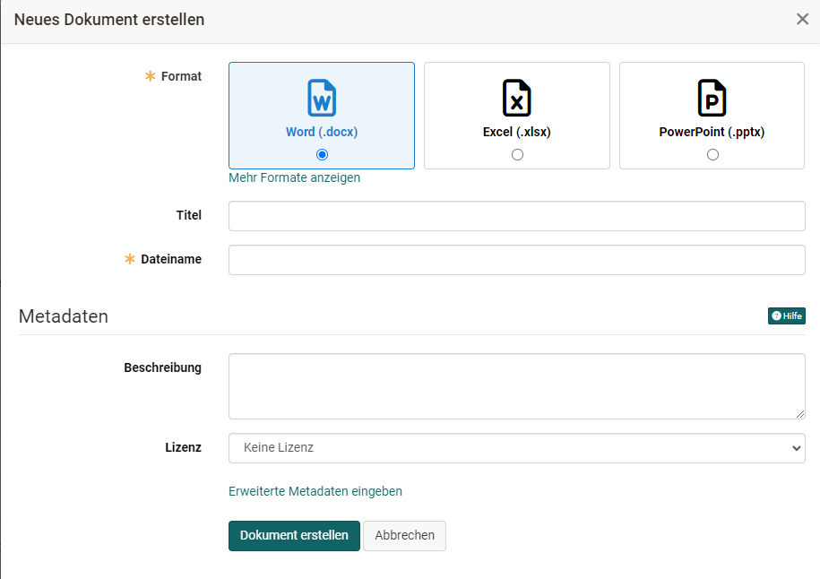
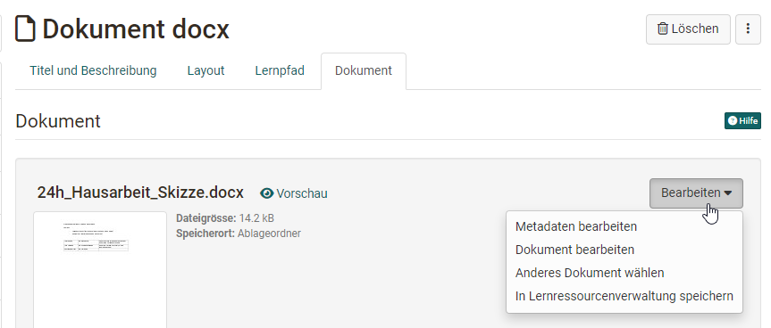

# Course Element "Document" {: #document}

## Profile

Name | Document
---------|----------
Icon | :o_icon_o_filetype_file:
Available since | Release 15.3
Functional group | Knowledge Transfer
Purpose | Provision of various documents, also for joint editing
Assessable | no
Specialty / Note | For office documents, appropriate licenses are required for editing

With the course element "Document" you embed a file in the course, for example a PDF file, an image or an Office document. Participants see the content directly in the course. As an owner of the course, you set up the course element in the course editor: `Course > Administration > Course editor`.

### For which file types is the course element intended? [:octicons-tag-16:{ title="from Release 15.3 (OO-4801)" }](https://track.frentix.com/issue/OO-4801){:target="_blank"}

The course element is suited for PDF files and for images in JPG or PNG format. You can embed Office documents (Word, Excel, PowerPoint) and draw.io diagrams [:octicons-tag-16:{ title="from Release 18.1 (OO-7090)" }](https://track.frentix.com/issue/OO-7090){:target="_blank"} if system administrators have activated the corresponding editors in the system administration: Office documents under `Administration > External tools > Document editors`, draw.io diagrams under `Administration > External tools > draw.io`. The settings are described on the page [External tools](../../manual_admin/administration/External_Tools_-_Administration/index.md#dokumenteneditoren) in the administration manual.

OpenOlat displays PDF files in an integrated PDF viewer (pdf.js) [:octicons-tag-16:{ title="from Release 18.1 (OO-6996)" }](https://track.frentix.com/issue/OO-6996){:target="_blank"}. It loads large PDF files progressively if the file supports this. The PDF viewer is read-only: editing requires a separate editor.

!!! info "Important"

    For video files there is the [course element "Video"](../learningresources/Course_Element_Video.md), for HTML files the [course element "HTML page"](../learningresources/Course_Element_HTML_Page.md). If you upload such a file in the course element "Document" or select it from the storage folder, OpenOlat does not embed it and points you to the matching course element with a message. If a [content domain](../basic_concepts/Content_Domain.md) (separate address for content) is set up in the server configuration, OpenOlat delivers the file in the course element "HTML page" through it. Scripts in the file therefore have no access to the OpenOlat session, that is the login of the person who opens the page. [:octicons-tag-16:{ title="from Release 21.0 (OO-7612)" }](https://track.frentix.com/issue/OO-7612){:target="_blank"}

### How do files get into the course element?

You set up the course element in the course editor in the "Document" tab. A file gets into the course element in three ways: you upload it, you link an existing file, or you create a new one.

{ class="lightbox" title="Tab Document in the course editor" }

#### Upload a file

You upload a file in one of two ways:

* **From your own computer**: In the area "Upload from local computer", click "Choose file" or drag and drop the file into the field.
* **As a learning resource**: Under "Select existing document", click "From learning resource repository" and then "Import file". The file becomes a learning resource, and the course element displays it.

#### Link a file

Under "Select existing document", you select a file that already exists:

* **From storage folder**: a file that is stored in the storage folder of the course.
* **From learning resource repository**: a file that is uploaded as a learning resource.

#### Create a file

For a new file, click "Create document" and select the format in the dialog "Create new document".

{ class="lightbox" title="Dialog Create document" }

Alternatively, you create the file as a learning resource: click "From learning resource repository" and then "Create".

If system administrators have activated draw.io in the system administration, you can also create draw.io diagrams for participants in the course element. To do this, click "Create document", then "Show more formats", and select "Diagram" or "Whiteboard".

Several people can open and edit a draw.io diagram at the same time [:octicons-tag-16:{ title="from Release 18.1 (OO-7091)" }](https://track.frentix.com/issue/OO-7091){:target="_blank"}. The changes appear for everyone in real time. This makes the course element "Document" with draw.io suitable for group work.

!!! info "Important"

    If many people work on the diagram at the same time, synchronization may pause briefly. Reload the document to restore the connection.

### Configure preview height [:octicons-tag-16:{ title="from Release 15.4 (OO-5116)" }](https://track.frentix.com/issue/OO-5116){:target="_blank"}

In the "Document" tab of the course editor, you set in the field "Display height" how high the preview of the document is. By default, "Automatic" is selected: the document uses the available space on the page. For some formats, for example PowerPoint, this results in black borders. With a fixed height you adjust the display precisely.

### Document display in Lightbox mode [:octicons-tag-16:{ title="from Release 18.1 (OO-6957)" }](https://track.frentix.com/issue/OO-6957){:target="_blank"}

If you open a document, an image or a video for viewing, OpenOlat displays it in Lightbox mode: as a window over the current page, without opening a new browser window. For editing, the document opens in a separate window.

### Make changes

You can later edit an embedded document, change its metadata or replace it completely. In the "Document" tab, the button "Edit" opens a menu for this. Which entries it shows depends on the file type.

{ class="lightbox" title="Detail view of a document" }

### Remove a document

A document cannot be deleted in the course element, only replaced. You select another document in the course editor in the "Document" tab: `Edit > Select other document`. If the course should no longer show any document, delete the whole course element in `Course > Administration > Course editor` and publish the course, see [Deleting, Moving and Copying Course Elements](Deleting_Moving_and_Copying_Course_Elements.md).

The file itself is kept. Where it is stored is shown by the "Storage location" below the document in the "Document" tab:

* **Storage folder**: Uploaded files, newly created files and files selected from the storage folder are stored here. You delete the file in `Course > Administration > Files > Storage folder`, see [Storage folder](Storage_folder.md).
* **Learning resource repository**: The file is a learning resource of its own. You delete it like any learning resource, see [Delete (a course or learning resource)](Course_Delete.md).

!!! info "Important"

    Delete the file only when no course element shows it any more. Otherwise participants see the message "No document" in the course element.

### Configure permissions

Once a document is linked to the course element, you define in the "Document" tab, section "User rights", which roles may edit and download the document. To do so, you tick each role in the rows "Edit" and "Download". The roles available are owners, coaches, participants and guests. Without a change, only owners may edit the document, and all roles may download it. The row "Edit" only appears if a document editor is available for the document.

After the download, the field "Modified by" in the dialog "Metadata" shows who last edited the document. You open the dialog in the "Document" tab: `Edit > Edit metadata`.

With these permissions you implement various scenarios, including collaborative ones.

!!! info "Important"

    If downloading is not permitted for a role, OpenOlat also disables printing for that role: the Print button and the menu entry in the PDF viewer do not appear [:octicons-tag-16:{ title="from Release 20.3.4 (OO-9530)" }](https://track.frentix.com/issue/OO-9530){:target="_blank"}.

## Further information {: #further_information}

**Mentioned on this page** 
[External Tools: Overview >](../../manual_admin/administration/External_Tools_-_Administration/index.md) 
[Course Element "Video" >](../learningresources/Course_Element_Video.md) 
[Course Element "HTML page" >](../learningresources/Course_Element_HTML_Page.md) 
[Content domain >](../basic_concepts/Content_Domain.md) 
[Deleting, Moving and Copying Course Elements >](Deleting_Moving_and_Copying_Course_Elements.md) 
[Storage folder >](Storage_folder.md) 
[Delete (a course or learning resource) >](Course_Delete.md)

**Further reading** 
[Course elements at a glance >](Course_Elements/index.md) 
[Course Element "Folder" >](Course_Element_Folder.md)

[To the top of the page ^](#document)
