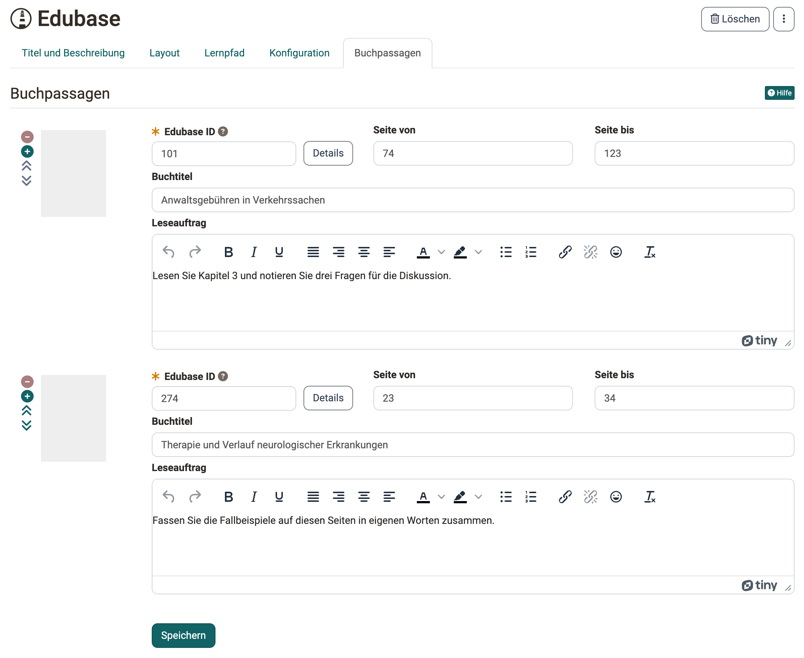

# Kursbaustein "Edubase" {: #edubase}

!!! info "Kontakt"

    Für den Kursbaustein braucht Ihre Organisation ein Konto bei Edubase und die Berechtigungen für die jeweiligen eBooks. Für die Aktivierung wenden Sie sich an Ihre Organisation.

## Steckbrief

Name | Edubase
---------|----------
Icon | { class=size24  }
Verfügbar seit | Release 12.2 (OO-2916)
Funktionsgruppe | Wissensvermittlung
Verwendungszweck | Anzeige der e-Books von Edubase
Bewertbar | nein
Spezialität / Hinweis |

Mit dem Kursbaustein "Edubase" binden Sie eBooks von [Edubase](https://www.edubase.ch/) in einen Kurs ein. Die Teilnehmenden öffnen die Bücher direkt in OpenOlat.

!!! info "Wichtig"

    Der Kursbaustein muss zunächst in der System-Administration unter `Administration > Externe Werkzeuge > Edubase/Edubook` freigeschaltet und konfiguriert werden, ebenso werden Berechtigungsschlüssel für die eBooks benötigt. Sind die Voreinstellungen abgeschlossen, kann der Kursbaustein zu einem Kurs hinzugefügt werden. Für die eingebundenen eBooks ist es im Editor möglich, Leseaufträge zu bestimmten Buchpassagen für Teilnehmende zu erstellen.

Ist dort die Option "Multi-User-PAK" aktiviert, können Sie diese auch im Kursbaustein aktivieren und mehrere Aktivierungscodes (PAK) mit gleichzeitigen Leserechten hinterlegen [:octicons-tag-16:{ title="ab Release 18.1.0 (OO-7229)" }](https://track.frentix.com/issue/OO-7229){:target="_blank"}. Teilnehmende öffnen ein eingebundenes eBook in einem eigenen Fenster [:octicons-tag-16:{ title="ab Release 18.1.0 (OO-7230)" }](https://track.frentix.com/issue/OO-7230){:target="_blank"}.

Im Tab "Buchpassagen" erfassen Sie je Buchausschnitt die "Edubase ID", den Seitenbereich mit "Seite von" und "Seite bis" sowie den "Buchtitel". Mit "Details" öffnen Sie die "Buchdetails" aus Edubase, dort setzen Sie mit "Titel übernehmen" den Titel des Buches als Buchtitel ein. Das Feld "Leseauftrag" erscheint, wenn im Tab "Konfiguration" die Option "Leseauftrag" eingeschaltet ist. Mit dem Plus- und dem Minus-Symbol fügen Sie Buchpassagen hinzu oder entfernen sie, mit den Pfeilen ändern Sie ihre Reihenfolge.

{ class="shadow lightbox" title="Tab Buchpassagen im Kurseditor · 2026.11.03" }

## Weiterführende Informationen {: #further_information}

**Auf dieser Seite erwähnt** 
[Edubase >](https://www.edubase.ch/)

**Weiterführend** 
[Externe Werkzeuge: Übersicht >](../../manual_admin/administration/External_Tools_-_Administration.de.md) 
[Kursbausteine im Überblick >](../learningresources/Course_Elements.de.md)

[Zum Seitenanfang ^](#edubase)