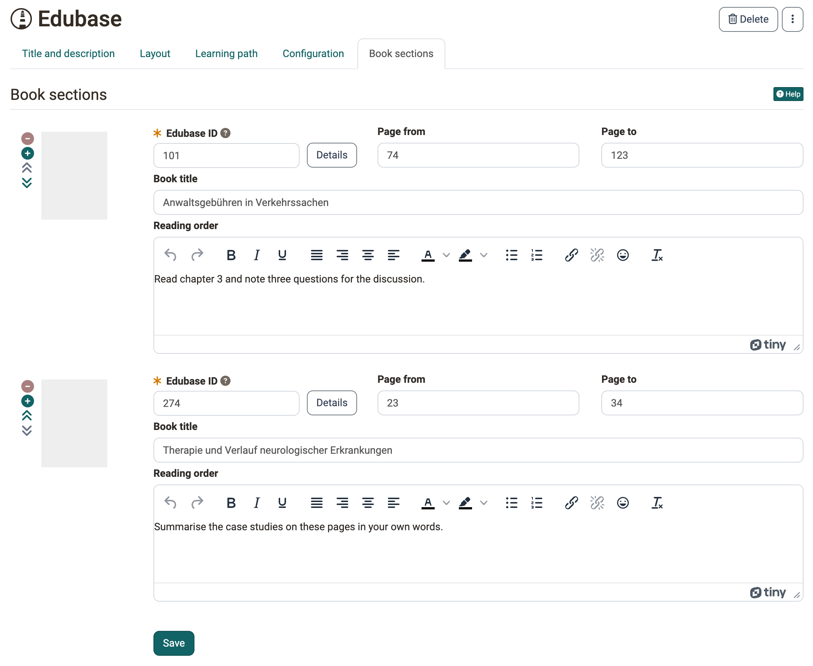

# Course Element "Edubase" {: #edubase}

!!! info "Contact"

    For the course element, your organisation needs an account with Edubase and the permissions for the respective e-books. To have it activated, contact your organisation.

## Profile

Name | Edubase
---------|----------
Icon | { class=size24 }
Available since | Release 12.2 (OO-2916)
Functional group | Knowledge transfer
Purpose | Display of e-books from Edubase
Assessable | no
Specialty / Note |

With the course element "Edubase" you integrate e-books from [Edubase](https://www.edubase.ch/) into a course. The participants open the books directly in OpenOlat.

!!! info "Important"

    The course element must first be activated and configured in the system administration under `Administration > External tools > Edubase/Edubook`, and authorization keys for the eBooks are also required. As soon as the pre-settings are done, the course element can be added to a course. By using the editor, you can define specific reading orders for participants for an embedded e-book.

If the option "Multi-User-PAK" is activated there, you can also activate it in the course element and enter several activation codes (PAK) with concurrent read rights [:octicons-tag-16:{ title="from Release 18.1.0 (OO-7229)" }](https://track.frentix.com/issue/OO-7229){:target="_blank"}. Participants open an embedded e-book in a separate window [:octicons-tag-16:{ title="from Release 18.1.0 (OO-7230)" }](https://track.frentix.com/issue/OO-7230){:target="_blank"}.

In the tab "Book sections" you enter the "Edubase ID", the page range with "Page from" and "Page to" and the "Book title" for each book excerpt. With "Details" you open the "Book details" from Edubase, where "Use title" inserts the title of the book as book title. The field "Reading order" appears if the option "Reading order" is switched on in the tab "Configuration". With the plus and minus icons you add or remove book sections, with the arrows you change their order.

{ class="shadow lightbox" title="Tab Book sections in the course editor · 2026.11.03" }

## Further information {: #further_information}

**Mentioned on this page** 
[Edubase >](https://www.edubase.ch/)

**Further reading** 
[External Tools: Overview >](../../manual_admin/administration/External_Tools_-_Administration.md) 
[Course elements at a glance >](Course_Elements/index.md)

[To the top of the page ^](#edubase)

