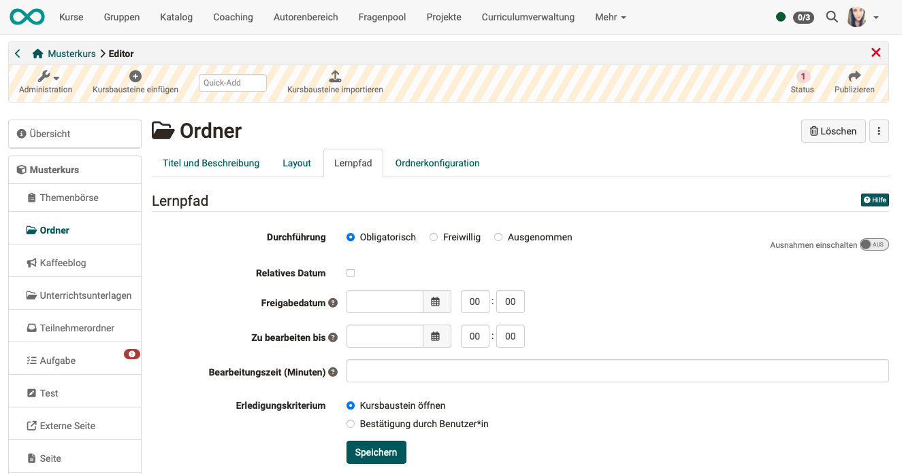
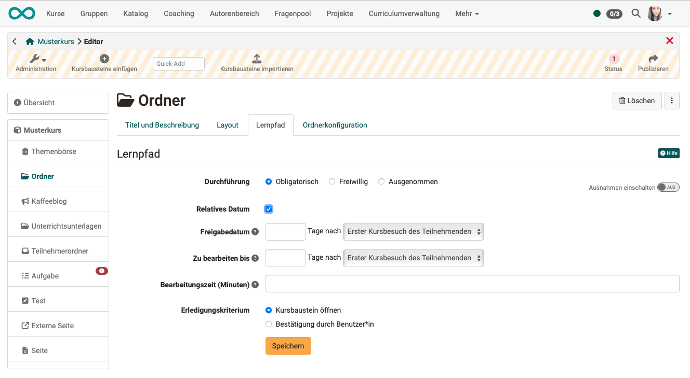
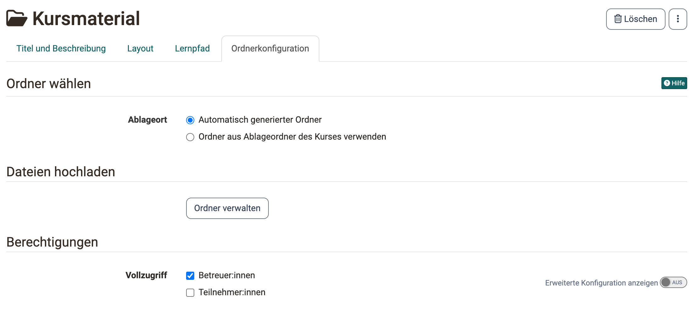
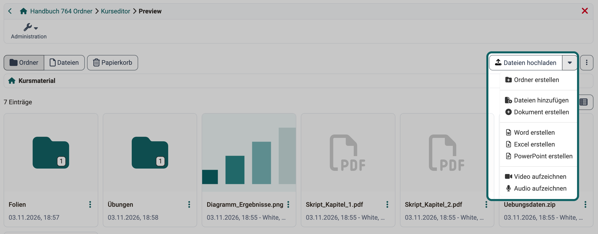
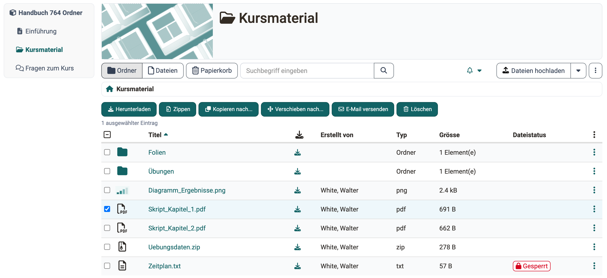

# Kursbaustein "Ordner" {: #folder}

## Steckbrief

Name | Ordner
---------|----------
Icon | :o_icon_o_bc_icon:
Verfügbar seit | Neuauflage mit Release 19.1
Funktionsgruppe | Wissensvermittlung
Verwendungszweck | Bereitstellung von Dateien zum Download (z.B. Material zum Kurs)
Bewertbar | nein
Spezialität / Hinweis | Ein ähnlicher Kursbaustein ist der Kursbaustein "Teilnehmer:innen Ordner". 

Mit dem Kursbaustein "Ordner" stellen Sie den Teilnehmenden Ihres Kurses Dateien zum Herunterladen bereit, zum Beispiel Folien oder Skripte. Erhalten auch die Teilnehmenden das Recht zum Hochladen, sammeln Sie im selben Ordner Dateien aller Kursmitglieder.

---

## Konfiguration im Kurseditor {: #config}

### Tab Lernpfad {: #tab_learning_path}

=== "Tab Lernpfad mit fixen Zeitangaben"

    { class="shadow lightbox" title="Tab Lernpfad mit fixen Zeitangaben im Kurseditor" }

=== "Tab Lernpfad mit relativen Zeitangaben"

    { class="shadow lightbox" title="Tab Lernpfad mit relativen Zeitangaben im Kurseditor" }

#### Durchführung {: #execution}

Mit "Durchführung" legen Sie fest, welche Rolle der Ordner im Lernpfad spielt. Ist er "Obligatorisch", müssen die Teilnehmenden ihn mindestens einmal öffnen, damit er als "erledigt" gilt. Ein "Freiwillig" gesetzter Ordner zählt bei der Berechnung des Lernfortschritts nicht mit. Ein "Ausgenommen" gesetzter Ordner erscheint nicht im Kursmenü, ausser Sie schalten die Ausnahmen ein und bestimmen, welche Kursmitglieder ihn trotzdem sehen.

#### Relatives Datum {: #relative_date}

Mit "Relatives Datum" wählen Sie, wie Sie "Freigabedatum" und "Zu bearbeiten bis" angeben. Ohne relatives Datum tragen Sie bei Bedarf feste Zeitpunkte ein. Mit relativem Datum wählen Sie statt fester Zeitpunkte einen Bezugspunkt, zum Beispiel eine Anzahl Tage nach dem ersten Kursbesuch der Teilnehmenden.

#### Freigabedatum {: #release_date}

Vor dem Freigabedatum sehen die Teilnehmenden den Ordner, können ihn aber nicht öffnen. Ab dem angegebenen Zeitpunkt öffnen sie ihn und arbeiten darin. Ohne Angabe ist der Ordner ohne zeitliche Einschränkung zugänglich, sofern man Zutritt zum Kurs hat.

#### Zu bearbeiten bis {: #due_date}

Bis zum angegebenen Zeitpunkt können die Teilnehmenden den Ordner öffnen und bearbeiten.
Ohne Angabe bleibt der Ordner ab dem Freigabedatum dauerhaft verfügbar, sofern man Zutritt zum Kurs hat.

#### Bearbeitungszeit {: #learning_time}

Hier tragen Sie ein, wie viele Minuten die Teilnehmenden nach Ihrer Schätzung für den Kursbaustein brauchen. Die Angabe ist unabhängig davon, wie viel Zeit die Teilnehmenden tatsächlich aufwenden. Die geschätzte Zeit kann in die Berechnung des Lernfortschritts einfliessen.

#### Erledigungskriterium {: #completion_criterion}

Hier bestimmen Sie, wodurch der Kursbaustein im Kursmenü als "erledigt" markiert wird. Zur Wahl stehen "Kursbaustein öffnen" und "Bestätigung durch Benutzer:in".

---

### Tab Ordnerkonfiguration {: #tab_folder_config}

{ class="shadow lightbox" title="Tab Ordnerkonfiguration im Kurseditor · 2026.11.03" }

#### Ordner wählen {: #select_folder}

Im Tab "Ordnerkonfiguration" legen Sie unter "Ablageort" fest, *wo* die Dateien dieses Ordners im Ablageordner des Kurses liegen. OpenOlat erstellt dafür entweder automatisch einen neuen Ordner, oder Sie wählen einen vorhandenen Ordner im Ablageordner des Kurses.

Mit der Option "Automatisch generierter Ordner" legt OpenOlat im Ablageordner des Kurses den Unterordner "_courseelementdata" an und darin einen Unterordner mit dem Namen des Kursbausteins, entlang der Kursstruktur. Dort speichert OpenOlat alle Dateien des Kursbausteins. Den Ablageordner öffnen Sie über `Kurs > Administration > Dateien > Ablageordner`.

Mit der Option "Ordner aus Ablageordner des Kurses verwenden" wählen Sie einen vorhandenen Ordner aus dem Ablageordner des Kurses. Das lohnt sich, wenn Sie die Dateien bereits geordnet in den Ablageordner hochgeladen haben. Sie können an dieser Stelle auch einen neuen Ordner im Ablageordner erstellen. Ist mit dem Kurs in den [Kurseinstellungen](Course_Settings/index.de.md) ein Ressourcenordner verknüpft, wählen Sie ihn ebenfalls hier: Er erscheint unter den Ordnern des Ablageordners als "_sharedfolder".

#### Dateien hochladen {: #transfer_files}

Sobald der Ablageort gewählt ist, laden Sie über den Button "Ordner verwalten" im Bereich "Dateien hochladen" Ihre Dateien hoch oder erstellen neue.

{ class="shadow lightbox" title="Vorschau des Kursbausteins Ordner im Kurseditor · 2026.11.03" }

Dieselben Dateien bearbeiten Sie auch bei geschlossenem Kurseditor (siehe [Ansicht bei geschlossenem Kurseditor](#view_with_editor_closed)).

#### Berechtigungen {: #user_rights}

Unter "Berechtigungen" bestimmen Sie, wer im Ordner Dateien hochladen und erstellen darf. Standardmässig haben neben den Besitzer:innen auch die Betreuer:innen "Vollzugriff", die Teilnehmer:innen nicht.

Mit "Erweiterte Konfiguration anzeigen" vergeben Sie das Recht auch an bestimmte Gruppen oder an einzelne Personen.

---

## Ansicht bei geschlossenem Kurseditor [:octicons-tag-16:{ title="ab Release 19.0 (OO-7490)" }](https://track.frentix.com/issue/OO-7490) {: #view_with_editor_closed}

{ class="shadow lightbox" title="Kursbaustein Ordner bei geschlossenem Kurseditor · 2026.11.03" }

Auch bei geschlossenem Kurseditor arbeiten Sie im Kurs direkt mit den Dateien des Ordners. Folgende Möglichkeiten stehen Kursbesitzer:innen und Personen mit der entsprechenden Berechtigung zur Verfügung:

### Dateien hinzufügen

**Dateien hochladen:** Wählen Sie eine Datei von Ihrer Festplatte aus. Klicken Sie auf den kleinen Pfeil neben "Dateien hochladen", um weitere Optionen zu sehen (siehe Bild im Abschnitt [Dateien hochladen](#transfer_files)):

* **Ordner erstellen:** Erstellt einen neuen Unterordner im Kursbaustein.

* **Dateien hinzufügen:** Greifen Sie auf den [File Hub](../personal_menu/File_Hub.de.md) sowie auf Ihre Ordner und Dateien zu. Sie können auch auf Ihr [Media Center](../personal_menu/Media_Center.de.md) zugreifen und Dateien direkt in den File Hub hochladen.

* **Dokument erstellen:** Je nach aktivierten Editoren (z.B. Word, Excel, PowerPoint, Diagramme, Whiteboard, Text, HTML, CSS, XML) können Sie hier neue Dokumente erstellen und diese mit einer Beschreibung, Lizenz und weiteren Metadaten versehen.

* **Word erstellen, Excel erstellen, PowerPoint erstellen:** Legt ein leeres Dokument im gewählten Format im Ordner an und öffnet es in einem neuen Fenster im Editor. Die Einträge erscheinen nur, wenn für das Format ein Editor aktiviert ist.

* **Video aufzeichnen:** Zeichnen Sie ein Video mit der Webcam auf.

* **Audio aufzeichnen:** Nehmen Sie eine Audiodatei auf.

---

## Weitere Optionen und Anpassungen des Kursbausteins {: #further_options}

Wer über neue Dateien im Ordner informiert sein will, abonniert die Änderungen im Ordner. Die Ansicht passen Sie an, indem Sie zwischen der Kachelansicht und der Tabellenansicht wechseln. In der Tabellenansicht wählen Sie die angezeigten Spalten und sehen so mehr Details als in der Kachelansicht. Mit der Suche finden Sie Dateien schnell. Gelöschte Dateien verschiebt OpenOlat in den "Papierkorb".

Im 3-Punkte-Menü des Kursbausteins öffnen Sie mit "WebDAV-Link" den Link für die [WebDAV-Verbindung](../basic_concepts/Using_WebDAV.de.md) und wählen "Metadaten aktualisieren".

### Metadaten {: #metadata}

Mit den [Metadaten](../basic_concepts/Search_General/index.de.md#metadata) beschreiben Sie eine Datei genauer. Kursbesitzer:innen bearbeiten sie über das 3-Punkte-Menü der Datei.

Neben der Beschreibung und der Sperre sind besonders die Lizenzangaben wichtig. Dort hinterlegen Sie eine Lizenz für das Dokument, zum Beispiel eine der Creative-Commons-Lizenzen, tragen den Lizenzgeber ein und ergänzen Angaben zum Herausgeber, zur Quelle oder zum Erscheinungsdatum. Der Ordner zeigt die Lizenz in einer eigenen Spalte. Ein Klick auf die Lizenz zeigt die hinterlegten Angaben.

Das Feld "Anzahl Ansichten" in den Metadaten zeigt, wie oft eine Datei heruntergeladen wurde. Was genau zählt, steht unter [Metadaten](../basic_concepts/Search_General/index.de.md#metadata). Das Feld "Externer Link zu dieser Ressource" zeigt den Link, der direkt auf die Datei führt. Sie kopieren ihn oder geben ihn als QR-Code weiter, siehe [Links kopieren und als QR-Code weitergeben](../basic_concepts/Navigation.de.md#url_field). Ob auch externe Personen die Datei öffnen, hängt von den Zugangseinstellungen des Kurses ab.

### Dateien bearbeiten [:octicons-tag-16:{ title="ab Release 14.0 (OO-3939)" }](https://track.frentix.com/issue/OO-3939) {: #edit_files}

Personen mit Bearbeitungsrechten können bei unterstützten Dateiformaten wie docx, xlsx, pptx, draw.io, dwb, txt, html, css und xml durch einen Klick auf den Dateinamen direkt in den Bearbeitungsmodus wechseln. Voraussetzung dafür ist, dass die Editoren für diese Formate in der System-Administration aktiviert sind: `Administration > Externe Werkzeuge > Dokumenteneditoren`. Mehr dazu finden Sie unter [Externe Werkzeuge](../../manual_admin/administration/External_Tools_-_Administration/index.de.md).

---

## Weiterführende Informationen {: #further_information}

**Auf dieser Seite erwähnt** 
[Kurseinstellungen >](Course_Settings/index.de.md) 
[Persönliche Werkzeuge: File Hub >](../personal_menu/File_Hub.de.md) 
[Persönliche Werkzeuge: Das Media Center >](../personal_menu/Media_Center.de.md) 
[Einsatz von WebDAV >](../basic_concepts/Using_WebDAV.de.md) 
[Allgemeines zur Suche >](../basic_concepts/Search_General/index.de.md) 
[Navigation >](../basic_concepts/Navigation.de.md) 
[Externe Werkzeuge: Übersicht >](../../manual_admin/administration/External_Tools_-_Administration/index.de.md)

**Weiterführend** 
[Lernpfadkurs - Kurseditor >](../learningresources/Learning_path_course_Course_editor.de.md) 
[Ablageordner >](../learningresources/Storage_folder.de.md) 
[Kursbaustein "Teilnehmer:innen Ordner" >](../learningresources/Course_Element_Participant_Folder.de.md)

**youtube** 
[Abonnements](<https://www.youtube.com/embed/h9gOqt7TR7Q>)

[Zum Seitenanfang ^](#folder)

