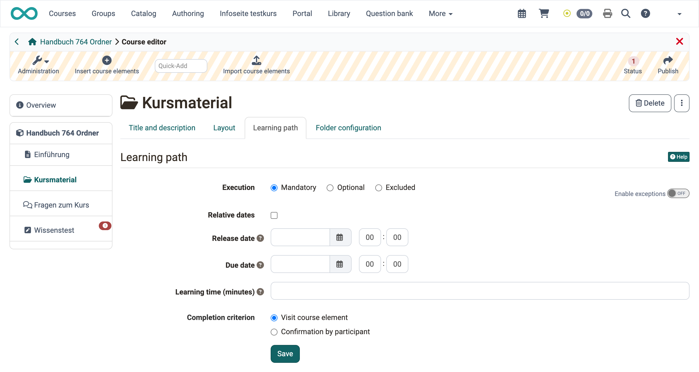
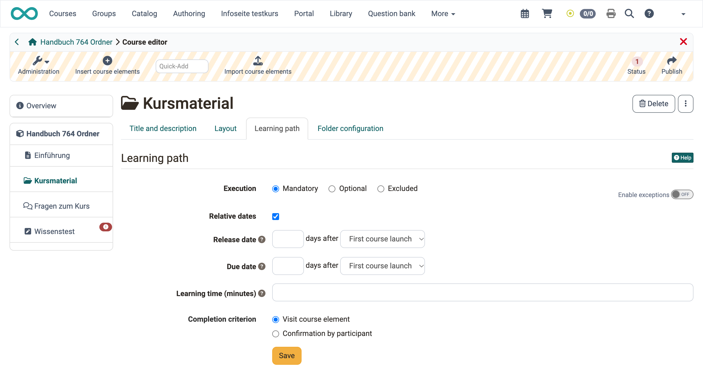
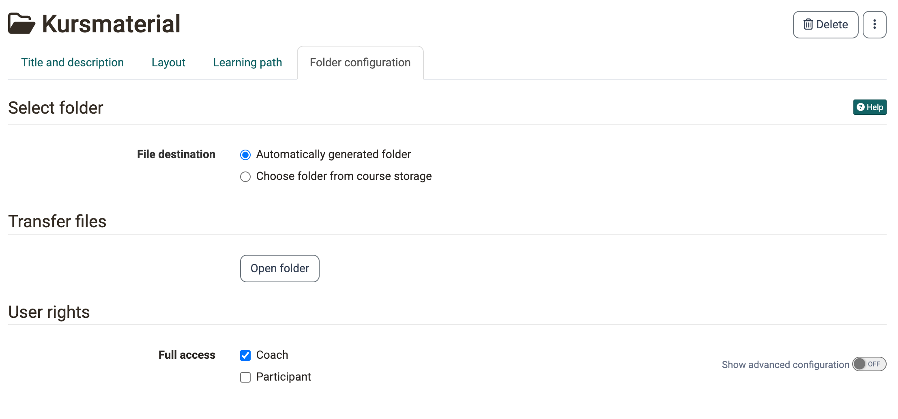
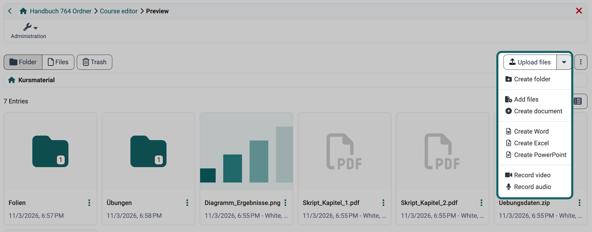
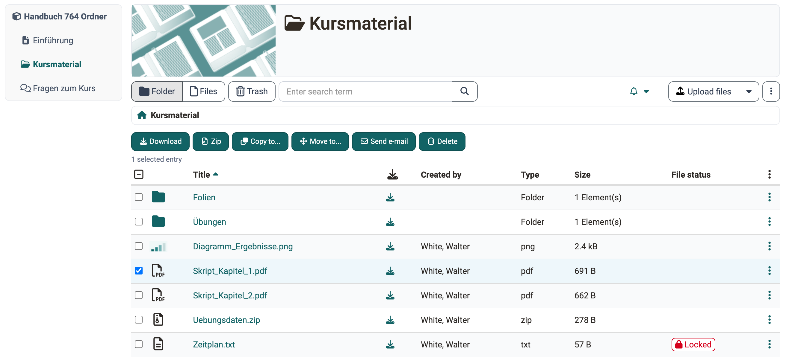

# Course Element "Folder" {: #folder}

## Profile

Name | Folder
---------|----------
Icon | :o_icon_o_bc_icon:
Available since | New edition with release 19.1
Functional group | Knowledge transfer
Purpose | Provision of files for download (e.g. material for the course)
Assessable | no
Specialty / Note | A similar course element is the course element "Participant folder".

With the course element "Folder" you provide the participants of your course with files to download, for example slides or scripts. If the participants also get the right to upload, you collect files from all course members in the same folder.

---

## Configuration in the course editor {: #config}

### Tab learning path {: #tab_learning_path}

=== "Learning path tab with fixed times"

    { class="shadow lightbox" title="Learning path tab with fixed times in the course editor · 2026.11.03" }

=== "Learning path tab with relative times"

    { class="shadow lightbox" title="Learning path tab with relative times in the course editor · 2026.11.03" }

#### Execution {: #execution}

With "Execution" you define the role the folder plays in the learning path. If it is "Mandatory", participants must open it at least once for it to be considered "completed". A folder set to "Optional" does not count towards the calculation of learning progress. A folder set to "Excluded" does not appear in the course menu, unless you switch on the exceptions and define which course members still see it.

#### Relative dates {: #relative_date}

With "Relative dates" you choose how you specify "Release date" and "Due date". Without relative dates, you enter fixed dates if needed. With relative dates, you choose a reference point instead of fixed dates, for example a number of days after the first course launch of the participants.

#### Release date {: #release_date}

Before the release date, participants see the folder but cannot open it. From the specified date, they open it and work in it. Without an entry, the folder is accessible without time restriction, provided you have access to the course.

#### Due date {: #due_date}

Participants can open and edit the folder up to the specified date.
Without an entry, the folder remains permanently available from the release date, provided you have access to the course.

#### Learning time {: #learning_time}

Here you enter how many minutes, by your estimate, participants need for the course element. The entry is independent of how much time participants actually spend. The estimated time can be included in the calculation of learning progress.

#### Completion criterion {: #completion_criterion}

Here you determine how the course element is marked as "completed" in the course menu. The options are "Visit course element" and "Confirmation by participant".

---

### Tab folder configuration {: #tab_folder_config}

{ class="shadow lightbox" title="Folder configuration tab in the course editor · 2026.11.03" }

#### Select folder {: #select_folder}

In the tab "Folder configuration" you define under "File destination" *where* the files of this folder are stored in the storage folder of the course. OpenOlat either creates a new folder automatically, or you select an existing folder in the storage folder of the course.

With the option "Automatically generated folder", OpenOlat creates the subfolder "_courseelementdata" in the storage folder of the course and in it a subfolder with the name of the course element, along the course structure. OpenOlat saves all files of the course element there. You open the storage folder via `Course > Administration > Files > Storage folder`.

With the option "Choose folder from course storage", you select an existing folder from the storage folder of the course. This is worthwhile if you have already uploaded the files to the storage folder in an orderly structure. At this point you can also create a new folder in the storage folder. If a resource folder is linked to the course in the [Course settings](Course_Settings/index.md), you also select it here: it appears among the folders of the storage folder as "_sharedfolder".

#### Transfer files {: #transfer_files}

As soon as the storage location is selected, you upload your files or create new ones using the "Open folder" button in the "Transfer files" area.

{ class="shadow lightbox" title="Preview of the folder course element in the course editor · 2026.11.03" }

You also work on the same files when the course editor is closed (see [View with closed course editor](#view_with_editor_closed)).

#### User rights {: #user_rights}

Under "User rights" you define who may upload and create files in the folder. By default, the coaches have "Full access" in addition to the owners, the participants do not.

With "Show advanced configuration" you also grant the right to specific groups or to individual persons.

---

## View with closed course editor [:octicons-tag-16:{ title="from Release 19.0 (OO-7490)" }](https://track.frentix.com/issue/OO-7490) {: #view_with_editor_closed}

{ class="shadow lightbox" title="Folder course element with closed course editor · 2026.11.03" }

Even with the course editor closed, you work directly with the files of the folder in the course. The following options are available to course owners and persons with the appropriate authorization:

### Add files

**Upload files:** Select a file from your hard disk. Click on the small arrow next to "Upload files" to see further options (see image in the section [Transfer files](#transfer_files)):

* **Create folder:** Creates a new subfolder in the course element.

* **Add files:** Access the [File Hub](../personal_menu/File_Hub.md) and your folders and files. You can also access your [Media Center](../personal_menu/Media_Center.md) and upload files directly to the File Hub.

* **Create document:** Depending on the editors activated (e.g. Word, Excel, PowerPoint, diagrams, whiteboard, text, HTML, CSS, XML), you can create new documents here and add a description, license and other metadata to them.

* **Create Word, Create Excel, Create PowerPoint:** Creates an empty document in the selected format in the folder and opens it in the editor in a new window. The entries only appear if an editor is enabled for the format.

* **Record video:** Record a video with your webcam.

* **Record audio:** Record an audio file.

---

## Further options and adjustments to the course element {: #further_options}

Anyone who wants to be informed about new files in the folder subscribes to the changes in the folder. You adjust the view by switching between the tile view and the table view. In the table view, you select the displayed columns and thus see more details than in the tile view. With the search you find files quickly. OpenOlat moves deleted files to the "Trash".

In the 3-dot menu of the course element, you display the [WebDAV link](../basic_concepts/Using_WebDAV.md) and select "Update metadata".

### Metadata  {: #metadata}

With the [metadata](../basic_concepts/Search_General/index.md#metadata) you describe a file in more detail. Course owners edit it via the 3-dot menu of the file.

In addition to the description and the lock, the license information is particularly important. There you define a license for the document, for example one of the Creative Commons licenses, enter the licensor and add information about the publisher, the source or the publication date. The folder shows the license in a separate column. A click on the license shows the stored information.

The field "Number of views" in the metadata shows how often a file was downloaded. What exactly counts is described under [Metadata](../basic_concepts/Search_General/index.md#metadata). There is also a link with which you can directly link the respective file. Whether external persons can also access the file depends on the access settings of the course.

### Edit files [:octicons-tag-16:{ title="from Release 14.0 (OO-3939)" }](https://track.frentix.com/issue/OO-3939) {: #edit_files}

Persons with editing rights can switch directly to editing mode for supported file formats such as docx, xlsx, pptx, draw.io, dwb, txt, html, css and xml by clicking on the file name. The prerequisite for this is that the editors for these formats are activated in the system administration: `Administration > External tools > Document editors`. More information is available under [External tools](../../manual_admin/administration/External_Tools_-_Administration.md).

---

## Further information {: #further_information}

**Mentioned on this page** 
[Course Settings >](Course_Settings/index.md) 
[User tools: File Hub >](../personal_menu/File_Hub.md) 
[User tools: Media Center >](../personal_menu/Media_Center.md) 
[Using WebDAV >](../basic_concepts/Using_WebDAV.md) 
[General information on the search >](../basic_concepts/Search_General/index.md) 
[External Tools: Overview >](../../manual_admin/administration/External_Tools_-_Administration.md)

**Further reading** 
[Learning path course - Course editor >](../learningresources/Learning_path_course_Course_editor.md) 
[Storage folder >](../learningresources/Storage_folder.md) 
[Course Element "Participant folder" >](../learningresources/Course_Element_Participant_Folder.md)

**youtube** 
[Subscriptions](<https://www.youtube.com/embed/h9gOqt7TR7Q>)

[To the top of the page ^](#folder)
