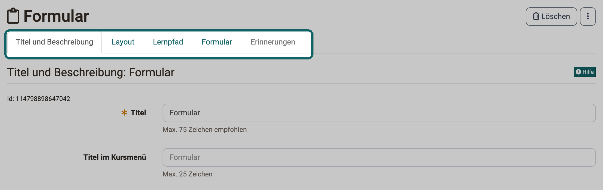
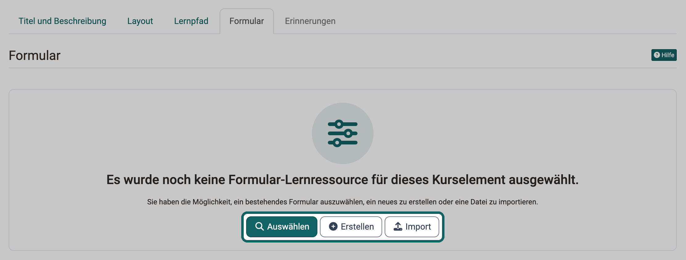
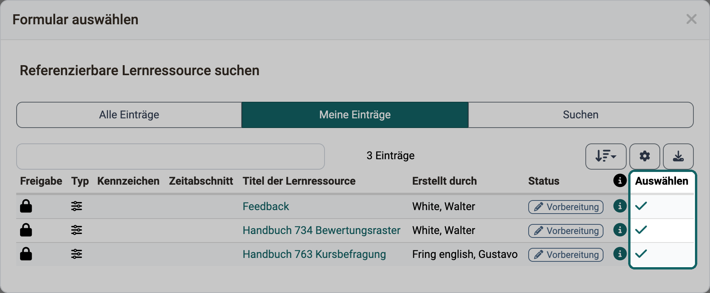
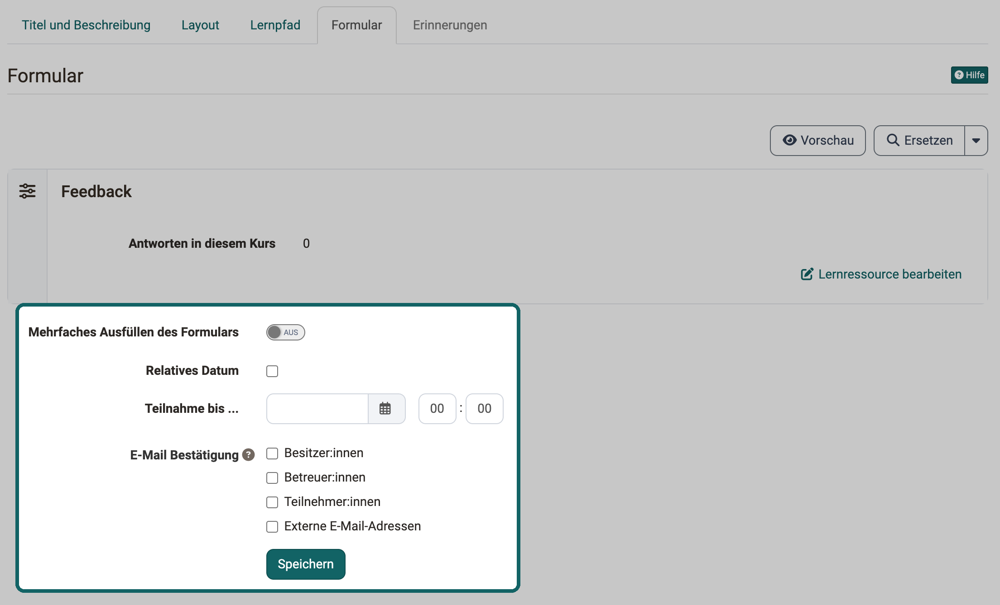
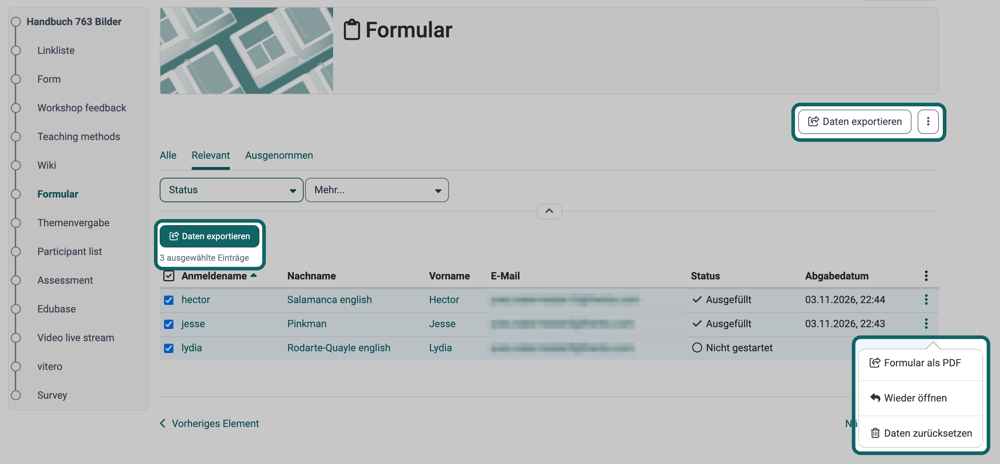
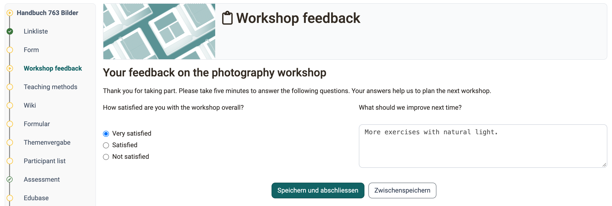

# Kursbaustein "Formular"  {: #course_element_form}

## Steckbrief

Name | Formular
---------|----------
Icon | :o_icon_o_icon_form:
Verfügbar seit | Release 15.5 (OO-5338)
Funktionsgruppe | Wissensüberprüfung
Verwendungszweck | Kursbaustein zur Integration der Lernressource "Formular"
Bewertbar | nein
Spezialität / Hinweis |

Mit dem Kursbaustein "Formular" können Sie die Lernressource Formular einem Kurs hinzufügen. Das Formular funktioniert ähnlich wie der [Kursbaustein "Umfrage"](../learningresources/Course_Element_Survey.de.md) und kann ebenfalls nur einmal ausgefüllt werden. Allerdings sind die Bearbeitungen des Formulars nicht anonym (zumindest in der Standardeinstellung).

Im Tab "Formular" legen Sie bei Bedarf einen Abgabetermin für das Ausfüllen fest. Eine [Kurs-Erinnerung](../learningresources/Course_Reminders.de.md) kann ebenfalls ergänzend verknüpft werden. Anders als beim Umfragebaustein können die Teilnehmenden bei Abgabe des ausgefüllten Formulars eine Bestätigungsmail mit Datum und Zeitpunkt der Abgabe sowie ihr ausgefülltes Formular als PDF im Anhang erhalten, wenn die [E-Mail Bestätigung](#confirmation_email) für sie eingeschaltet ist.

Betreuende sehen im Kurs in der Übersichtstabelle, welche Teilnehmenden das Formular schon ausgefüllt haben und welche nicht. Betreuer:innen können ein abgegebenes Formular wieder öffnen, damit die teilnehmende Person es weiter bearbeitet, oder es ganz zurücksetzen. Ein Klick auf eine teilnehmende Person zeigt ihr ausgefülltes Formular. Die Formulardaten aller Teilnehmenden stehen als Excel-Export zur Verfügung.

Die Verwendung dieses Kursbausteins ist z.B. hilfreich, wenn die Lernenden bestimmte Formulare verpflichtend ausfüllen müssen, z.B. vor der Aufnahme eines Laborpraktikums oder als Bestätigung für das eigenständige Erbringen einer Leistung.

!!! info "Wichtig"

    Anders als der Kursbaustein "Umfrage" bietet dieser Kursbaustein keine grafische Auswertungsübersicht.

## Formulare einbinden [:octicons-tag-16:{ title="ab Release 15.5 (OO-5338)" }](https://track.frentix.com/issue/OO-5338){:target="_blank"}

Wie Sie Formulare erstellen und in Kurse einbinden erfahren Sie im [How-to Bereich](../../manual_how-to/create_a_form/create_a_form.de.md).

Nachdem Sie den Kursbaustein Formular dem Kurs hinzugefügt haben, stehen Ihnen im Kurseditor folgende Tabs zur Verfügung:

{ class="shadow lightbox" title="Kursbaustein Formular im Kurseditor · 2026.11.03" }

In den Tabs "Titel und Beschreibung" und "Layout" hinterlegen Sie allgemeine Beschreibungen und Informationen zum Kursbaustein und legen seine Darstellung fest. Im [Tab Lernpfad](../learningresources/Learning_path_course_Course_editor.de.md) legen Sie die Einstellungen fest, die nur für Lernpfadkurse gelten. Herkömmliche Kurse haben stattdessen die Tabs "Sichtbarkeit" und "Zugang". Dort legen Sie fest, wer diesen Kursbaustein sehen und nutzen kann.

### Tab "Formular"

Den Kursbaustein konfigurieren Sie im Tab "Formular". Im ersten Schritt wählen Sie ein bestehendes Formular aus oder legen ein neues an. Solange kein Formular gewählt ist, bietet der Tab drei Wege an:

* **Auswählen**: Sie verbinden den Kursbaustein mit einem Formular, das bereits als Lernressource besteht.
* **Erstellen**: Sie legen eine neue Lernressource "Formular" an, die OpenOlat gleich mit dem Kursbaustein verbindet.
* **Import**: Sie importieren ein Formular, das als Datei vorliegt.

{ class="shadow lightbox" title="Tab Formular im Kurseditor · 2026.11.03" }

Mit "Auswählen" öffnet sich der Dialog "Formular auswählen". Er zeigt unter "Meine Einträge" alle Formulare, deren Besitzer:in Sie sind. Mit einem Klick auf den Haken in der Spalte "Auswählen" fügen Sie ein Formular dem Kurs hinzu.

{ class="shadow lightbox" title="Dialog Formular auswählen · 2026.11.03" }

Ein neu erstelltes Formular enthält zunächst noch keine Elemente, Fragen oder Textfelder. Diese fügen Sie im [Formulareditor](../learningresources/Form_Editor.de.md) hinzu.

Erstellen Sie ein Formular im Kurseditor, legt OpenOlat automatisch eine neue Lernressource "Formular" an. Sie finden sie auch im [Autorenbereich](../area_modules/Authoring/index.de.md) unter "Meine Einträge" und können sie in weiteren Kursen und Kursbausteinen einbinden.

Ist ein Formular gewählt, zeigt der Tab seinen Titel und die Zahl der "Antworten in diesem Kurs". Mit "Vorschau" sehen Sie das Formular so, wie Teilnehmende es ausfüllen. Mit dem Button "Lernressource bearbeiten" öffnen Sie die Lernressource "Formular" und gestalten das Formular im Formulareditor. Den Button sehen Besitzer:innen des Formulars, Lernressourcenverwalter:innen und Administrator:innen. Mit "Ersetzen" wählen Sie ein anderes Formular, über den Pfeil daneben importieren Sie eines mit "Import".

{ class="shadow lightbox" title="Tab Formular im Kurseditor · 2026.11.03" }

#### Mehrfaches Ausfüllen des Formulars {: #multiple_execution}

In manchen Fällen füllen Teilnehmende ein Formular nur einmal aus, zum Beispiel für das Feedback zu einem Kurs. In anderen Fällen soll dieselbe Person ein Formular mehrfach ausfüllen, zum Beispiel für mehrere Bestellungen. Dafür schalten Sie "Mehrfaches Ausfüllen des Formulars" ein.

#### Teilnahme bis ... {: #completion_deadline}

Unter "Teilnahme bis ..." legen Sie fest, bis wann Teilnehmende das Formular ausfüllen können. Sie wählen ein festes oder ein relatives Datum, zum Beispiel x Tage nach dem ersten Kursbesuch. Sobald ein Enddatum gesetzt ist, steht auch der Tab "[Erinnerungen](../learningresources/Course_Reminders.de.md)" zur Verfügung. Damit erinnern Sie die Teilnehmenden zum Beispiel wenige Tage vor dem Abgabetermin per E-Mail an das Ausfüllen des Formulars.

#### E-Mail Bestätigung {: #confirmation_email}

Unter "E-Mail Bestätigung" wählen Sie, wer nach einer Abgabe eine Bestätigung per E-Mail erhält: "Besitzer:innen", "Betreuer:innen", "Teilnehmer:innen" und "Externe E-Mail-Adressen". Teilnehmende erhalten ihr ausgefülltes Formular als PDF im Anhang, die übrigen Empfänger:innen nach jeder Abgabe das jeweils ausgefüllte Formular, ebenfalls als PDF.

!!! warning "Achtung"

    Sobald mindestens eine teilnehmende Person das Formular angesehen hat, lässt es sich nicht mehr ersetzen und nur noch eingeschränkt bearbeiten.

## Ansicht: Besitzer:in und Betreuer:in

Ausserhalb des Kurseditors sehen Besitzer:innen und Betreuer:innen im Kursbaustein eine Übersicht der Teilnehmenden mit ihrem Status, zum Beispiel "Nicht gestartet". Über die Filterfunktion kann auch eine bestimmte Personengruppe angezeigt werden, z.B. alle Personen, die das Formular noch nicht gestartet haben. Das eigentliche Formular sehen Besitzer:innen und Betreuer:innen hier aber nicht.

Über den Button "Daten exportieren" oben rechts können die ausgefüllten Formulare exportiert werden. Der Export erzeugt ein Archiv mit einer Excel-Datei mit allen Formulardaten sowie je abgegebenem Formular einer PDF-Datei. Hat eine Person das Formular mehrfach ausgefüllt, erscheint jede Abgabe als separater Eintrag mit einer eigenen PDF-Datei. Markiert man einzelne Personen in der Tabelle, erscheint zusätzlich ein Button "Daten exportieren", der nur die Formulare der ausgewählten Personen berücksichtigt. Für eine einzelne Person steht im Mehr-Menü am Ende der Zeile die Aktion "Formular als PDF" zur Verfügung. [:octicons-tag-16:{ title="ab Release 20.2.1 (OO-9048)" }](https://track.frentix.com/issue/OO-9048){:target="_blank"}

Über das Mehr-Menü am Ende einer Zeile kann ein bereits abgegebenes Formular ausserdem mit "Wieder öffnen" erneut zur Bearbeitung freigegeben oder mit "Daten zurücksetzen" für diese Person gelöscht werden. Besitzer:innen können über das Mehr-Menü oben rechts mit "Alle Daten zurücksetzen" sämtliche Formulareinträge auf einmal löschen.

"Daten zurücksetzen" löscht nur die Formulardaten der Person, nicht ihre Kursmitgliedschaft. Die Person bleibt daher weiterhin in der Übersicht sichtbar, mit dem Status "Nicht gestartet". Soll eine Person gar nicht mehr in der Liste erscheinen, muss sie in der [Mitgliederverwaltung](../learningresources/Members_management.de.md) des Kurses als Teilnehmer:in entfernt werden.

Besitzer:innen verfügen zusätzlich noch über den Tab "Erinnerungen", wenn die Formularabgabe mit einer Deadline versehen ist. Hier können sie neue Erinnerungen erstellen und sehen welche [Erinnerungen](../learningresources/Course_Reminders.de.md) schon versandt wurden.

{ class="shadow lightbox" title="Teilnehmerliste des Kursbausteins Formular · 2026.11.03" }

## Ansicht: Teilnehmende

Teilnehmende sehen das Formular direkt, wenn sie den Kursbaustein öffnen, und füllen es dort aus. Mit "Zwischenspeichern" sichern sie ihre Angaben, bevor sie fertig sind.

{ class="shadow lightbox" title="Kursbaustein Formular in der Kursansicht · 2026.11.06" }

Mit "Speichern und abschliessen" geben Teilnehmende das fertig ausgefüllte Formular ab. Danach können sie es nur noch ansehen, nicht mehr bearbeiten.

## Weiterführende Informationen {: #further_information}

**Auf dieser Seite erwähnt** 
[Kursbaustein "Umfrage" >](../learningresources/Course_Element_Survey.de.md) 
[Erinnerungen >](../learningresources/Course_Reminders.de.md) 
[Wie erstelle ich eine Formular-Lernressource? >](../../manual_how-to/create_a_form/create_a_form.de.md) 
[Lernpfadkurs - Kurseditor >](../learningresources/Learning_path_course_Course_editor.de.md) 
[Der Formulareditor >](../learningresources/Form_Editor.de.md) 
[Autorenbereich - Übersicht >](../area_modules/Authoring/index.de.md) 
[Mitgliederverwaltung >](../learningresources/Members_management.de.md)

**Weiterführend** 
[Formulare in Kursen >](../learningresources/Forms_in_Courses.de.md) 
[Kursadministration - Archivierung & Reports >](../learningresources/Course_Archiving.de.md)

[Zum Seitenanfang ^](#course_element_form)
