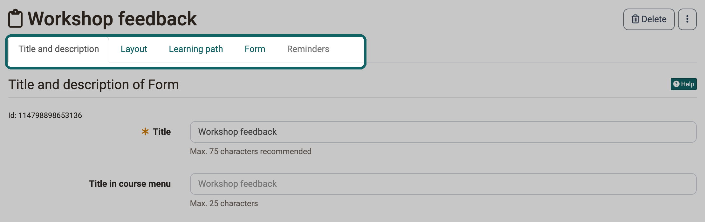
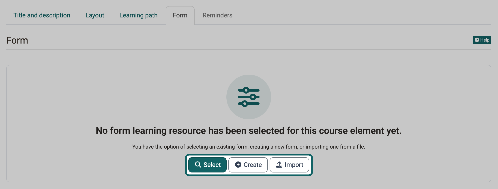
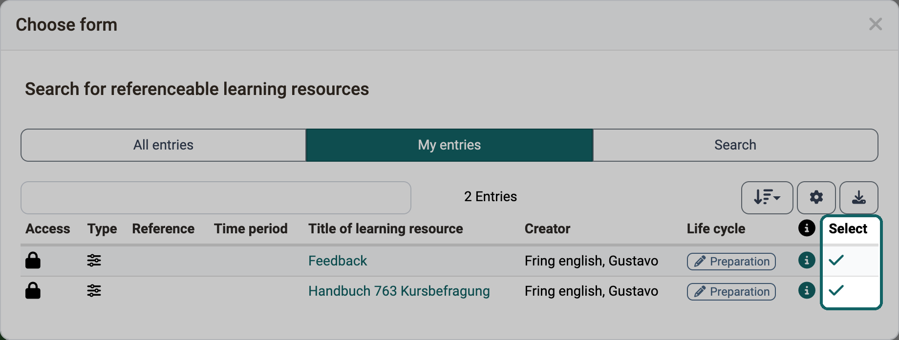
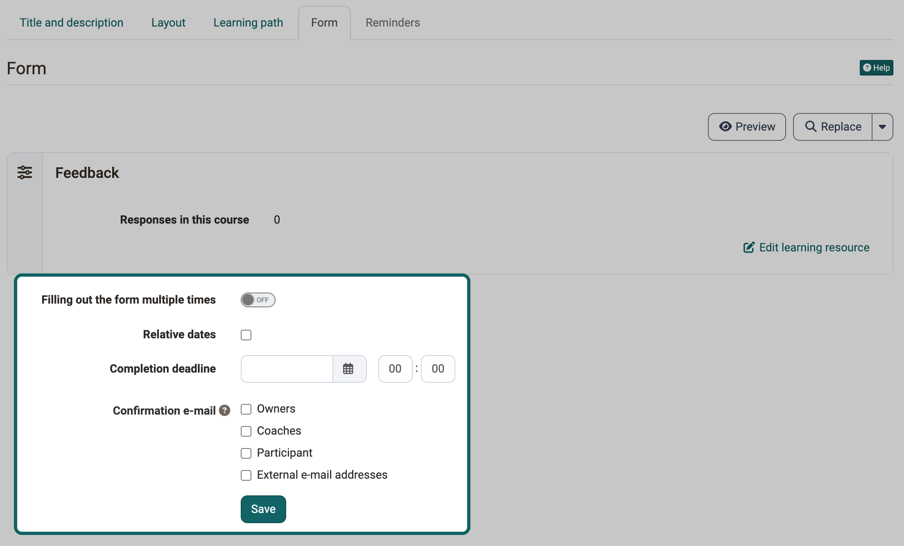
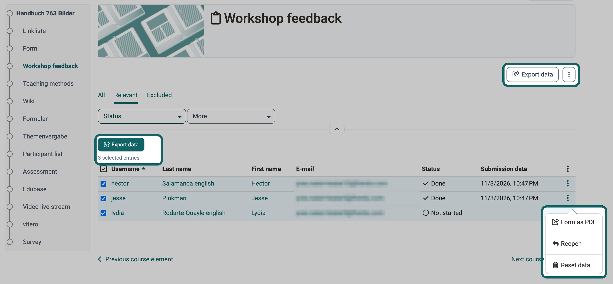
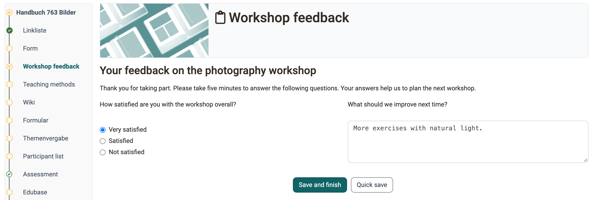

# Course Element "Form"  {: #course_element_form}

## Profile

Name | Form
---------|----------
Icon | :o_icon_o_icon_form:
Available since | Release 15.5 (OO-5338)
Functional group | Assessment
Purpose | Course element for integration of learning resource "Form"
Assessable | no
Specialty / Note | 

Using the course element "Form" you can add the learning resource form to a course. The form works similar to the [course element "Survey"](../learningresources/Course_Element_Survey.md) and can also be filled out only once. However, in contrast to the survey (at least in the standard setting), filling in the form is not anonymous. 

In the tab "Form" you can set a deadline for filling out the form. A [Course Reminder](../learningresources/Course_Reminders.md) can also be linked in addition. In contrast to the survey module, participants can receive a confirmation e-mail with the date and time of submission as well as their completed form as a PDF attachment when they submit the completed form, if the [confirmation e-mail](#confirmation_email) is switched on for them.

In the course, coaches see in the overview table which participants have already completed the form and which have not. Coaches can reopen a submitted form so that the participant can continue editing it, or reset it completely. A click on a participant shows their completed form. The form data of all participants are available as Excel export.

The use of this course element makes sense e.g. if the learners have to fill in certain forms obligatorily, e.g. before starting a laboratory internship or as confirmation for the independent performance of a service.

!!! info "Important"

    Unlike the course element "Survey", this course element does not offer a graphical evaluation overview.

## Integrate forms [:octicons-tag-16:{ title="from Release 15.5 (OO-5338)" }](https://track.frentix.com/issue/OO-5338){:target="_blank"}

You can find out how to create forms and integrate them into courses in the [How-to section](../../manual_how-to/create_a_form/create_a_form.md).

After you have added the course element Form to the course, the following tabs are available in the course editor:

{ class="shadow lightbox" title="Course element Form in the course editor · 2026.11.03" }

In the tabs "Title and description" and "Layout" you enter general descriptions and information about the course element and define its presentation. In the [tab Learning path](../learningresources/Learning_path_course_Course_editor.md) you define the settings that only apply to learning path courses. Conventional courses have the tabs "Visibility" and "Access" instead. There you define who can see and use this course element.

### Tab "Form"

You configure the course element in the "Form" tab. In the first step, you select an existing form or create a new one. As long as no form is selected, the tab offers three ways:

* **Select**: You connect the course element with a form that already exists as a learning resource.
* **Create**: You create a new learning resource "Form", which OpenOlat connects with the course element right away.
* **Import**: You import a form that is available as a file.

{ class="shadow lightbox" title="Form tab in the course editor · 2026.11.03" }

"Select" opens the dialog "Choose form". Under "My entries" it shows all forms you own. Click the checkmark in the column "Select" to add a form to the course.

{ class="shadow lightbox" title="Choose form dialog · 2026.11.03" }

A newly created form does not yet contain any elements, questions or text fields. You add them in the [form editor](Form_Editor/index.md).

If you create a form in the course editor, OpenOlat automatically creates a new learning resource "Form". You also find it in the [Authoring area](../area_modules/Authoring/index.md) under "My entries" and can include it in further courses and course elements.

Once a form is selected, the tab shows its title and the number of "Responses in this course". With "Preview" you see the form the way participants fill it in. With the button "Edit learning resource" you open the learning resource "Form" and design the form in the form editor. Owners of the form, learning resource managers and administrators see the button. With "Replace" you select a different form, with the arrow next to it you import one with "Import".

{ class="shadow lightbox" title="Form tab in the course editor · 2026.11.03" }

#### Filling out the form multiple times {: #multiple_execution}

In some cases, participants fill out a form only once, for example for feedback on a course. In other cases, the same person should fill out a form several times, for example for several orders. For this, switch on "Filling out the form multiple times".

#### Completion deadline {: #completion_deadline}

Under "Completion deadline" you define until when participants can fill out the form. You choose a fixed or a relative date, for example x days after the first course visit. As soon as an end date is set, the tab "[Reminders](../learningresources/Course_Reminders.md)" is also available. With it you remind participants by e-mail a few days before the deadline, for example, to fill out the form.

#### Confirmation e-mail {: #confirmation_email}

Under "Confirmation e-mail" you choose who receives a confirmation by e-mail after a submission: "Owners", "Coaches", "Participant" and "External e-mail addresses". Participants receive their completed form as a PDF attachment, the other recipients receive the respective completed form after each submission, also as a PDF.

!!! warning "Attention"

    As soon as at least one participant has viewed the form, it can no longer be replaced and can only be edited to a limited extent.

## View: Owners and Coaches

Outside the course editor, owners and coaches see an overview of the participants with their status in the course element, for example "Not started". The filter function can also be used to display a specific group of people, e.g. all people who have not yet started the form. However, owners and coaches do not see the actual form here.

The "Export data" button at the top right lets you export the completed forms. The export creates an archive containing an Excel file with all form data as well as one PDF file per submitted form. If a person has completed the form more than once, each submission appears as a separate entry with its own PDF file. If you select individual persons in the table, an additional "Export data" button appears that only includes the forms of the selected persons. For an individual person, the action "Form as PDF" is available in the three-dot menu at the end of the row. [:octicons-tag-16:{ title="from Release 20.2.1 (OO-9048)" }](https://track.frentix.com/issue/OO-9048){:target="_blank"}

Via the three-dot menu at the end of a row, a submitted form can also be reopened for editing with "Reopen" or deleted for that person with "Reset data". Owners can delete all form entries at once via the three-dot menu at the top right with "Reset all data".

"Reset data" only deletes the person's form data, not their course membership. The person therefore remains visible in the overview, with the status "Not started". If a person should no longer appear in the list at all, they must be removed as a participant in the course's [member management](../learningresources/Members_management.md).

Owners additionally have the tab "Reminders" if the form submission has a deadline. Here you can create new reminders and see which [reminders](../learningresources/Course_Reminders.md) have already been sent.

{ class="shadow lightbox" title="Participant list of the course element Form · 2026.11.03" }

## View: Participants

Participants see the form directly when they open the course element and fill it out there. With "Quick save" they save their entries before they are finished.

{ class="shadow lightbox" title="Course element Form in the course view · 2026.11.06" }

With "Save and finish" participants submit the completed form. After that they can only view it, not edit it.

## Further information {: #further_information}

**Mentioned on this page** 
[Course Element "Survey" >](../learningresources/Course_Element_Survey.md) 
[Course Reminders >](../learningresources/Course_Reminders.md) 
[How do I create a form learning resource? >](../../manual_how-to/create_a_form/create_a_form.md) 
[Learning path course - Course editor >](../learningresources/Learning_path_course_Course_editor.md) 
[The form editor >](Form_Editor/index.md) 
[Authoring - Overview >](../area_modules/Authoring/index.md) 
[Members management >](../learningresources/Members_management.md)

**Further reading** 
[Forms in courses >](../learningresources/Forms_in_Courses.md) 
[Course Administration: Archiving & Reports >](Course_Archiving/index.md)

[To the top of the page ^](#course_element_form)
