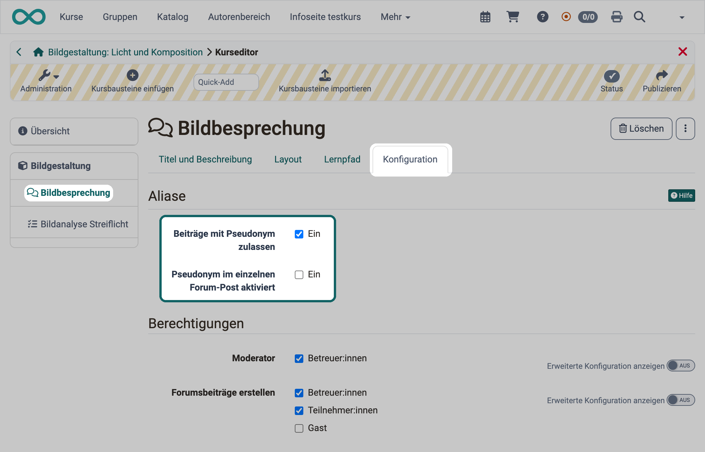
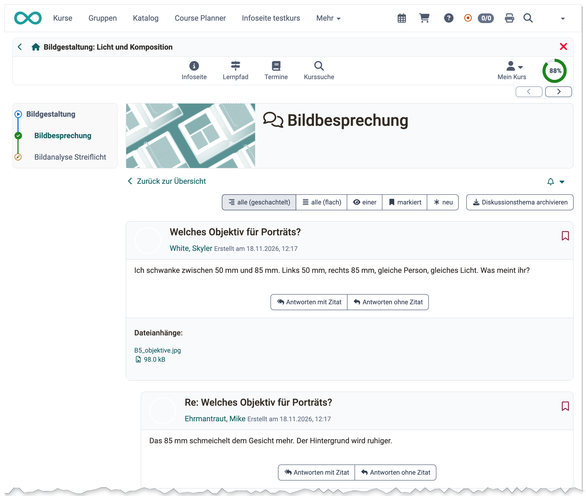
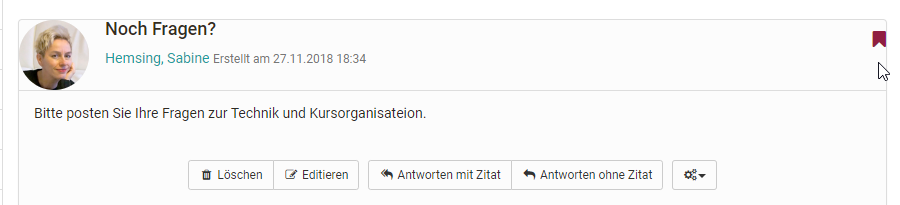
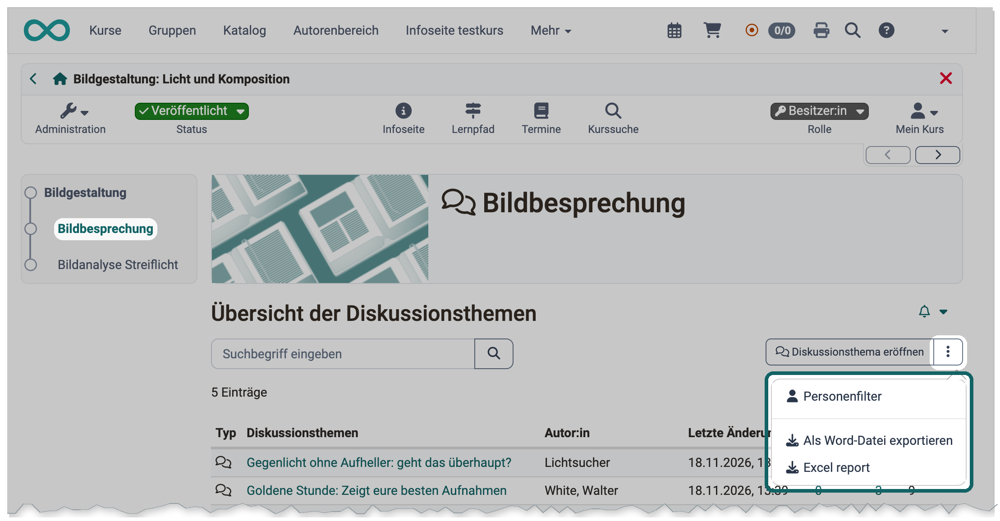
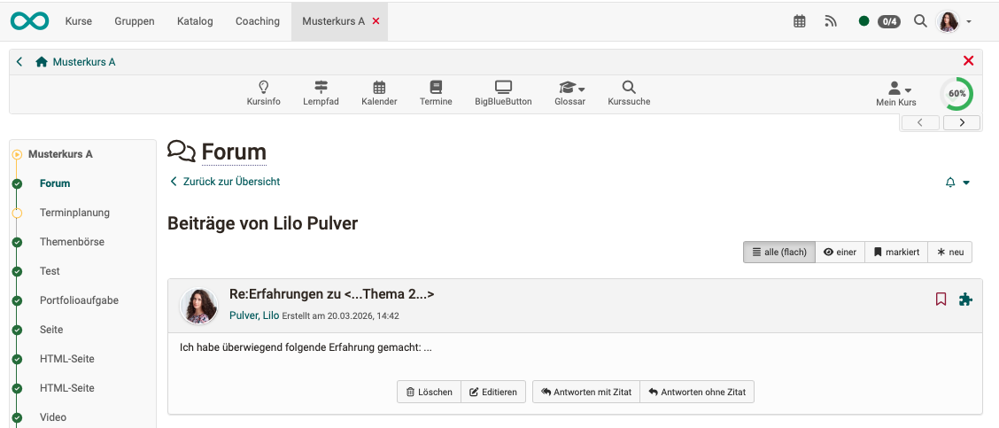
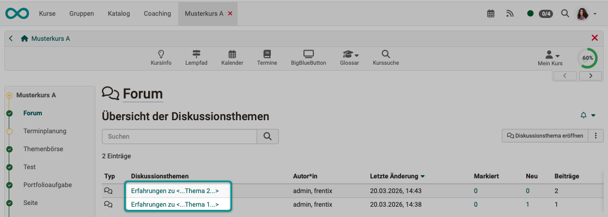
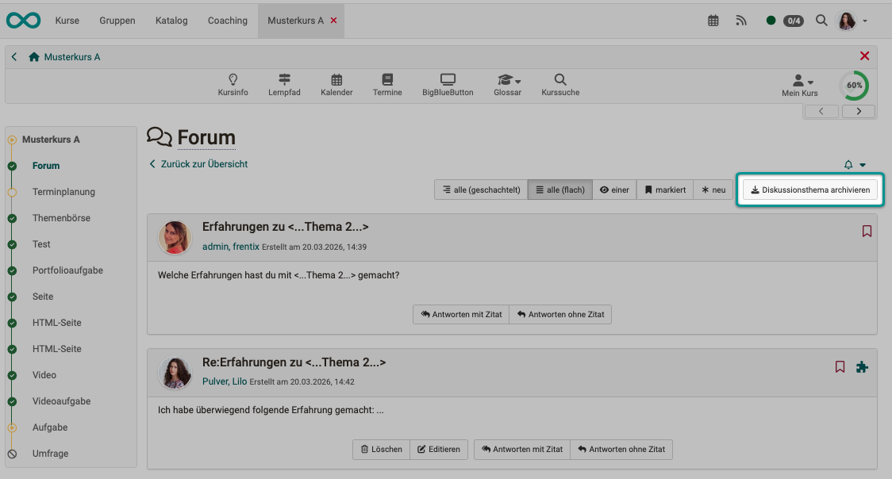
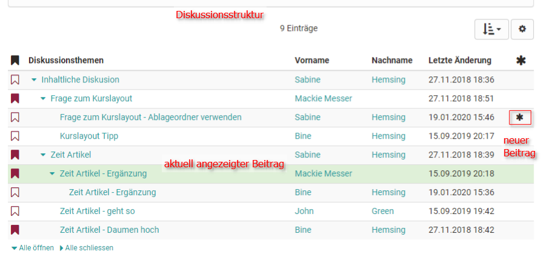

# Kursbaustein "Forum" {: #forum}

## Steckbrief

Name | Forum
---------|----------
Icon | :o_icon_o_fo_icon:
Verfügbar seit | Neuauflage mit Release 18.0
Funktionsgruppe | Kommunikation und Kollaboration
Verwendungszweck | Asynchrone Online-Diskussionen
Bewertbar | nein
Spezialität / Hinweis |

Mit dem Kursbaustein "Forum" diskutieren die Mitglieder Ihres Kurses zeitversetzt (asynchron): Jede Person schreibt und antwortet dann, wenn es ihr passt. Teilnehmende stellen dort etwa Fragen zum Inhalt des Kurses und beantworten sie gegenseitig, Sie eröffnen eine Fachdiskussion oder setzen forenbasierte Lernmethoden um, etwa eine Pro-Contra-Diskussion oder ein Brainstorming zu einer Frage.

[Zum Seitenanfang ^](#forum)

---

## Tab Konfiguration [:octicons-tag-16:{ title="ab Release 15.0 (OO-4347)" }](https://track.frentix.com/issue/OO-4347) {: #config}

Wer im Forum schreiben und wer es moderieren darf, legen Sie im Kurseditor im Tab "Konfiguration" fest. Im Bereich "Berechtigungen" bestimmen Sie mit "Forumsbeiträge erstellen", welche Kursrollen Beiträge erstellen. Zur Wahl stehen Betreuer:innen, Teilnehmende und Gäste; standardmässig erstellen Betreuer:innen und Teilnehmende Beiträge. Mit "Moderator" bestimmen Sie, ob Betreuer:innen das Forum moderieren. Ausserdem legen Sie fest, ob Beiträge mit Pseudonym erlaubt sind.

---

### Foren mit Pseudonym [:octicons-tag-16:{ title="ab Release 10.4 (OO-1769)" }](https://track.frentix.com/issue/OO-1769){:target="_blank"} {: #pseudonym}

Ist "Beiträge mit Pseudonym zulassen" eingeschaltet, tragen die Verfasser:innen eines Beitrags selbst einen Namen ein, unter dem ihr Beitrag erscheint. Wer das Pseudonym mit einem Passwort schützt, verwendet es allein. Ohne Passwort können mehrere Personen dasselbe Pseudonym verwenden.

Ist zusätzlich "Pseudonym im einzelnen Forum-Post aktiviert" eingeschaltet, ist beim Verfassen jedes Beitrags die Option "Pseudonym verwenden" bereits gewählt.

Beide Optionen erscheinen im Tab, sobald die System-Administration Pseudonyme erlaubt: unter `Administration > Module > Forum` mit "Schreiben mit einem Pseudonym gestatten". Mehr dazu im [Administrationshandbuch](../../manual_admin/administration/Modules/index.de.md#forum).

{ class="shadow lightbox" title="Kurseditor, Kursbaustein Forum, Tab Konfiguration · 2026.11.27" }

---

### Moderationsrechte {: #moderator}

Moderieren heisst, eine Diskussion zu ordnen und bei Bedarf einzugreifen. Besitzer:innen haben diese Rechte immer, [Betreuer:innen](../basic_concepts/Roles/index.de.md#coach) dann, wenn für sie das Recht "Moderator" eingeschaltet ist. Das Recht ist standardmässig eingeschaltet; Besitzer:innen schalten es im Tab "Konfiguration" ab. Wer moderiert, kann:

* Alle Forumsbeiträge bearbeiten, löschen und Dateien anhängen.
* "Thread priorisieren (sticky)": Das Diskussionsthema steht immer zuoberst in der Liste.
* "Diskussion beenden": Auf Beiträge dieses Diskussionsthemas lässt sich nicht mehr antworten.
* "Diskussion verbergen": Das Diskussionsthema erscheint nicht mehr in der Liste der Diskussionsthemen.
* "Diskussion anzeigen": Ein verborgenes Diskussionsthema erscheint wieder in der Liste.

Wer moderiert, verschiebt auch ganze Diskussionsthemen oder einzelne Beiträge: in ein anderes Diskussionsthema desselben Forums, in ein anderes Forum im Kurs oder in ein Forum in einem anderen Kurs. Alle Antworten auf den verschobenen Beitrag wandern mit und sind danach im ursprünglichen Forum nicht mehr sichtbar. Am Ziel legen Sie den Beitrag als neues Diskussionsthema an oder fügen ihn in ein bestehendes ein. Im letzten Schritt schicken Sie bei Bedarf allen betroffenen Personen eine E-Mail, die sagt, wohin ihr Beitrag verschoben ist. [:octicons-tag-16:{ title="ab Release 11.3 (OO-2592)" }](https://track.frentix.com/issue/OO-2592)

!!! warning "Achtung"

    Forumsbeiträge lassen sich auch in Foren verschieben, auf die die Verfasser:in des Beitrags keinen Zugriff hat.

!!! info "Wichtig"

    Besitzer:innen geben das Recht "Moderator" auch einzelnen Personen oder Gruppen, etwa ausgewählten Teilnehmenden. Dazu schalten sie im Bereich "Berechtigungen" beim Recht "Moderator" die erweiterte Konfiguration ein.

[Zum Seitenanfang ^](#forum)

---

## Arbeiten mit Foren {: #usage}

Ein Forum ist der Ort für zeitversetzte Diskussionen in Kursen und in OpenOlat-Gruppen. Standardmässig lesen und schreiben alle Teilnehmenden im Forum.

Teilnehmende eröffnen Diskussionsthemen, archivieren sie und passen die Darstellung eines Diskussionsthemas an. Sie erstellen, bearbeiten und markieren Beiträge und abonnieren das ganze Forum.

{ class="shadow lightbox" title="Kursbaustein Forum, geöffnetes Diskussionsthema · 2026.11.27" }

!!! tip "Tipp"

    Empfehlen Sie den Teilnehmenden, das Forum zu abonnieren, um bei neuen Beiträgen benachrichtigt zu werden. Hinterlegen alle Teilnehmenden im "[Profil](../personal_menu/Profile/index.de.md#profile_photo)" ein Profilfoto, erscheint es neben jedem ihrer Beiträge und macht die Diskussion persönlicher.

---

### Diskussionsthemen eröffnen {: #start_discussion}

Ein Forum umfasst mehrere Diskussionsthemen. Mit "Diskussionsthema eröffnen" schreiben Sie den ersten Beitrag eines neuen Diskussionsthemas. Alle weiteren Beiträge darin beziehen sich auf dieses Thema.

---

### Beitrag erstellen {: #posting}

Eine Diskussion entsteht, wenn die meisten Beiträge innerhalb eines Diskussionsthemas als Antwort auf einen bestehenden Beitrag stehen. Klicken Sie dafür beim Beitrag auf "Antworten mit Zitat" oder "Antworten ohne Zitat". "Titel" und "Beitrag" sind Pflichtfelder. Wählen Sie einen aussagekräftigen Titel und passen Sie ihn bei einer Antwort an deren Inhalt an.

Im Editor des Forums formatieren Sie Ihren Beitrag und hängen Dateien an. Als Faustregel gilt: Einen Text, der länger ist als eine A4-Seite, hängen Sie als Datei an und fassen ihn im Beitrag kurz zusammen.

Ihren eigenen Beitrag bearbeiten oder löschen Sie später, solange noch niemand darauf geantwortet hat.

Erlaubt das Forum Pseudonyme, veröffentlichen Sie Ihren Beitrag auch unter einem Pseudonym.

!!! tip "Tipp"

    Prüfen Sie vor dem Eröffnen eines neuen Diskussionsthemas, ob es schon ein passendes gibt. Als Besitzer:in oder Betreuer:in bereiten Sie die passenden Diskussionsthemen am besten vor.

---

### Forumsbeiträge markieren {: #mark}

Markieren Sie einen Beitrag, um ihn leichter wiederzufinden oder für eine spätere Antwort vorzumerken. Klicken Sie dazu im geöffneten Diskussionsthema auf das Lesezeichen-Symbol rechts oben im Beitrag. In der Übersicht des Forums sehen Sie, wie viele Beiträge je Diskussionsthema markiert sind.

{ class="shadow lightbox" title="Forumsbeitrag im Diskussionsthema" }

---

### Forumsbeiträge exportieren {: #export}

Im Kursbaustein "Forum" finden Sie unter dem Button mit den drei Punkten die Optionen "Personenfilter", "Als Word-Datei exportieren" und "Excel report". Das Menü sehen auch Teilnehmende. "Als Word-Datei exportieren" lädt die Beiträge des Forums als Word-Datei zusammen mit den angefügten Dateien in einer ZIP-Datei herunter.

{ class="shadow lightbox" title="Kursbaustein Forum, Übersicht der Diskussionsthemen · 2026.11.27" }

Mit dem "Personenfilter" zeigen Sie gezielt die Beiträge einer bestimmten Person an, dazu Angaben wie die Anzahl Wörter und Zeichen ihrer Beiträge.

{ class="shadow lightbox" title="Kursbaustein Forum" }

Die Option "Excel report" erstellt eine Excel-Datei mit statistischen Angaben zu den Beiträgen, etwa zu Verfasser:innen und Umfang, ohne den Text der Beiträge. Sie enthält eine Zeile je Forumsbeitrag. [:octicons-tag-16:{ title="ab Release 18.1 (OO-6960)" }](https://track.frentix.com/issue/OO-6960)

---

### Forumsbeiträge archivieren {: #archive}

Ein einzelnes Diskussionsthema sichern Sie als ZIP-Archiv. Es enthält die Beiträge als Word-Datei und die Anhänge der Beiträge.

* Klicken Sie auf das Diskussionsthema, um es zu öffnen.
* Klicken Sie über dem Diskussionsthema auf den Button "Diskussionsthema archivieren".

{ class="shadow lightbox" title="Themenübersicht des Forums" }

{ class="shadow lightbox" title="Geöffnetes Diskussionsthema im Forum" }

---

### Foren abonnieren {: #abo}

:octicons-device-camera-video-24: **Video-Einführung**: [Abonnements](<https://www.youtube.com/embed/h9gOqt7TR7Q>){:target="_blank"}

Wer ein Forum abonniert, erfährt von neuen und geänderten Beiträgen, ohne das Forum selbst zu prüfen. Klicken Sie im Forum rechts oben auf das Glockensymbol und schalten Sie im Fenster "Abonnements" den Schalter "Abonnieren" ein. Die Benachrichtigungen erhalten Sie unter `Persönliche Werkzeuge > Abonnements` und, je nach Ihren persönlichen Einstellungen, per E-Mail, gleich wer den Beitrag verfasst oder geändert hat. Mehr dazu auf der Seite [Abonnements](../personal_menu/Subscriptions.de.md#activate_abo).

!!! tip "Tipp"

    Empfehlen Sie den Teilnehmenden, alle Foren zu abonnieren, um bei neuen Beiträgen benachrichtigt zu werden.

---

### Darstellungsmöglichkeiten für Diskussionsthemen {: #display_threads}

Je nach Umfang einer Diskussion wählen Sie im geöffneten Diskussionsthema eine dieser Darstellungen:

* alle (geschachtelt)
* alle (flach)
* einer
* markiert
* neu

Mit "alle (geschachtelt)" und "alle (flach)" stehen alle Beiträge untereinander, mit oder ohne Einrückung. Der erste Beitrag steht zuoberst, die weiteren folgen der Struktur der Diskussion. In einem Forum mit vielen Beiträgen zeigt "neu" nur die Beiträge, die Sie noch nicht gelesen haben.

Für verzweigte Diskussionen eignet sich die Ansicht "einer": Sie zeigt die ganze Struktur des Diskussionsthemas, und Sie blenden einzelne Zweige ein und aus. Neue Beiträge erkennen Sie dort am Sternchen.

{ class="shadow lightbox" title="Diskussionsthema im Forum" }

[Zum Seitenanfang ^](#forum)

---

## Generelles zum Forum {: #general}

### Alternativen

a) Für Ankündigungen an den Kurs, auf die Teilnehmende antworten sollen, nehmen Sie das Forum statt des [Kursbausteins "Mitteilungen"](../learningresources/Course_Element_Notifications.de.md).

b) Braucht der Kurs nur ein Forum, das jederzeit zur Verfügung steht, schalten Sie statt des Kursbausteins das Werkzeug [Forum in der Toolbar](Course_Settings_Toolbar.de.md#forum) ein. Es gilt für den ganzen Kurs. Pseudonyme und eine eigene Vergabe der Moderationsrechte bietet nur der Kursbaustein.

c) Die [Dateidiskussion](../learningresources/Course_Element_File_Dialog.de.md) verbindet Forum und Dateiablage: Zu jeder hochgeladenen Datei legt OpenOlat automatisch ein Forum an. So diskutiert der Kurs über ein bestimmtes Dokument, etwa den Entwurf einer Seminararbeit, ein Bild oder ein Konzept.

[Zum Seitenanfang ^](#forum)

---

## Weiterführende Informationen {: #further_information}

**Auf dieser Seite erwähnt** 
[Rollen und Rechte: Welche Rollen gibt es? >](../basic_concepts/Roles/index.de.md) 
[Module: Übersicht >](../../manual_admin/administration/Modules/index.de.md) 
[Persönliche Konfiguration: Profil >](../personal_menu/Profile/index.de.md) 
[Persönliche Werkzeuge: Abonnements >](../personal_menu/Subscriptions.de.md) 
[Kursbaustein "Mitteilungen" >](Course_Element_Notifications.de.md) 
[Toolbar >](Course_Settings_Toolbar.de.md) 
[Kursbaustein "Dateidiskussion" >](Course_Element_File_Dialog.de.md)

**Weiterführend** 
[Kursbaustein "Blog" >](Course_Element_Blog.de.md)

**youtube** 
[Abonnements](<https://www.youtube.com/embed/h9gOqt7TR7Q>)

[Zum Seitenanfang ^](#forum)
