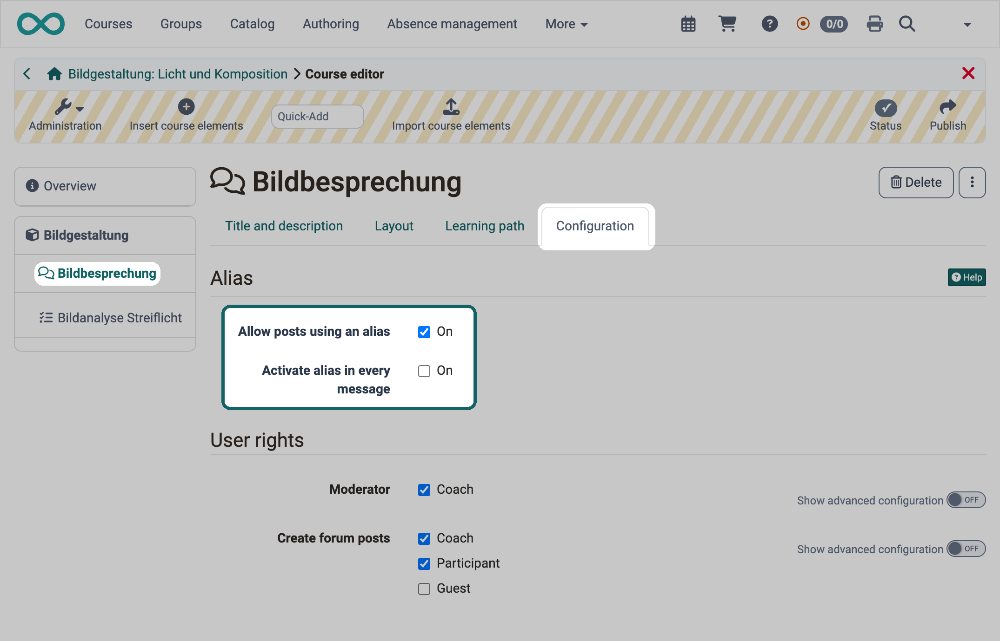
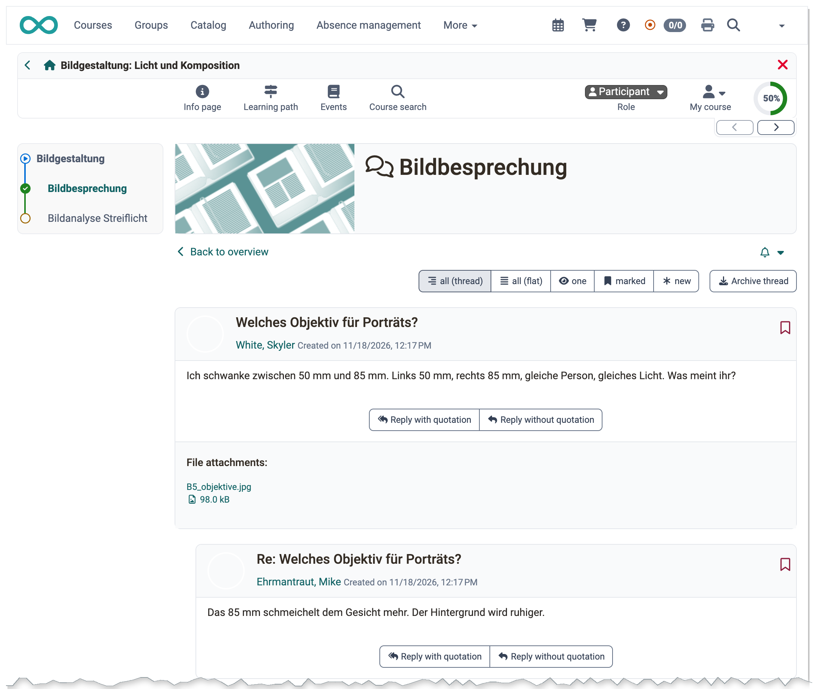
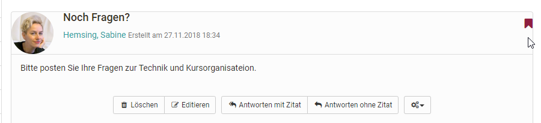
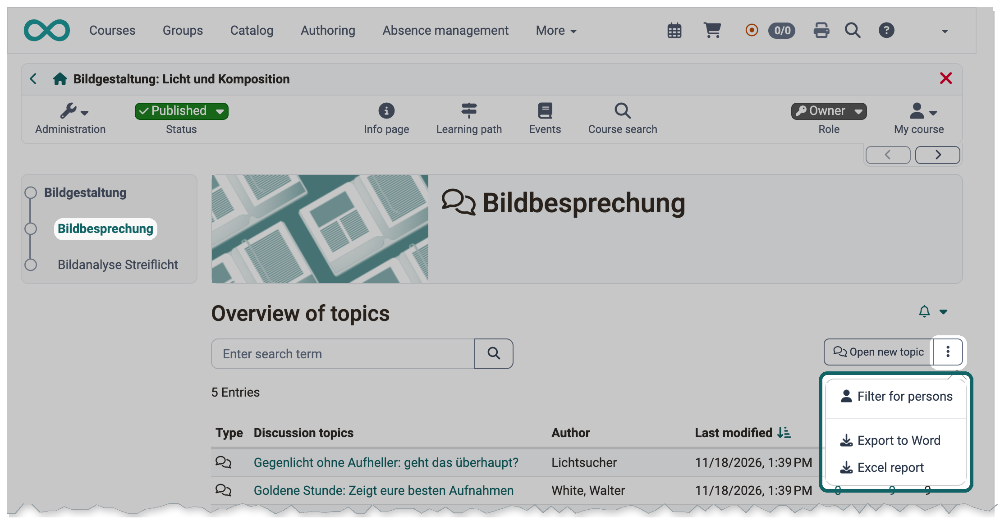
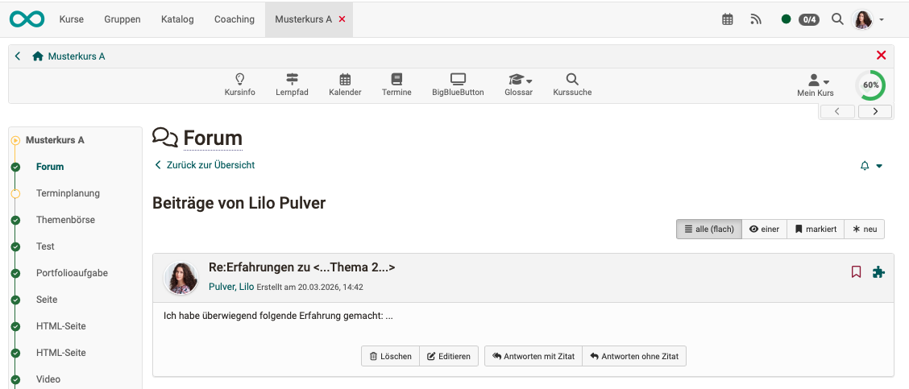
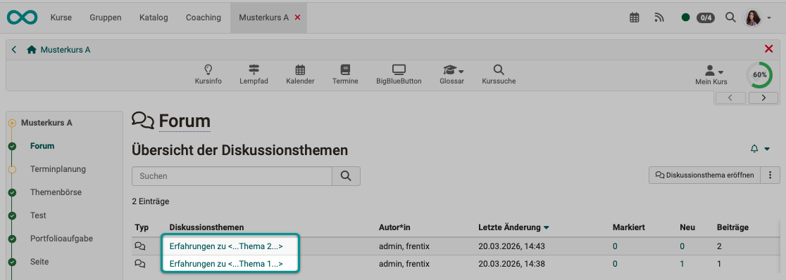
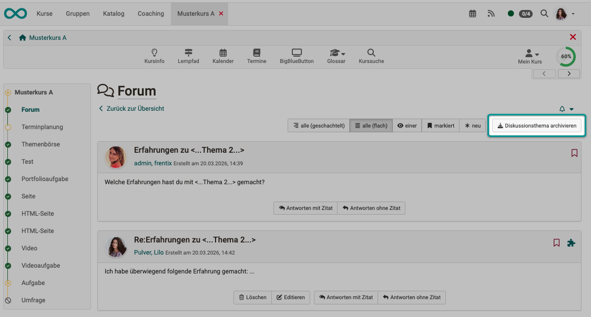
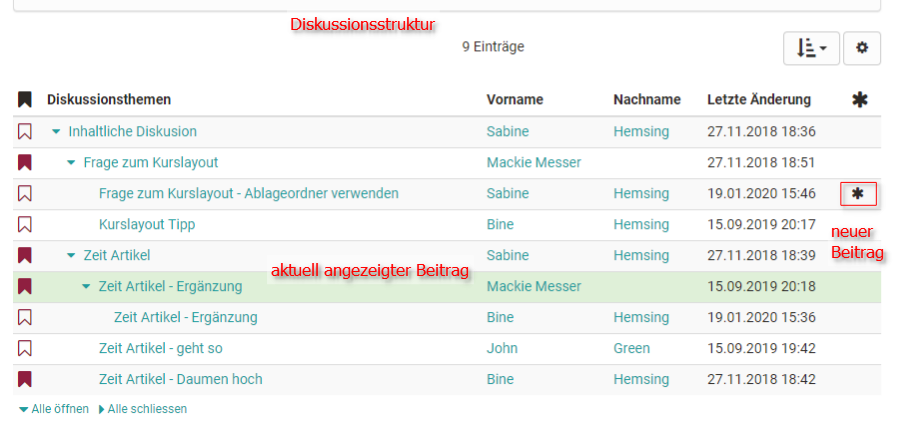

# Course Element "Forum" {: #forum}

## Profile

Name | Forum
---------|----------
Icon | :o_icon_o_fo_icon:
Available since | New edition with release 18.0
Functional group | Communication and collaboration
Purpose | Asynchronous online discussions
Assessable | no
Specialty / Note |

With the course element "Forum", the members of your course discuss at different times (asynchronously): each person writes and replies whenever it suits them. Participants ask questions about the content of the course there, for example, and answer each other, you start a subject discussion or implement forum-based learning methods, such as a pro-and-con discussion or a brainstorming on a question.

[To the top of the page ^](#forum)

---

## Tab Configuration [:octicons-tag-16:{ title="from Release 15.0 (OO-4347)" }](https://track.frentix.com/issue/OO-4347) {: #config}

You define who may write in the forum and who may moderate it in the course editor in the "Configuration" tab. In the "User rights" section, you use "Create forum posts" to define which course roles create posts. You can choose between coaches, participants and guests; by default, coaches and participants create posts. With "Moderator", you define whether coaches moderate the forum. You also define whether posts using an alias are allowed.

---

### Forums with alias [:octicons-tag-16:{ title="from Release 10.4 (OO-1769)" }](https://track.frentix.com/issue/OO-1769){:target="_blank"} {: #pseudonym}

If "Allow posts using an alias" is switched on, the authors of a post enter a name themselves under which their post appears. Whoever protects the alias with a password uses it exclusively. Without a password, several people can use the same alias.

If "Activate alias in every message" is switched on as well, the option "Use alias" is already selected when writing each post.

Both options appear in the tab as soon as the system administration allows aliases: under `Administration > Modules > Forum` with "Allow posts using an alias". More about this in the [administration manual](../../manual_admin/administration/Modules/index.md#forum).

{ class="shadow lightbox" title="Course editor, course element Forum, Configuration tab · 2026.11.27" }

---

### Moderation rights {: #moderator}

Moderating means keeping a discussion in order and intervening if needed. Owners always have these rights, [coaches](../basic_concepts/Roles/index.md#coach) if the right "Moderator" is switched on for them. The right is switched on by default; owners switch it off in the "Configuration" tab. Whoever moderates can:

* Edit and delete all forum posts and attach files.
* "Prioritize thread (sticky)": the thread always stays on top of the list.
* "Close discussion": posts of this thread can no longer be replied to.
* "Hide discussion": the thread no longer appears in the list of threads.
* "Show discussion": a hidden thread appears in the list again.

Whoever moderates also moves entire threads or individual posts: to another thread of the same forum, to another forum in the course or to a forum in another course. All replies to the moved post move along and are then no longer visible in the original forum. At the destination, you create the post as a new thread or add it to an existing one. In the last step, you send an e-mail to all people concerned if needed, telling them where their post has been moved. [:octicons-tag-16:{ title="from Release 11.3 (OO-2592)" }](https://track.frentix.com/issue/OO-2592)

!!! warning "Attention"

    Forum posts can also be moved to forums to which the author of the post has no access.

!!! info "Important"

    Owners also give the right "Moderator" to individual people or groups, for example to selected participants. To do so, they switch on the advanced configuration for the right "Moderator" in the "User rights" section.

[To the top of the page ^](#forum)

---

## Working with forums {: #usage}

A forum is the place for asynchronous discussions in courses and in OpenOlat groups. By default, all participants read and write in the forum.

Participants open threads, archive them and adjust the display of a thread. They create, edit and mark posts and subscribe to the entire forum.

{ class="shadow lightbox" title="Course element Forum, open thread · 2026.11.27" }

!!! tip "Tip"

    Recommend that participants subscribe to the forum in order to be notified of new posts. If all participants add a profile photo in their "[profile](../personal_menu/Profile/index.md#profile_photo)", it appears next to each of their posts and makes the discussion more personal.

---

### Start discussion topic {: #start_discussion}

A forum contains several threads. With "Open new topic", you write the first post of a new thread. All further posts in it refer to this topic.

---

### Create a post {: #posting}

A discussion develops when most posts within a thread are replies to an existing post. To do so, click "Reply with quotation" or "Reply without quotation" at the post. "Title" and "Post" are mandatory fields. Choose a meaningful title and adapt it to the content of your reply.

In the forum editor, you format your post and attach files. As a rule of thumb: attach a text that is longer than one A4 page as a file and summarise it briefly in the post.

You edit or delete your own post later as long as nobody has replied to it yet.

If the forum allows aliases, you also publish your post under an alias.

!!! tip "Tip"

    Before opening a new thread, check whether a suitable one already exists. As owner or coach, you best prepare the suitable threads in advance.

---

### Mark forum posts  {: #mark}

Mark a post to find it again more easily or to note it for a later reply. To do so, click the bookmark icon in the upper right corner of the post in the open thread. In the overview of the forum, you see how many posts per thread are marked.

{ class="shadow lightbox" title="Forum post in a discussion topic" }

---

### Export forum posts {: #export}

In the course element "Forum", you find the options "Filter for persons", "Export to Word" and "Excel report" under the button with the three dots. Participants see this menu as well. "Export to Word" downloads the posts of the forum as a Word file together with the attached files in a ZIP file.

{ class="shadow lightbox" title="Course element Forum, overview of topics · 2026.11.27" }

With the "Filter for persons", you show the posts of a specific person, together with information such as the number of words and characters of their posts.

{ class="shadow lightbox" title="Course element Forum" }

The option "Excel report" creates an Excel file with statistical information on the posts, for example on authors and length, without the text of the posts. It contains one row per forum post. [:octicons-tag-16:{ title="from Release 18.1 (OO-6960)" }](https://track.frentix.com/issue/OO-6960)

---

### Archive forum posts {: #archive}

You save a single thread as a ZIP archive. It contains the posts as a Word file and the attachments of the posts.

* Click the thread to open it.
* Above the thread, click the button "Archive thread".

{ class="shadow lightbox" title="Topic overview of the forum" }

{ class="shadow lightbox" title="Open discussion topic in the forum" }

---

### Subscribe to forums {: #abo}

:octicons-device-camera-video-24: **Video Introduction (German)**: [Subscriptions](<https://www.youtube.com/embed/h9gOqt7TR7Q>){:target="_blank"}

Whoever subscribes to a forum learns about new and modified posts without checking the forum themselves. Click the bell icon in the upper right corner of the forum and switch on "Subscribe" in the "Subscriptions" window. You receive the notifications under `User tools > Subscriptions` and, depending on your personal settings, by e-mail, no matter who wrote or modified the post. More about this on the page [Subscriptions](../personal_menu/Subscriptions.md#activate_abo).

!!! tip "Tip"

    Recommend that participants subscribe to all forums in order to be notified of new posts.

---

### Display options for forum threads {: #display_threads}

Depending on the size of a discussion, you choose one of these displays in the open thread:

* all (thread)
* all (flat)
* one
* marked
* new

With "all (thread)" and "all (flat)", all posts appear one below the other, with or without indentation. The first post is on top, the others follow the structure of the discussion. In a forum with many posts, "new" shows only the posts you have not read yet.

For branched discussions, the view "one" is suitable: it shows the entire structure of the thread, and you show and hide individual branches. You recognise new posts there by the asterisk.

{ class="shadow lightbox" title="Discussion topic in the forum" }

[To the top of the page ^](#forum)

---

## General further information {: #general}

### Alternatives

a) For announcements to the course that participants are to reply to, use the forum instead of the [course element "Info messages"](../learningresources/Course_Element_Notifications.md).

b) If the course needs only one forum that is available at all times, switch on the tool [Forum in the toolbar](Course_Settings_Toolbar.md#forum) instead of the course element. It applies to the entire course. Aliases and your own assignment of moderation rights are offered only by the course element.

c) The [File dialog](../learningresources/Course_Element_File_Dialog.md) combines forum and file storage: for each uploaded file, OpenOlat automatically creates a forum. This way, the course discusses a specific document, for example the draft of a seminar paper, an image or a concept.

[To the top of the page ^](#forum)

---

## Further information {: #further_information}

**Mentioned on this page** 
[Roles and Rights: Which roles are available? >](../basic_concepts/Roles/index.md) 
[Modules: Overview >](../../manual_admin/administration/Modules/index.md) 
[Personal Configuration: Profile >](../personal_menu/Profile/index.md) 
[User tools: Subscriptions >](../personal_menu/Subscriptions.md) 
[Course Element "Info messages" >](Course_Element_Notifications.md) 
[Toolbar >](Course_Settings_Toolbar.md) 
[Course Element "File Dialog" >](Course_Element_File_Dialog.md)

**Further reading** 
[Course Element "Blog" >](Course_Element_Blog.md)

**youtube** 
[Subscriptions](<https://www.youtube.com/embed/h9gOqt7TR7Q>)

[To the top of the page ^](#forum)
