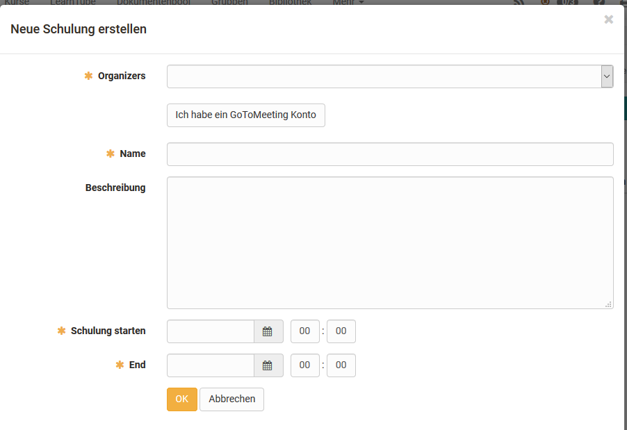

# Kursbaustein "GoToMeeting" {: #gotomeeting}

## Steckbrief

Name | GoToMeeting
---------|----------
Icon | :o_icon_o_gotomeeting_icon:
Verfügbar seit | Release 10.5 (OO-1944)
Funktionsgruppe | Kommunikation und Kollaboration
Verwendungszweck | Integration der Webkonferenz-Software GoToMeeting
Bewertbar | nein
Spezialität / Hinweis | GoToMeeting ist eine kommerzielle Software. Um den Kursbaustein zu nutzen, ist eine separate Lizenz und ein Serverhosting erforderlich.

## Tool Spezifisches {: #tool_specific}

!!! note "Link zu weiteren Infos"

    Tool Webseite: <https://www.goto.com/meeting>

## Konfiguration im Kurseditor {: #editor_config}

Kein spezifischer Tab

## Konfiguration in der Kursansicht {: #closed_editor_config}

Im Kurs bei geschlossenem Kurseditor erstellen Sie im Bereich "Konfiguration" ein neues Meeting: 
`Kurs > Kursbaustein "GoToMeeting" > Konfiguration > Neue Schulung erstellen`

{ class="shadow lightbox" title="Dialog Neue Schulung erstellen" }

!!! info "Zugang zum Meeting-Raum"

    Im Bereich "Schulungen" erhält man Zugang zum Meeting-Raum.

## Weiterführende Informationen {: #further_information}

**Auf dieser Seite erwähnt** 
[GoToMeeting (Anbieter-Website)](https://www.goto.com/meeting)

**Weiterführend** 
[Kursbausteine >](Course_Elements.de.md) 
[Kursbaustein "Adobe Connect" >](Course_Element_Adobe_Connect.de.md) 
[Virtuelle Klassenzimmer >](../basic_concepts/Virtual_classrooms.de.md) 
[Externe Werkzeuge: Übersicht >](../../manual_admin/administration/External_Tools_-_Administration.de.md)

[Zum Seitenanfang ^](#gotomeeting)
