# Kursbaustein "HTML-Seite" {: #html_page}

## Steckbrief

Name | HTML-Seite
---------|----------
Icon | :o_icon_o_sp_icon:
Verfügbar seit | Neuauflage mit Release 18
Funktionsgruppe | Andere
Verwendungszweck | Darstellung verschiedener Inhalte (Texte, Bilder, Videos) innerhalb einer HTML-Seite
Bewertbar | nein
Spezialität / Hinweis | Für die Einbindung von Office-Dokumenten nutzen Sie bitte den Kursbaustein "Dokument". frentix empfiehlt den Einsatz nicht.

Mit dem Kursbaustein "HTML-Seite" zeigen Sie Texte, Bilder und Videos im Kurs so, wie man es von Websites kennt.

Der Kursbaustein zeigt eine HTML-Datei an. Sie gestalten sie im HTML-Editor, den Sie im Tab "Seiteninhalt" öffnen. Die HTML-Datei und die Dateien, die sie verwendet, liegen im [Ablageordner](../learningresources/Storage_folder.de.md) des Kurses.

!!! warning "frentix empfiehlt, Domänen getrennt zu halten"

    Im Kursbaustein "HTML-Seite" hinterlegen Sie beliebigen HTML- und
    JavaScript-Code, auch Inhalte einer fremden Domäne. OpenOlat liefert diesen
    Code unter Ihrer eigenen Domäne aus, sofern keine separate Adresse für
    Inhalte ([Inhaltsdomäne](../basic_concepts/Content_Domain.de.md)) eingerichtet ist. Diese separate Adresse richtet der Betrieb Ihrer
    OpenOlat-Installation ein. Aus modernen Sicherheitsüberlegungen
    empfiehlt frentix, verschiedene Domänen nicht zu vermischen, und rät deshalb
    vom Einsatz dieses Kursbausteins ab.

## Beispiel {: #example}

=== "Ansicht im Kurs"

    Eine HTML-Seite gestalten Sie vor allem mit Bildern, Texten, Tabellen und Videos. Mit HTML-Kenntnissen fügen Sie auch Elemente wie ein Accordion ein.

    Das Beispiel zeigt drei Fotos, die mit der Klasse "Linksbündig" nebeneinander stehen. Wie Sie so eine Bildreihe anlegen, beschreibt der Abschnitt [Mehrere Bilder nebeneinander](#images_side_by_side).

    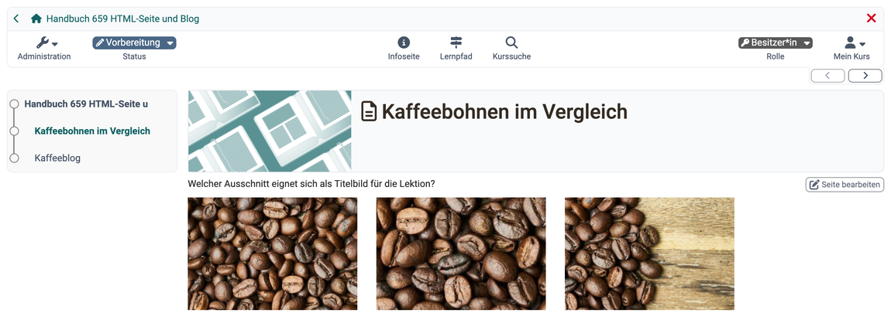{ class="shadow lightbox" title="Kursbaustein HTML-Seite in der Kursansicht · 2026.10.08" }

=== "Bearbeitung im Editor"

    Sie stellen die Inhalte ähnlich wie in einem Textverarbeitungsprogramm zusammen. Dafür bearbeiten Sie die HTML-Datei direkt in OpenOlat im HTML-Editor TinyMCE.

    Der Kursbaustein "Seite" verwendet dagegen den Content Editor, der die Inhalte als Blöcke zusammenstellt. Auf Mobilgeräten zeigt OpenOlat solche Blöcke besser an.

    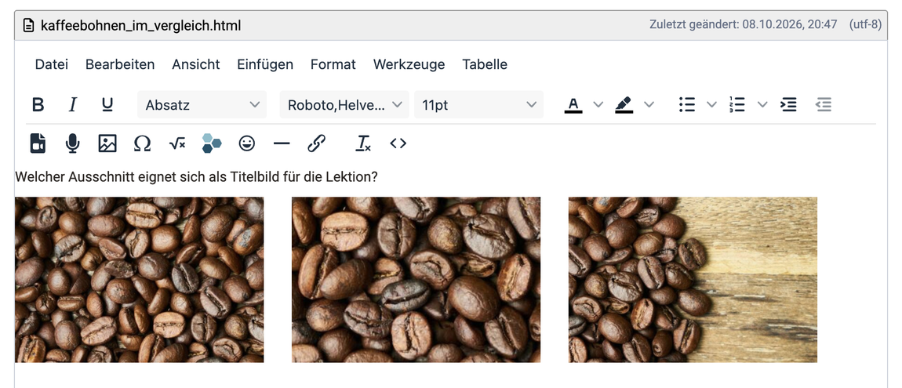{ class="shadow lightbox" title="HTML-Editor im Kursbaustein HTML-Seite · 2026.10.08" }

=== "HTML-Quellcode"

    Mit HTML-Kenntnissen sehen und bearbeiten Sie auch direkt den erzeugten HTML-Quellcode.

    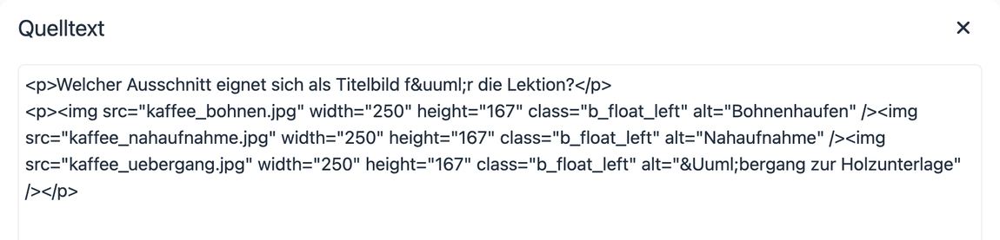{ class="shadow lightbox" title="Dialog Quelltext im HTML-Editor · 2026.10.08" }

## Tab Seiteninhalt {: #tab_page_content}

Im Tab "Seiteninhalt" legen Sie fest, welche HTML-Datei der Kursbaustein zeigt. Dafür gibt es vier Wege:

  * Mit "Erstellen" eine neue HTML-Seite online in OpenOlat anlegen
  * Mit "Auswählen" eine HTML-Datei aus dem Ablageordner wählen
  * Mit "Import" eine extern erstellte HTML-Datei oder eine ZIP-Datei von Ihrem Rechner hochladen
  * Eine extern erstellte HTML-Datei in den Ablageordner hochladen und dort mit "Auswählen" wählen

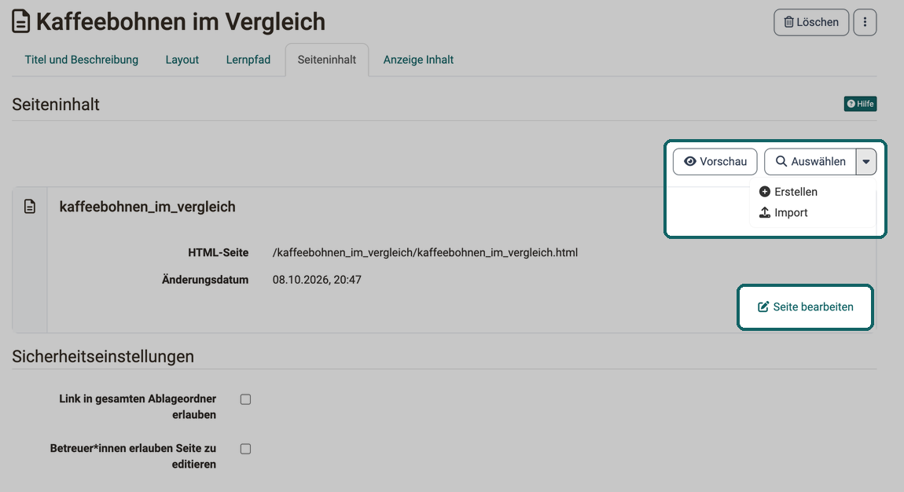{ class="shadow lightbox" title="Tab Seiteninhalt im Kurseditor · 2026.10.08" }

Die verknüpfte HTML-Datei bearbeiten Sie im HTML-Editor von OpenOlat, der ähnlich wie ein Textverarbeitungsprogramm funktioniert. Mit "Seite bearbeiten" öffnen Sie die Datei im Editor. Mit "Vorschau" zeigt OpenOlat die verknüpfte Seite in einer Vorschau an. Eine Datei, die Sie mit "Erstellen" anlegen, trägt bereits den Namen des Kursbausteins.

Unter "Sicherheitseinstellungen" legen Sie mit "Link in gesamten Ablageordner erlauben" fest, ob Ihre HTML-Seite auf alle Dateien des Ablageordners verweisen darf. Ist die Option ausgeschaltet, verweist die Seite nur auf Dateien im eigenen Ordner und in dessen Unterordnern. Schalten Sie die Option ein, wenn Ihre HTML-Seite Grafiken, CSS-Dateien oder Skripte aus anderen Ordnern verwendet. Bei einem neu eingefügten Kursbaustein ist sie ausgeschaltet.

Mit "Betreuer:innen erlauben Seite zu editieren" legen Sie fest, ob Betreuer:innen die hinterlegte HTML-Datei bearbeiten dürfen. Betreuer:innen benötigen dafür keine Kursbesitzerrechte oder Zugang zum Kurseditor. Unabhängig von dieser Einstellung dürfen Kursbesitzer:innen, Administrator:innen und Lernressourcenverwalter:innen die Seite bearbeiten, ebenso Personen mit dem [Kursrecht "Kurseditor"](../learningresources/Members_management.de.md#additional_rights). Wer die Seite bearbeiten darf, sieht in der Kursansicht rechts über der Seite den Button "Seite bearbeiten".

### Inhalt auswechseln {: #change_content}

Ist der Inhalt einer HTML-Seite überholt, tauschen Sie die verknüpfte Datei aus, statt einen neuen Kursbaustein anzulegen. Die Buttons im [Tab "Seiteninhalt"](#tab_page_content) wirken auch nachträglich. Mit "Auswählen" verknüpfen Sie eine andere Datei aus dem Ablageordner. Mit "Import" laden Sie eine HTML-, ZIP- oder PDF-Datei von Ihrem Rechner hoch. Mit "Erstellen" legen Sie eine neue HTML-Seite an, die an die Stelle der bisherigen tritt. Zeigt der Kursbaustein bereits eine Datei, finden Sie "Erstellen" und "Import" im Menü neben dem Button "Auswählen".

Laden Sie mit "Import" eine ZIP-Datei hoch, entpackt OpenOlat sie und zeigt Ihnen anschliessend die enthaltenen HTML-Dateien zur Auswahl an. So ersetzen Sie eine extern erstellte Seite samt Bildern, CSS-Dateien und Skripten in einem Schritt.

!!! info "Wichtig"

    OpenOlat entpackt eine importierte ZIP-Datei in einen neuen Ordner, der den Namen der ZIP-Datei trägt und dort entsteht, wo die verknüpfte Datei liegt. Existiert dieser Ordner bereits, hängt OpenOlat eine Nummer an den Namen an. Der bestehende Inhalt bleibt erhalten und wird nicht überschrieben. Löschen Sie die alten Ordner bei Bedarf selbst im [Ablageordner](../learningresources/Storage_folder.de.md).

## Tab Anzeige Inhalt {: #layout}

Im Tab "Anzeige Inhalt" legen Sie fest, wie OpenOlat die Seite im Kurs anzeigt: unverändert oder optimiert für OpenOlat. Mit dem Anzeigemodus "Optimiert für OpenOlat" wenden Sie zum Beispiel das Kurslayout auf den Seiteninhalt an oder aktivieren ein in den Kurs eingebundenes [Glossar](../learningresources/Glossary_usage.de.md#glossary_call_in_HTML) für die Seite.

Ist eine [Inhaltsdomäne](../basic_concepts/Content_Domain.de.md) eingerichtet, liefert OpenOlat den Inhalt darüber aus. Skripte im Inhalt erhalten so keinen Zugriff auf die OpenOlat-Sitzung. Kursinterne Links auf andere Kursbausteine funktionieren weiterhin. [:octicons-tag-16:{ title="ab Release 21.0 (OO-7612)" }](https://track.frentix.com/issue/OO-7612){:target="_blank"}

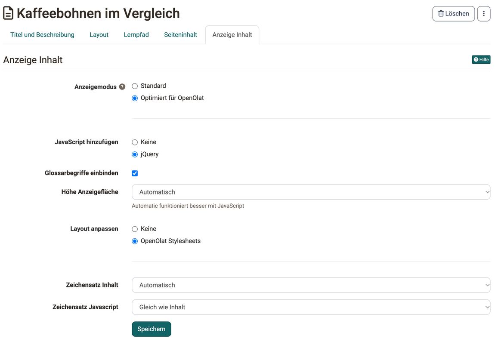{ class="shadow lightbox" title="Tab Anzeige Inhalt im Kurseditor · 2026.10.08" }

Im Tab stehen die folgenden Einstellungen zur Wahl.

#### Anzeigemodus {: #display_mode}

Wählen Sie den Modus "Standard", um die Seite unverändert anzuzeigen. Dieser Modus eignet sich für Seiten, die im Modus "Optimiert für OpenOlat" fehlerhaft erscheinen, vor allem für extern erstellte HTML-Seiten.

Wählen Sie den Modus "Optimiert für OpenOlat", wenn Sie das Kurslayout in der Seite einbinden, eine JavaScript-Bibliothek verwenden, das Glossar des Kurses auf dieser Seite anwenden oder die Höhe der Seite automatisch anpassen möchten.

Für SCORM-Module empfiehlt sich der Modus "Standard".

#### JavaScript hinzufügen {: #javascript_library}

Die Funktionen des Anzeigemodus "Optimiert für OpenOlat" brauchen die JavaScript-Bibliothek "jQuery". Wählen Sie "Keine", wenn Ihre Inhalte mit "jQuery" fehlerhaft erscheinen.

#### Glossarbegriffe einbinden {: #glossary_terms}

Mit dieser Option hebt OpenOlat die Begriffe des Glossars auf Ihrer HTML-Seite hervor, sofern Sie ein Glossar in Ihren Kurs eingebunden haben. Die Option setzt die JavaScript-Bibliothek "jQuery" voraus.

#### Höhe Anzeigefläche {: #display_height}

Hier legen Sie die Höhe der Inhaltsanzeige fest. Mit "Automatisch" passt OpenOlat die Höhe an den Inhalt der Seite an. Alternativ wählen Sie einen festen Wert.

#### Layout anpassen {: #adapt_layout}

Mit "OpenOlat Stylesheets" übernimmt Ihre Seite das Layout von OpenOlat und des Kurses, etwa Schriftart, Farben und Schriftgrösse. Mit "Keine" behält Ihre Seite ihr eigenes Layout.

#### Zeichensatz Inhalt {: #content_character_set}

Mit "Automatisch" erkennt OpenOlat den Zeichensatz der Seite selbst. Zeigt die Seite Umlaute oder Sonderzeichen falsch an, wählen Sie einen bestimmten Zeichensatz. Enthält die Seite keine Angabe zum Zeichensatz, verwendet OpenOlat ISO-8859-1.

#### Zeichensatz Javascript {: #javascript_character_set}

Hier wählen Sie den Zeichensatz für den JavaScript-Code der Seite. Mit "Gleich wie Inhalt" verwendet OpenOlat denselben Zeichensatz wie für den Inhalt.

!!! tip "Tipp"

    In der Regel sind im Tab "Anzeige Inhalt" keine Änderungen notwendig. Die Standardeinstellungen passen für die meisten Seiten.

## Der HTML-Editor {: #html_editor}

An allen Stellen in OpenOlat, an denen HTML-Seiten erzeugt und bearbeitet werden, ist der HTML-Editor TinyMCE eingebunden.

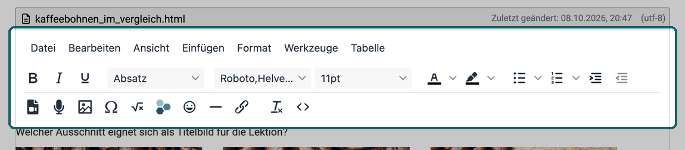{ class="shadow lightbox" title="HTML-Editor im Kursbaustein HTML-Seite · 2026.10.08" }

Dieser extern entwickelte Editor ist ebenfalls Open Source. Weitere Informationen finden Sie auf der Website: [https://www.tiny.cloud](https://www.tiny.cloud)

!!! info "Wichtig"

    OpenOlat öffnet den HTML-Editor je nach Ort mit unterschiedlichen Voreinstellungen. Die Buttons im Editor passen so zur jeweiligen Situation.

    **Beispiel:** 
    In einer HTML-Seite eines Kursbausteins bietet der Editor die Aufnahme eines Videos an. An anderen Stellen, an denen eine Videoaufnahme nicht passt, zeigt der Editor diese Option nicht.

!!! info "Wichtig"

    Aus Sicherheitsgründen stellt der HTML-Editor nicht alle Möglichkeiten von HTML zur Verfügung. Das betrifft vor allem eingebettetes JavaScript.

## Elemente und Gestaltung einer HTML-Seite {: #html_elements}

Der HTML-Editor bietet die folgenden Elemente, um Ihre Seite zu gestalten.

### Formatierungen

Dazu gehören zum Beispiel:

* Schriften: individuell eingestellt oder aus vordefinierten Formaten gewählt, etwa h2
* Aufzählungen mit Punkten oder Zahlen, in HTML die Elemente ul und ol
* Einrückungen

### Video

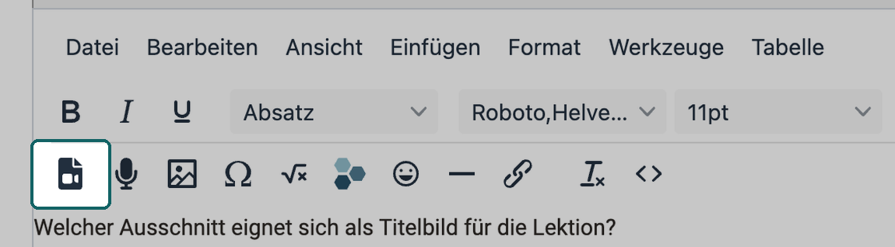{ class="shadow lightbox" title="Werkzeugleiste des HTML-Editors · 2026.10.08" }

Für die Anzeige verwendet der Editor den Mediaplayer von OpenOlat. Das hat zwei Vorteile:

1. Der Player erkennt das Format selbst, solange die Video- und Audiodaten richtig codiert sind.
2. Der Player erkennt, ob Teilnehmende mit einem HTML-fähigen und Codec-kompatiblen Browser auf einem Mobilgerät auf das Video zugreifen. In diesem Fall bindet er das Video mit einem HTML5-Tag ein, so dass es auch auf einem iPad oder einem ähnlichen Gerät läuft.

!!! info "Wichtig"

    Ein Video in einer HTML-Seite spielt OpenOlat einfach ab. Annotationen, Fragen und die weiteren Funktionen einer Video-Lernressource bietet der Kursbaustein ["Video"](Course_Element_Video.de.md).

Sie laden Videodateien hoch, die OpenOlat speichert, oder verweisen auf externe Videos, zum Beispiel auf YouTube.

Eingefügte Videodateien tauschen Sie bei Bedarf später aus.

Wie Sie Videos einbinden, beschreibt die Seite [Videos im Kursbaustein "HTML-Seite"](../basic_concepts/Video_in_HTML_Pages.de.md).

!!! tip "Tipp"

    Sie können Ihrer Mediendatei auch noch ein Startbild (Vorschau) hinzufügen.

### Videorecording

Im HTML-Editor nehmen Sie ein Video direkt auf und fügen es in die Seite ein. Wie das geht, beschreibt die Seite ["Video aufnehmen"](../basic_concepts/Video_Recording.de.md).

### Musik (.MP3)

Für reine Audiodateien bietet der Player die Grundfunktionen: Starten, Stoppen und eine Fortschrittsanzeige.

Im Feld "Adresse" geben Sie einen Link auf eine MP3-Datei ein oder laden eine Datei in OpenOlat hoch.

### Audiorecording

Im HTML-Editor nehmen Sie auch Audio direkt auf. Wie das geht, beschreibt die Seite ["Audio aufnehmen"](../learningresources/Audio_Recording.de.md).

### Bilder

Mit Bildern zeigen Sie, was sich in Worten schwer beschreiben lässt, etwa ein Foto oder eine Grafik. Sie wählen Bilddateien im Format JPG, GIF oder PNG und legen im Dialog "Bild einfügen/bearbeiten" auch Grösse und Ausrichtung fest. Unter "Alternative Beschreibung" hinterlegen Sie einen Text für Personen, die das Bild nicht sehen. Der "Bildtitel" erscheint, wenn jemand mit der Maus auf das Bild zeigt. Mit "Beschriftung anzeigen" erhält das Bild eine Beschriftung, die Sie im Editor unter dem Bild eintragen. Im Tab "Erweitert" stellen Sie Abstände und Rahmen des Bildes ein.

### Mehrere Bilder nebeneinander {: #images_side_by_side}

Möchten Sie zwei oder drei Bilder in einer Reihe zeigen, etwa Fotos zum Vergleich, weisen Sie jedem Bild die Klasse "Linksbündig" zu. So stehen die Bilder nebeneinander, ohne dass Sie eine Tabelle brauchen. Dieser Weg funktioniert im Kursbaustein "HTML-Seite" ebenso wie in einem Blogeintrag. Wie das Ergebnis aussieht, zeigt das [Beispiel](#example) oben: drei Fotos in der Kursansicht, im Editor und im HTML-Quellcode.

1. Setzen Sie den Cursor an die Stelle, an der die Bildreihe beginnen soll.
2. Klicken Sie in der Werkzeugleiste auf das Bildsymbol oder wählen Sie im Menü "Einfügen" den Eintrag "Bild...". Der Dialog "Bild einfügen/bearbeiten" öffnet sich im Tab "Allgemein".
3. Klicken Sie rechts neben dem Feld "Quelle" auf das Symbol zum Durchsuchen. Der Dialog "Verlinkung auswählen" öffnet sich.
4. Wählen Sie unter "Bestehende Datei auswählen" eine Bilddatei und klicken Sie auf "Auswählen". Ein neues Bild laden Sie mit "Datei hochladen" und "Hochladen" von Ihrem Rechner hoch.
5. Prüfen Sie, dass unter "Klasse" der Eintrag "Linksbündig" gewählt ist. Bei einem neuen Bild ist er voreingestellt.
6. Tragen Sie unter "Breite" einen Wert in Pixeln ein, der klein genug ist, damit alle Bilder zusammen in die Zeile passen, zum Beispiel 250 bei drei Bildern. Die Höhe passt sich automatisch an.
7. Klicken Sie auf "Speichern".
8. Setzen Sie den Cursor direkt hinter das eingefügte Bild und wiederholen Sie die Schritte 2 bis 7 für jedes weitere Bild.

Statt Pixeln können Sie unter "Breite" auch einen Prozentwert eingeben, etwa 30%. Leeren Sie in diesem Fall das Feld "Höhe", damit das Bild seine Proportionen behält.

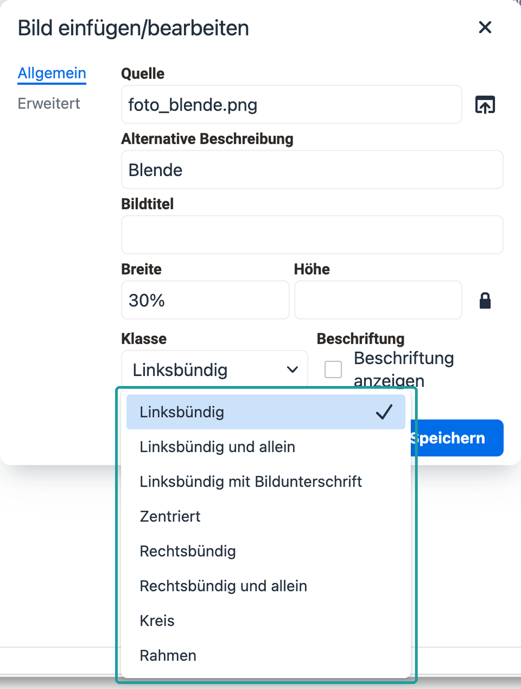{ class="shadow lightbox" title="Tab Allgemein im Dialog Bild einfügen/bearbeiten" }

Reicht die Breite der Zeile nicht für alle Bilder, rückt das nächste Bild in die folgende Zeile. Verkleinern Sie dann die Breite der Bilder. Das Eingabefeld des Editors kann schmaler sein als die Seite in der Ansicht, etwa im Formular eines Blogeintrags. Ob die Bilder in einer Zeile stehen, prüfen Sie deshalb in der Kursansicht oder im veröffentlichten Blogeintrag.

Pro Bild wählen Sie genau eine Klasse. Die Klassen bewirken Folgendes:

* **Linksbündig:** Das Bild steht links. Text und weitere Bilder mit derselben Klasse folgen rechts daneben.
* **Linksbündig mit Bildunterschrift:** Das Bild steht links, ohne Abstand zum Inhalt daneben. Auch mit "Beschriftung anzeigen" stehen mehrere Bilder mit dieser Klasse in der Kursansicht nebeneinander, jedes mit seiner Beschriftung darunter.
* **Rechtsbündig:** Das Bild steht rechts, der Text fliesst links daneben.
* **Zentriert:** Das Bild steht allein und mittig in seiner Zeile.
* **Linksbündig und allein**, **Rechtsbündig und allein:** Das Bild steht allein in seiner Zeile, links oder rechts. Hier endet das Umfliessen der vorangehenden Bilder.
* **Kreis**, **Rahmen:** Diese Klassen geben dem Bild eine runde Form oder einen Rahmen, verändern aber seine Position nicht.

Die Klassen stammen aus den OpenOlat Stylesheets, die im Kursbaustein "HTML-Seite" standardmässig eingebunden sind. Wählen Sie im Tab ["Anzeige Inhalt"](#layout) den Anzeigemodus "Standard" oder unter "Layout anpassen" die Option "Keine", bindet OpenOlat diese Stylesheets in der Kursansicht nicht ein. Die Klassen wirken dann nur im HTML-Editor, nicht in der Kursansicht.

Im Kursbaustein "HTML-Seite" gibt es einen zweiten Weg über das Menü "Tabelle": Wählen Sie dort den Eintrag "Tabelle" und im Raster eine Zeile mit drei Spalten. Fügen Sie anschliessend in jede Zelle ein Bild ein. Der Editor im Blog bietet das Menü "Tabelle" nicht an, dort führt nur der Weg über die Klasse zum Ziel.

### Mathematische Formeln

OpenOlat stellt mathematische Formeln mit MathJax dar.

### Emoticons

Emoticons fügen Sie so ein, wie Sie es von sozialen Medien kennen.

### Hyperlinks

Sie setzen Links ins Internet und Links innerhalb von OpenOlat, etwa auf bestimmte Kursbausteine, auch in anderen Kursen. 
Die Links können auf Bilder, Videos oder die Werkzeuge in der [Toolbar](Course_Settings_Toolbar.de.md#available_icons) zeigen. 
Wählen Sie, ob der Link im Kursinhalt oder in einem neuen Fenster erscheint.

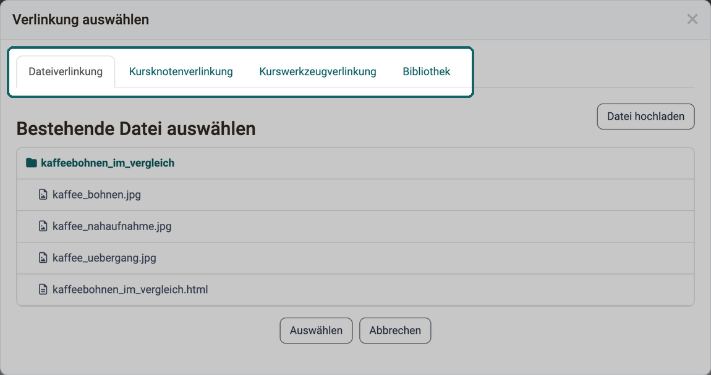{ class="shadow lightbox" title="Dialog Verlinkung auswählen im HTML-Editor · 2026.10.08" }

### PDF-Dokumente

!!! tip "Empfehlung"

    Der Kursbaustein "HTML-Seite" zeigt neben HTML-Dateien auch eine PDF-Datei an. Für PDF- und Office-Dokumente empfehlen sich die Kursbausteine ["Dokument"](Course_Element_Document.de.md) oder ["Ordner"](Course_Element_Folder.de.md). Wählen Sie im Tab "Seiteninhalt" eine PDF-Datei, weist OpenOlat dort ebenfalls auf den Kursbaustein "Dokument" hin.

### Extern erstellte HTML-Seiten hochladen

!!! tip "Tipp"

    Sie können auch extern erstellte Dateien in den Ablageordner des Kurses hochladen oder einen Ressourcenordner mit dem Kurs und dem Ablageordner verbinden. Der Button "Auswählen" zeigt Ihnen alle HTML- und PDF-Dateien im Ablageordner. Diese Dateien verknüpfen Sie mit dem Kursbaustein "HTML-Seite" und binden sie so in Ihren Kurs ein. Dieser Weg empfiehlt sich, wenn Sie die Ordnerstruktur des Ablageordners selbst bestimmen möchten. Sind es viele Dateien, legt der Assistent ["Mehrere HTML-Seiten"](#multi) alle Kursbausteine in einem Schritt an.

!!! warning "Achtung"

    Bearbeiten Sie HTML-Seiten, die Sie mit einem externen Editor erstellt haben, weiterhin im externen Editor. Speichern Sie eine solche Seite im HTML-Editor von OpenOlat, können Teile der Formatierung verloren gehen. Der HTML-Editor von OpenOlat bearbeitet nur den Bereich `<body>` einer HTML-Seite. Einträge im Bereich `<head>` ändern Sie im externen Editor.

## Mehrere HTML-Seiten auf einmal anlegen {: #multi}

Liegen bereits viele HTML-Dateien im Ablageordner, etwa ein extern erstelltes Skript mit mehreren Kapiteln, legt der Assistent "Mehrere HTML-Seiten" für jede Datei einen eigenen Kursbaustein "HTML-Seite" an. So fügen Sie nicht jede Seite einzeln ein und verknüpfen sie mit ihrer Datei. Auf Wunsch übernimmt der Assistent auch die Ordnerstruktur des Ablageordners als Kursbausteine "Struktur".

Den Assistenten nutzt, wer den Kurseditor öffnen darf: Kursbesitzer:innen, Administrator:innen, Lernressourcenverwalter:innen und Personen mit dem [Kursrecht "Kurseditor"](../learningresources/Members_management.de.md#additional_rights). Er steht in herkömmlichen Kursen und in Lernpfadkursen zur Verfügung.

So legen Sie mehrere HTML-Seiten an:

1. Laden Sie die Dateien in den [Ablageordner](../learningresources/Storage_folder.de.md) des Kurses hoch. Der Assistent bietet auch die Dateien eines Ressourcenordners an, den Sie mit dem Kurs verknüpft haben.
2. Wählen Sie im Kurseditor im Kursmenü den Kursbaustein, hinter oder unter dem die neuen Seiten stehen sollen.
3. Klicken Sie in der Toolbar des Kurseditors auf "Kursbausteine einfügen" und in der Gruppe "Andere" auf "Mehrere HTML-Seiten". Der Eintrag steht direkt nach "HTML-Seite". Der Dialog "Wählen Sie die Dateien." öffnet sich. 
`Kurs > Administration > Kurseditor > Kursbausteine einfügen > Andere > Mehrere HTML-Seiten`
4. Setzen Sie ein Häkchen bei jeder Datei, die eine eigene Seite werden soll. Der Dialog zeigt alle Dateien und Ordner des Ablageordners, auch Bilder, CSS-Dateien und Skripte. Wählen Sie gezielt die HTML-Dateien, die Teilnehmende als eigene Seite im Kursmenü sehen sollen. Ein Häkchen bei einem Ordner wählt alle Dateien und Unterordner darin mit aus. "Alle auswählen" und "Auswahl löschen" setzen oder entfernen alle Häkchen auf einmal.
5. Klicken Sie auf "Nach dem aktuellen Kursbaustein einfügen". Die neuen Kursbausteine stehen dann direkt hinter dem gewählten Kursbaustein. Mit "Als Kind des aktuellen Kursbausteins einfügen" stehen sie am Ende unter dem gewählten Kursbaustein. Ist im Kursmenü der oberste Eintrag gewählt, bietet der Dialog nur "Als Kind des aktuellen Kursbausteins einfügen" an.

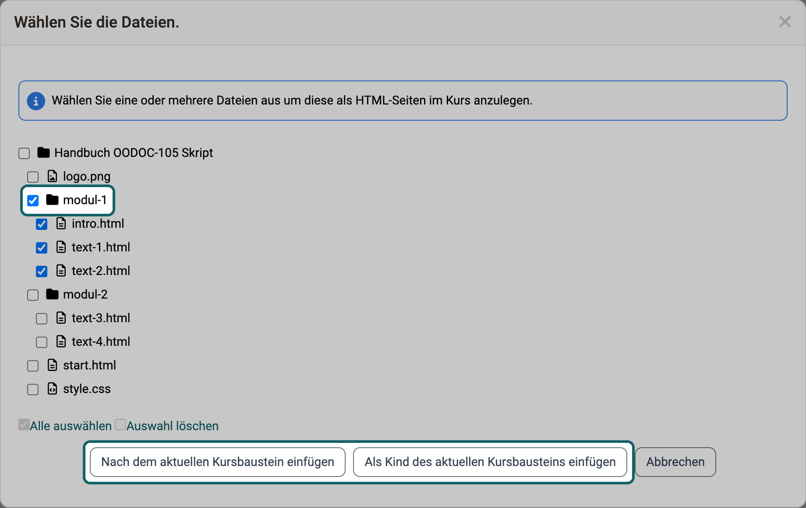{ class="shadow lightbox" title="Dialog Wählen Sie die Dateien. im Kurseditor · 2026.11.10" }

Der Dialog schliesst sich, und das Kursmenü des Kurseditors zeigt die neuen Kursbausteine. Teilnehmende sehen sie, sobald Sie den Kurs [publizieren](Using_additional_Course_Editor_Tools.de.md#publish).

Den Assistenten öffnen Sie über "Kursbausteine einfügen". [Quick-Add](Using_additional_Course_Editor_Tools.de.md#quick_add) legt Kursbausteine einzeln an, also eine HTML-Seite pro Eingabe.

### Was der Assistent anlegt {: #multi_result}

Jede ausgewählte Datei wird ein Kursbaustein "HTML-Seite", der genau diese Datei zeigt. Ist die Datei keine HTML-Datei, steht über dem Inhalt ein Link zum Herunterladen: Ein Bild zeigt die Seite direkt an, eine CSS-Datei als Text, ein Word-Dokument dagegen nur als Link. Jeder ausgewählte Ordner wird ein Kursbaustein "Struktur", unter dem die Kursbausteine aus diesem Ordner stehen. Ist ein Ordner nicht ausgewählt, stehen die ausgewählten Dateien daraus eine Ebene höher, direkt unter dem nächsten ausgewählten Ordner oder am gewählten Ort im Kursmenü. Der oberste Eintrag im Dialog steht für den Ablageordner selbst und trägt den Kurstitel. Wählen Sie ihn mit aus, etwa mit "Alle auswählen", entsteht auch für ihn ein Kursbaustein "Struktur" mit dem Kurstitel als "Titel", unter dem alle übrigen stehen.

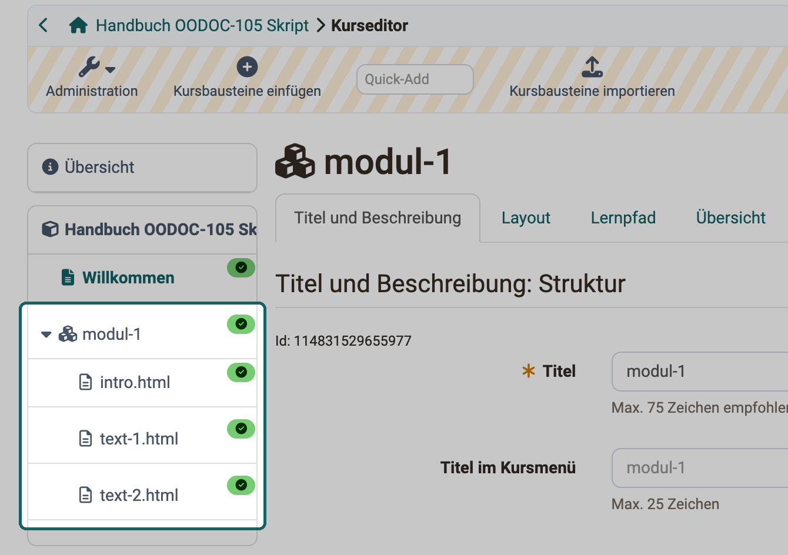{ class="shadow lightbox" title="Kursmenü im Kurseditor nach dem Assistenten Mehrere HTML-Seiten · 2026.11.10" }

Als "Titel" übernimmt der Assistent den Datei- oder Ordnernamen, bei Dateien mit Endung, zum Beispiel "kapitel1.html". Geben Sie den neuen Kursbausteinen danach im Tab "Titel und Beschreibung" verständliche Titel, damit Teilnehmende im Kursmenü erkennen, was sie erwartet.

In den angelegten HTML-Seiten ist unter "Sicherheitseinstellungen" die Option "Link in gesamten Ablageordner erlauben" eingeschaltet. So funktionieren Verweise zwischen den Seiten und auf Bilder, CSS-Dateien oder Skripte in anderen Ordnern des Ablageordners. Fügen Sie eine HTML-Seite einzeln ein, schalten Sie die Option bei Bedarf im [Tab "Seiteninhalt"](#tab_page_content) selbst ein.

## Unterschiede: Kursbaustein Seite - Kursbaustein HTML-Seite {: #page_differences}

|                        | KB Seite                       | KB HTML-Seite                  |
| -----------------------| ------------------------------ | ------------------------------ |
| Erstellung des Inhalts | im Content Editor              | im HTML-Editor                 |
| Gestaltung             | blockbasierter Ansatz          | HTML-Seite                     |
| Erstellungsaufwand     | geringer, da vorstrukturiert   | meistens höher                 |
| Vorschau               | direkt im Editor               | separater Tab "Anzeige Inhalt" |
| Medien                 | im Media Center                | im Ablageordner                |
| Editieren kann Betreuer:innen erlaubt werden  | :material-check: | :material-check:      |
| erweiterte Berechtigungen                     | :material-check: | :material-cancel:     |
| Integration pdf        | :material-check:               | :material-check:               |
| Integration Office-Dokumente | :material-check:         | :material-cancel:              |
| Integration draw.io Diagramme        | :material-check: | :material-cancel:     |

## Weiterführende Informationen {: #further_information}

**Auf dieser Seite erwähnt** 
[Ablageordner >](../learningresources/Storage_folder.de.md) 
[Inhaltsdomäne >](../basic_concepts/Content_Domain.de.md) 
[Mitgliederverwaltung >](../learningresources/Members_management.de.md) 
[Glossar - Verwendung >](../learningresources/Glossary_usage.de.md) 
[tiny.cloud](https://www.tiny.cloud) 
[Kursbaustein "Video" >](Course_Element_Video.de.md) 
[Videos im Kursbaustein "HTML-Seite" >](../basic_concepts/Video_in_HTML_Pages.de.md) 
[Video aufnehmen >](../basic_concepts/Video_Recording.de.md) 
[Audio aufnehmen >](../learningresources/Audio_Recording.de.md) 
[Toolbar >](Course_Settings_Toolbar.de.md) 
[Kursbaustein "Dokument" >](Course_Element_Document.de.md) 
[Kursbaustein "Ordner" >](Course_Element_Folder.de.md) 
[Kurseditorwerkzeuge >](Using_additional_Course_Editor_Tools.de.md)

**Weiterführend** 
[Kursbaustein "Checkliste" >](Course_Element_Checklist.de.md) 
[Kursbaustein "Seite" >](Course_Element_Page.de.md) 
[Kursbaustein "SCORM 1.2" >](Course_Element_SCORM_Learning_Content.de.md)

[Zum Seitenanfang ^](#html_page)

