# Course Element "HTML page" {: #html_page}

## Profile

Name | HTML page
---------|----------
Icon | :o_icon_o_sp_icon:
Available since | New edition with release 18
Functional group | Other
Purpose | Presentation of different content elements (text, images, videos) within an HTML page
Assessable | no
Specialty / Note | To integrate Office documents, please use the "Document" course element. frentix does not recommend its use.

With the course element "HTML page" you show texts, images and videos in the course in the way known from websites.

The course element displays an HTML file. You design it in the HTML editor, which you open in the tab "Page content". The HTML file and the files it uses are stored in the [storage folder](../learningresources/Storage_folder.md) of the course.

!!! warning "frentix recommends keeping domains separate"

    In the course element "HTML page" you store any HTML and JavaScript code,
    including content of a foreign domain. OpenOlat delivers this code under your
    own domain, unless a separate address for content is set up. This separate
    address is set up by whoever operates your OpenOlat installation. Based on
    modern security considerations, frentix recommends not
    to mix different domains and therefore advises against the use of this course
    element.

## Example {: #example}

=== "View in course"

    You design an HTML page primarily with images, texts, tables and videos. With HTML knowledge, you can also insert elements such as an accordion.

    The example shows three photos that stand side by side with the class "Left". How to create such a row of images is described in the section [Several images side by side](#images_side_by_side).

    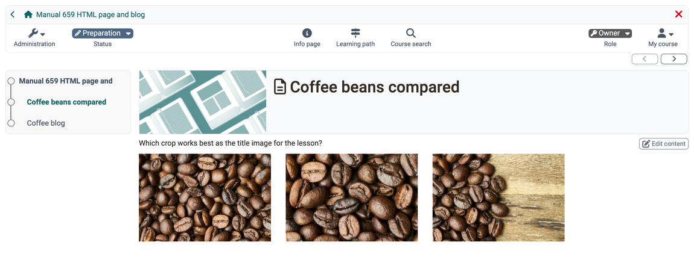{ class="shadow lightbox" title="Course element HTML page in the course view · 2026.10.08" }

=== "Editing in editor"

    You compile the content in a similar way to a word processing program. For this, you edit the HTML file directly in OpenOlat in the HTML editor TinyMCE.

    The course element "Page", on the other hand, uses the Content Editor, which compiles the content as blocks. OpenOlat displays such blocks better on mobile devices.

    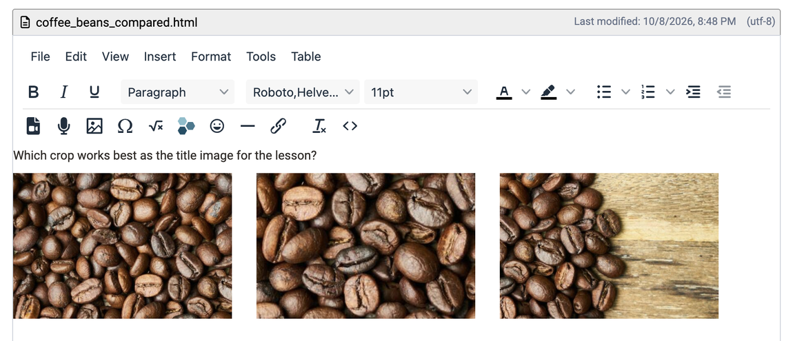{ class="shadow lightbox" title="HTML editor in the course element HTML page · 2026.10.08" }

=== "HTML source code"

    With HTML knowledge, you can also view and edit the generated HTML source code directly.

    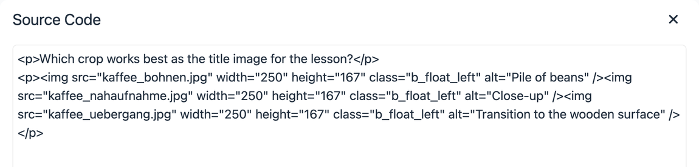{ class="shadow lightbox" title="Source Code dialog in the HTML editor · 2026.10.08" }

## Tab Page content {: #tab_page_content}

In the tab "Page content" you define which HTML file the course element shows. There are four ways to do this:

  * Use "Create" to create a new HTML page online in OpenOlat
  * Use "Select" to choose an HTML file from the storage folder
  * Use "Import" to upload an externally created HTML file or a ZIP file from your computer
  * Upload an externally created HTML file to the storage folder and choose it there with "Select"

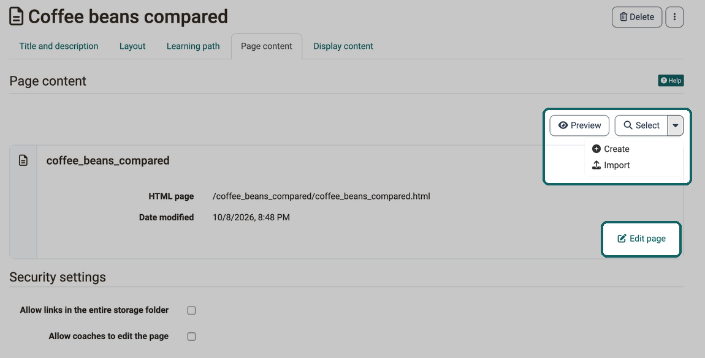{ class="shadow lightbox" title="Page content tab in the course editor · 2026.10.08" }

You edit the linked HTML file in the HTML editor of OpenOlat, which works similar to a word processing program. With "Edit page" you open the file in the editor. With "Preview", OpenOlat shows the linked page in a preview. A file that you create with "Create" already has the name of the course element.

Under "Security settings" you define with "Allow links in the entire storage folder" whether your HTML page may refer to all files in the storage folder. If the option is switched off, the page only refers to files in its own folder and its subfolders. Switch the option on if your HTML page uses graphics, CSS files or scripts from other folders. For a newly inserted course element it is switched off.

With "Allow coaches to edit the page" you define whether coaches are allowed to edit the stored HTML file. The coaches do not need course owner rights or access to the course editor. Regardless of this setting, course owners, administrators and learning resource managers can edit the page, as can persons with the [course right "Course editor"](../learningresources/Members_management.md#additional_rights). Whoever is allowed to edit the page sees the "Edit page" button above the page on the right in the course view.

### Replace the content {: #change_content}

If the content of an HTML page is out of date, replace the linked file instead of creating a new course element. The buttons in the [Page content tab](#tab_page_content) also work afterwards. With "Select" you link a different file from the storage folder. With "Import" you upload an HTML, ZIP or PDF file from your computer. With "Create" you create a new HTML page that takes the place of the previous one. If the course element already shows a file, you find "Create" and "Import" in the menu next to the "Select" button.

If you upload a ZIP file with "Import", OpenOlat unpacks it and then offers the HTML files it contains for selection. This way you replace an externally created page together with its images, CSS files and scripts in one step.

!!! info "Important"

    OpenOlat unpacks an imported ZIP file into a new folder that carries the name of the ZIP file and is created where the linked file is stored. If that folder already exists, OpenOlat appends a number to the name. The existing content remains and is not overwritten. Delete the old folders yourself in the [storage folder](../learningresources/Storage_folder.md) if required.

## Tab Display content {: #layout}

In the "Display content" tab you determine how OpenOlat displays the page in the course: unaltered or optimized for OpenOlat. With the display mode "Optimized for OpenOlat" you can, for example, apply the course layout to the page content or enable a [glossary](../learningresources/Glossary_usage.md#glossary_call_in_HTML) embedded in the course for the page.

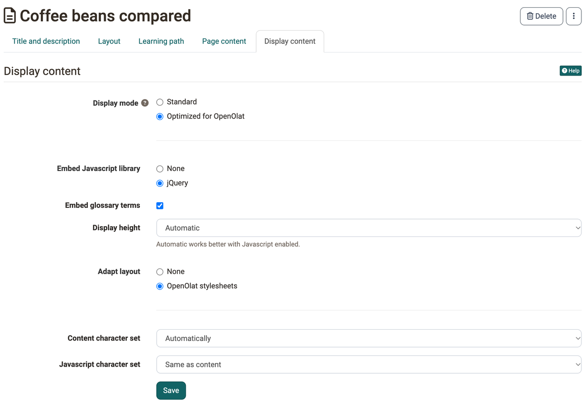{ class="shadow lightbox" title="Display content tab in the course editor · 2026.10.08" }

The following settings are available in the tab.

#### Display mode {: #display_mode}

Select the mode "Standard" to display the page unmodified. This mode is suitable for pages that are displayed incorrectly in the mode "Optimized for OpenOlat", above all for externally created HTML pages.

Select the mode "Optimized for OpenOlat" if you want to embed the course layout in the page, use a JavaScript library, apply the course glossary to this page or adjust the height of the page automatically.

For SCORM modules, the mode "Standard" is recommended.

#### Embed Javascript library {: #javascript_library}

The functions of the display mode "Optimized for OpenOlat" require the JavaScript library "jQuery". Select "None" if your content is displayed incorrectly with "jQuery".

#### Embed glossary terms {: #glossary_terms}

With this option, OpenOlat highlights the terms of the glossary on your HTML page, provided you have embedded a glossary in your course. The option requires the JavaScript library "jQuery".

#### Display height {: #display_height}

Here you define the height of the content display. With "Automatic", OpenOlat adapts the height to the content of the page. Alternatively, select a fixed value.

#### Adapt layout {: #adapt_layout}

With "OpenOlat stylesheets", your page takes over the layout of OpenOlat and of the course, such as font type, colors and font size. With "None", your page keeps its own layout.

#### Content character set {: #content_character_set}

With "Automatically", OpenOlat detects the character set of the page itself. If the page displays umlauts or special characters incorrectly, select a specific character set. If the page contains no information on the character set, OpenOlat uses ISO-8859-1.

#### Javascript character set {: #javascript_character_set}

Here you select the character set for the JavaScript code of the page. With "Same as content", OpenOlat uses the same character set as for the content.

!!! tip "Tip"

    As a rule, no changes are necessary in the "Display content" tab. The default settings are suitable for most pages.

## The HTML editor {: #html_editor}

The HTML editor TinyMCE is integrated at all points in OpenOlat where HTML pages are created and edited.

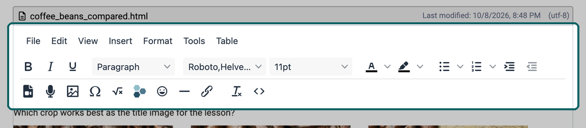{ class="shadow lightbox" title="HTML editor in the course element HTML page · 2026.10.08" }

This externally developed editor is also open source. Further information can be found on the website: [https://www.tiny.cloud](https://www.tiny.cloud)

!!! info "Important"

    OpenOlat opens the HTML editor with different default settings depending on the place. The buttons in the editor thus match the respective situation.

    **Example:** 
    In an HTML page of a course element, the editor offers to record a video. At other places where a video recording does not fit, the editor does not show this option.

!!! info "Important"

    For security reasons, the HTML editor does not provide all options of HTML. This applies above all to embedded JavaScript.

## Elements and design of an HTML page {: #html_elements}

The HTML editor offers the following elements to design your page.

### Formatting

These include, for example:

* Fonts: set individually or selected from predefined formats, such as h2
* Enumerations with dots or numbers, in HTML the elements ul and ol
* Indentations

### Video

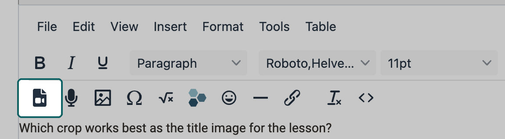{ class="shadow lightbox" title="Toolbar of the HTML editor · 2026.10.08" }

For the display, the editor uses the media player of OpenOlat. This has two advantages:

1. The player recognizes the format itself as long as the video and audio data are encoded correctly.
2. The player recognizes whether participants access the video with an HTML-capable and codec-compatible browser on a mobile device. In this case, it embeds the video with an HTML5 tag so that it also plays on an iPad or a similar device.

!!! info "Important"

    OpenOlat simply plays a video in an HTML page. Annotations, questions and the other functions of a video learning resource are offered by the course element ["Video"](Course_Element_Video.md).

You upload video files, which OpenOlat stores, or refer to external videos, for example on YouTube.

You can replace inserted video files later if required.

How to embed videos is described on the page [Videos in course element "HTML page"](../basic_concepts/Video_in_HTML_Pages.md).

!!! tip "Tip"

    You can also add a start image (preview) to your media file.

### Video recording

In the HTML editor you record a video directly and insert it into the page. How this works is described on the page ["Video Recording"](../basic_concepts/Video_Recording.md).

### Music (.mp3)

For audio-only files, the player offers the basic functions: start, stop and a progress indicator.

In the "Address" field, you enter a link to an MP3 file or upload a file to OpenOlat.

### Audio recording

In the HTML editor you can also record audio directly. How this works is described on the page ["Audio Recording"](../learningresources/Audio_Recording.md).

### Images

Images show what is hard to describe in words, for example a photo or a graphic. You select image files in the format JPG, GIF or PNG and also define size and alignment in the "Insert/Edit Image" dialog. Under "Alternative description" you enter a text for people who cannot see the image. The "Image title" appears when someone points at the image with the mouse. With "Show caption" the image gets a caption, which you enter in the editor below the image. In the "Advanced" tab you set the spacing and border of the image.

### Several images side by side {: #images_side_by_side}

If you want to show two or three images in a row, for example photos for comparison, assign the class "Left" to each image. The images then stand side by side without you needing a table. This works in the course element "HTML page" as well as in a blog entry. The [example](#example) above shows the result: three photos in the course view, in the editor and in the HTML source code.

1. Place the cursor where the row of images should begin.
2. Click the image icon in the toolbar or select the entry "Image..." in the "Insert" menu. The dialog "Insert/Edit Image" opens in the "General" tab.
3. Click the browse icon to the right of the "Source" field. The dialog "Select link" opens.
4. Select an image file under "Select an existing file" and click "Select". To add a new image, upload it from your computer with "Upload file" and "Upload".
5. Check that the entry "Left" is selected under "Class". It is preset for a new image.
6. Under "Width", enter a value in pixels small enough for all images to fit into the line together, for example 250 for three images. The height adjusts automatically.
7. Click "Save".
8. Place the cursor directly behind the inserted image and repeat steps 2 to 7 for each further image.

Instead of pixels, you can also enter a percentage under "Width", for example 30%. In this case, empty the "Height" field so that the image keeps its proportions.

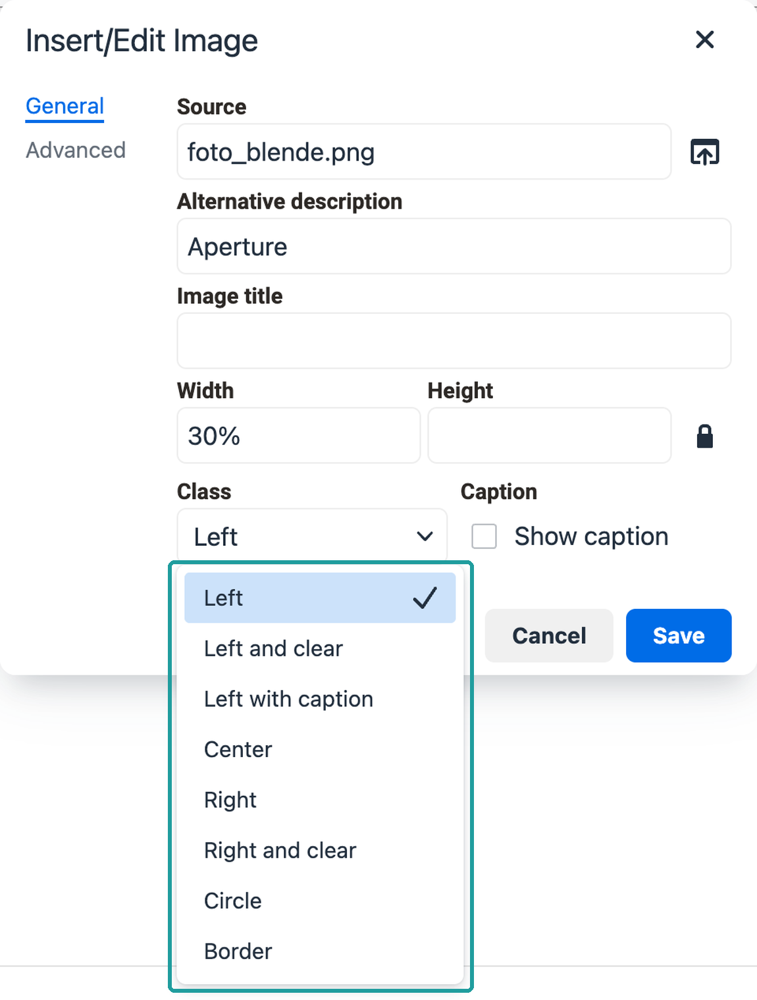{ class="shadow lightbox" title="General tab in the Insert/Edit Image dialog" }

If the line is not wide enough for all images, the next image moves to the following line. In this case, reduce the width of the images. The input field of the editor can be narrower than the page in the view, for example in the form of a blog entry. Therefore, check in the course view or in the published blog entry whether the images stand in one line.

Select exactly one class per image. The classes have the following effect:

* **Left:** The image stands on the left. Text and further images with the same class follow to the right of it.
* **Left with caption:** The image stands on the left, without spacing to the content next to it. With "Show caption" as well, several images with this class stand side by side in the course view, each with its caption below it.
* **Right:** The image stands on the right, the text flows to the left of it.
* **Center:** The image stands alone and centered in its line.
* **Left and clear**, **Right and clear:** The image stands alone in its line, on the left or on the right. The flow around the preceding images ends here.
* **Circle**, **Border:** These classes give the image a round shape or a border, but do not change its position.

The classes come from the OpenOlat stylesheets, which are included by default in the course element "HTML page". If you select the display mode "Standard" or the option "None" under "Adapt layout" in the ["Display content"](#layout) tab, OpenOlat does not include these stylesheets in the course view. The classes then only take effect in the HTML editor, not in the course view.

In the course element "HTML page" there is a second way via the "Table" menu: select the entry "Table" there and a row with three columns in the grid. Then insert an image into each cell. The editor in the blog does not offer the "Table" menu, so there the class is the only way.

### Mathematical formulas

OpenOlat displays mathematical formulas with MathJax.

### Emoticons

You insert emoticons in the way you know from social media.

### Hyper links

You set links to the Internet and links within OpenOlat, for example to certain course elements, also in other courses. 
The links can point to images, videos or the tools in the [Toolbar](Course_Settings_Toolbar.md#available_icons). 
Select whether the link appears in the course content or in a new window.

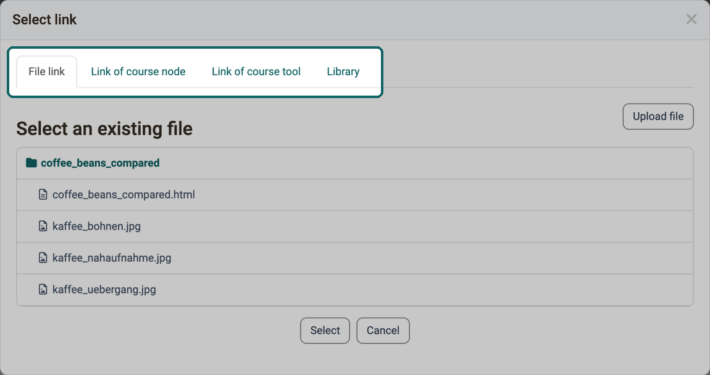{ class="shadow lightbox" title="Select link dialog in the HTML editor · 2026.10.08" }

### PDF files

!!! tip "Recommendation"

    In addition to HTML files, the course element "HTML page" also displays a PDF file. For PDF and Office documents, the course elements ["Document"](../learningresources/Course_Element_Document.md) or ["Folder"](../learningresources/Course_Element_Folder.md) are recommended. If you select a PDF file in the tab "Page content", OpenOlat also points to the course element "Document" there.

### Upload externally created HTML pages

!!! tip "Tip"

    You can also upload externally created files to the storage folder of the course or link a resource folder to the course and the storage folder. The "Select" button shows you all HTML and PDF files in the storage folder. You link these files with the course element "HTML page" and thus integrate them into your course. This method is recommended if you want to define the folder structure of the storage folder yourself. If there are many files, the wizard ["Multiple HTML pages"](#multi) creates all course elements in one step.

!!! warning "Attention"

    Continue to edit HTML pages that you have created with an external editor in the external editor. If you save such a page in the HTML editor of OpenOlat, parts of the formatting may be lost. The HTML editor of OpenOlat only edits the `<body>` area of an HTML page. You change entries in the `<head>` area in the external editor.

## Creating multiple HTML pages at once {: #multi}

If many HTML files are already stored in the storage folder, for example an externally created script with several chapters, the wizard "Multiple HTML pages" creates a separate course element "HTML page" for each file. This way you do not insert each page individually and link it to its file. On request, the wizard also takes over the folder structure of the storage folder as course elements "Structure".

The wizard can be used by anyone who may open the course editor: course owners, administrators, learning resource managers and persons with the [course right "Course editor"](../learningresources/Members_management.md#additional_rights). It is available in conventional courses and in learning path courses.

How to create multiple HTML pages:

1. Upload the files to the [storage folder](../learningresources/Storage_folder.md) of the course. The wizard also offers the files of a resource folder that you have linked to the course.
2. In the course editor, select the course element in the course menu after or below which the new pages should be placed.
3. In the toolbar of the course editor, click "Insert course elements" and, in the group "Other", "Multiple HTML pages". The entry is located directly after "HTML page". The dialog "Select the files." opens. 
`Course > Administration > Course editor > Insert course elements > Other > Multiple HTML pages`
4. Tick each file that should become a page of its own. The dialog shows all files and folders of the storage folder, including images, CSS files and scripts. Specifically select the HTML files that participants should see as a page of their own in the course menu. A tick on a folder also selects all files and subfolders in it. "Select all" and "Delete selection" set or remove all ticks at once.
5. Click "Add after current course element". The new course elements are then placed directly after the selected course element. With "Add as child of current course element" they are placed at the end below the selected course element. If the top entry in the course menu is selected, the dialog only offers "Add as child of current course element".

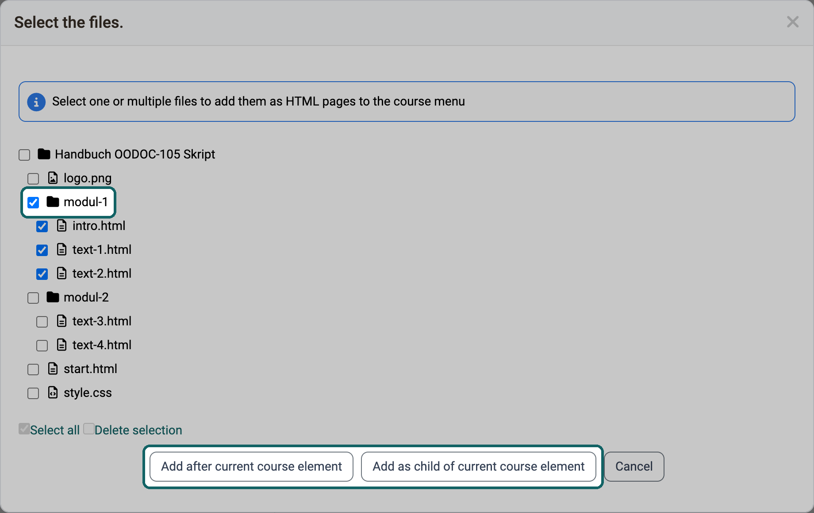{ class="shadow lightbox" title="Dialog Select the files. in the course editor · 2026.11.10" }

The dialog closes, and the course menu of the course editor shows the new course elements. Participants see them as soon as you [publish](Using_additional_Course_Editor_Tools.md#publish) the course.

You open the wizard via "Insert course elements". [Quick-Add](Using_additional_Course_Editor_Tools.md#quick_add) creates course elements individually, that is, one HTML page per entry.

### What the wizard creates {: #multi_result}

Each selected file becomes a course element "HTML page" that shows exactly this file. If the file is not an HTML file, a download link appears above the content: the page shows an image directly and a CSS file as text, but a Word document only as a link. Each selected folder becomes a course element "Structure", below which the course elements from this folder are placed. If a folder is not selected, the selected files from it are placed one level higher, directly below the next selected folder or at the selected place in the course menu. The top entry in the dialog stands for the storage folder itself and bears the course title. If you select it as well, for example with "Select all", a course element "Structure" with the course title as "Title" is created for it too, below which all others are placed.

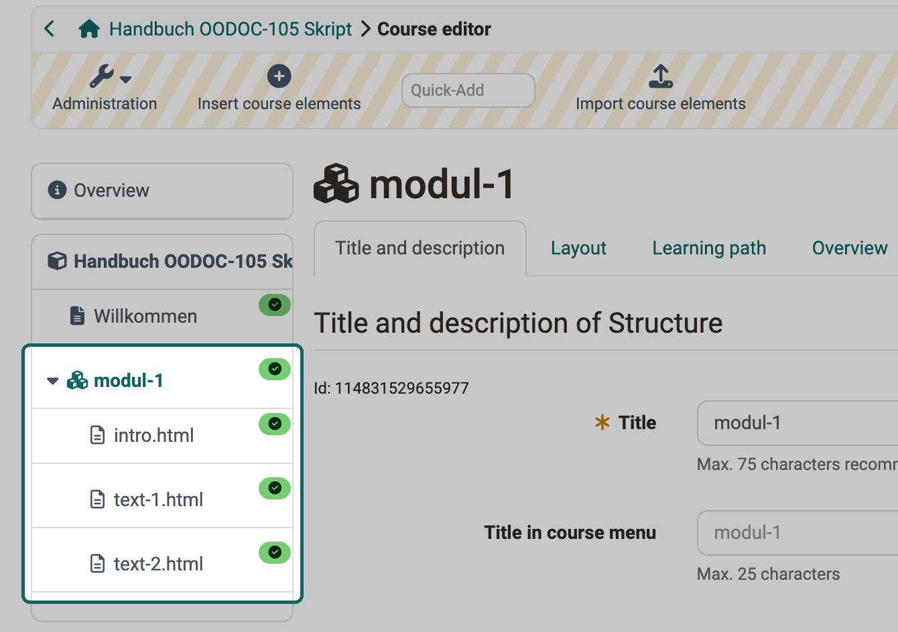{ class="shadow lightbox" title="Course menu in the course editor after the wizard Multiple HTML pages · 2026.11.10" }

As "Title", the wizard takes over the file or folder name, for files including the extension, for example "chapter1.html". Afterwards, give the new course elements understandable titles in the tab "Title and description" so that participants recognize in the course menu what to expect.

In the created HTML pages, the option "Allow links in the entire storage folder" is switched on under "Security settings". This way, links between the pages and to images, CSS files or scripts in other folders of the storage folder work. If you insert an HTML page individually, switch the option on yourself in the [tab "Page content"](#tab_page_content) if required.

## Differences: Course element page - Course element HTML page {: #page_differences}

|                        | CE page                       | CE HTML page                  |
| -----------------------| ------------------------------ | ------------------------------ |
| Creation of the content | in Content Editor              | in HTML editor                 |
| Design             | block-based approach          | HTML page                     |
| Production effort     | lower, as pre-structured   | mostly higher                 |
| Preview               | directly in editor               | separate tab "Display content" |
| Media                 | in the Media Center           | in the storage folder                |
| Editing can be allowed for coaches  | :material-check: | :material-check:      |
| Extended authorizations                    | :material-check: | :material-cancel:     |
| Integration pdf        | :material-check:               | :material-check:               |
| Integration office files | :material-check:         | :material-cancel:              |
| Integration draw.io diagrams        | :material-check: | :material-cancel:     |

## Further information {: #further_information}

**Mentioned on this page** 
[Storage folder >](../learningresources/Storage_folder.md) 
[Members management >](../learningresources/Members_management.md) 
[Glossary - Usage >](../learningresources/Glossary_usage.md) 
[tiny.cloud](https://www.tiny.cloud) 
[Course Element "Video" >](Course_Element_Video.md) 
[Videos in course element "HTML page" >](../basic_concepts/Video_in_HTML_Pages.md) 
[Video Recording >](../basic_concepts/Video_Recording.md) 
[Audio recording >](../learningresources/Audio_Recording.md) 
[Toolbar >](Course_Settings_Toolbar.md) 
[Course Element "Document" >](Course_Element_Document.md) 
[Course Element "Folder" >](Course_Element_Folder.md) 
[Course editor tools >](Using_additional_Course_Editor_Tools.md)

**Further reading** 
[Course Element "Checklist" >](Course_Element_Checklist.md) 
[Course Element "Page" >](Course_Element_Page.md) 
[Course Element "SCORM 1.2" >](Course_Element_SCORM_Learning_Content.md)

[To the top of the page ^](#html_page)

