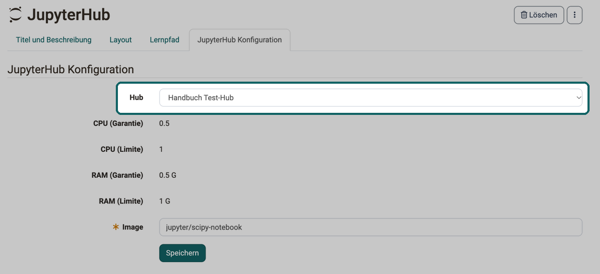

# Kursbaustein "JupyterHub" {: #jupyterhub}

## Steckbrief

Name | JupyterHub
---------|----------
Icon | { class=size24 }
Verfügbar seit | Release 18
Funktionsgruppe | Wissensvermittlung
Verwendungszweck | Bereitstellung von Jupyter-Images
Bewertbar | nein
Spezialität / Hinweis | Beta-Version

Mit dem Kursbaustein starten Teilnehmende direkt aus dem Kurs eine Jupyter-Umgebung, etwa um Notebooks zu bearbeiten. Kursbesitzer:innen legen fest, welches Jupyter-Image dabei startet, und müssen die Umgebung nicht selbst an die Teilnehmenden verteilen.

Voraussetzung ist, dass die Administration den Kursbaustein eingeschaltet und mindestens einen Hub eingerichtet hat, siehe [Externe Werkzeuge: JupyterHub](../../manual_admin/administration/External_Tools_-_Administration.de.md#jupyter). Weitere Informationen zu JupyterHub finden Sie auf [Jupyter.org](https://jupyter.org/hub).

## Kursbaustein konfigurieren [:octicons-tag-16:{ title="ab Release 18.0.0 (OO-6901)" }](https://track.frentix.com/issue/OO-6901){:target="_blank"}

Welche Jupyter-Umgebung die Teilnehmenden starten, legen Sie im Kurseditor im Tab "JupyterHub Konfiguration" fest. Im Feld "Hub" wählen Sie einen der Hubs, die die Administration eingerichtet hat. Zur Auswahl stehen nur aktive Hubs [:octicons-tag-16:{ title="ab Release 21.0 (OO-9565)" }](https://track.frentix.com/issue/OO-9565){:target="_blank"}. Ist der bei einem bestehenden Kursbaustein hinterlegte Hub inzwischen inaktiv, bleibt er ausgewählt, und das Feld zeigt die Warnung "Dieser JupyterHub wurde inaktiviert und wird nicht mehr funktionieren." Teilnehmende sehen statt der Jupyter-Umgebung die Meldung "Jupyter Hub inaktiv".

{ class="shadow lightbox" title="Tab JupyterHub Konfiguration im Kurseditor · 2026.10.20" }

Unter dem Hub zeigt der Tab die Werte "CPU (Garantie)", "CPU (Limite)", "RAM (Garantie)" und "RAM (Limite)", sofern die Administration sie für den Hub festgelegt hat. Sie gelten für jede gestartete Umgebung und lassen sich hier nicht ändern.

Im Pflichtfeld "Image" tragen Sie den Namen des Jupyter-Images ein, das der Hub startet, zum Beispiel `jupyter/scipy-notebook`. Wählen Sie einen anderen Hub, leert OpenOlat das Feld "Image".

Je nach Einrichtung des Hubs zeigt der Tab zusätzlich einen "Info-Text", die Schaltfläche "Image prüfen", die prüft, ob das eingetragene Image verfügbar ist, und eine Option, mit der Sie die Seite zur Zustimmung "Datenübertragung" für die Teilnehmenden unterdrücken.

## Weiterführende Informationen {: #further_information}

[Externe Werkzeuge: Übersicht >](../../manual_admin/administration/External_Tools_-_Administration.de.md) 
[Jupyter.org >](https://jupyter.org/hub) 
[Kursbausteine >](../learningresources/Course_Elements.de.md) 
[Kursbaustein "LTI-Seite" >](../learningresources/Course_Element_LTI_Page.de.md)

[Zum Seitenanfang ^](#jupyterhub)
