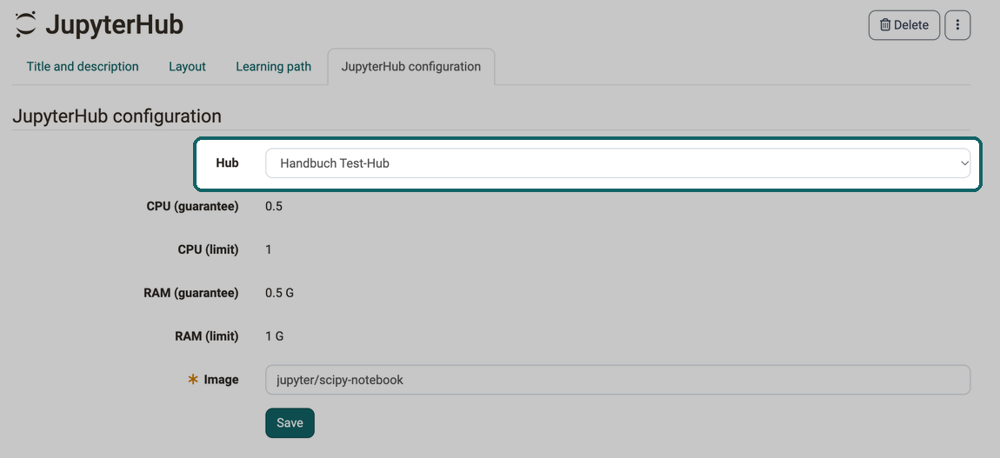

# Course Element "JupyterHub" {: #jupyterhub}

## Profile

Name | JupyterHub
---------|----------
Icon | { class=size24 }
Available since | Release 18
Functional group | Knowledge transfer
Purpose | Provision of Jupyter images
Assessable | no
Specialty / Note | Beta version

With this course element, participants start a Jupyter environment directly from the course, for example to work on notebooks. Course owners define which Jupyter image starts and do not have to distribute the environment to the participants themselves.

The prerequisite is that the administration has switched on the course element and set up at least one hub, see [External tools: JupyterHub](../../manual_admin/administration/External_Tools_-_Administration.md#jupyter). For more information on JupyterHub see [jupyter.org](https://jupyter.org/hub).

## Configuring the course element [:octicons-tag-16:{ title="from Release 18.0.0 (OO-6901)" }](https://track.frentix.com/issue/OO-6901){:target="_blank"}

You define which Jupyter environment the participants start in the course editor in the "JupyterHub configuration" tab. In the "Hub" field you choose one of the hubs that the administration has set up. Only active hubs are available for selection [:octicons-tag-16:{ title="from Release 21.0 (OO-9565)" }](https://track.frentix.com/issue/OO-9565){:target="_blank"}. If the hub configured for an existing course element has since become inactive, it remains selected, and the field shows the warning "This JupyterHub has been inactivated and will no longer work." Instead of the Jupyter environment, participants see the message "Jupyter hub inactive".

{ class="shadow lightbox" title="JupyterHub configuration tab in the course editor · 2026.10.20" }

Below the hub, the tab shows the values "CPU (guarantee)", "CPU (limit)", "RAM (guarantee)" and "RAM (limit)", if the administration has defined them for the hub. They apply to each started environment and cannot be changed here.

In the mandatory field "Image" you enter the name of the Jupyter image that the hub starts, for example `jupyter/scipy-notebook`. If you choose a different hub, OpenOlat clears the "Image" field.

Depending on how the hub is set up, the tab also shows an "Info text", the button "Check image", which checks whether the entered image is available, and an option with which you suppress the "data transmission" agreement page for the participants.

## Further information {: #further_information}

[External Tools: Overview >](../../manual_admin/administration/External_Tools_-_Administration.md) 
[Jupyter.org >](https://jupyter.org/hub) 
[Types of Course Elements >](../learningresources/Course_Elements.md) 
[Course Element "LTI Page" >](../learningresources/Course_Element_LTI_Page.md)

[To the top of the page ^](#jupyterhub)
