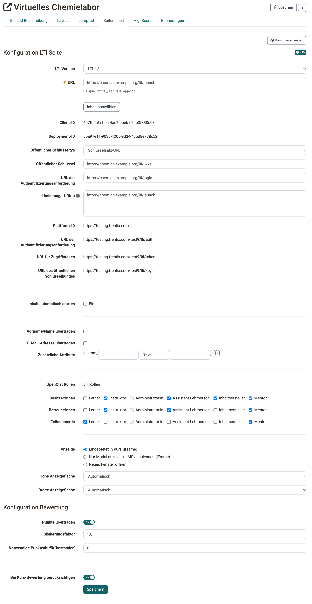

# Kursbaustein "LTI-Seite" {: #lti}

## Steckbrief

Name | LTI-Seite
---------|----------
Icon | :o_icon_o_lti_icon:
Verfügbar seit | Release 7.1 oder früher
Funktionsgruppe | Andere
Verwendungszweck | Integration externer Lernapplikationen
Bewertbar | ja
Spezialität / Hinweis |

Mit dem Kursbaustein "LTI-Seite" binden Sie eine externe Lernapplikation (in LTI und in OpenOlat "Tool") in Ihren Kurs ein, zum Beispiel einen Chat, ein Wiki, einen Testeditor oder ein virtuelles Labor. Die Teilnehmenden starten sie direkt im Kurs, und die Lernapplikation kann Punkte an OpenOlat zurückgeben. LTI steht für "Learning Tools Interoperability" und ist ein IMS Standard zur Einbindung von externen Lernapplikationen. Weitere Informationen zu LTI finden Sie auf der LTI Projekthomepage: [http://www.imsglobal.org/lti/](http://www.imsglobal.org/lti/)

## Prozess

So läuft der Start einer LTI-Seite ab:

* Im Kurseditor wählen Sie im Tab "Seiteninhalt" die "LTI Version" und geben die Adresse der Lernapplikation und die Angaben zur Verbindung ein: bei "LTI 1.0 / 1.1" den Schlüssel und das Passwort des Anbieters, bei "LTI 1.3" die Angaben, die OpenOlat und die Lernapplikation miteinander austauschen.
* Wählt eine teilnehmende Person die LTI-Seite in der Kursnavigation, fragt OpenOlat zuerst nach ihrer Zustimmung, wenn der Kursbaustein persönliche Daten überträgt: Vor- und Nachname, E-Mail-Adresse oder Benutzerattribute. Erst danach übermittelt OpenOlat die Daten und die Kursinformationen geschützt an die Lernapplikation. Diese Frage lässt sich abschalten, siehe [Zustimmung "Datenübertragung" unterdrücken](#suppress_consent).
* OpenOlat fragt später nur dann erneut nach der Zustimmung, wenn sich die übermittelten Daten ändern.
* Danach zeigt OpenOlat die Startseite des Kursbausteins mit dem Button "LTI-Lerninhalt anzeigen". Nach dem Klick prüft die Lernapplikation die Anfrage und erscheint im Kurs. Mit der Option "Inhalt automatisch starten" entfällt dieser Zwischenschritt.

## LTI im Kursbaustein konfigurieren {: #configure}

!!! tip "Tipp"

    Für "LTI 1.3" muss das Modul "LTI 1.3" in der System-Administration eingeschaltet sein. Vorkonfigurierte Tools richten Systemadministrator:innen ebenfalls dort ein. "LTI 1.0 / 1.1" steht immer zur Wahl.

Im Kurseditor legen Sie im Tab "Seiteninhalt" fest, welche Lernapplikation der Kursbaustein startet, welche Daten OpenOlat dabei übermittelt und ob die Lernapplikation Punkte an OpenOlat zurückgibt. Der Tab hat zwei Bereiche: "Konfiguration LTI Seite" und "Konfiguration Bewertung". Welche Felder erscheinen, hängt von der gewählten "LTI Version" ab.

{ class="shadow lightbox" title="Tab Seiteninhalt im Kurseditor · 2026.11.04" }

### Konfiguration LTI Seite {: #lti_configuration}

#### LTI Version {: #lti_version}

Hier wählen Sie, wie OpenOlat die externe Lernapplikation anbindet. Zur Wahl stehen "LTI 1.0 / 1.1", "LTI 1.3" und die Tools, die Systemadministrator:innen in der System-Administration für alle Kurse vorkonfiguriert haben. Wir empfehlen "LTI 1.3", die ältere Version bleibt aus Kompatibilitätsgründen wählbar. "LTI 1.3" und die vorkonfigurierten Tools stehen zur Wahl, sobald das Modul "LTI 1.3" eingeschaltet ist: [LTI aktivieren](../../manual_admin/administration/LTI_Integrations/index.de.md#activate_lti)

Wählen Sie ein vorkonfiguriertes Tool, übernimmt OpenOlat die Angaben zur Verbindung aus dessen Konfiguration und trägt die URL des Tools im Feld "URL" vor. Von den Angaben zur Verbindung zeigt der Tab dann nur die "Deployment-ID".

Bei "LTI 1.3" zeigt der Tab statt "Schlüssel" und "Passwort" die Angaben, die OpenOlat und die Lernapplikation für eine sichere Verbindung austauschen. Einige tragen Sie vom Anbieter der Lernapplikation ein, die übrigen zeigt OpenOlat zum Weitergeben an den Anbieter:

| Feld | Bedeutung |
|---|---|
| Client-ID, Deployment-ID | Mit diesen beiden Kennungen erkennt die Lernapplikation, dass ein Aufruf von dieser LTI-Seite in OpenOlat kommt. OpenOlat erzeugt beide beim ersten Speichern. Sie geben sie an den Anbieter der Lernapplikation weiter. |
| Öffentlicher Schlüsseltyp | "RSA-Schlüssel" oder "Schlüsselsatz-URL". Im Feld darunter tragen Sie den öffentlichen Schlüssel der Lernapplikation ein oder die Adresse, unter der die Lernapplikation ihre Schlüssel bereitstellt. Sie erhalten beides vom Anbieter. |
| URL der Authentifizierungsanforderung, erstes Feld | Die Adresse der Lernapplikation, über die OpenOlat die Anmeldung startet. Sie erhalten sie vom Anbieter. |
| Umleitungs-URI(s) | Die Adressen, die die Lernapplikation für die Anmeldung verwendet, eine pro Zeile. Mindestens eine muss eingetragen sein. Sie erhalten sie vom Anbieter. |
| Plattform-ID, URL der Authentifizierungsanforderung (zweites Feld), URL für Zugriffstoken, URL des öffentlichen Schlüsselbundes | Die Angaben von OpenOlat, nur lesbar. Sie geben sie an den Anbieter der Lernapplikation weiter. |

Welche LTI-Dienste OpenOlat als Plattform unterstützt, zeigt die Übersicht [Unterstützte LTI-Dienste](../../manual_admin/administration/LTI_Integrations/index.de.md#supported_services).

#### URL {: #url}

In diesem Pflichtfeld geben Sie die Adresse der externen Lernapplikation ein, zum Beispiel "https://saltire.lti.app/tool". Bei einem vorkonfigurierten Tool ist die URL des Tools vorgetragen. Sie können sie anpassen, etwa auf eine Unterseite des Tools, die Domain muss aber dieselbe bleiben.

#### Schlüssel und Passwort {: #key_password}

Die beiden Felder erscheinen nur bei "LTI 1.0 / 1.1". Im Feld "Schlüssel" tragen Sie den Schlüssel ein, den Sie vom Anbieter der externen Lernapplikation erhalten haben, im Feld "Passwort" das zugehörige Passwort.

#### Inhalt auswählen {: #select_content}

Mit dem Button "Inhalt auswählen" wählen Sie einen bestimmten Inhalt des Tools aus, statt nur dessen Startadresse einzutragen (Deep Linking). Bei "LTI 1.3" erscheint der Button immer. Bei einem vorkonfigurierten Tool erscheint er nur, wenn Systemadministrator:innen beim Tool "Deep-Linking aktivieren" eingeschaltet haben, in der System-Administration im Tab "Externe Tools". Nutzbar ist der Button, sobald Sie die Konfiguration gespeichert haben. Die gewählten Inhalte listet der Tab danach im Feld "Ressourcen" über dem Button: [LTI - Deep Linking](../../manual_admin/administration/LTI_Deeplinking.de.md) [:octicons-tag-16:{ title="ab Release 18.1 (OO-7173)" }](https://track.frentix.com/issue/OO-7173)

#### Inhalt automatisch starten {: #skip_launch_page}

Ist diese Option eingeschaltet, startet die Lernapplikation direkt, ohne die Startseite des Kursbausteins mit dem Button "LTI-Lerninhalt anzeigen". Ist die Option ausgegraut, schreibt die Serverkonfiguration Ihrer OpenOlat-Instanz diese Startseite für alle Kurse vor. OpenOlat zeigt sie dann immer.

!!! info "Kontakt"

    Ob die Startseite des Kursbausteins für alle Kurse vorgeschrieben ist, legt die Serverkonfiguration fest. Für eine Änderung wenden Sie sich an Ihre Organisation.

#### Zustimmung "Datenübertragung" unterdrücken {: #suppress_consent}

Die Option erscheint, sobald "Vorname/Name übertragen" oder "E-Mail-Adresse übertragen" angekreuzt ist. Ist sie eingeschaltet, startet die Lernapplikation ohne die Frage nach der Zustimmung. Die Teilnehmenden können die Übermittlung ihrer Daten dann weder annehmen noch ablehnen, deshalb fragt OpenOlat beim Einschalten nach einer Bestätigung. Schreibt die Serverkonfiguration die Startseite des Kursbausteins vor, ist auch diese Option ausgegraut, und OpenOlat fragt immer nach der Zustimmung. Überträgt der Kursbaustein nur Benutzerattribute aus "Zusätzliche Attribute", erscheint die Option nicht, und OpenOlat fragt ebenfalls immer nach der Zustimmung.

#### Vorname/Name übertragen {: #transmit_name}

Ist diese Checkbox angekreuzt, übermittelt OpenOlat beim Start den Vor- und Nachnamen der teilnehmenden Person an die Lernapplikation. Ohne Häkchen übermittelt OpenOlat beim Start keinen Namen.

#### E-Mail-Adresse übertragen {: #transmit_email}

Ist diese Checkbox angekreuzt, übermittelt OpenOlat beim Start die E-Mail-Adresse der teilnehmenden Person an die Lernapplikation.

#### Zusätzliche Attribute {: #additional_attributes}

Hier geben Sie weitere Parameter ein, die OpenOlat an die Lernapplikation übermittelt, zum Beispiel die Angabe, dass die Anfrage von OpenOlat kommt. Je Parameter wählen Sie "Text" für einen festen Wert, der für alle Teilnehmenden gleich ist, oder "Benutzer:in" für ein Benutzerattribut, dessen Wert je Person verschieden ist. Mit "+" und "-" fügen Sie Parameter hinzu oder entfernen sie. Der LTI-Standard definiert diese Parameter nicht. Klären Sie deshalb mit dem Anbieter, welche Parameter die Lernapplikation verarbeitet.

#### OpenOlat Rollen {: #openolat_roles}

In diesem Bereich legen Sie fest, welche LTI-Rolle eine Person erhält, wenn sie die Lernapplikation startet. Für jede der drei OpenOlat-Rollen "Besitzer:innen", "Betreuer:innen" und "Teilnehmer:in" wählen Sie die passenden LTI-Rollen: "Lerner", "Instruktor", "Administrator:in", "Assistent Lehrperson", "Inhaltsersteller" und "Mentor".

Welche dieser LTI-Rollen Sie als Kursbesitzer:in zuweisen dürfen, legen Systemadministrator:innen in der System-Administration fest: `Administration > Externe Werkzeuge > LTI`, Tab "Rollen-Mapping", siehe [LTI - Rollen-Mapping](../../manual_admin/administration/LTI_Role_Mapping.de.md#administration). Nicht freigegebene LTI-Rollen sind ausgegraut. Administrator:innen und Lernressourcenverwalter:innen der Organisation, der der Kurs zugeordnet ist, können immer alle LTI-Rollen zuweisen [:octicons-tag-16:{ title="ab Release 20.2 (OO-9003)" }](https://track.frentix.com/issue/OO-9003){:target="_blank"}.

#### Anzeige {: #display}

Wählen Sie die Option "Eingebettet in Kurs (iFrame)", um die Lernapplikation eingebettet im Kurslayout anzuzeigen. Mit der Option "Nur Modul anzeigen, LMS ausblenden (iFrame)" blendet OpenOlat sich vollständig aus, solange die Lernapplikation geöffnet ist. Mit der Option "Neues Fenster öffnen" öffnet sich die Lernapplikation in einem neuen Fenster. Das ist sinnvoll, wenn sie viel Platz braucht oder parallel mit anderen Kursbausteinen verwendet werden soll.

#### Höhe Anzeigefläche {: #display_height}

Wählen Sie "Automatisch" oder eine explizite Grösse aus, wenn die automatische Funktion ungenügend ist. Bei "LTI 1.3" mit der Option "Neues Fenster öffnen" erscheint das Feld nicht.

#### Breite Anzeigefläche {: #display_width}

Wählen Sie "Automatisch" oder eine explizite Grösse aus, wenn die automatische Funktion ungenügend ist. Bei "LTI 1.3" mit der Option "Neues Fenster öffnen" erscheint das Feld nicht.

#### Alle beim Start gesendeten Informationen anzeigen (Debug) {: #debug}

Die Checkbox erscheint nur bei "LTI 1.0 / 1.1". Ist sie angekreuzt, sehen die Teilnehmenden die gesendeten Informationen. Diese Informationen beinhalten Parameter wie die Benutzeridentifikation, den Kursnamen und den Kursbaustein. Wenn Sie in der Kursansicht auf die Schaltfläche "Launch Endpoint with BasicLTI Data" oberhalb der gesendeten Daten klicken, gelangen Sie zur Startseite der Lernapplikation.

### Konfiguration Bewertung {: #grading_configuration}

In diesem Bereich legen Sie fest, ob die Lernapplikation Punkte an OpenOlat sendet und wie OpenOlat sie umrechnet.

#### Punkte übertragen {: #transfer_score}

Mit diesem Schalter wird die LTI-Seite zum bewertbaren Kursbaustein: Die externe Lernapplikation sendet Punkte an OpenOlat. Die Punkte erscheinen im Bewertungswerkzeug, bei der teilnehmenden Person auf der Startseite des Kursbausteins und im Leistungsnachweis. Ist der Schalter ausgeschaltet, ist die LTI-Seite nicht bewertbar, und OpenOlat zeigt keine Punkte an. Wie die Lernapplikation die Punkte sendet, hängt von der "LTI Version" ab:

* **LTI 1.3:** über den Bewertungsdienst (Assignment and Grade Services). OpenOlat bietet ihn der Lernapplikation nur an, wenn "Punkte übertragen" eingeschaltet ist. Die Lernapplikation kann darüber auch lesen, welche Punkte OpenOlat für den Kursbaustein schon gespeichert hat.
* **LTI 1.0 / 1.1:** über Basic Outcomes, nach dem LTI-Standard als Wert von 0 bis 1.

Bei allen LTI-Versionen übernimmt OpenOlat Punkte nur für Teilnehmer:innen des Kurses. Besitzer:innen und Betreuer:innen, die im Kurs nicht zugleich Teilnehmer:innen sind, erhalten keine Punkte.

#### Skalierungsfaktor {: #scaling_factor}

Der Skalierungsfaktor rechnet den Wert, den die Lernapplikation sendet, in die Punkte des Kurses um. OpenOlat multipliziert den gesendeten Wert mit dem Faktor. Der Standard ist "1".

* **LTI 1.0 / 1.1:** Die Lernapplikation sendet einen Wert von 0 bis 1. Möchten Sie in OpenOlat maximal 10 Punkte vergeben, tragen Sie als Skalierungsfaktor "10" ein. Der Skalierungsfaktor ist damit zugleich die höchste Punktzahl des Kursbausteins.
* **LTI 1.3:** OpenOlat übernimmt den Punktwert, den die Lernapplikation sendet, und multipliziert ihn mit dem Faktor. Die maximale Punktzahl, die die Lernapplikation mitsendet, verwendet OpenOlat dabei nicht, und der Kursbaustein hat keine höchste Punktzahl. Das gilt auch für vorkonfigurierte Tools. Sendet die Lernapplikation 7 von 10 Punkten, ergibt der Faktor "1" in OpenOlat 7 Punkte.

#### Notwendige Punktzahl für 'bestanden' {: #score_needed_to_pass}

Geben Sie hier den optionalen Schwellenwert an, ab dem der Kursbaustein als bestanden gilt. Der Schwellenwert bezieht sich auf die skalierten Punkte, nicht auf den Wert, den die Lernapplikation sendet. Im Beispiel mit dem Skalierungsfaktor "10" entspricht ein Schwellenwert von "5" der Hälfte der Punkte.

#### Bei Kurs-Bewertung berücksichtigen {: #include_in_course_assessment}

In Lernpfadkursen erscheint der Schalter, sobald "Punkte übertragen" eingeschaltet ist. Ist er eingeschaltet, fliessen die Punkte und der Status dieses Kursbausteins in die Gesamtbewertung des Kurses ein. Schalten Sie ihn aus, damit der Kursbaustein nicht in die Gesamtbewertung einfliesst. In herkömmlichen Kursen legen Sie im [Kursbaustein "Struktur"](Course_Element_Structure.de.md) fest, welche Kursbausteine in die Gesamtbewertung zählen.

#### Skalierungsfaktor für Kurs-Bewertung {: #score_scaling}

Das Feld erscheint, wenn die Kurs-Bewertung die Punkte mit Gewichtung zusammenzählt und "Punkte übertragen" sowie "Bei Kurs-Bewertung berücksichtigen" eingeschaltet sind. OpenOlat multipliziert die Punkte der LTI-Seite für die Kurs-Bewertung mit diesem Faktor. Mehr dazu unter [Kursbewertung mit Punkten: Summe mit Gewichtung](Course_Settings_Assessment/index.de.md#evaluation_with_points_weighting).

## Tab Badges [:octicons-tag-16:{ title="ab Release 18.0 (OO-7003)" }](https://track.frentix.com/issue/OO-7003)

Haben Kursbesitzer:innen unter `Kurs > Administration > Einstellungen > Tab "Bewertung" > Abschnitt "Badges"` die Vergabe von Badges aktiviert, zeigt der Kurseditor zu diesem Kursbaustein den Tab "Badges". Dort erstellen Sie einen Badge eigens für diesen Kursbaustein.

## Weiterführende Informationen {: #further_information}

**Auf dieser Seite erwähnt** 
[LTI Projekthomepage (IMS Global Learning Consortium) >](http://www.imsglobal.org/lti/) 
[LTI 1.3 Integrationen >](../../manual_admin/administration/LTI_Integrations/index.de.md) 
[LTI - Deep Linking >](../../manual_admin/administration/LTI_Deeplinking.de.md) 
[LTI - Rollen-Mapping >](../../manual_admin/administration/LTI_Role_Mapping.de.md) 
[Kursbaustein "Struktur" >](Course_Element_Structure.de.md) 
[Kurseinstellungen - Tab Bewertung >](Course_Settings_Assessment/index.de.md)

**Weiterführend** 
[LTI-Zugang zu einer Gruppe konfigurieren >](../groups/LTI_Share_groups.de.md) 
[LTI-Zugang zu einem Kurs konfigurieren >](LTI_Share_courses.de.md) 
[LTI - Externe Werkzeuge >](../../manual_admin/administration/LTI_External_tools.de.md) 
[LTI - Externe Plattformen >](../../manual_admin/administration/LTI_External_platforms.de.md) 
[Bewertungswerkzeug - Übersicht >](Assessment_tool_overview/index.de.md)

[Zum Seitenanfang ^](#lti)
