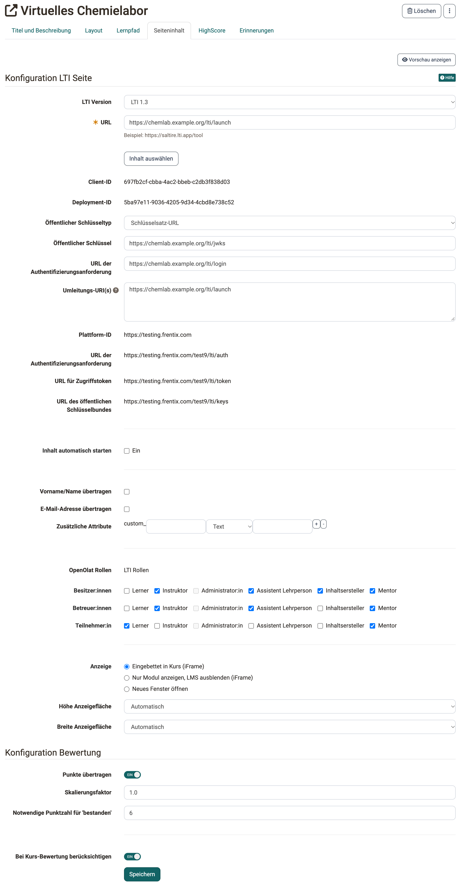

# Kursbaustein "LTI-Seite" {: #lti}

## Steckbrief

Name | LTI-Seite
---------|----------
Icon | :o_icon_o_lti_icon:
Verfügbar seit | Release 15.5 (Beta)
Funktionsgruppe | Andere
Verwendungszweck | Integration externer Lernapplikationen
Bewertbar | ja
Spezialität / Hinweis |

Mit Hilfe des Kursbausteins "LTI-Seite" können Sie externe Lernapplikationen in Ihren Kurs integrieren und den Inhalt im OpenOlat-Fenster anzeigen lassen. LTI steht für "Learning Tools Interoperability" und ist ein IMS Standard zur Einbindung von externen Lernapplikationen wie zum Beispiel einem Chat, einem Mediawiki, einem Testeditor oder einem virtuellen Labor. Weitere Informationen zu LTI finden Sie auf der LTI Projekthomepage: [http://www.imsglobal.org/lti/](http://www.imsglobal.org/lti/)

## Prozess

* Geben Sie im Tab "Seiteninhalt" die zu referenzierende URL sowie den Schlüssel und das zugehörige Passwort an.
* Wenn eine teilnehmende Person in der Kursnavigation die LTI-Seite auswählt, muss sie aus Datenschutzgründen zuerst der Datenübertragung zustimmen, bevor im Hintergrund die Benutzerdaten und Kursinformationen sowie der Schlüssel geschützt an die eingebundene Lernapplikation übermittelt werden.
* Die Lernapplikation überprüft die Zugangsrechte und erlaubt bei gültigem Schlüssel den Zugriff.
* OpenOlat fragt später nur dann erneut nach der Zustimmung, wenn sich die Konfiguration des Bausteins in Bezug auf die übermittelten Daten ändert.
* Wenn die teilnehmende Person die LTI-Seite in der Navigation auswählt, erscheint die eingebundene Lernapplikation im OpenOlat-Kurs.

## LTI im Kursbaustein konfigurieren

!!! tip "Tipp"

    Voraussetzung ist die von einem/einer Administrator:in vorgenommene Aktivierung und generelle Einrichtung von LTI.

Die folgenden Parameter können im Kursbaustein konfiguriert werden:

{ class="shadow lightbox" title="Tab Seiteninhalt im Kurseditor · 2026.11.04" }

**LTI Version:** Hier wählen Sie, wie OpenOlat die externe Lernapplikation anbindet. Zur Wahl stehen "LTI 1.0 / 1.1", "LTI 1.3" und die Tools, die Administrator:innen für alle Kurse vorkonfiguriert haben. Wir empfehlen "LTI 1.3", die ältere Version bleibt aus Kompatibilitätsgründen wählbar. "LTI 1.3" und die vorkonfigurierten Tools stehen zur Wahl, sobald das Modul "LTI 1.3" eingeschaltet ist: [LTI aktivieren](../../manual_admin/administration/LTI_Integrations.de.md#activate_lti)

Wählen Sie ein vorkonfiguriertes Tool, übernimmt OpenOlat die URL und die Angaben zur Verbindung aus dessen Konfiguration.

Mit dem Button "Inhalt auswählen" wählen Sie einen bestimmten Inhalt des Tools aus, statt nur dessen Startadresse einzutragen (Deep Linking). Der Button erscheint bei "LTI 1.3" und bei einem vorkonfigurierten Tool, bei dem "Deep-Linking aktivieren" eingeschaltet ist. Nutzbar ist er, sobald Sie die Konfiguration gespeichert haben. Die gewählten Inhalte erscheinen danach im Feld "Ressourcen": [LTI - Deep Linking](../../manual_admin/administration/LTI_Deeplinking.de.md) [:octicons-tag-16:{ title="ab Release 18.1 (OO-7173)" }](https://track.frentix.com/issue/OO-7173)

Welche LTI-Dienste OpenOlat als Plattform unterstützt, zeigt die Übersicht [Unterstützte LTI-Dienste](../../manual_admin/administration/LTI_Integrations.de.md#supported_services).

**URL:** In diesem Eingabefeld geben Sie die Adresse der externen Lernapplikation ein.  Das Format ist zum Beispiel "https://tools.< Firma xyz >.de/lti_quiz/lti_quizwand.php".

**Schlüssel:** Hier geben Sie den Schlüssel ein, den Sie vom Anbieter der externen Lernapplikation erhalten haben ("lti_quiz" im obigen Beispiel).

**Passwort:** Hier geben Sie das zum Schlüssel passende Passwort ein, das Sie ebenfalls vom Anbieter der externen Lernapplikation erhalten haben ("weeHoo1w" im obigen Beispiel).

**Inhalt automatisch starten:** Ist diese Option aktiviert, wird die verbundene Applikation direkt, ohne Zwischenseite "LTI-Lerninhalt anzeigen" dargestellt. Der Administrator kann diese Option abschalten.

* * *

**Vorname/Name übertragen:** Wenn Sie diese Checkbox ankreuzen, wird der Vor- und Nachname der teilnehmenden Person an die externe Lernapplikation weitergegeben. Ansonsten kann die teilnehmende Person die externe Lernapplikation anonym nutzen.

**E-Mail-Adresse übertragen:** Markieren Sie die Checkbox, wird die E-Mailadresse der teilnehmenden Person an die externe Lernapplikation weitergegeben.

**Zusätzliche Attribute:** In dieses Eingabefeld können Sie weitere Parameter eingeben, die an die Lernapplikation übermittelt werden sollen. So kann der Lernapplikation beispielsweise mitgeteilt werden, dass die Anfrage von der Lernplattform OpenOlat übermittelt wird. (Die externe Lernapplikation muss die weitergegebenen Informationen verarbeiten können, weshalb eine Absprache mit dem Anbieter nötig ist). Sie haben die Wahl von statischen Text-Attributen (Wert ist für alle teilnehmenden Personen identisch) oder zusätzlichen dynamischen Benutzerattributen (Wert ist pro teilnehmender Person unterschiedlich). Sie können beliebig viele Zusatzattribute definieren, die LTI-Ressource muss allerdings wissen, dass es diese Attribute gibt, da sie nicht im Standard definiert sind.

* * *

**OpenOlat Rollen:** In diesem Bereich legen Sie fest, welche LTI-Rolle eine Person erhält, wenn sie die LTI-Ressource startet. Für jede der drei OpenOlat-Rollen "Besitzer:innen", "Betreuer:innen" und "Teilnehmer:in" wählen Sie die passenden LTI-Rollen: "Lerner", "Instruktor", "Administrator:in", "Assistent Lehrperson", "Inhaltsersteller" und "Mentor".

Welche dieser LTI-Rollen Sie als Kursbesitzer:in zuweisen dürfen, legt die System-Administration fest. Nicht freigegebene LTI-Rollen sind ausgegraut. Administrator:innen und Lernressourcenverwalter:innen der Organisation, der der Kurs zugeordnet ist, können immer alle LTI-Rollen zuweisen [:octicons-tag-16:{ title="ab Release 20.2 (OO-9003)" }](https://track.frentix.com/issue/OO-9003){:target="_blank"}.

**Punkte übertragen:** Mit diesem Schalter im Bereich "Konfiguration Bewertung" wird die LTI-Seite zum bewertbaren Kursbaustein: Die externe Lernapplikation sendet Punkte an OpenOlat. Die Punkte erscheinen im Bewertungswerkzeug, bei der teilnehmenden Person auf der Startseite des Kursbausteins und im Leistungsnachweis. Wie die Lernapplikation die Punkte sendet, hängt von der "LTI Version" ab:

* **LTI 1.3:** über den Bewertungsdienst (Assignment and Grade Services). OpenOlat bietet ihn der Lernapplikation an, sobald "Punkte übertragen" eingeschaltet ist. Die Lernapplikation kann darüber auch die Bewertungsspalte des Kursbausteins und die Resultate lesen.
* **LTI 1.0 / 1.1:** über Basic Outcomes, nach dem Standard als Wert von 0 bis 1.

**Skalierungsfaktor:** Der Skalierungsfaktor rechnet den Wert, den die Lernapplikation sendet, in die Punkte des Kurses um. OpenOlat multipliziert den gesendeten Wert mit dem Faktor. Der Standard ist "1".

* **LTI 1.0 / 1.1:** Die Lernapplikation sendet einen Wert von 0 bis 1. Möchten Sie in OpenOlat maximal 10 Punkte vergeben, tragen Sie als Skalierungsfaktor "10" ein.
* **LTI 1.3:** OpenOlat übernimmt den Punktwert, den die Lernapplikation sendet, und multipliziert ihn mit dem Faktor. Die maximale Punktzahl, die die Lernapplikation mitsendet, verwendet OpenOlat dabei nicht. Sendet die Lernapplikation 7 von 10 Punkten, ergibt der Faktor "1" in OpenOlat 7 Punkte.

**Notwendige Punktzahl für 'bestanden':** Geben Sie hier den optionalen Schwellenwert an, ab dem der Kursbaustein als bestanden gilt. Der Schwellenwert bezieht sich auf die skalierten Punkte, nicht auf den Wert, den die Lernapplikation sendet. Im Beispiel mit dem Skalierungsfaktor "10" entspricht ein Schwellenwert von "5" der Hälfte der Punkte.

**Bei Kurs-Bewertung berücksichtigen:** Ist dieser Schalter eingeschaltet, fliessen die Punkte und der Status dieses Kursbausteins in die Gesamtbewertung des Kurses ein. Schalten Sie ihn aus, damit der Kursbaustein nicht in die Gesamtbewertung einfliesst.

* * *

**Anzeige:** Wählen Sie die Option "Eingebettet in Kurs (iFrame)" um die LTI Ressource eingebettet im Kurslayout anzuzeigen. Mit der Option "Nur Modul anzeigen, LMS ausblenden (iFrame)" wird OpenOlat vollständig ausgeblendet, solange die LTI Ressource aktiv ist. Mit der Option "Neues Fenster öffnen" wird die LTI Ressource hingegen in einem neuen Fenster geöffnet. Dies ist sinnvoll, wenn die Ressource viel Platz braucht oder parallel mit anderen Kurselementen verwendet werden soll.

**Höhe Anzeigefläche:** Wählen Sie "Automatisch" oder eine explizite Grösse aus, wenn die automatische Funktion ungenügend ist.

**Breite Anzeigefläche:** Wählen Sie "Automatisch" oder eine explizite Grösse aus, wenn die automatische Funktion ungenügend ist.

* * *

**Alle beim Start gesendeten Informationen anzeigen (Debug):** Wenn Sie diese Checkbox ankreuzen, werden den teilnehmenden Personen die gesendeten Informationen angezeigt. Diese Informationen beinhalten Parameter, wie zum Beispiel die Benutzeridentifikation, den Kursnamen, den Kursbaustein etc. Wenn Sie in der Kursansicht auf die Schaltfläche "Launch Endpoint with BasicLTI Data" oberhalb der Anzeige der gesendeten Daten klicken, gelangen Sie zur Startseite der Lernapplikation.

## Tab Badges [:octicons-tag-16:{ title="ab Release 18.0 (OO-7003)" }](https://track.frentix.com/issue/OO-7003)

Haben Kursbesitzer:innen unter `Kurs > Administration > Einstellungen > Tab "Bewertung" > Abschnitt "Badges"` die Vergabe von Badges aktiviert, zeigt der Kurseditor zu diesem Kursbaustein den Tab "Badges". Dort erstellen Sie einen Badge eigens für diesen Kursbaustein.

[Zum Seitenanfang ^](#lti)

## Weiterführende Informationen {: #further_information}

**Auf dieser Seite erwähnt** 
[LTI Projekthomepage (IMS Global Learning Consortium) >](http://www.imsglobal.org/lti/) 
[LTI 1.3 Integrationen >](../../manual_admin/administration/LTI_Integrations.de.md) 
[LTI - Deep Linking >](../../manual_admin/administration/LTI_Deeplinking.de.md)

**Weiterführend** 
[LTI-Zugang zu einer Gruppe konfigurieren >](../groups/LTI_Share_groups.de.md) 
[LTI-Zugang zu einem Kurs konfigurieren >](LTI_Share_courses.de.md) 
[LTI - Externe Werkzeuge >](../../manual_admin/administration/LTI_External_tools.de.md) 
[LTI - Externe Plattformen >](../../manual_admin/administration/LTI_External_platforms.de.md) 
[LTI - Rollen-Mapping >](../../manual_admin/administration/LTI_Role_Mapping.de.md) 
[Bewertungswerkzeug - Übersicht >](Assessment_tool_overview.de.md)

[Zum Seitenanfang ^](#lti)
