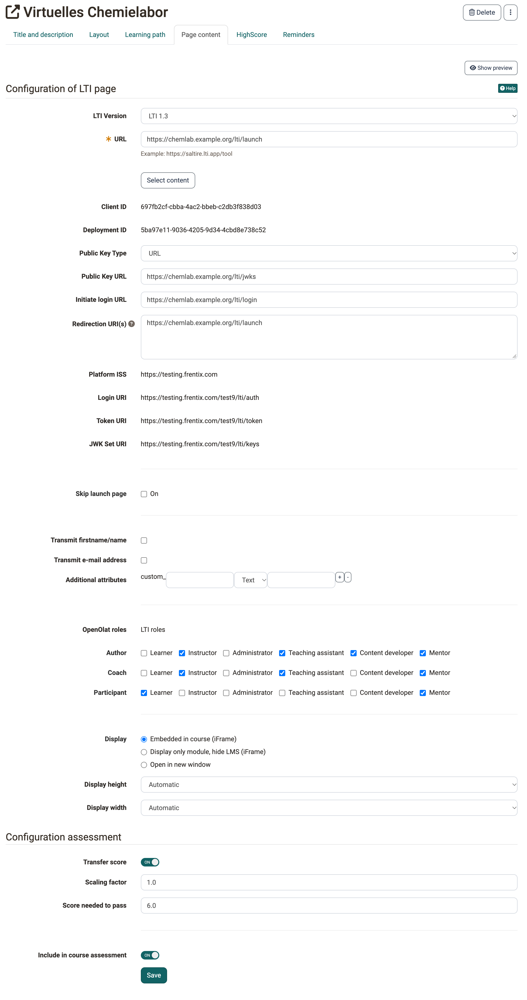

# Course Element "LTI Page" {: #lti}

## Profile

Name | LTI Page
---------|----------
Icon | :o_icon_o_lti_icon:
Available since | Release 7.1 or earlier
Functional group | Others
Purpose | Integration of external learning applications
Assessable | yes
Specialty / Note |

With the course element "LTI page" you integrate an external learning application (in LTI and in OpenOlat "tool") into your course, for example a chat, a wiki, a test editor or a virtual lab. Participants launch it directly in the course, and the learning application can return scores to OpenOlat. LTI stands for "Learning Tools Interoperability" and is an IMS standard to embed external learning applications. More information about LTI can be found on the LTI project page: [http://www.imsglobal.org/lti/](http://www.imsglobal.org/lti/)

## Process

This is how the launch of an LTI page works:

* In the course editor, in the tab "Page content", you choose the "LTI Version" and enter the address of the learning application and the connection details: with "LTI 1.0 / 1.1" the key and the password of the provider, with "LTI 1.3" the details that OpenOlat and the learning application exchange with each other.
* When a participant selects the LTI page in the course navigation, OpenOlat first asks for their consent if the course element transfers personal data: first and last name, e-mail address or user attributes. Only then does OpenOlat transfer the data and the course information to the learning application in a protected manner. This question can be switched off, see [Suppress "data transmission" agreement](#suppress_consent).
* Later, OpenOlat only asks for consent again if the transferred data change.
* Then OpenOlat shows the start page of the course element with the button "Display LTI learning content". After the click, the learning application checks the request and appears in the course. With the option "Skip launch page" this intermediate step is omitted.

## Configure LTI in the course element {: #configure}

!!! tip "Tip"

    For "LTI 1.3", the module "LTI 1.3" must be switched on in the system administration. System administrators also set up preconfigured tools there. "LTI 1.0 / 1.1" is always available.

In the course editor, in the tab "Page content", you determine which learning application the course element launches, which data OpenOlat transfers and whether the learning application returns scores to OpenOlat. The tab has two areas: "Configuration of LTI page" and "Configuration assessment". Which fields appear depends on the selected "LTI Version".

{ class="shadow lightbox" title="Page content tab in the course editor · 2026.11.04" }

### Configuration of LTI page {: #lti_configuration}

#### LTI Version {: #lti_version}

Here you choose how OpenOlat connects the external learning application. The options are "LTI 1.0 / 1.1", "LTI 1.3" and the tools that system administrators have preconfigured for all courses in the system administration. We recommend "LTI 1.3", the older version remains selectable for compatibility reasons. "LTI 1.3" and the preconfigured tools are available as soon as the module "LTI 1.3" is switched on: [Activate LTI](../../manual_admin/administration/LTI_Integrations/index.md#activate_lti)

If you choose a preconfigured tool, OpenOlat takes the connection details from its configuration and pre-fills the URL of the tool in the field "URL". Of the connection details, the tab then only shows the "Deployment ID".

With "LTI 1.3", instead of "Key" and "Password" the tab shows the details that OpenOlat and the learning application exchange for a secure connection. You enter some of them from the provider of the learning application, the others are shown by OpenOlat for you to pass on to the provider:

| Field | Meaning |
|---|---|
| Client ID, Deployment ID | With these two identifiers the learning application recognises that a call comes from this LTI page in OpenOlat. OpenOlat generates both when you save for the first time. You pass them on to the provider of the learning application. |
| Public Key Type | "RSA key" or "Key set URL". In the field below, you enter the public key of the learning application or the address at which the learning application provides its keys. You receive both from the provider. |
| Initiate login URL | The address of the learning application through which OpenOlat starts the login. You receive it from the provider. |
| Redirection URI(s) | The addresses the learning application uses for the login, one per line. At least one must be entered. You receive them from the provider. |
| Platform ISS, Login URI, Token URI, JWK Set URI | The details of OpenOlat, read-only. You pass them on to the provider of the learning application. |

Which LTI services OpenOlat supports as a platform is shown in the overview [Supported LTI services](../../manual_admin/administration/LTI_Integrations/index.md#supported_services).

#### URL {: #url}

In this mandatory field, enter the address of the external learning application, for example "https://saltire.lti.app/tool". With a preconfigured tool, the URL of the tool is pre-filled. You can adjust it, for example to a sub-page of the tool, but the domain must stay the same.

#### Key and Password {: #key_password}

The two fields only appear with "LTI 1.0 / 1.1". In the field "Key", enter the key you received from the provider of the external learning application, in the field "Password" the matching password.

#### Select content {: #select_content}

With the button "Select content" you choose a specific content of the tool instead of only entering its start address (Deep Linking). With "LTI 1.3" the button always appears. With a preconfigured tool it only appears if system administrators have switched on "Activate Deep-Linking" for the tool, in the system administration in the tab "External tools". The button can be used as soon as you have saved the configuration. The tab then lists the selected contents in the field "Resources" above the button: [LTI - Deep Linking](../../manual_admin/administration/LTI_Deeplinking.md) [:octicons-tag-16:{ title="from Release 18.1 (OO-7173)" }](https://track.frentix.com/issue/OO-7173)

#### Skip launch page {: #skip_launch_page}

If this option is switched on, the learning application starts directly, without the start page of the course element with the button "Display LTI learning content". If the option is greyed out, the server configuration of your OpenOlat instance prescribes this start page for all courses. OpenOlat then always shows it.

!!! info "Contact"

    Whether the start page of the course element is prescribed for all courses is defined by the server configuration. For a change, contact your organisation.

#### Suppress "data transmission" agreement {: #suppress_consent}

The option appears as soon as "Transmit firstname/name" or "Transmit e-mail address" is checked. If it is switched on, the learning application starts without asking for consent. Participants can then neither accept nor decline the transfer of their data, which is why OpenOlat asks for a confirmation when you switch it on. If the server configuration prescribes the start page of the course element, this option is greyed out as well, and OpenOlat always asks for consent. If the course element only transfers user attributes from "Additional attributes", the option does not appear, and OpenOlat also always asks for consent.

#### Transmit firstname/name {: #transmit_name}

If this checkbox is checked, OpenOlat transfers the first and last name of the participant to the learning application at launch. Without the checkmark, OpenOlat transfers no name at launch.

#### Transmit e-mail address {: #transmit_email}

If this checkbox is checked, OpenOlat transfers the e-mail address of the participant to the learning application at launch.

#### Additional attributes {: #additional_attributes}

Here you enter further parameters that OpenOlat transfers to the learning application, for example the information that the request comes from OpenOlat. For each parameter, choose "Text" for a fixed value that is the same for all participants, or "User" for a user attribute whose value differs per person. With "+" and "-" you add or remove parameters. The LTI standard does not define these parameters. Therefore, clarify with the provider which parameters the learning application processes.

#### OpenOlat roles {: #openolat_roles}

In this area you define which LTI role a person receives when they launch the learning application. For each of the three OpenOlat roles "Owners", "Coach" and "Participant" you select the matching LTI roles: "Learner", "Instructor", "Administrator", "Teaching assistant", "Content developer" and "Mentor".

Which of these LTI roles you may assign as a course owner is defined by system administrators in the system administration: `Administration > External tools > LTI`, tab "Role mapping", see [LTI - Role mapping](../../manual_admin/administration/LTI_Role_Mapping.md#administration). LTI roles that are not released are greyed out. Administrators and learning resource managers of the organisation the course belongs to can always assign all LTI roles [:octicons-tag-16:{ title="from Release 20.2 (OO-9003)" }](https://track.frentix.com/issue/OO-9003){:target="_blank"}.

#### Display {: #display}

Select the option "Embedded in course (iFrame)" to display the learning application embedded within the course layout. With the option "Display only module, hide LMS (iFrame)" OpenOlat hides itself completely while the learning application is open. With the option "Open in new window" the learning application opens in a new window. This is useful if it needs a lot of space or is to be used in parallel with other course elements.

#### Display height {: #display_height}

Select "Automatic" or an explicit size in case the automatic feature does not work properly. With "LTI 1.3" and the option "Open in new window" the field does not appear.

#### Display width {: #display_width}

Select "Automatic" or an explicit size in case the automatic feature does not work properly. With "LTI 1.3" and the option "Open in new window" the field does not appear.

#### Show all information transmitted on launch (Debug) {: #debug}

The checkbox only appears with "LTI 1.0 / 1.1". If it is checked, participants see the information sent. This information includes parameters such as the user identification, the course title and the course element. By clicking on the button "Launch Endpoint with BasicLTI Data" in the course view above the data sent, you get to the start page of the learning application.

### Configuration assessment {: #grading_configuration}

In this area you determine whether the learning application sends scores to OpenOlat and how OpenOlat converts them.

#### Transfer score {: #transfer_score}

With this switch, the LTI page becomes an assessable course element: the external learning application sends scores to OpenOlat. The scores appear in the assessment tool, on the start page of the course element for the participant and in the evidence of achievement. If the switch is off, the LTI page is not assessable and OpenOlat shows no scores. How the learning application sends the scores depends on the "LTI Version":

* **LTI 1.3:** through the grade service (Assignment and Grade Services). OpenOlat only offers it to the learning application if "Transfer score" is switched on. Through it, the learning application can also read which scores OpenOlat has already stored for the course element.
* **LTI 1.0 / 1.1:** through Basic Outcomes, according to the LTI standard as a value from 0 to 1.

With all LTI versions, OpenOlat only accepts scores for participants of the course. Owners and coaches who are not also participants of the course receive no scores.

#### Scaling factor {: #scaling_factor}

The scaling factor converts the value the learning application sends into the points of the course. OpenOlat multiplies the sent value by the factor. The default is "1".

* **LTI 1.0 / 1.1:** The learning application sends a value from 0 to 1. If you want to award a maximum of 10 points in OpenOlat, enter "10" as the scaling factor. The scaling factor is thus also the maximum score of the course element.
* **LTI 1.3:** OpenOlat takes the score the learning application sends and multiplies it by the factor. OpenOlat does not use the maximum score the learning application sends along, and the course element has no maximum score. This also applies to preconfigured tools. If the learning application sends 7 out of 10 points, the factor "1" results in 7 points in OpenOlat.

#### Score needed to pass {: #score_needed_to_pass}

Enter the optional cut value from which the course element counts as passed. The cut value relates to the scaled score, not to the value the learning application sends. In the example with the scaling factor "10", a cut value of "5" corresponds to half of the points.

#### Include in course assessment {: #include_in_course_assessment}

In learning path courses, the switch appears as soon as "Transfer score" is switched on. If it is on, the score and the status of this course element are included in the overall assessment of the course. Switch it off so that the course element is not included in the overall assessment. In conventional courses, you determine in the [course element "Structure"](Course_Element_Structure.md) which course elements count towards the overall assessment.

#### Scaling factor for course assessment {: #score_scaling}

The field appears if the course assessment adds up the points with weighting and "Transfer score" as well as "Include in course assessment" are switched on. OpenOlat multiplies the points of the LTI page by this factor for the course assessment. More about this under [Course assessment with points: Sum with weighting](Course_Settings_Assessment/index.md#evaluation_with_points_weighting).

## Tab Badges [:octicons-tag-16:{ title="from Release 18.0 (OO-7003)" }](https://track.frentix.com/issue/OO-7003)

If course owners have activated the awarding of badges under `Course > Administration > Settings > Tab "Assessment" > Section "Badges"`, the course editor shows the tab "Badges" for this course element. There you create a badge specifically for this course element.

## Further information {: #further_information}

**Mentioned on this page** 
[LTI project page (IMS Global Learning Consortium) >](http://www.imsglobal.org/lti/) 
[LTI 1.3 Integrations >](../../manual_admin/administration/LTI_Integrations/index.md) 
[LTI - Deep Linking >](../../manual_admin/administration/LTI_Deeplinking.md) 
[LTI - Role mapping >](../../manual_admin/administration/LTI_Role_Mapping.md) 
[Course Element "Structure" >](Course_Element_Structure.md) 
[Course Settings - Tab Assessment >](Course_Settings_Assessment/index.md)

**Further reading** 
[Configure LTI access to a group >](../groups/LTI_Share_groups.md) 
[Configure LTI access to a course >](LTI_Share_courses.md) 
[LTI - External tools >](../../manual_admin/administration/LTI_External_tools.md) 
[LTI - External platforms >](../../manual_admin/administration/LTI_External_platforms.md) 
[Assessment tool - overview >](Assessment_tool_overview/index.md)

[To the top of the page ^](#lti)
