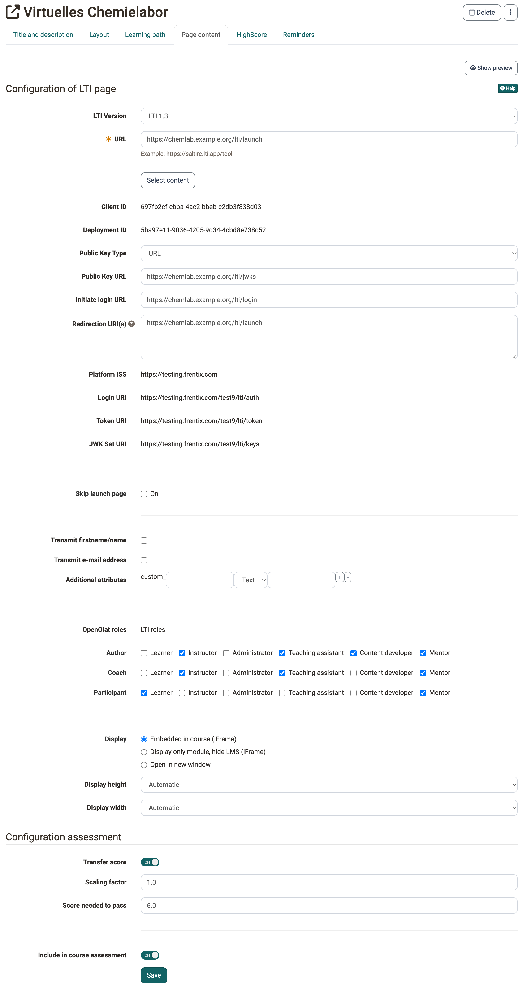

# Course Element "LTI Page" {: #lti}

## Profile

Name | LTI Page
---------|----------
Icon | :o_icon_o_lti_icon:
Available since |  Release 15.5 (beta)
Functional group | Others
Purpose | Integration of external learning applications
Assessable | yes
Specialty / Note |

By means of the course element "LTI page" it is possible to integrate external learning applications in your course and to have their content displayed in an OpenOlat window. LTI stands for "Learning Tools Interoperability" and is an IMS standard to embed external learning applications such as a chat, a media wiki, a test editor or a virtual lab. More information about LTI can be found on the LTI project page: [http://www.imsglobal.org/lti/](http://www.imsglobal.org/lti/)

## Process

* Indicate the URL to be referenced in the tab "Page content" along with its key and password.
* When a participant selects the LTI page in the course navigation, they must first agree to the data transfer for data protection reasons before the user data and course information as well as the key are transferred to the embedded learning application in the background in a protected manner.
* The learning application checks the access rights and grants access with a valid key.
* Later, OpenOlat only asks for consent again if the configuration of the course element changes with regard to the transmitted data.
* When the participant selects the LTI page in the navigation, the integrated learning application appears in the OpenOlat course.

## Configure LTI page

!!! tip "Tip"

    The prerequisite is that system administrators have activated and set up LTI in the system administration.

The following parameters can be configured:

{ class="shadow lightbox" title="Page content tab in the course editor · 2026.11.04" }

**LTI Version:** Here you choose how OpenOlat connects the external learning application. The options are "LTI 1.0 / 1.1", "LTI 1.3" and the tools that system administrators have preconfigured for all courses in the system administration. We recommend "LTI 1.3", the older version remains selectable for compatibility reasons. "LTI 1.3" and the preconfigured tools are available as soon as the module "LTI 1.3" is switched on: [Activate LTI](../../manual_admin/administration/LTI_Integrations.md#activate_lti)

If you choose a preconfigured tool, OpenOlat takes the URL and the connection details from its configuration.

With the button "Select content" you choose a specific content of the tool instead of only entering its start address (Deep Linking). The button appears with "LTI 1.3" and with a preconfigured tool for which "Activate Deep-Linking" is switched on. It can be used as soon as you have saved the configuration. The selected contents then appear in the field "Resources": [LTI - Deep Linking](../../manual_admin/administration/LTI_Deeplinking.md) [:octicons-tag-16:{ title="from Release 18.1 (OO-7173)" }](https://track.frentix.com/issue/OO-7173)

Which LTI services OpenOlat supports as a platform is shown in the overview [Supported LTI services](../../manual_admin/administration/LTI_Integrations.md#supported_services).

**URL:** In this input field, enter the address of the external learning application.  The format is for example "https://tools.< Firma xyz >.com/lti_quiz/lti_quizwand.php".

**Key:** Enter the key provided by the supplier of your external learning application ("lti_quiz" in the example above).

**Password:** Enter the password matching the key, also provided by the supplier of your external learning application ("weeHoo1w" in the example above).

**Skip launch page:** If this option is activated, the connected application is displayed directly, without the "Display LTI Learning Content" intermediate page. If the option is greyed out, the server configuration of your OpenOlat instance prescribes the intermediate page for all courses. OpenOlat then always shows the intermediate page.

!!! info "Contact"

    Whether the intermediate page is prescribed for all courses is defined by the server configuration. For a change, contact your organisation.

* * *

**Transmit firstname/name:** By checking this box, the first and last name of the participant are transferred to the external learning application. Otherwise, the participant can use the external learning application anonymously.

**Transmit e-mail address:** By checking this box, the e-mail address of the participant is transferred to the external learning application.

**Additional attributes:** In this input field you can enter further parameters that are to be transferred to the learning application. For example, you can tell the learning application that the request comes from the learning platform OpenOlat. (The external learning application must be able to process the transferred information, which is why an agreement with the provider is necessary.) You have the choice between static text attributes (identical value for all participants) and additional dynamic user attributes (different value for each participant). You can define as many additional attributes as you like, but the LTI resource must know that these attributes exist, as they are not defined in the standard.

* * *

**OpenOlat roles:** In this area you define which LTI role a person receives when they launch the LTI resource. For each of the three OpenOlat roles "Author", "Coach" and "Participant" you select the matching LTI roles: "Learner", "Instructor", "Administrator", "Teaching assistant", "Content developer" and "Mentor".

Which of these LTI roles you may assign as a course owner is defined by system administrators in the system administration: `Administration > External tools > LTI`, tab "Role mapping", see [LTI - Role mapping](../../manual_admin/administration/LTI_Role_Mapping.md#administration). LTI roles that are not released are greyed out. Administrators and learning resource managers of the organisation the course belongs to can always assign all LTI roles [:octicons-tag-16:{ title="from Release 20.2 (OO-9003)" }](https://track.frentix.com/issue/OO-9003){:target="_blank"}.

**Transfer score:** With this switch in the area "Configuration assessment", the LTI page becomes an assessable course element: the external learning application sends scores to OpenOlat. The scores appear in the assessment tool, on the start page of the course element for the participant and in the evidence of achievement. How the learning application sends the scores depends on the "LTI Version":

* **LTI 1.3:** through the grade service (Assignment and Grade Services). OpenOlat offers it to the learning application as soon as "Transfer score" is switched on. Through it, the learning application can also read the grade column of the course element and the results.
* **LTI 1.0 / 1.1:** through Basic Outcomes, according to the standard as a value from 0 to 1.

**Scaling factor:** The scaling factor converts the value the learning application sends into the points of the course. OpenOlat multiplies the sent value by the factor. The default is "1".

* **LTI 1.0 / 1.1:** The learning application sends a value from 0 to 1. If you want to award a maximum of 10 points in OpenOlat, enter "10" as the scaling factor.
* **LTI 1.3:** OpenOlat takes the score the learning application sends and multiplies it by the factor. OpenOlat does not use the maximum score the learning application sends along. If the learning application sends 7 out of 10 points, the factor "1" results in 7 points in OpenOlat.

**Score needed to pass:** Enter the optional cut value from which the course element counts as passed. The cut value relates to the scaled score, not to the value the learning application sends. In the example with the scaling factor "10", a cut value of "5" corresponds to half of the points.

**Include in course assessment:** If this switch is on, the score and the status of this course element are included in the overall assessment of the course. Switch it off so that the course element is not included in the overall assessment.

* * *

**Display:** Select the option "Embedded in course (iFrame)" to embed the LTI resource within the course layout. The option "Display only module, hide LMS (iFrame)" completely hides OpenOlat while the LTI resource is active. With the option "Open in new window" the LTI resource is opened in a separate window. This is useful if the resource needs a lot of space or is to be used in parallel with other course elements.

**Display height:** Select "Automatic" or an explicit size in case the automatic feature does not work properly.

**Display width:** Select "Automatic" or an explicit size in case the automatic feature does not work properly.

* * *

**Show all information transmitted on launch (Debug):** By checking this box, the participants see the information sent. This information includes parameters such as the user identification, the course title, the course element, etc. By clicking on "Launch Endpoint with BasicLTI Data" in the course view above the display of the data sent, you get to the start page of the learning application.

## Tab Badges [:octicons-tag-16:{ title="from Release 18.0 (OO-7003)" }](https://track.frentix.com/issue/OO-7003)

If course owners have activated the awarding of badges under `Course > Administration > Settings > Tab "Assessment" > Section "Badges"`, the course editor shows the tab "Badges" for this course element. There you create a badge specifically for this course element.

[To the top of the page ^](#lti)

## Further information {: #further_information}

**Mentioned on this page** 
[LTI project page (IMS Global Learning Consortium) >](http://www.imsglobal.org/lti/) 
[LTI 1.3 Integrations >](../../manual_admin/administration/LTI_Integrations.md) 
[LTI - Deep Linking >](../../manual_admin/administration/LTI_Deeplinking.md)

**Further reading** 
[Configure LTI access to a group >](../groups/LTI_Share_groups.md) 
[Configure LTI access to a course >](LTI_Share_courses.md) 
[LTI - External tools >](../../manual_admin/administration/LTI_External_tools.md) 
[LTI - External platforms >](../../manual_admin/administration/LTI_External_platforms.md) 
[LTI - Role mapping >](../../manual_admin/administration/LTI_Role_Mapping.md) 
[Assessment tool - overview >](Assessment_tool_overview/index.md)

[To the top of the page ^](#lti)
