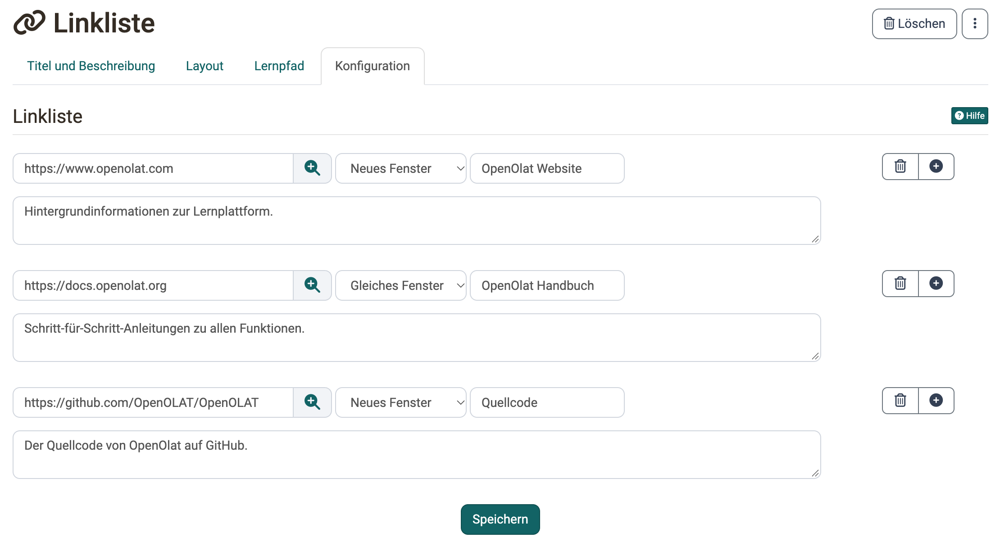

# Kursbaustein "Linkliste" {: #linklist}

## Steckbrief

Name | Linkliste
---------|----------
Icon | :o_icon_o_ll_icon:
Verfügbar seit | Release 7.1 oder früher
Funktionsgruppe | Andere
Verwendungszweck | Linksammlungen innerhalb der Kursstruktur (Kursmenü)
Bewertbar | nein
Spezialität / Hinweis |

Mit dem Kursbaustein "Linkliste" stellen Sie den Teilnehmenden eine Sammlung von Links direkt in der Kursstruktur bereit, zum Beispiel auf Fachartikel, Websites oder Dateien. Sie erfassen die Links im Kurseditor im Tab "Konfiguration" in einem Formular, ohne HTML zu schreiben.

Je Link füllen Sie eine Zeile aus:

* Ins Feld "URL angeben oder Ziel wählen" tragen Sie die URL der Zielseite ein. Über das Lupensymbol daneben wählen Sie stattdessen eine Datei aus dem Ablageordner des Kurses. Im Dialog laden Sie bei Bedarf auch neue Dateien hoch.
* In der Auswahlliste daneben legen Sie mit "Neues Fenster" oder "Gleiches Fenster" fest, wo der Link öffnet.
* Ins Feld "Titel angeben" tragen Sie den Titel ein, den die Teilnehmenden als Link sehen. Das Feld ist ein Pflichtfeld.
* Im Feld darunter ergänzen Sie bei Bedarf eine Beschreibung zum Link.

Mit dem Plus-Symbol fügen Sie einen weiteren Link hinzu, mit dem Papierkorb-Symbol entfernen Sie einen Link.

{ class="shadow lightbox" title="Tab Konfiguration der Linkliste im Kurseditor · 2026.11.03" }

## Weiterführende Informationen {: #further_information}

**Weiterführend** 
[Kursbaustein "Externe Seite" >](../learningresources/Course_Element_External_Page.de.md) 
[Kursbaustein "Ordner" >](../learningresources/Course_Element_Folder.de.md) 
[Kursbausteine im Überblick >](../learningresources/Course_Elements.de.md)

[Zum Seitenanfang ^](#linklist)

