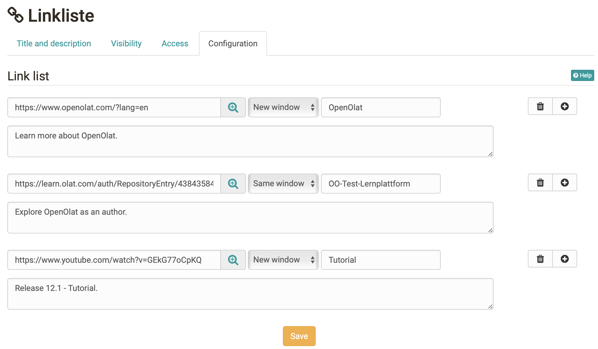

# Course Element "Link list" {: #linklist}

## Profile

Name | Link list
---------|----------
Icon | :o_icon_o_ll_icon:
Available since | Release 7.1 or earlier
Functional group | Others
Purpose | Link collections within the course structure (course menu)
Assessable | no
Specialty / Note |

With the course element "Link list" you provide the participants with a collection of links directly in the course structure, for example to specialist articles, websites or files. You enter the links in the course editor in the tab "Configuration" in a form, without writing HTML.

For each link, you fill in one row:

* In the field "Enter URL or select target" you enter the URL of the target page. Using the magnifier icon next to it, you select a file from the storage folder of the course instead. In the dialog, you can also upload new files if needed.
* In the selection list next to it, you define with "New window" or "Same window" where the link opens.
* In the field "Enter a title" you enter the title that the participants see as the link. The field is mandatory.
* In the field below, you add a description of the link if needed.

With the plus icon you add another link, with the trash icon you remove a link.

{ class="shadow lightbox" title="Tab Configuration of the link list in the course editor" }

## Further information {: #further_information}

**Further reading** 
[Course Element "External Page" >](../learningresources/Course_Element_External_Page.md) 
[Course Element "Folder" >](../learningresources/Course_Element_Folder.md) 
[Types of Course Elements >](../learningresources/Course_Elements.md)

[To the top of the page ^](#linklist)
