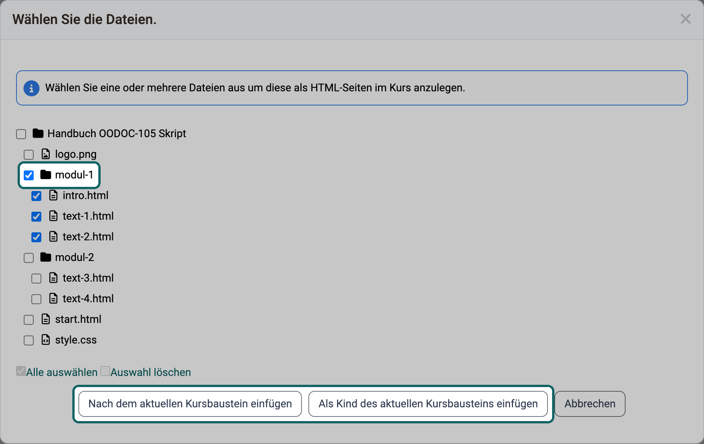
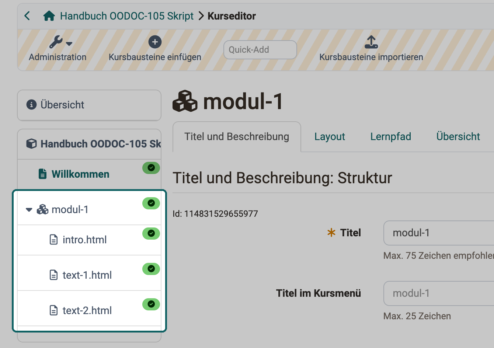

# Assistent "Mehrere HTML-Seiten" {: #multiple_html_pages}

Haben Sie ein Skript mit mehreren Kapiteln als HTML-Dateien erstellt, etwa ausserhalb von OpenOlat, machen Sie daraus mit dem Assistenten "Mehrere HTML-Seiten" in einem Schritt einen gegliederten Kurs. Sie laden die Ordner mit den Dateien in den Ablageordner, und der Assistent übernimmt sie samt Gliederung: Jeder Ordner wird ein Kapitel im Kursmenü, ein Kursbaustein ["Struktur"](Course_Element_Structure.de.md), und jede Datei darin eine Seite, ein Kursbaustein "HTML-Seite". Sie fügen also keine Seite einzeln ein und verknüpfen sie mit ihrer Datei.

## Steckbrief

Name | Mehrere HTML-Seiten
---------|----------
Icon | :o_icon_o_icon_wizard:
Verfügbar seit | Release 8.0 (2011)
Funktionsgruppe | Andere
Verwendungszweck | Assistent, der aus Dateien des Ablageordners in einem Schritt mehrere Kursbausteine "HTML-Seite" anlegt
Legt an | je ausgewählte Datei: Kursbaustein ["HTML-Seite"](Course_Element_HTML_Page.de.md) je ausgewählten Ordner: Kursbaustein ["Struktur"](Course_Element_Structure.de.md)

## Ganze Ordner als Kursstruktur übernehmen {: #folders}

Am meisten Arbeit spart der Assistent, wenn Sie ganze Ordner übernehmen. Legen Sie die Inhalte im Ablageordner so ab, wie der Kurs gegliedert sein soll: ein Ordner je Kapitel, darin die HTML-Dateien dieses Kapitels. Setzen Sie im Assistenten das Häkchen bei den Ordnern. Der Assistent baut daraus in einem Schritt die ganze Kursstruktur: Jeder Ordner wird ein Kursbaustein "Struktur", darunter stehen seine Seiten, und Unterordner werden Unterkapitel.

Die Reihenfolge im Kursmenü folgt dem Alphabet der Ordner- und Dateinamen. Nummerieren Sie die Namen deshalb vorher, etwa "01_einleitung" und "02_grundlagen", dann stehen Kapitel und Seiten gleich in der richtigen Reihenfolge.

## Mehrere HTML-Seiten anlegen {: #create}

Den Assistenten nutzt, wer den Kurseditor öffnen darf: Kursbesitzer:innen, Administrator:innen, Lernressourcenverwalter:innen und Personen mit dem [Kursrecht "Kurseditor"](../learningresources/Members_management.de.md#additional_rights). Er steht in herkömmlichen Kursen und in Lernpfadkursen zur Verfügung.

So legen Sie mehrere HTML-Seiten an:

1. Laden Sie die Dateien in den [Ablageordner](../learningresources/Storage_folder.de.md) des Kurses hoch. Der Assistent bietet auch die Dateien eines [Ressourcenordners](Resource_Folder.de.md) an, den Sie mit dem Kurs verknüpft haben.
2. Wählen Sie im Kurseditor im Kursmenü den Kursbaustein, hinter oder unter dem die neuen Seiten stehen sollen.
3. Klicken Sie in der Toolbar des Kurseditors auf "Kursbausteine einfügen" und in der Gruppe "Andere" auf "Mehrere HTML-Seiten". Der Eintrag steht direkt nach "HTML-Seite". Der Dialog "Wählen Sie die Dateien." öffnet sich. 
`Kurs > Administration > Kurseditor > Kursbausteine einfügen > Andere > Mehrere HTML-Seiten`
4. Setzen Sie ein Häkchen bei jeder Datei, die eine eigene Seite werden soll. Der Dialog zeigt alle Dateien und Ordner des Ablageordners, auch Bilder, CSS-Dateien und Skripte. Wählen Sie gezielt die HTML-Dateien, die Teilnehmende als eigene Seite im Kursmenü sehen sollen. Ein Häkchen bei einem Ordner wählt alle Dateien und Unterordner darin mit aus. Entfernen Sie danach die Häkchen bei Bildern, CSS-Dateien und Skripten, sonst wird auch jede dieser Dateien eine eigene Seite. "Alle auswählen" und "Auswahl löschen" setzen oder entfernen alle Häkchen auf einmal.
5. Klicken Sie auf "Nach dem aktuellen Kursbaustein einfügen". Die neuen Kursbausteine stehen dann direkt hinter dem gewählten Kursbaustein. Mit "Als Kind des aktuellen Kursbausteins einfügen" stehen sie am Ende unter dem gewählten Kursbaustein. Ist im Kursmenü der oberste Eintrag gewählt, bietet der Dialog nur "Als Kind des aktuellen Kursbausteins einfügen" an.

{ class="shadow lightbox" title="Dialog Wählen Sie die Dateien. im Kurseditor · 2026.11.10" }

Der Dialog schliesst sich, und das Kursmenü des Kurseditors zeigt die neuen Kursbausteine. Teilnehmende sehen sie, sobald Sie den Kurs [publizieren](Using_additional_Course_Editor_Tools.de.md#publish).

Den Assistenten öffnen Sie nur über "Kursbausteine einfügen". [Quick-Add](Using_additional_Course_Editor_Tools.de.md#quick_add) bietet ihn nicht an, es legt eine HTML-Seite pro Eingabe an.

## Was der Assistent anlegt {: #result}

Jede ausgewählte Datei wird ein Kursbaustein "HTML-Seite", der genau diese Datei zeigt. Ist die Datei keine HTML-Datei, steht über dem Inhalt ein Link zum Herunterladen: Ein Bild erscheint direkt auf der Seite, eine CSS-Datei als Text, ein Word-Dokument dagegen nur als Link. Jeder ausgewählte Ordner wird ein Kursbaustein "Struktur", unter dem die Kursbausteine aus diesem Ordner stehen. Ist ein Ordner nicht ausgewählt, rücken die ausgewählten Dateien daraus eine Ebene nach oben: Sie stehen unter dem übergeordneten Ordner, wenn dieser ausgewählt ist, sonst am gewählten Ort im Kursmenü. Beispiel: Sie wählen im Ordner "modul-1" nur die Datei "kapitel1.html", nicht den Ordner selbst. Dann entsteht kein Kursbaustein "Struktur" "modul-1", und die Seite "kapitel1.html" steht direkt am gewählten Ort. Der oberste Eintrag im Dialog steht für den Ablageordner selbst und trägt den Kurstitel. Wählen Sie ihn mit aus, etwa mit "Alle auswählen", entsteht auch für ihn ein Kursbaustein "Struktur" mit dem Kurstitel als "Titel", unter dem alle übrigen stehen.

{ class="shadow lightbox" title="Kursmenü im Kurseditor nach dem Assistenten Mehrere HTML-Seiten · 2026.11.10" }

Als "Titel" übernimmt der Assistent den Datei- oder Ordnernamen, bei Dateien mit Endung, zum Beispiel "kapitel1.html". Geben Sie den neuen Kursbausteinen danach im Tab "Titel und Beschreibung" verständliche Titel, damit Teilnehmende im Kursmenü erkennen, was sie erwartet.

In den angelegten HTML-Seiten ist unter "Sicherheitseinstellungen" die Option "Link in gesamten Ablageordner erlauben" eingeschaltet. So funktionieren Verweise zwischen den Seiten und auf Bilder, CSS-Dateien oder Skripte in anderen Ordnern des Ablageordners. Fügen Sie eine HTML-Seite einzeln ein, schalten Sie die Option bei Bedarf im [Tab "Seiteninhalt"](Course_Element_HTML_Page.de.md#tab_page_content) selbst ein.

Wie Sie Inhalt und Anzeige der angelegten Seiten ändern, steht unter [Kursbaustein "HTML-Seite"](Course_Element_HTML_Page.de.md).

## Weiterführende Informationen {: #further_information}

**Auf dieser Seite erwähnt** 
[Kursbaustein "Struktur" >](Course_Element_Structure.de.md) 
[Kursbaustein "HTML-Seite" >](Course_Element_HTML_Page.de.md) 
[Mitgliederverwaltung >](../learningresources/Members_management.de.md) 
[Ablageordner >](../learningresources/Storage_folder.de.md) 
[Ressourcenordner >](Resource_Folder.de.md) 
[Kurseditorwerkzeuge >](Using_additional_Course_Editor_Tools.de.md)

**Weiterführend** 
[Kursbausteine im Kurseditor >](General_Configuration_of_Course_Elements.de.md) 
[Assistent "Mehrere Checklisten" >](Course_Element_Multiple_Checklists.de.md)

[Zum Seitenanfang ^](#multiple_html_pages)
