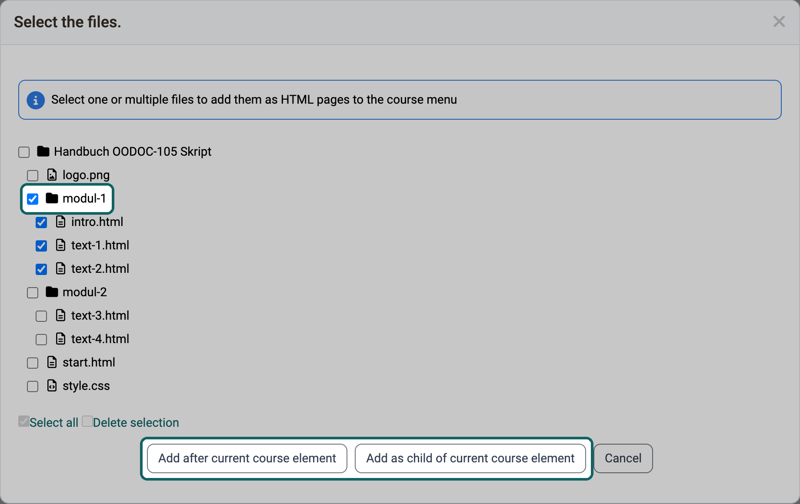
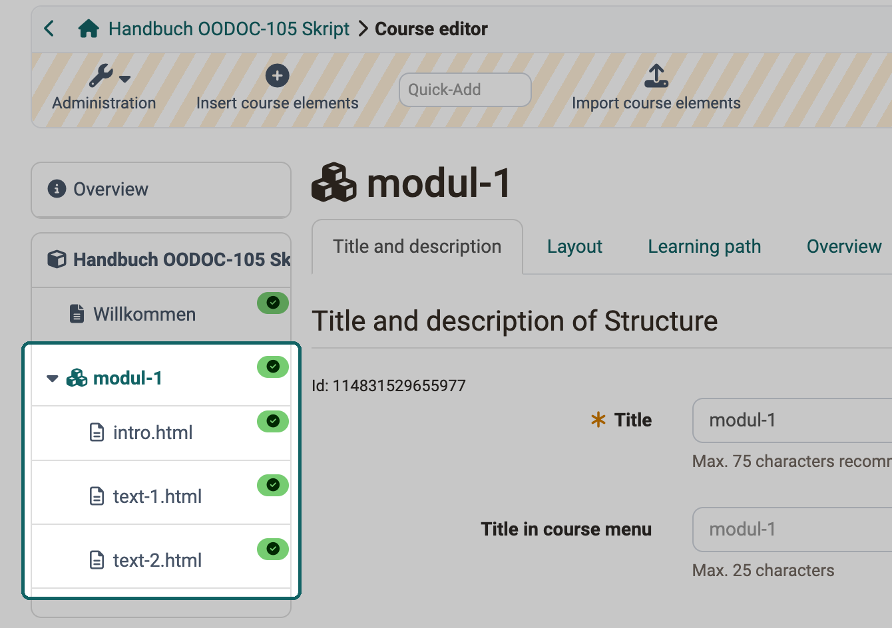

# Wizard "Multiple HTML pages" {: #multiple_html_pages}

If you have created a script with several chapters as HTML files, for example outside of OpenOlat, the wizard "Multiple HTML pages" turns it into a structured course in one step. You upload the folders with the files to the storage folder, and the wizard takes them over including their structure: each folder becomes a chapter in the course menu, a course element ["Structure"](Course_Element_Structure.md), and each file in it a page, a course element "HTML page". So you do not insert any page individually and link it to its file.

## Profile

Name | Multiple HTML pages
---------|----------
Icon | :o_icon_o_icon_wizard:
Available since | Release 8.0 (2011)
Functional group | Other
Purpose | Wizard that creates several course elements "HTML page" in one step from files of the storage folder
Creates | per selected file: course element ["HTML page"](Course_Element_HTML_Page.md) per selected folder: course element ["Structure"](Course_Element_Structure.md)

## Taking over whole folders as course structure {: #folders}

The wizard saves the most work when you take over whole folders. Arrange the content in the storage folder the way the course should be structured: one folder per chapter, containing the HTML files of that chapter. In the wizard, tick the folders. The wizard then builds the whole course structure in one step: each folder becomes a course element "Structure" with its pages below it, and subfolders become subchapters.

The order in the course menu follows the alphabetical order of the folder and file names. Number the names beforehand, for example "01_introduction" and "02_basics", so that chapters and pages appear in the right order straight away.

## Creating multiple HTML pages {: #create}

The wizard can be used by anyone who may open the course editor: course owners, administrators, learning resource managers and persons with the [course right "Course editor"](../learningresources/Members_management.md#additional_rights). It is available in conventional courses and in learning path courses.

How to create multiple HTML pages:

1. Upload the files to the [storage folder](../learningresources/Storage_folder.md) of the course. The wizard also offers the files of a [resource folder](Resource_Folder.md) that you have linked to the course.
2. In the course editor, select the course element in the course menu after or below which the new pages should be placed.
3. In the toolbar of the course editor, click "Insert course elements" and, in the group "Other", "Multiple HTML pages". The entry is located directly after "HTML page". The dialog "Select the files." opens. 
`Course > Administration > Course editor > Insert course elements > Other > Multiple HTML pages`
4. Tick each file that should become a page of its own. The dialog shows all files and folders of the storage folder, including images, CSS files and scripts. Specifically select the HTML files that participants should see as a page of their own in the course menu. A tick on a folder also selects all files and subfolders in it. Then remove the ticks on images, CSS files and scripts, otherwise each of these files also becomes a page of its own. "Select all" and "Delete selection" set or remove all ticks at once.
5. Click "Add after current course element". The new course elements are then placed directly after the selected course element. With "Add as child of current course element" they are placed at the end below the selected course element. If the top entry in the course menu is selected, the dialog only offers "Add as child of current course element".

{ class="shadow lightbox" title="Dialog Select the files. in the course editor · 2026.11.10" }

The dialog closes, and the course menu of the course editor shows the new course elements. Participants see them as soon as you [publish](Using_additional_Course_Editor_Tools.md#publish) the course.

You open the wizard only via "Insert course elements". [Quick-Add](Using_additional_Course_Editor_Tools.md#quick_add) does not offer it; it creates one HTML page per entry.

## What the wizard creates {: #result}

Each selected file becomes a course element "HTML page" that shows exactly this file. If the file is not an HTML file, a download link appears above the content: an image appears directly on the page, a CSS file as text, but a Word document only as a link. Each selected folder becomes a course element "Structure", below which the course elements from this folder are placed. If a folder is not selected, the selected files from it move up one level: they are placed below the parent folder if that folder is selected, otherwise at the selected place in the course menu. Example: in the folder "modul-1" you select only the file "chapter1.html", not the folder itself. Then no course element "Structure" "modul-1" is created, and the page "chapter1.html" is placed directly at the selected place. The top entry in the dialog stands for the storage folder itself and bears the course title. If you select it as well, for example with "Select all", a course element "Structure" with the course title as "Title" is created for it too, below which all others are placed.

{ class="shadow lightbox" title="Course menu in the course editor after the wizard Multiple HTML pages · 2026.11.10" }

As "Title", the wizard takes over the file or folder name, for files including the extension, for example "chapter1.html". Afterwards, give the new course elements understandable titles in the tab "Title and description" so that participants recognize in the course menu what to expect.

In the created HTML pages, the option "Allow links in the entire storage folder" is switched on under "Security settings". This way, links between the pages and to images, CSS files or scripts in other folders of the storage folder work. If you insert an HTML page individually, switch the option on yourself in the [tab "Page content"](Course_Element_HTML_Page.md#tab_page_content) if required.

How to change the content and display of the created pages is described under [Course element "HTML page"](Course_Element_HTML_Page.md).

## Further information {: #further_information}

**Mentioned on this page** 
[Course Element "Structure" >](Course_Element_Structure.md) 
[Course Element "HTML page" >](Course_Element_HTML_Page.md) 
[Members management >](../learningresources/Members_management.md) 
[Storage folder >](../learningresources/Storage_folder.md) 
[Resource folder >](Resource_Folder.md) 
[Course editor tools >](Using_additional_Course_Editor_Tools.md)

**Further reading** 
[Course elements in the Course editor >](General_Configuration_of_Course_Elements.md) 
[Wizard "Multiple checklists" >](Course_Element_Multiple_Checklists.md)

[To the top of the page ^](#multiple_html_pages)
