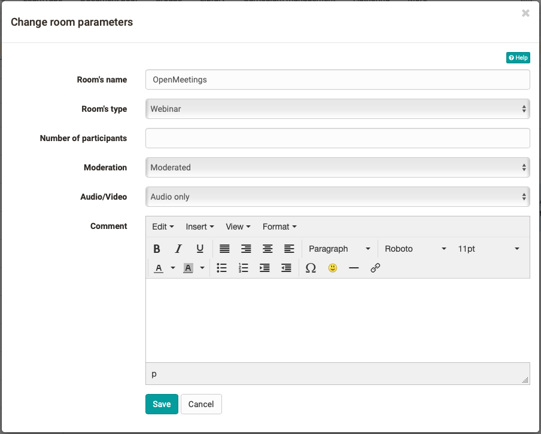
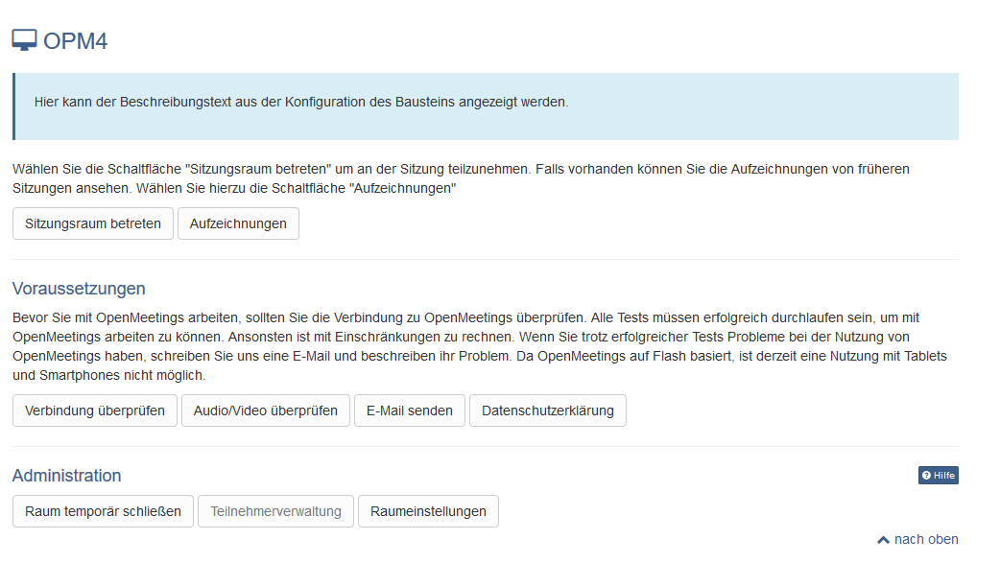

# Course Element "OpenMeetings" {: #openmeetings}

## Profile

Name | OpenMeetings
---------|----------
Icon | :o_icon_o_openmeetings_icon:
Available since | Release 8.3.0 (OO-407)
Functional group | Communication and collaboration
Purpose | Integration of the OpenMeetings web conferencing software 
Assessable | no
Specialty / Note | OpenMeetings is an open source software. Server hosting is required for use in OpenOlat (Open source license Apache 2.0).

## Tool-specific {: #tool_specific}

OpenMeetings has three different room types, all of which can also be used in
OpenOlat:

  * Presentation rooms (webinar rooms)
  * Cooperation rooms (conference rooms) and
  * Interview rooms

Different functions are available depending on the room selected. The special thing about OpenMeetings is that cooperation rooms are not only available in courses but also in groups. Every OpenOlat user can use his own virtual classroom for group work and cooperation meetings.

!!! info "Important"

    OpenOlat course owners and coaches are OpenMeetings moderators by default.

!!! note "Link to further information"

    For more information about current features, see the URL <http://incubator.apache.org/openmeetings>

## Configuration in the course editor {: #editor_configuration}

After adding the course element, you must first create an OpenMeetings room in the "Room" tab and configure the room settings. These settings can be adjusted later in the course editor as well as in the course unit.

{ class="shadow lightbox" title="Room tab in the course editor" }

The desired room type can be selected under "Room's type". The exact room designations can vary depending on the OpenMeetings instance.  While cooperation and presentation rooms differ primarily in whether each user automatically receives audio/video rights when entering the room or not, the interview room is structured differently from the other rooms.

* **Conferences** are cooperation rooms and are intended for smaller numbers of users where all participants have equal rights and can use all tools. 

* A **webinar room** or presentation room is suitable if there is one or a few speakers and many participants for whom the audio function should not be provided at all or only afterwards. A presentation room is also a better choice for inexperienced users.

* The **Interview Room** is a space that is particularly suitable for video conferencing or video-based interviews.

Specifying a **maximum number of participants** limits the available seats in the meeting room. Once all seats are occupied, no new users can enter the room until one person leaves.

Under "**Moderation**", you can define whether a moderator is required before the participants of a room can obtain further rights. If the option "**No moderation**" is selected, the first user who enters the room automatically receives moderation rights.

Under "Audio/Video" you specify whether only audio or audio and video are available in the room. With the option "Recording allowed" you can record the session; the recording is converted and made available automatically after the session. In the "Comment" field you describe the agenda of the session and the target audience.

## Configuration in the course view {: #course_run_configuration}

{ class="shadow lightbox" title="Course element OpenMeetings in the course view" }

Via "Enter" you enter the meeting room.

If recordings are available, you access them via the "Recordings" link.

Via "Close" you close the room so that no access is possible.

Via the link "Members" you see the persons who are currently in the room and can remove them if required. Via the button "Room configuration" course owners and coaches also adjust the room settings in the course.

## Further information {: #further_information}

**Mentioned on this page** 
[incubator.apache.org/openmeetings](http://incubator.apache.org/openmeetings)

[To the top of the page ^](#openmeetings)

