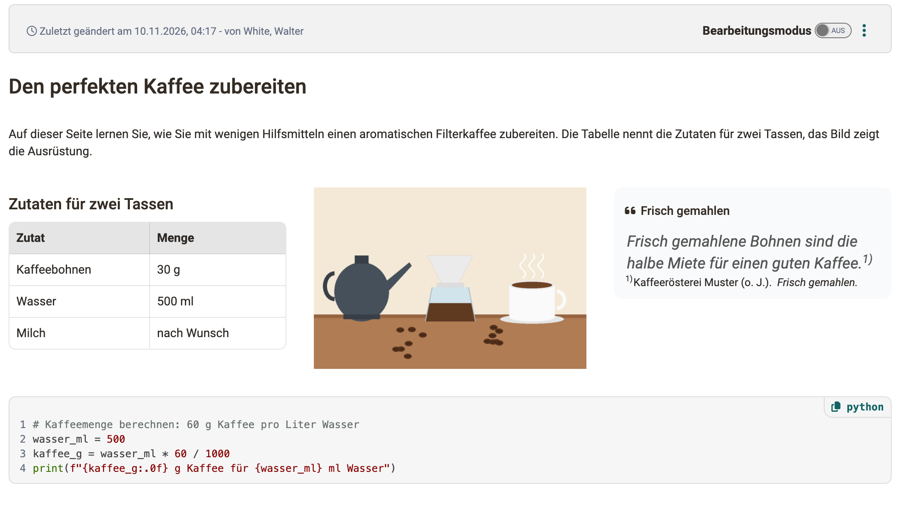
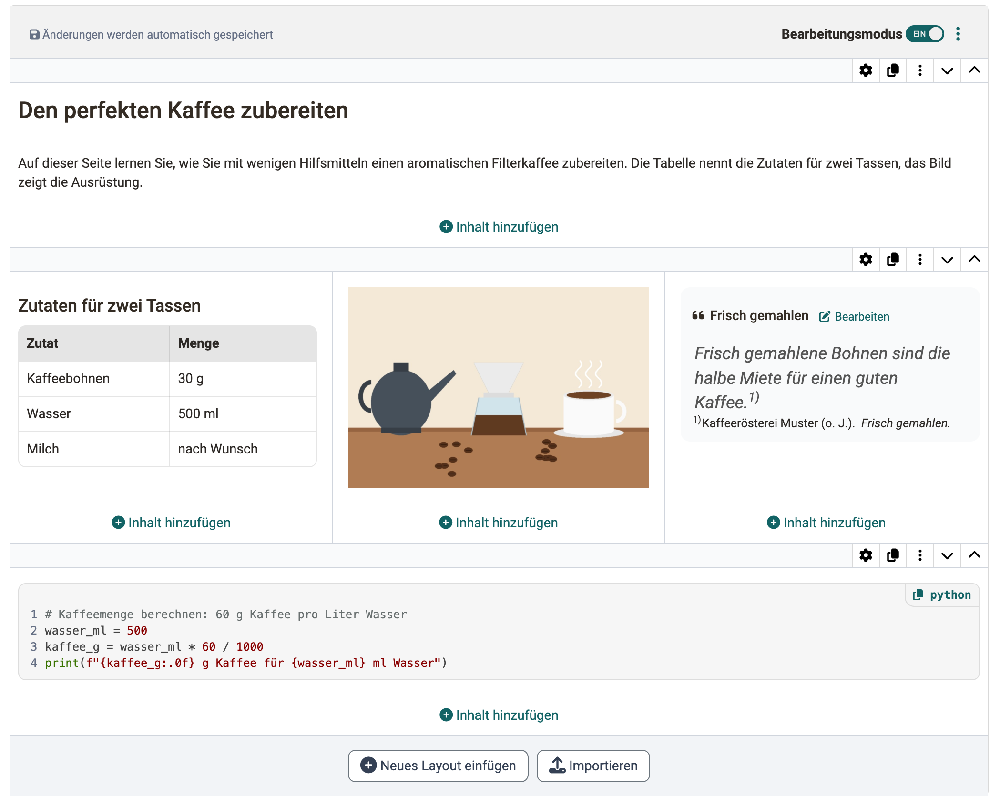
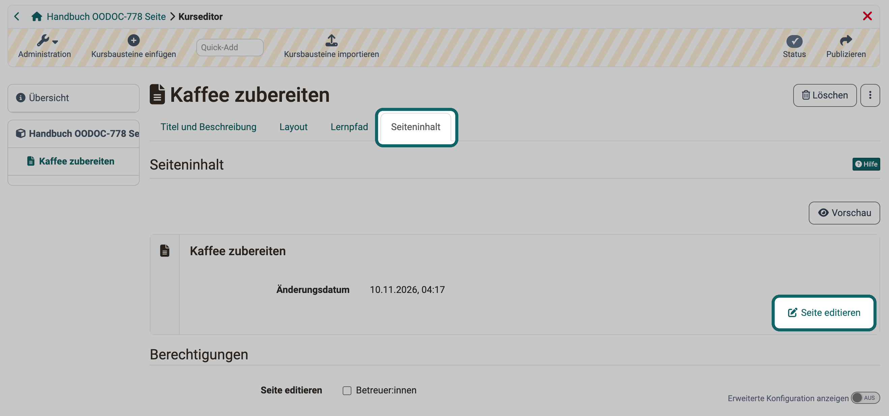
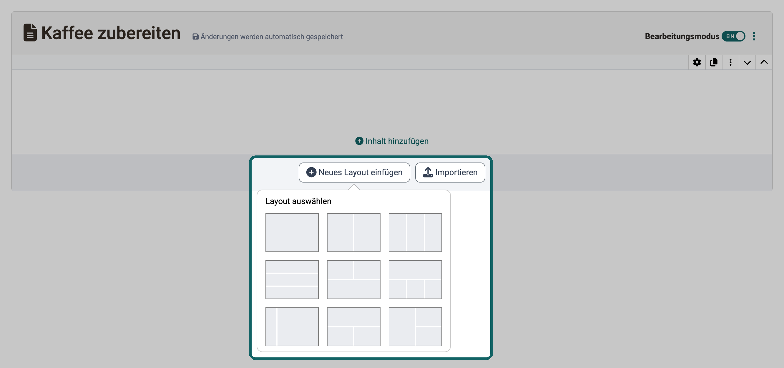
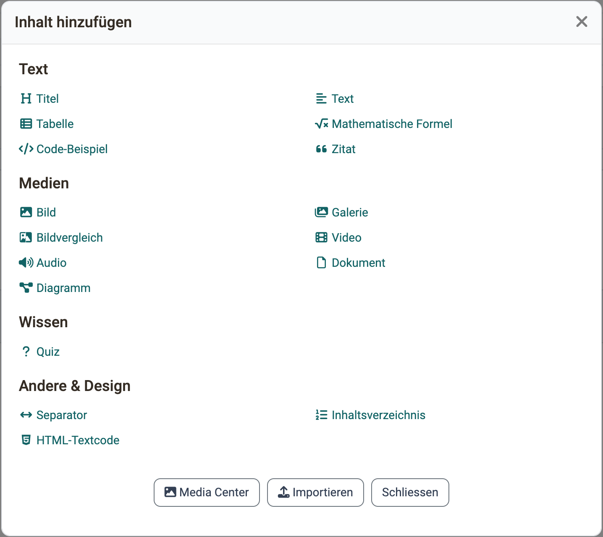
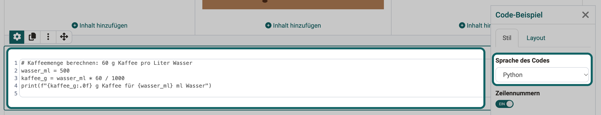
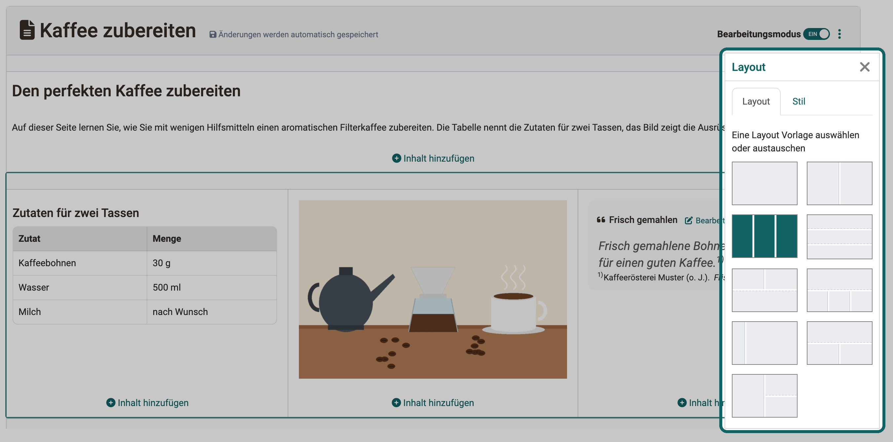
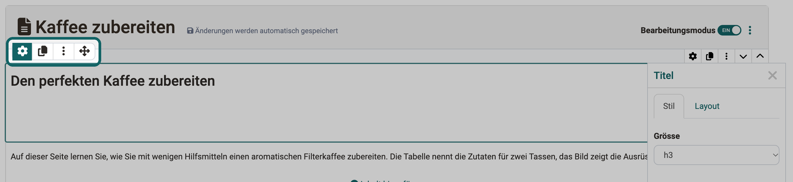

# Kursbaustein "Seite" {: #course_element_page}

## Steckbrief

Name | Seite
---------|----------
Icon | :o_icon_o_page_icon:
Verfügbar seit | Release 18
Funktionsgruppe | Wissensvermittlung
Verwendungszweck | Darstellung verschiedener Inhalte in einem blockbasierten Layout
Bewertbar | nein
Spezialität / Hinweis | Den blockbasierten Content Editor gibt es neben dem Kursbaustein Seite auch in der Lernressource Formular und in Portfolio-Einträgen.

## Beispiel

=== "Ansicht im Kurs"

    Mit dem Kursbaustein Seite stellen Sie Texte, Bilder, Tabellen, Videos und weitere Inhaltselemente auf einer Seite im Kurs zusammen. Layouts ordnen die Inhalte in Spalten und Zeilen an.

    { class="shadow lightbox" title="Kursbaustein Seite in der Kursansicht · 2026.11.10" }

=== "Bearbeitungsmodus"

    Im Bearbeitungsmodus sehen Sie die Seite schon fast so, wie Teilnehmende sie sehen. Das unterscheidet den Content Editor vom HTML-Editor des Kursbausteins "HTML-Seite".

    { class="shadow lightbox" title="Kursbaustein Seite im Bearbeitungsmodus · 2026.11.10" }

## Seiteninhalt erstellen [:octicons-tag-16:{ title="ab Release 18.0.0 (OO-6966)" }](https://track.frentix.com/issue/OO-6966){:target="_blank"}

Den Inhalt der Seite bauen Sie im Content Editor auf. Sie öffnen ihn im Kurseditor über den Tab "Seiteninhalt" des Kursbausteins: 
`Kurs > Administration > Kurseditor > Kursbaustein "Seite" > Tab "Seiteninhalt" > Seite editieren`

{ class="shadow lightbox" title="Kursbaustein Seite im Kurseditor · 2026.11.10" }

Im Content Editor legen Sie zuerst ein Layout an: Klicken Sie auf "Neues Layout einfügen" und wählen Sie eine der neun Layout-Vorlagen. Ein Layout teilt die Seite in Felder, zum Beispiel in drei Spalten. Weitere Layouts fügen Sie auf dieselbe Weise darunter ein.

{ class="shadow lightbox" title="Content Editor des Kursbausteins Seite · 2026.11.10" }

Die Seite füllen Sie auf zwei Wegen: Sie fügen Inhaltselemente einzeln hinzu, oder Sie importieren bestehende Inhalte im Markdown- oder Word-Format in einem Schritt.

### Inhaltselemente einzeln hinzufügen {: #add_elements}

Jedes Feld eines Layouts nimmt ein oder mehrere Inhaltselemente auf, zum Beispiel einen Titel, einen Text und ein Bild. Der Link "Inhalt hinzufügen" im Feld öffnet den gleichnamigen Dialog. Er ordnet die Inhaltselemente unter vier Überschriften: "Text", "Medien", "Wissen" sowie "Andere & Design" [:octicons-tag-16:{ title="ab Release 19.0.0 (OO-7830)" }](https://track.frentix.com/issue/OO-7830){:target="_blank"}.

{ class="shadow lightbox" title="Dialog Inhalt hinzufügen im Kursbaustein Seite · 2026.11.10" }

Im Kursbaustein Seite stehen folgende Inhaltselemente zur Wahl, geordnet wie im Dialog.

Unter "Text":

* **Titel:** Überschrift in einer der vordefinierten Grössen h1 bis h6.
* **Text:** Fliesstext, den Sie mit einem kleinen HTML-Editor gestalten.
* **Tabelle:** Inhalte in Zeilen und Spalten. Die Anzahl Zeilen und Spalten legen Sie im Inspektor fest.
* **Mathematische Formel:** Mathematische Formeln, erstellt mit dem Formeleditor MathJax.
* **Code-Beispiel:** Programmcode, den die Seite anzeigt, ohne ihn auszuführen.
Im Inspektor wählen Sie unter "Sprache des Codes" eine von 28 Programmiersprachen oder "Automatisch" und "Klartext" [:octicons-tag-16:{ title="ab Release 18.2.0 (OO-7140)" }](https://track.frentix.com/issue/OO-7140){:target="_blank"}.
{ class="shadow lightbox" title="Content Editor des Kursbausteins Seite · 2026.11.10" }
* **Zitat:** Ein Zitat mit Quellenangabe. Im Media Center abgelegt, lässt es sich als eigenständiges Inhaltselement wiederverwenden.

Unter "Medien":

* **Bild:** Ein Bild aus dem Media Center oder ein neu hochgeladenes Bild.
* **Galerie:** Mehrere Bilder als Slideshow, in einem Raster oder mit kleinen Vorschaubildern [:octicons-tag-16:{ title="ab Release 19.0.0 (OO-7142)" }](https://track.frentix.com/issue/OO-7142){:target="_blank"}
* **Bildvergleich:** Zwei übereinander liegende Bilder, die ein Schieberegler ineinander überblendet [:octicons-tag-16:{ title="ab Release 19.0.0 (OO-7143)" }](https://track.frentix.com/issue/OO-7143){:target="_blank"}
* **Video:** Eine Videodatei aus dem Media Center, neu hochgeladen oder neu aufgenommen.
* **Audio:** Audio aus dem Media Center auswählen, neu aufnehmen oder als MP3- oder M4A-Datei hinzufügen [:octicons-tag-16:{ title="ab Release 18.1.1 (OO-7366)" }](https://track.frentix.com/issue/OO-7366){:target="_blank"}
* **Dokument:** Word-, PowerPoint- oder Excel-Dokumente laden Sie hoch oder erstellen sie direkt. PDF und andere Dateien laden Sie hoch oder übernehmen sie aus dem Media Center.
* **Diagramm:** draw.io-Diagramm neu erstellen oder aus der Liste auswählen [:octicons-tag-16:{ title="ab Release 18.1.0 (OO-7092)" }](https://track.frentix.com/issue/OO-7092){:target="_blank"}

Unter "Wissen":

* **Quiz:** Bindet Quizfragen in die Seite ein, neu erstellt oder aus dem Fragenpool importiert [:octicons-tag-16:{ title="ab Release 19.0.0 (OO-7145)" }](https://track.frentix.com/issue/OO-7145){:target="_blank"}. Bei Freitextfragen erhalten Lernende hier ein [KI-Feedback zu ihrer Antwort](../basic_concepts/Content_Editor.de.md#ai_feedback) [:octicons-tag-16:{ title="ab Release 21.0 (OO-9497)" }](https://track.frentix.com/issue/OO-9497){:target="_blank"}

Unter "Andere & Design":

* **Separator:** Eine Linie, die Inhalte optisch voneinander trennt.
* **Inhaltsverzeichnis:** Listet die Titel der Seite als anklickbare Sprungmarken auf [:octicons-tag-16:{ title="ab Release 21.0 (OO-9411)" }](https://track.frentix.com/issue/OO-9411){:target="_blank"}
* **HTML-Textcode:** Text, den Sie mit dem grösseren HTML-Editor gestalten, mit mehr Optionen als im Inhaltselement "Text".

Unten im Dialog stehen zwei Schaltflächen. "Media Center" übernimmt ein Element aus Ihrem Media Center auf die Seite; dort können Sie auch neue Elemente für das Media Center anlegen. "Importieren" übernimmt bestehende Inhalte, wie im nächsten Abschnitt beschrieben.

### Bestehende Inhalte aus Markdown oder Word importieren [:octicons-tag-16:{ title="ab Release 20.3.0 (OO-9290)" }](https://track.frentix.com/issue/OO-9290){:target="_blank"} {: #markdown_import}

Liegen Inhalte schon im Markdown-Format oder als Word-Dokument (.docx) vor, importieren Sie sie direkt, statt die Seite Element für Element aufzubauen [:octicons-tag-16:{ title="Word-Import ab Release 21.0 (OO-9415)" }](https://track.frentix.com/issue/OO-9415){:target="_blank"}: als Datei-Upload oder als eingefügter Text, z.B. aus der Zwischenablage. OpenOlat wandelt die Inhalte automatisch in die passenden Inhaltselemente um (Titel, Text, Tabelle, Code-Beispiel, Bild usw.) und legt referenzierte Bilder im Media Center ab.

Damit lassen sich Inhalte aus externen Werkzeugen, einfachen Textdateien oder KI-Anwendungen ohne manuelles Nachformatieren als Seite im Kurs übernehmen.

[Details zum Import >](../basic_concepts/Content_Editor.de.md#markdown)

## Seite editieren (Bearbeitungsmodus)

### Layout editieren

Passt die Anordnung der Felder nicht mehr, wechseln Sie die Layout-Vorlage, ohne die Inhalte neu anzulegen. Klicken Sie dazu in das Layout. OpenOlat zeigt einen Rahmen um das Layout und rechts oben seine Werkzeugleiste: Zahnrad ("Einstellungen bearbeiten"), "Duplizieren", 3 Punkte ("Mehr Aktionen") sowie die Pfeile "Nach unten verschieben" und "Nach oben verschieben".

Das Zahnrad öffnet den Inspektor "Layout", dort wählen Sie eine andere Layout-Vorlage. Solange der Inspektor offen ist, verdeckt er die Werkzeugleiste des Layouts. Mit dem X ("Inspektor schliessen") blenden Sie ihn wieder aus.

Vorhandene Inhaltselemente bleiben erhalten und lassen sich in die neuen Felder verschieben.

{ class="shadow lightbox" title="Inspektor eines Layouts im Kursbaustein Seite · 2026.11.10" }

### Inhaltselemente editieren

Um ein Inhaltselement zu ändern, zu kopieren oder zu verschieben, klicken Sie es an. Links oben am Element erscheint seine Werkzeugleiste mit vier Symbolen.

{ class="shadow lightbox" title="Werkzeugleiste eines Inhaltselements im Kursbaustein Seite · 2026.11.10" }

* **Zahnrad ("Einstellungen bearbeiten"):** blendet den [Inspektor](../basic_concepts/Content_Editor.de.md#inspector) mit den Einstellungen des Elements ein und aus.
* **Duplizieren:** kopiert das Element [:octicons-tag-16:{ title="ab Release 20.1.0 (OO-7709)" }](https://track.frentix.com/issue/OO-7709){:target="_blank"}.
* **3 Punkte ("Mehr Aktionen"):** öffnet ein Menü mit "Davor hinzufügen", "Danach hinzufügen", "Duplizieren" und "Löschen".
* **Pfeilkreuz ("Inhalt umziehen"):** verschiebt das Element per Drag & Drop an eine andere Stelle, auch in ein anderes Feld oder Layout.

## Ablage der Medien

Bilder, Videos, Dokumente und andere Medien, die Sie in eine Seite einfügen, legt OpenOlat im [Media Center](../personal_menu/Media_Center.de.md) ab, nicht wie beim [Kursbaustein "HTML-Seite"](../learningresources/Course_Element_HTML_Page.de.md) im [Ablageordner](../learningresources/Storage_folder.de.md) des Kurses. Im Media Center finden Sie alle eingefügten Medien wieder und regeln dort Verwaltung und Freigabe.

Medien laden Sie im persönlichen Menü ins Media Center hoch oder direkt im Content Editor, wenn Sie ein neues Inhaltselement anlegen.

## Unterschiede: Seite - HTML-Seite

|                        | Seite                          | HTML-Seite                     |
| -----------------------| ------------------------------ | ------------------------------ |
| Erstellung des Inhalts | im Content Editor              | im HTML-Editor                 |
| Gestaltung             | blockbasierter Ansatz          | HTML-Seite                     |
| Erstellungsaufwand     | geringer, da vorstrukturiert   | teilweise höher                 |
| Vorschau               | direkt im Editor               | separater Tab "Anzeige Inhalt" |
| Medien                 | im Media Center               | im Ablageordner                |
| Bearbeitung durch Betreuer:innen möglich  | :material-check: | :material-check:      |
| erweiterte Berechtigungen                     | :material-check: | :material-cancel:     |
| Integration pdf        | :material-check:               | :material-check:               |
| Integration Office-Dokumente | :material-check:         | :material-cancel:              |
| Integration draw.io Diagramme        | :material-check: | :material-cancel:     |

!!! tip "Tipp"

    Wollen Sie nur Office-Dokumente einbinden, eignen sich auch die Kursbausteine "Dokument" oder "Ordner".

!!! info "Wichtig"

    Kursbesitzer:innen bearbeiten die Seite immer. Betreuer:innen bearbeiten sie, wenn im Tab "Seiteninhalt" unter "Berechtigungen" bei "Seite editieren" das Häkchen "Betreuer:innen" gesetzt ist.

## Weiterführende Informationen {: #further_information}

**Auf dieser Seite erwähnt** 
[Content Editor >](../basic_concepts/Content_Editor.de.md) 
[Persönliche Werkzeuge: Das Media Center >](../personal_menu/Media_Center.de.md) 
[Kursbaustein "HTML-Seite" >](../learningresources/Course_Element_HTML_Page.de.md) 
[Ablageordner >](../learningresources/Storage_folder.de.md)

**Weiterführend** 
[Kursbausteine im Überblick >](Course_Elements/index.de.md) 
[Kursbaustein "Portfolioaufgabe" >](../learningresources/Course_Element_Portfolio_Task.de.md)

[Zum Seitenanfang ^](#course_element_page)

