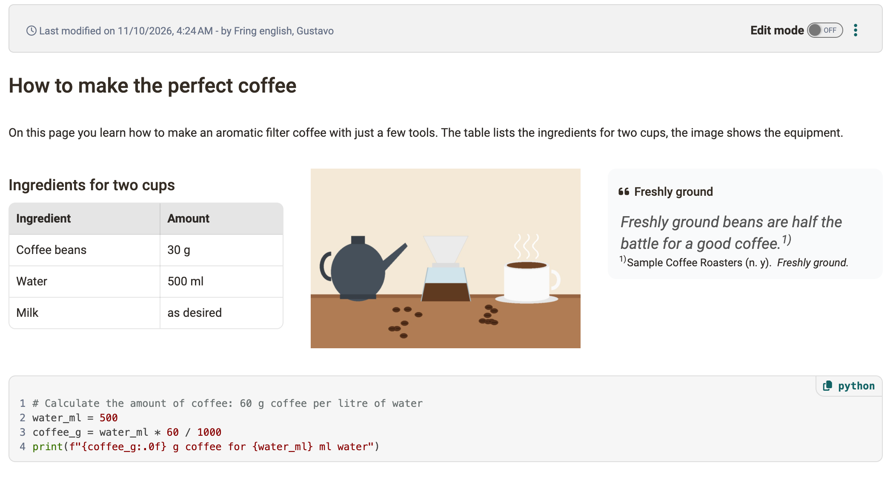
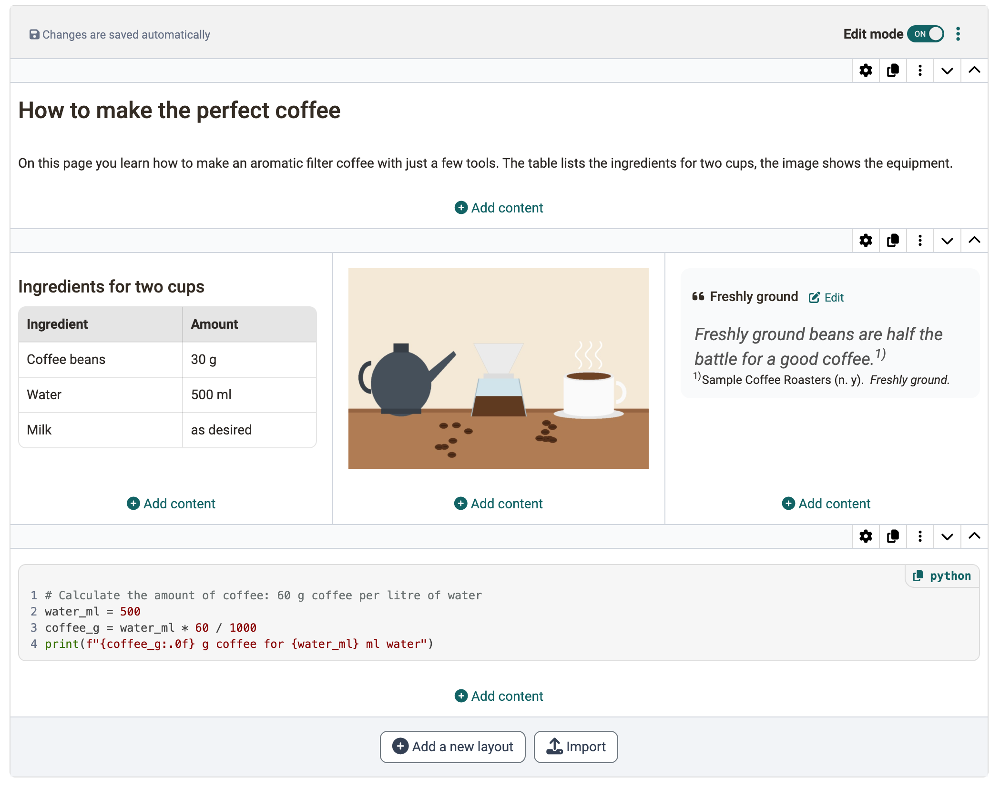
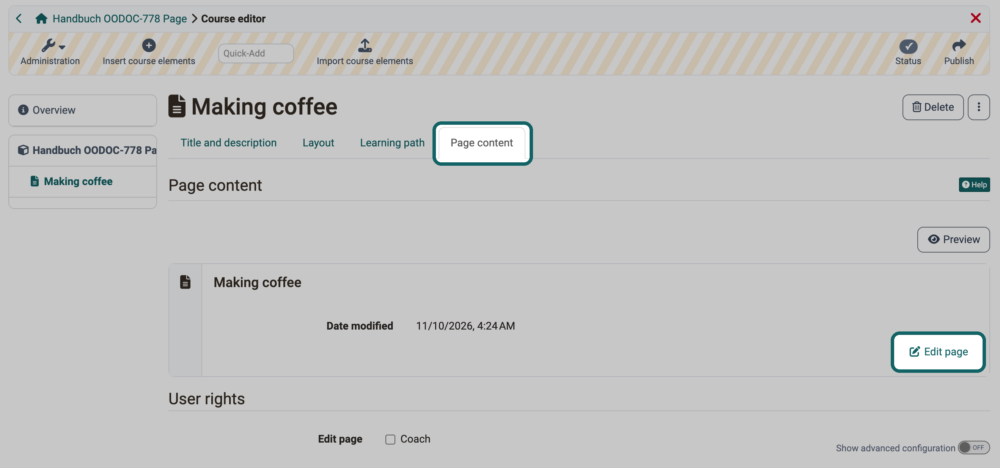
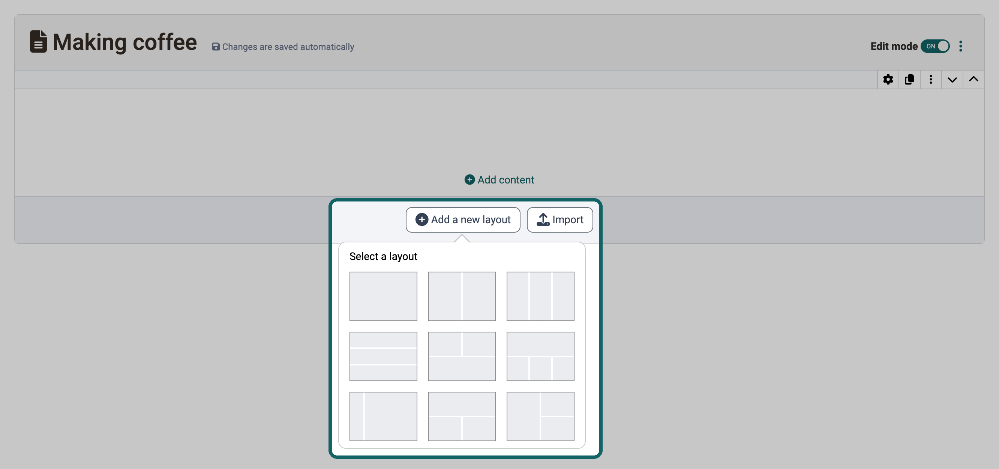
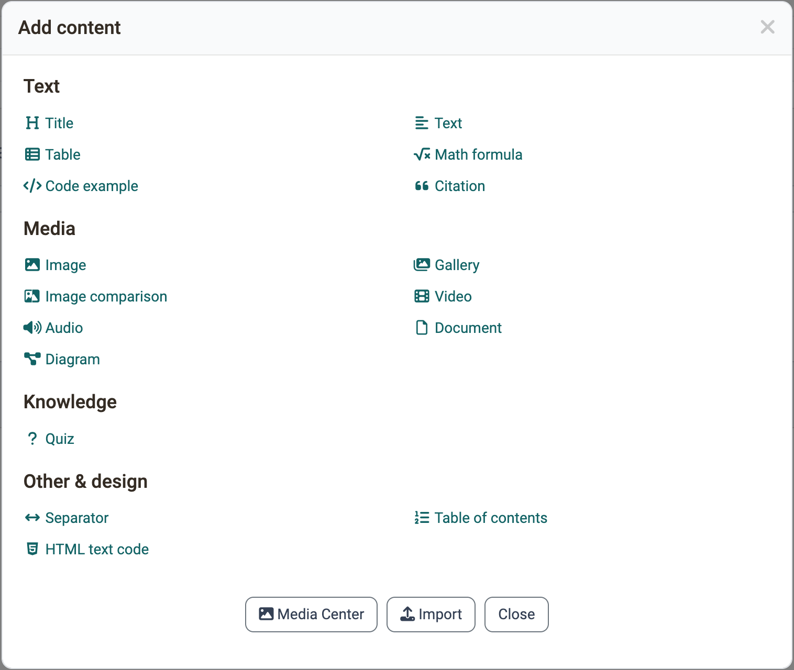
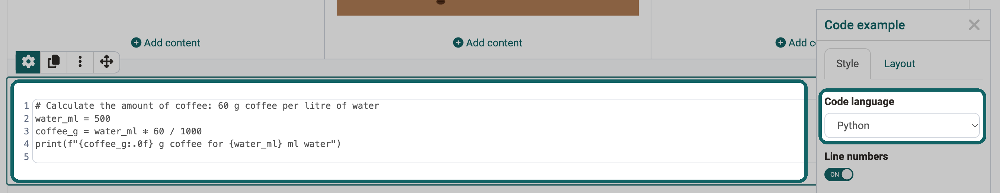
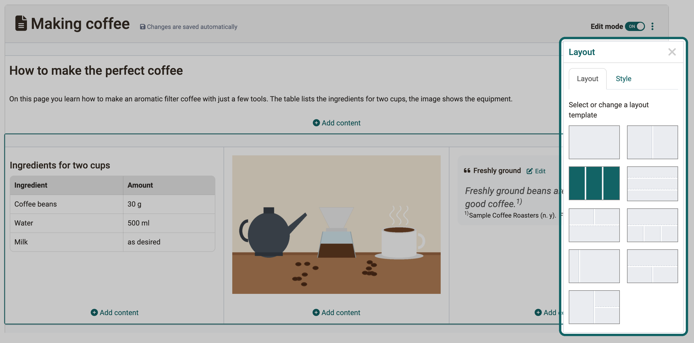
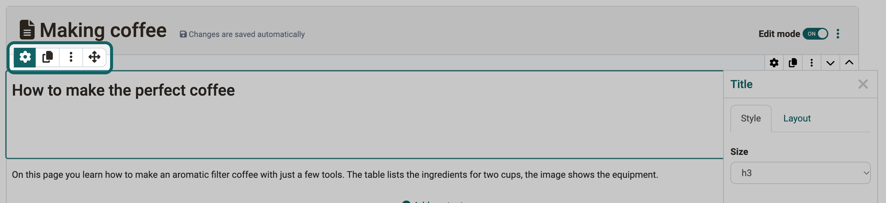

# Course Element "Page" {: #course_element_page}

## Profile

Name | Page
---------|----------
Icon | :o_icon_o_page_icon:
Available since | Release 18
Functional group | Knowledge Transfer
Purpose | Display of different content in a block-based layout
Assessable | no
Specialty / Note | Besides the course element Page, the block-based Content Editor is also available in the learning resource Form and in portfolio entries.

## Example

=== "Course view"

    With the course element Page you put texts, images, tables, videos and other content elements together on one page in the course. Layouts arrange the content in columns and rows.

    { class="shadow lightbox" title="Course element Page in the course view · 2026.11.10" }

=== "Edit mode"

    In edit mode you already see the page almost the way participants see it. This sets the Content Editor apart from the HTML editor of the course element "HTML page".

    { class="shadow lightbox" title="Course element Page in edit mode · 2026.11.10" }

## Create page content [:octicons-tag-16:{ title="from Release 18.0.0 (OO-6966)" }](https://track.frentix.com/issue/OO-6966){:target="_blank"}

You build the content of the page in the Content Editor. You open it in the course editor via the tab "Page content" of the course element: 
`Course > Administration > Course editor > Course element "Page" > Tab "Page content" > Edit page`

{ class="shadow lightbox" title="Course element Page in the course editor · 2026.11.10" }

In the Content Editor you first create a layout: click "Add a new layout" and select one of the nine layout templates. A layout divides the page into fields, for example into three columns. You add further layouts below in the same way.

{ class="shadow lightbox" title="Content Editor of the course element Page · 2026.11.10" }

You fill the page in two ways: you add content elements individually, or you import existing content in markdown or Word format in one step.

### Adding content elements individually {: #add_elements}

Each field of a layout holds one or more content elements, for example a title, a text and an image. The link "Add content" in the field opens the dialog of the same name. It sorts the content elements under four headings: "Text", "Media", "Knowledge" and "Other & design" [:octicons-tag-16:{ title="from Release 19.0.0 (OO-7830)" }](https://track.frentix.com/issue/OO-7830){:target="_blank"}.

{ class="shadow lightbox" title="Dialog Add content in the course element Page · 2026.11.10" }

In the course element Page the following content elements are available, ordered as in the dialog.

Under "Text":

* **Title:** A heading in one of the predefined sizes h1 to h6.
* **Text:** Running text that you design with a small HTML editor.
* **Table:** Content in rows and columns. You set the number of rows and columns in the inspector.
* **Math formula:** Mathematical formulas, created with the MathJax formula editor.
* **Code example:** Program code that the page displays without running it.
In the inspector you select one of 28 programming languages under "Code language", or "Automatic" and "Plain text" [:octicons-tag-16:{ title="from Release 18.2.0 (OO-7140)" }](https://track.frentix.com/issue/OO-7140){:target="_blank"}.
{ class="shadow lightbox" title="Content Editor of the course element Page · 2026.11.10" }
* **Citation:** A citation with source. Stored in the Media Center, it can be reused as a standalone content element.

Under "Media":

* **Image:** An image from the Media Center or a newly uploaded image.
* **Gallery:** Several images as a slideshow, in a grid or with small thumbnails [:octicons-tag-16:{ title="from Release 19.0.0 (OO-7142)" }](https://track.frentix.com/issue/OO-7142){:target="_blank"}
* **Image comparison:** Two superimposed images that a slider blends into each other [:octicons-tag-16:{ title="from Release 19.0.0 (OO-7143)" }](https://track.frentix.com/issue/OO-7143){:target="_blank"}
* **Video:** A video file from the Media Center, newly uploaded or newly recorded.
* **Audio:** Select audio from the Media Center, record it or add it as an MP3 or M4A file [:octicons-tag-16:{ title="from Release 18.1.1 (OO-7366)" }](https://track.frentix.com/issue/OO-7366){:target="_blank"}
* **Document:** You upload Word, PowerPoint or Excel documents or create them directly. You upload PDF and other files or take them from the Media Center.
* **Diagram:** Create a new draw.io diagram or select one from the list [:octicons-tag-16:{ title="from Release 18.1.0 (OO-7092)" }](https://track.frentix.com/issue/OO-7092){:target="_blank"}

Under "Knowledge":

* **Quiz:** Embeds quiz questions into the page, newly created or imported from the question bank [:octicons-tag-16:{ title="from Release 19.0.0 (OO-7145)" }](https://track.frentix.com/issue/OO-7145){:target="_blank"}. For essay questions, learners receive [AI feedback on their answer](../basic_concepts/Content_Editor.md#ai_feedback) here [:octicons-tag-16:{ title="from Release 21.0 (OO-9497)" }](https://track.frentix.com/issue/OO-9497){:target="_blank"}

Under "Other & design":

* **Separator:** A line that visually separates content.
* **Table of contents:** Lists the titles of the page as clickable jump marks [:octicons-tag-16:{ title="from Release 21.0 (OO-9411)" }](https://track.frentix.com/issue/OO-9411){:target="_blank"}
* **HTML text code:** Text that you design with the larger HTML editor, with more options than in the content element "Text".

At the bottom of the dialog there are two buttons. "Media Center" adds an element from your Media Center to the page; there you can also create new elements for the Media Center. "Import" takes over existing content, as described in the next section.

### Importing existing content from markdown or Word [:octicons-tag-16:{ title="from Release 20.3.0 (OO-9290)" }](https://track.frentix.com/issue/OO-9290){:target="_blank"} {: #markdown_import}

If content already exists in markdown format or as a Word document (.docx), you import it directly instead of building the page element by element [:octicons-tag-16:{ title="Word import from Release 21.0 (OO-9415)" }](https://track.frentix.com/issue/OO-9415){:target="_blank"}: as a file upload or as pasted text, e.g. from the clipboard. OpenOlat automatically converts the content into the matching content elements (Title, Text, Table, Code example, Image, etc.) and stores referenced images in the Media Center.

This allows content from external tools, plain text files or AI applications to be adopted as a page in the course without manual reformatting.

[Details on the import >](../basic_concepts/Content_Editor.md#markdown)

## Edit page (Edit mode)

### Edit layout

If the arrangement of the fields no longer fits, you change the layout template without creating the content again. To do so, click into the layout. OpenOlat shows a frame around the layout and, in the upper right corner, its toolbar: gear icon ("Edit settings"), "Duplicate", 3 dots ("More actions") and the arrows "Move down" and "Move up".

The gear icon opens the inspector "Layout", where you select a different layout template. As long as the inspector is open, it covers the toolbar of the layout. With the X ("Close inspector") you hide it again.

Existing content elements are preserved and can be moved to the new fields.

{ class="shadow lightbox" title="Inspector of a layout in the course element Page · 2026.11.10" }

### Edit content elements

To change, copy or move a content element, click it. Its toolbar with four icons appears in the upper left corner of the element.

{ class="shadow lightbox" title="Toolbar of a content element in the course element Page · 2026.11.10" }

* **Gear icon ("Edit settings"):** shows and hides the [inspector](../basic_concepts/Content_Editor.md#inspector) with the settings of the element.
* **Duplicate:** copies the element [:octicons-tag-16:{ title="from Release 20.1.0 (OO-7709)" }](https://track.frentix.com/issue/OO-7709){:target="_blank"}.
* **3 dots ("More actions"):** opens a menu with "Add before", "Add after", "Duplicate" and "Delete".
* **Arrow cross ("Drag content"):** moves the element by drag & drop to another position, also to another field or layout.

## Media storage

Images, videos, documents and other media that you insert into a page are stored by OpenOlat in the [Media Center](../personal_menu/Media_Center.md), not, as with the [course element "HTML page"](../learningresources/Course_Element_HTML_Page.md), in the [storage folder](../learningresources/Storage_folder.md) of the course. In the Media Center you find all inserted media again and manage and share them there.

You upload media to the Media Center in the personal menu or directly in the Content Editor when you create a new content element.

## Differences: Page - HTML-Page

|                        | Page                                      | HTML page                                 |
| -----------------------| ------------------------------ | ------------------------------ |
| Content creation | in Content Editor              | in HTML Editor                 |
| Layout             | block-based approach          | HTML Page                     |
| Creation effort     | lower, since pre-structured   | possibly higher                 |
| Preview               | directly in editor               |  separate tab "Display content" |
| Media                 | in Media Center               | in storage folder                |
| Editing by coaches possible | :material-check: | :material-check:      |
| Extended authorizations                    | :material-check: | :material-cancel:     |
| Integration pdf        | :material-check:               | :material-check:               |
| Integration Office-Documents | :material-check:         | :material-cancel:              |
| Integration draw.io Diagrams        | :material-check: | :material-cancel:     |

!!! tip "Tip"

    If you only want to include Office documents, the course elements "Document" or "Folder" are also suitable.

!!! info "Important"

    Course owners can always edit the page. Coaches can edit it if the checkbox "Coach" is selected for "Edit page" under "Rights" in the tab "Page content".

## Further information {: #further_information}

**Mentioned on this page** 
[Content Editor >](../basic_concepts/Content_Editor.md) 
[User tools: Media Center >](../personal_menu/Media_Center.md) 
[Course Element "HTML page" >](../learningresources/Course_Element_HTML_Page.md) 
[Storage folder >](../learningresources/Storage_folder.md)

**Further reading** 
[Course elements at a glance >](Course_Elements/index.md) 
[Course Element "Portfolio task" >](../learningresources/Course_Element_Portfolio_Task.md)

[To the top of the page ^](#course_element_page)

