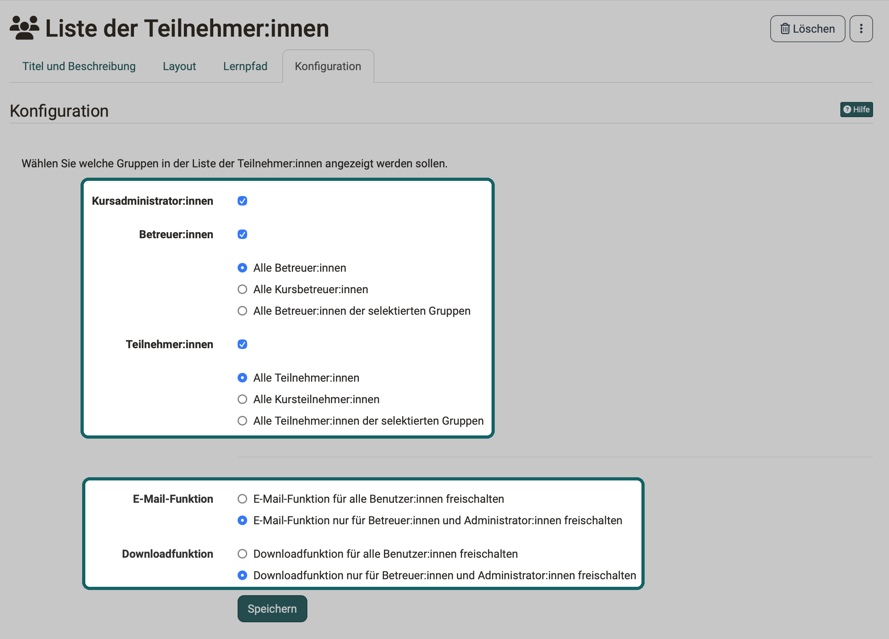

# Kursbaustein "Liste der Teilnehmer:innen"  {: #participant_list}

## Steckbrief

Name | Liste der Teilnehmer:innen
---------|----------
Icon | :o_icon_o_cmembers_icon:
Verfügbar seit | 
Funktionsgruppe | Kommunikation und Kollaboration
Verwendungszweck | Liste aller Kursmitglieder, gruppiert nach Rollen
Bewertbar | nein
Spezialität / Hinweis |

Der Kursbaustein "Liste der Teilnehmer:innen", oft auch Teilnehmerliste genannt, zeigt allen, die ihn öffnen, wer im Kurs dabei ist. Je nach Einstellung erscheinen darin die Kursadministrator:innen, die Betreuer:innen, die Teilnehmer:innen oder eine Auswahl dieser Gruppen. Die [Mitgliederverwaltung](../learningresources/Members_management.de.md) dagegen öffnen nur Besitzer:innen und Personen, die den Kurs mitverwalten, etwa mit dem Recht "Mitglieder-Verwaltung".

Die Liste zeigt die Mitglieder mit Foto, gruppiert unter "Kursadministrator:innen", "Betreuer:innen" und "Teilnehmer:innen". Wer mehrere Rollen hat, erscheint nur einmal, unter der höchsten Rolle. Welche Benutzergruppen die Liste anzeigt, legen Sie im Kurseditor fest: 
`Kurs > Administration > Kurseditor > Kursbaustein wählen > Tab "Konfiguration"`

Für Betreuer:innen und Teilnehmer:innen wählen Sie zusätzlich, wer genau in der Liste erscheint:

- "Alle Betreuer:innen" bzw. "Alle Teilnehmer:innen": alle Personen mit dieser Rolle, auch aus den Gruppen des Kurses und aus dem Course Planner
- "Alle Kursbetreuer:innen" bzw. "Alle Kursteilnehmer:innen": die Mitglieder des Kurses, auch die aus dem Course Planner, aber nicht die Mitglieder der Gruppen
- "Alle Betreuer:innen der selektierten Gruppen" bzw. "Alle Teilnehmer:innen der selektierten Gruppen": nur die Mitglieder der Gruppen, die Sie auswählen, einzeln oder über einen Lernbereich, der mehrere Gruppen zusammenfasst

Ist der Kurs im Course Planner eingebunden, steht zusätzlich die Option "Alle Betreuer:innen des ausgewählten Produkts" bzw. "Alle Teilnehmer:innen des ausgewählten Produkts" zur Wahl.

{ class="shadow lightbox" title="Konfiguration des Kursbausteins Liste der Teilnehmer:innen im Kurseditor · 2026.10.22" }

Über die Liste erreichen Sie die Visitenkarte der angezeigten Personen. Welche Angaben dort stehen, hängt davon ab, was die Personen in ihrem Profil hinterlegt haben. Erlaubt es die Konfiguration, schicken Sie allen oder ausgewählten Mitgliedern eine E-Mail oder laden die Liste herunter und drucken sie.

Mit der "E-Mail-Funktion" legen Sie im Kurseditor fest, ob alle Benutzer:innen aus der Liste E-Mails verschicken dürfen oder nur Betreuer:innen und Administrator:innen. In der Kursansicht verschicken Sie E-Mails über die Schaltfläche "E-Mail versenden", an einzelne Mitglieder oder an alle Mitglieder einer Rolle. Im Formular können Sie auch externe E-Mail-Adressen hinzufügen.

Ist der Chat in OpenOlat eingeschaltet, zeigt die Liste neben dem Namen jeder Person ihren Online-Status. Ein Klick darauf öffnet das Chatfenster (Instant Messenger).

Mit der "Downloadfunktion" legen Sie fest, wer die Liste als Excel-Datei herunterladen oder drucken darf: alle Benutzer:innen oder nur Betreuer:innen und Administrator:innen.

!!! info "Wichtig"

    Die Toolbar enthält ein Werkzeug mit demselben Namen "Liste der Teilnehmer:innen". Es zeigt eine ähnliche Liste, lässt sich aber nicht konfigurieren.

## Weiterführende Informationen {: #further_information}

**Auf dieser Seite erwähnt** 
[Mitgliederverwaltung](../learningresources/Members_management.de.md)

[Zum Seitenanfang ^](#participant_list)
