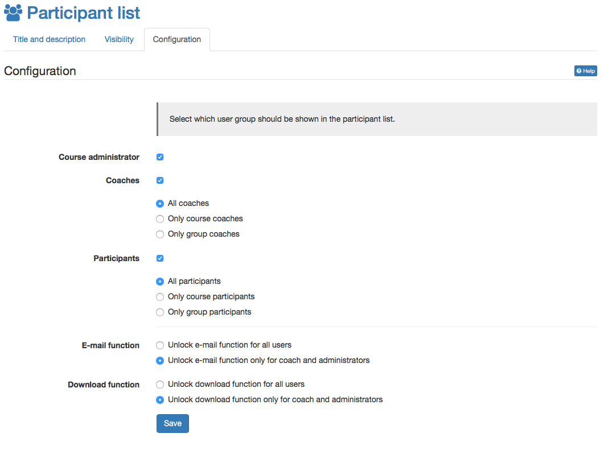

# Course Element "Participant list" {: #participant_list}

## Profile

Name | Participant list
---------|----------
Icon | :o_icon_o_cmembers_icon:
Available since | Release 8.0 (2012)
Functional group | Communication and collaboration
Purpose | List of all course participants, grouped by roles
Assessable | no
Specialty / Note |

The course element "Participant list" shows everyone who opens it who takes part in the course. Depending on the configuration, the list shows the course administrators, the coaches, the participants or a selection of these groups. The [Members management](../learningresources/Members_management.md), by contrast, is only opened by owners and by persons who co-manage the course, for example with the right "Members management".

The list shows the members with photo, grouped under "Course administrator", "Coach" and "Participant". A person with several roles appears only once, under the highest role. You define which user groups the list shows in the course editor: 
`Course > Administration > Course editor > Select course element > Tab "Configuration"`

For coaches and participants, you also choose who exactly appears in the list:

- "All coaches" or "All participants": all persons with this role, including those from the groups of the course and from the Course Planner
- "All coaches of the course" or "All participants of the course": the members of the course, including those from the Course Planner, but not the members of the groups
- "All coaches of the selected groups" or "All participants of the selected groups": only the members of the groups you select, individually or via a learning area that combines several groups

If the course is integrated in the Course Planner, the option "All coaches of the selected product" or "All participants of the selected product" is also available.

{ class="shadow lightbox" title="Configuration of the course element Participant list in the course editor" }

From the list you reach the visiting card of the persons shown. Which details it contains depends on what the persons have stored in their profile. If the configuration allows it, you send an e-mail to all or selected members or download the list and print it.

With the "E-mail function" you define in the course editor whether all users of the list may send e-mails or only coaches and administrators. In the course view, you send e-mails via the button "Send e-mail", to individual members or to all members of a role. In the form you can also add external e-mail addresses.

If the chat is switched on in OpenOlat, the list shows the online status of each person next to their name. A click on it opens the chat window (instant messenger).

With the "Download function" you define who may download the list as an Excel file or print it: all users or only coaches and administrators.

!!! info "Important"

    The toolbar contains a tool with the same name "Participant list". It shows a similar list but cannot be configured.

## Further information {: #further_information}

**Mentioned on this page** 
[Members management >](../learningresources/Members_management.md)

**Further reading** 
[Types of Course Elements >](Course_Elements.md) 
[Toolbar: Overview >](Toolbar.md) 
[Personal Configuration: Profile >](../personal_menu/Profile.md)

[To the top of the page ^](#participant_list)

