# Kursbaustein "Portfolioaufgabe" {: #course_element_portfolio}

## Steckbrief

Name | Portfolioaufgabe
---------|----------
Icon | :o_icon_o_ep_icon:
Verfügbar seit | Release 7.1 oder früher
Funktionsgruppe | Wissensüberprüfung
Verwendungszweck | Bereitstellung einer Portfolio-Mappe für jede Teilnehmer:in zur Bearbeitung
Bewertbar | ja
Spezialität / Hinweis |

### Funktionsweise

* Autor:innen stellen über den Kursbaustein "Portfolioaufgabe" eine vorbereitete Mappe für alle Teilnehmer:innen bereit.
* Teilnehmer:innen holen die Portfolioaufgabe im Kurs ab und erhalten damit eine eigene Mappe in ihrem Portfolio.
* In dieser Mappe bearbeiten sie die Aufgaben mit Inhalten unterschiedlicher Formate.
* Auf Wunsch geben sie die Mappe ihren Betreuer:innen oder weiteren Personen frei. Je nach Zugangsrecht kommentieren oder bewerten diese Personen die Mappe.

!!! tip "Tipp"

    Für die Portfolioaufgabe brauchen Sie eine Lernressource ["Portfolio 2.0 Vorlage"](../learningresources/Portfolio_template_Creation.de.md). Sie erstellen die Vorlage direkt im Kursbaustein im [Tab "Lerninhalt"](#tab_learning_content) oder vorab im Autorenbereich.

---

## Sicht Autor:in (Portfolioaufgabe erstellen) {: #view_author}

### Tab Titel und Beschreibung {: #tab_title}

Wie bei allen Kursbausteinen bestimmen Sie in diesem Tab den Seitentitel, den Titel links im Kursmenü und die Beschreibung.

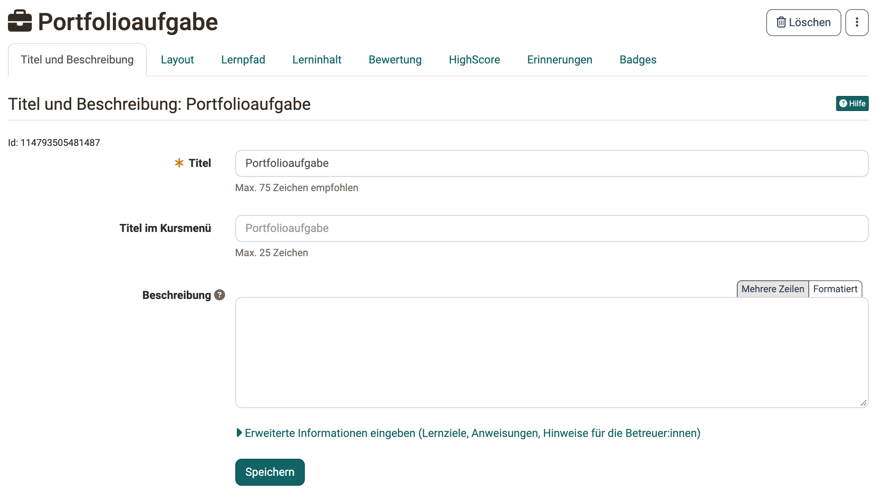{ class="shadow lightbox" title="Tab Titel und Beschreibung der Portfolioaufgabe im Kurseditor · 2026.11.02" }

### Tab Layout {: #tab_layout}

In diesem Tab legen Sie fest, wie der Kursbaustein im Kurs erscheint. Unter "Anzeige" wählen Sie, ob Titel und Beschreibung sichtbar sind. Mit "Hintergrundbild", "Stil Hintergrundbild" und "Farbkategorie" gestalten Sie die Überschrift des Kursbausteins. Die "Vorschau" zeigt das Ergebnis.

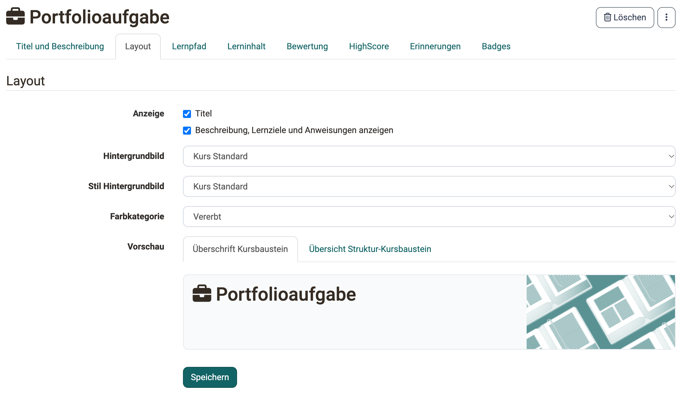{ class="shadow lightbox" title="Tab Layout der Portfolioaufgabe im Kurseditor · 2026.11.02" }

### Tab Lernpfad {: #tab_learning_path}

In diesem Tab legen Sie unter anderem das Erledigungskriterium fest, also wann die Portfolioaufgabe als erledigt gilt.

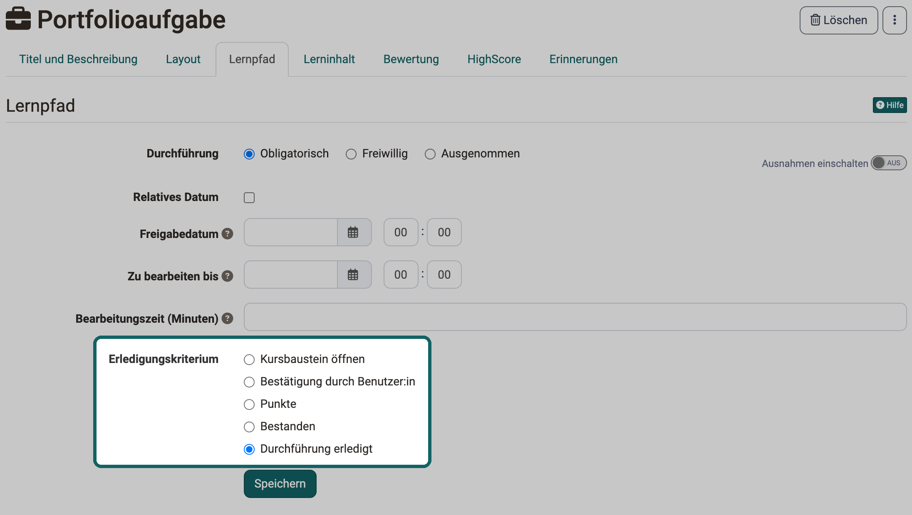{ class="shadow lightbox" title="Tab Lernpfad der Portfolioaufgabe im Kurseditor · 2026.11.02" }

### Tab Lerninhalt {: #tab_learning_content}

Nachdem Sie dem Kurs einen Kursbaustein "Portfolioaufgabe" hinzugefügt haben, verbinden Sie ihn mit einer Lernressource ["Portfolio 2.0 Vorlage"](../learningresources/Portfolio_template_Creation.de.md). Dafür öffnen Sie im Kurseditor den Tab "Lerninhalt".

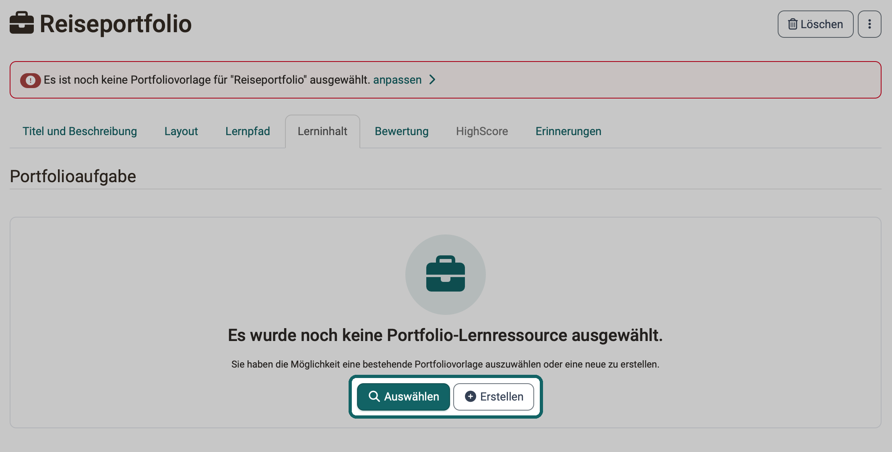{ class="shadow lightbox" title="Tab Lerninhalt der Portfolioaufgabe ohne Vorlage · 2026.11.02" }

Mit "Erstellen" legen Sie direkt im Kurs eine neue Portfoliovorlage an. Mit "Auswählen" verknüpfen Sie eine zuvor erstellte Vorlage.

Soll die Vorlage ein Formular enthalten, legen Sie das Formular als Lernressource "Formular" an, nicht als Kursbaustein "Formular". Wie das geht, zeigt die Anleitung [Wie erstelle ich eine Formular-Lernressource?](../../manual_how-to/create_a_form/create_a_form.de.md)

Wenn Sie dem Kursbaustein eine Vorlage hinzugefügt haben, zeigt der Tab "Lerninhalt" ihren Namen und unter "Abgeholt", wie oft die Vorlage bereits abgeholt wurde. Mit "Lernressource bearbeiten" bearbeiten Sie die Vorlage. Mit "Vorschau" sehen Sie sich die Vorlage an. Mit "Ersetzen" hinterlegen Sie eine andere Vorlage.

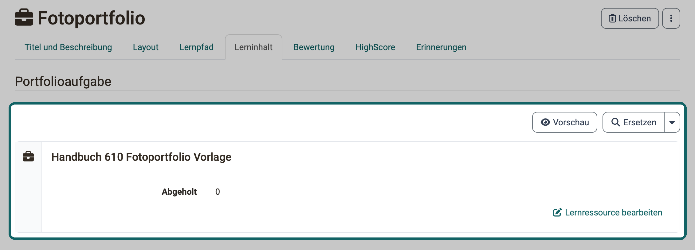{ class="shadow lightbox" title="Tab Lerninhalt mit gewählter Portfoliovorlage · 2026.11.02" }

!!! info "Wichtig"

    Sobald eine Teilnehmer:in die Portfolioaufgabe abgeholt hat, lässt sich die Vorlage nicht mehr ersetzen. So arbeiten alle Teilnehmer:innen mit derselben Vorlage.

### Tab Bewertung {: #tab_assessment}

Soll die Portfolioaufgabe bewertet werden, konfigurieren Sie im Kurseditor zusätzlich den Tab "Bewertung".

Sind für die Portfolioaufgabe bereits Bewertungen vorhanden, zeigt OpenOlat in diesem Tab die Einstellungen unter "Konfiguration Bewertung" schreibgeschützt an. Bearbeitbar bleibt der Bereich "Bewertungsformular". Mit "Bearbeitungsmodus aktivieren" machen Sie die Einstellungen wieder bearbeitbar, siehe [Schreibschutz der Bewertungskonfiguration](Course_Elements.de.md#assessment_config_read_only). [:octicons-tag-16:{ title="ab Release 21.1 (OO-9647)" }](https://track.frentix.com/issue/OO-9647)

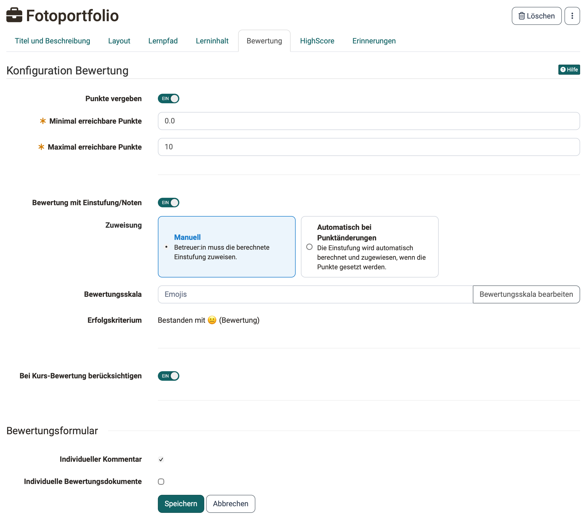{ class="shadow lightbox" title="Tab Bewertung der Portfolioaufgabe im Kurseditor · 2026.11.02" }

Wie Betreuer:innen eine Portfolioaufgabe kommentieren und bewerten, erfahren Sie auf der Seite [Portfolioaufgabe: kommentieren und bewerten](../learningresources/Portfolio_assignment_Grading.de.md).

### Tab HighScore [:octicons-tag-16:{ title="ab Release 11.3 (OO-2133)" }](https://track.frentix.com/issue/OO-2133) {: #tab_highscore}

Mit dem Tab "HighScore" zeigen Sie den Teilnehmer:innen, wie ihre Punkte im Vergleich zu den anderen abschneiden. Der Tab ist erst aktiv, wenn im Tab "Bewertung" die Vergabe von Punkten eingeschaltet ist. Dann schalten Sie hier einzeln ein, was die Teilnehmer:innen sehen, zum Beispiel das Siegertreppchen oder die "Liste der besten Teilnehmer:innen".

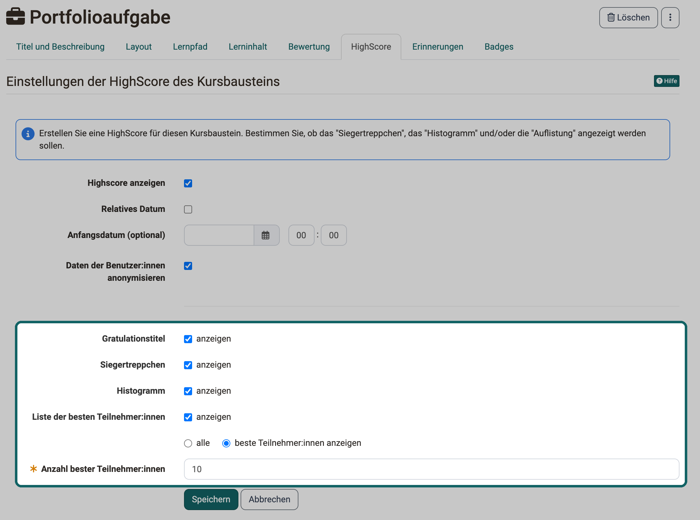{ class="shadow lightbox" title="Tab HighScore der Portfolioaufgabe im Kurseditor · 2026.11.02" }

### Tab Erinnerungen {: #tab_reminders}

Wie bei anderen Kursbausteinen richten Sie hier den automatischen Versand von [Erinnerungen](../learningresources/Course_Reminders.de.md) ein. Als Bedingung zum Kursbaustein stehen "Punkte" und "Bestanden" zur Wahl, sofern Sie im Tab "Bewertung" Punkte oder Bestanden/Nicht bestanden eingeschaltet haben.

### Tab Badges {: #tab_badges}

Haben Besitzer:innen des Kurses unter [`Kurs > Administration > Einstellungen > Bewertung > Badges`](../learningresources/Course_Settings_Assessment.de.md#section_badges) die Vergabe von Badges eingeschaltet, zeigt der Kurseditor für diesen Kursbaustein den Tab "Badges". Dort erstellen Besitzer:innen des Kurses mit "Einen neuen Badge erstellen" einen Badge eigens für diesen Kursbaustein.

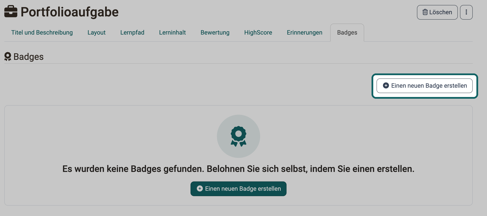{ class="shadow lightbox" title="Tab Badges der Portfolioaufgabe im Kurseditor · 2026.11.02" }

[Zum Seitenanfang ^](#course_element_portfolio)

---

## Sicht Teilnehmer:in {: #view_participant}

### Schritt 1: Portfolioaufgabe abholen

Hat eine Autor:in im Kurs eine Portfolioaufgabe vorbereitet, öffnen Sie als Teilnehmer:in den Kursbaustein im Kursmenü. Mit dem Button "Portfolioaufgabe abholen" erhalten Sie eine Kopie der Vorlage zur Bearbeitung in Ihrem eigenen Portfolio.

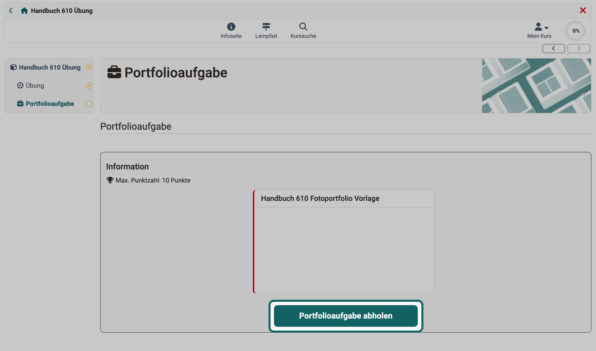{ class="shadow lightbox" title="Kursbaustein Portfolioaufgabe im Kurs · 2026.11.02" }

[Zum Seitenanfang ^](#course_element_portfolio)

---

### Schritt 2: Übersicht und Zugriff nach Abholung [:octicons-tag-16:{ title="ab Release 19.0 (OO-7482)" }](https://track.frentix.com/issue/OO-7482)

Nach dem Abholen zeigt der Kursbaustein in der "Leistungsübersicht" den Stand Ihrer Bearbeitung: Erfolgsstatus, Punkte und das Datum der Abholung. Mit "Portfolio öffnen" öffnen Sie die Mappe zur Bearbeitung.

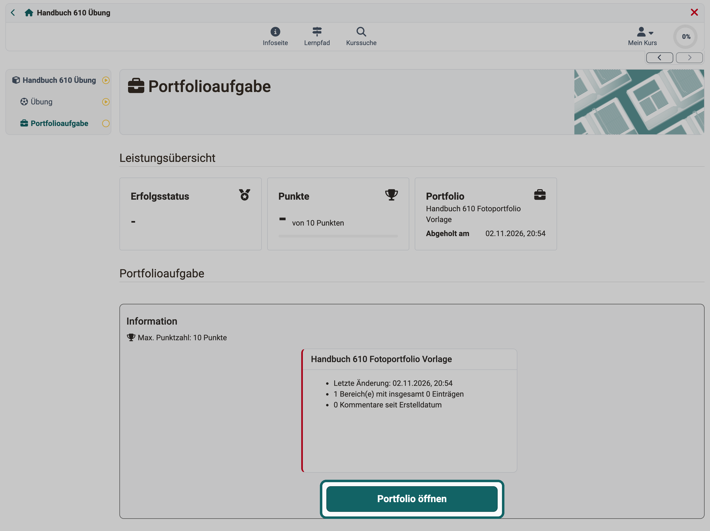{ class="shadow lightbox" title="Abgeholte Portfolioaufgabe im Kurs · 2026.11.02" }

Die abgeholte Mappe finden Sie ausserdem in Ihrem [persönlichen Menü](../personal_menu/Personal_Tools.de.md) unter: 
`Portfolio 2.0 > Zu meinen Mappen`

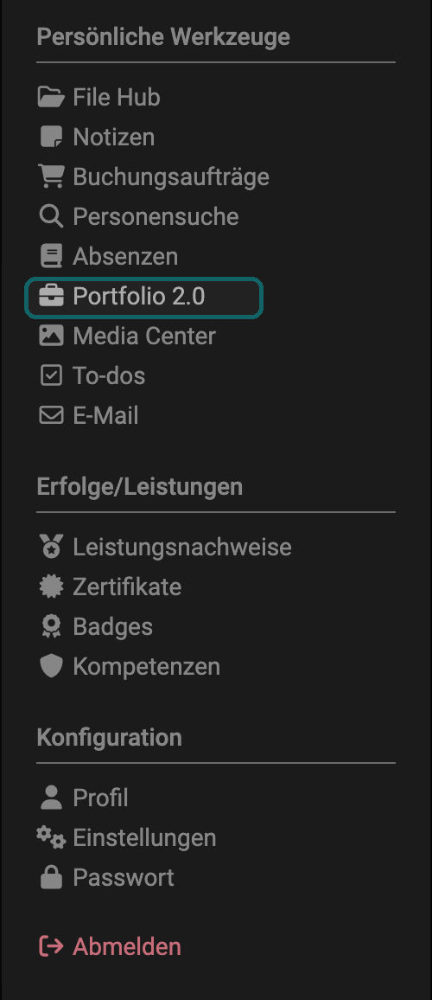{ width="250" class="shadow lightbox" title="Persönliches Menü · 2026.11.02" }

!!! note "Hinweis"

    Im persönlichen Portfolio sind auch Ihre weiteren Mappen sichtbar. Alle aus einem Kurs abgeholten Portfolioaufgaben sind mit einem roten Strich am linken Rand gekennzeichnet und enthalten unterhalb des Titels den Hinweis auf den zugehörigen Kurs.

Nach dem Abholen öffnen Sie die Mappe also im Kurs oder über Ihr persönliches Menü.

[Zum Seitenanfang ^](#course_element_portfolio)

---

### Schritt 3: Portfolioaufgabe bearbeiten

**Schritt 3a:** Öffnen Sie die Mappe.

Je nachdem, wie die Autor:in die Portfolioaufgabe vorbereitet hat, stehen Ihnen als Teilnehmer:in unterschiedliche Bereiche mit Aufgabenstellungen zur Verfügung:

* Hat die Autor:in eine Anleitung und weitere Unterlagen zum Herunterladen angehängt?
* Hat die Autor:in vorgesehen, dass Sie neue Einträge erstellen? Dann bearbeiten Sie die Aufgaben mit dem [Portfolio Editor](../area_modules/The_portfolio_editor_17_1.de.md) und fügen passende Inhalte hinzu, etwa Texte, Bilder oder Videos. Die Autor:in erlaubt das in der Vorlage mit der Option "Benutzer:innen dürfen neue Einträge erstellen" unter `Portfolio 2.0 Vorlage > Administration > Einstellungen > Einstellungen`, siehe [Portfoliovorlage: Administration und Bearbeitung](Portfolio_template_Administration_and_editing.de.md).
* Hat die Autor:in vorgesehen, dass Sie eine Mappe auch wieder löschen dürfen? Dann steht Ihnen in der Mappe links oben die Schaltfläche "Mappe löschen" zur Verfügung.
* Hat die Autor:in vorgesehen, dass Sie ein Formular ausfüllen? Dann finden Sie es in den angezeigten Bereichen.

**Beispiel:** 

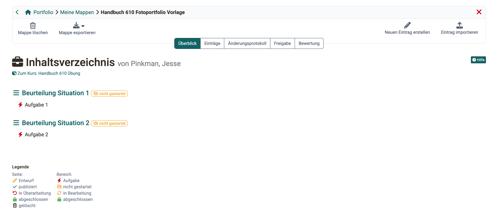{ class="shadow lightbox" title="Portfolio-Mappe, Tab Überblick · 2026.11.02" }

**Schritt 3b:** Klicken Sie auf einen Bereich oder auf den Tab "Einträge".

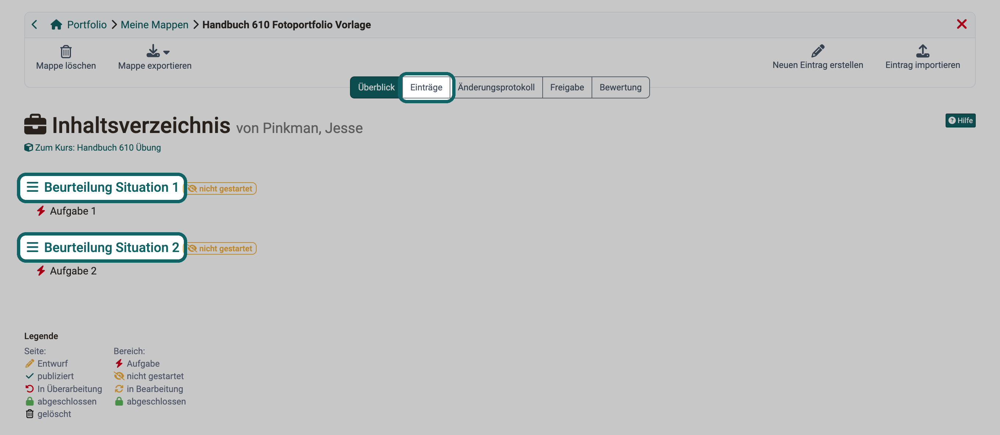{ class="shadow lightbox" title="Portfolio-Mappe, Tab Überblick · 2026.11.02" }

**Schritt 3c:** Wählen Sie dort eine angezeigte Aufgabe oder suchen Sie die Aufgaben in den anderen Bereichen. In der Tabellenansicht klicken Sie direkt auf die Aufgabe.

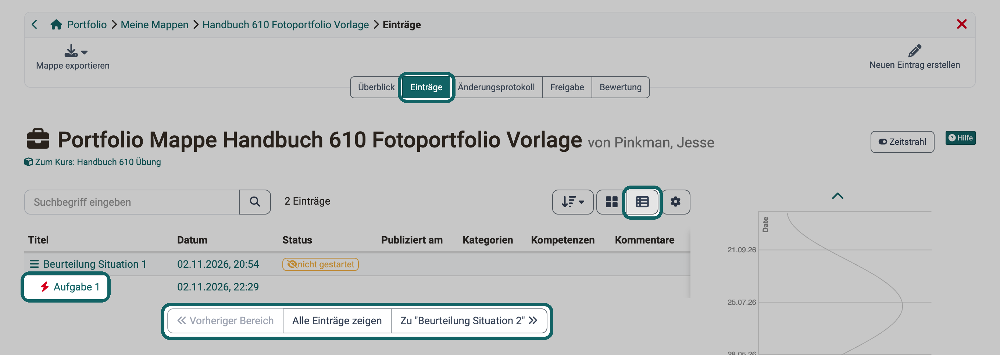{ class="shadow lightbox" title="Portfolio-Mappe, Tab Einträge · 2026.11.02" }

In der Listenansicht wählen Sie die Aufgabe im Auswahlfeld "Wählen Sie eine Aufgabe zur Bearbeitung".

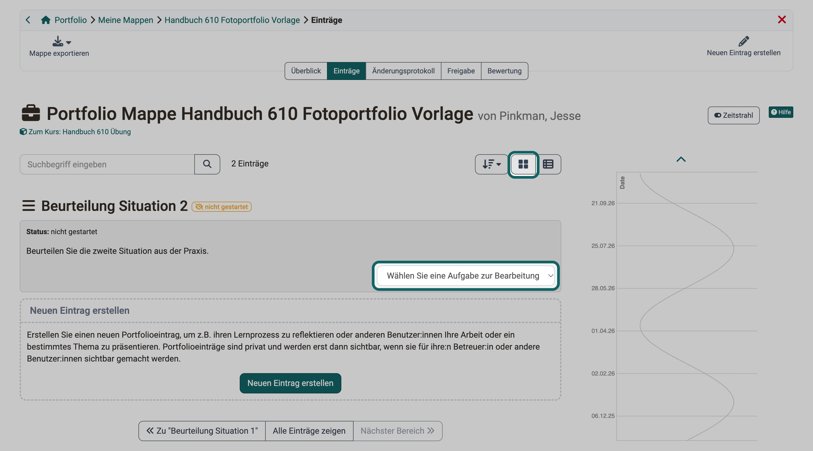{ class="shadow lightbox" title="Portfolio-Mappe, Tab Einträge · 2026.11.02" }

**Schritt 3d:** Folgen Sie den Anweisungen. Autor:innen gestalten Aufgaben ganz unterschiedlich. Im folgenden Beispiel können Sie ein Dokument herunterladen und Ihre Antwort ergänzen.

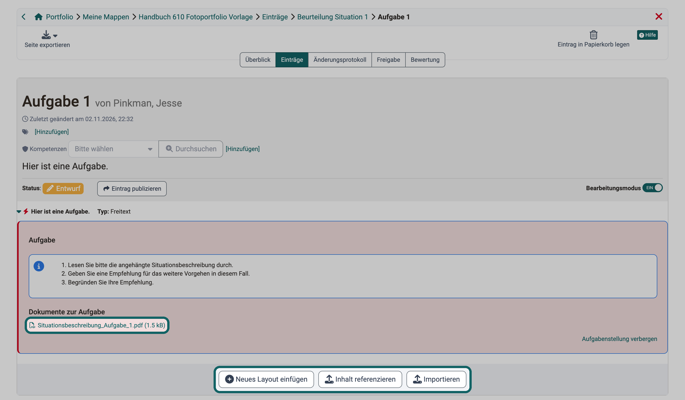{ class="shadow lightbox" title="Portfolio-Mappe, Eintrag zur Aufgabe · 2026.11.02" }

#### Beispiel: Antwort in einem Layout-Block {: #answer_layout_block}

Im folgenden Beispiel beantworten Sie die Aufgabe in einem Layout-Block, den Sie mit eigenen Inhalten füllen.

**Schritt 3e:** Fügen Sie mit "Neues Layout einfügen" einen Layout-Block hinzu und wählen Sie die Spalten.

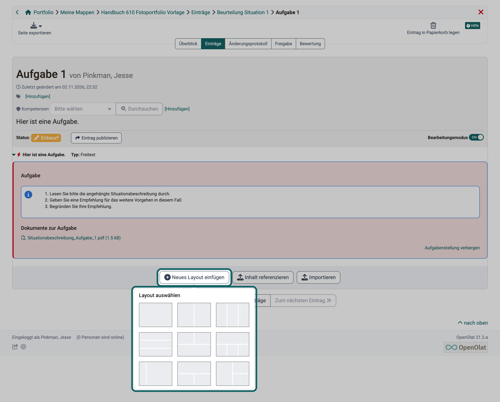{ class="shadow lightbox" title="Portfolio-Mappe, Eintrag zur Aufgabe · 2026.11.02" }

**Schritt 3f:** Fügen Sie mit "Inhalt hinzufügen" Inhalte in die Spalten des Layout-Blocks ein.

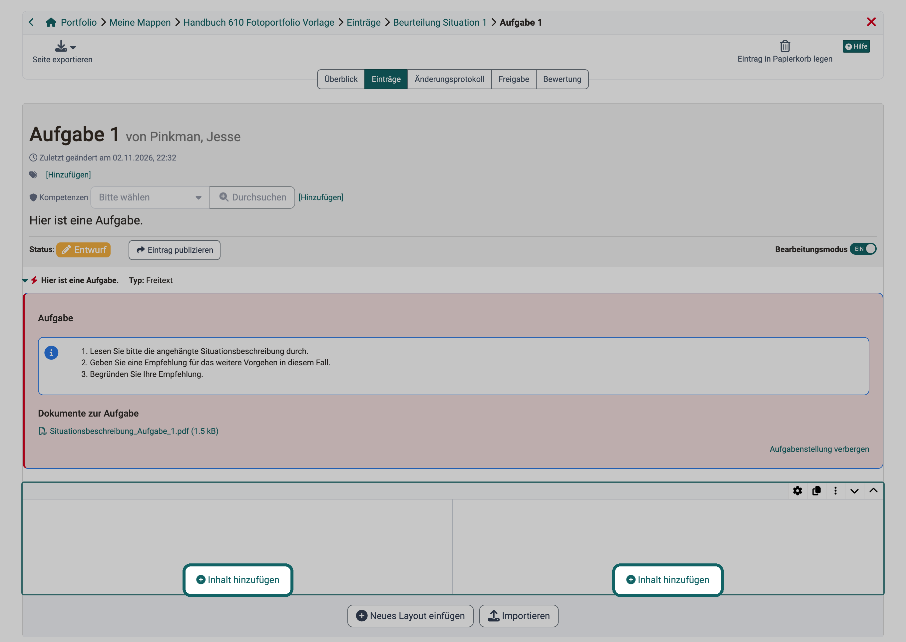{ class="shadow lightbox" title="Portfolio-Mappe, Eintrag zur Aufgabe · 2026.11.02" }

**Schritt 3g:** Wählen Sie im Dialog "Inhalt hinzufügen" die passende Art von Inhalt.

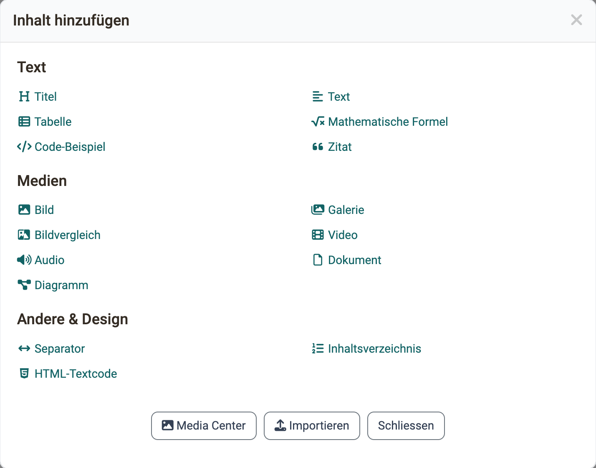{ class="shadow lightbox" title="Portfolio-Mappe, Dialog Inhalt hinzufügen · 2026.11.02" }

**Schritt 3h:** Hier antwortet die Teilnehmer:in mit einem selbst aufgezeichneten Video.

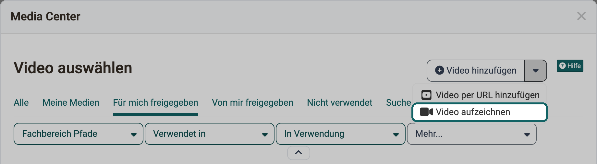{ class="shadow lightbox" title="Media Center in einem Eintrag · 2026.11.02" }

#### Beispiel: Inhalt referenzieren {: #reference_content}

Haben Sie einen passenden Inhalt bereits in einem anderen Eintrag erstellt, referenzieren Sie ihn, statt ihn neu zu erstellen. Der Eintrag bindet den Inhalt dann als Verweis ein. Die Schaltfläche "Inhalt referenzieren" steht unter der Aufgabe, solange der Eintrag noch keinen Inhalt enthält.

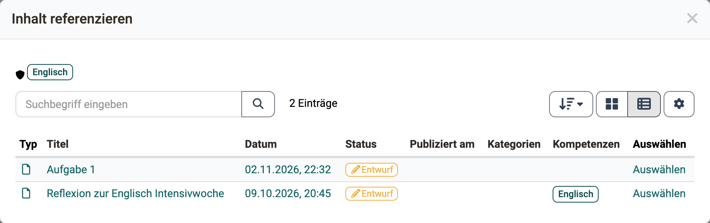{ class="shadow lightbox" title="Dialog Inhalt referenzieren · 2026.11.02" }

#### Beispiel: Formular ausfüllen {: #fill_in_form}

Enthält die Portfolioaufgabe ein Formular, das die Autor:in vorbereitet hat, füllen Sie es direkt im Eintrag aus. Mit "Speichern" sichern Sie Ihre Antworten. Der Eintrag bleibt im Status "Entwurf", bis Sie ihn publizieren.

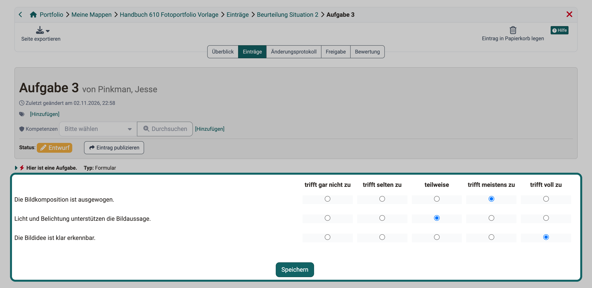{ class="shadow lightbox" title="Formular in einem Eintrag · 2026.11.02" }

#### Wie behalte ich die Übersicht über den Bearbeitungsstand? {: #editing_status}

Sowohl im Tab "Überblick" als auch im Tab "Einträge" zeigen Ihnen Symbole und Status, wie weit Sie mit den einzelnen Bereichen und Einträgen sind.

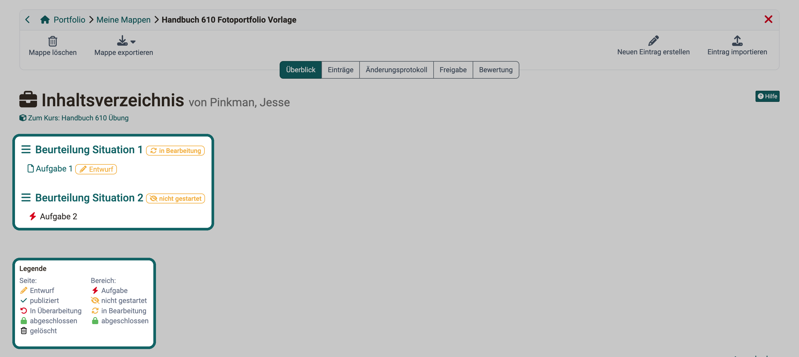{ class="shadow lightbox" title="Portfolio-Mappe, Tab Überblick · 2026.11.02" }

[Zum Seitenanfang ^](#course_element_portfolio)

---

### Schritt 4: Eintrag publizieren {: #publish}

Ist ein Eintrag fertig, publizieren Sie ihn mit "Eintrag publizieren". Erst dann sehen ihn die Personen, die Zugang zu Ihrer Mappe haben, und können ihn kommentieren. Bis dahin hat der Eintrag den Status "Entwurf".

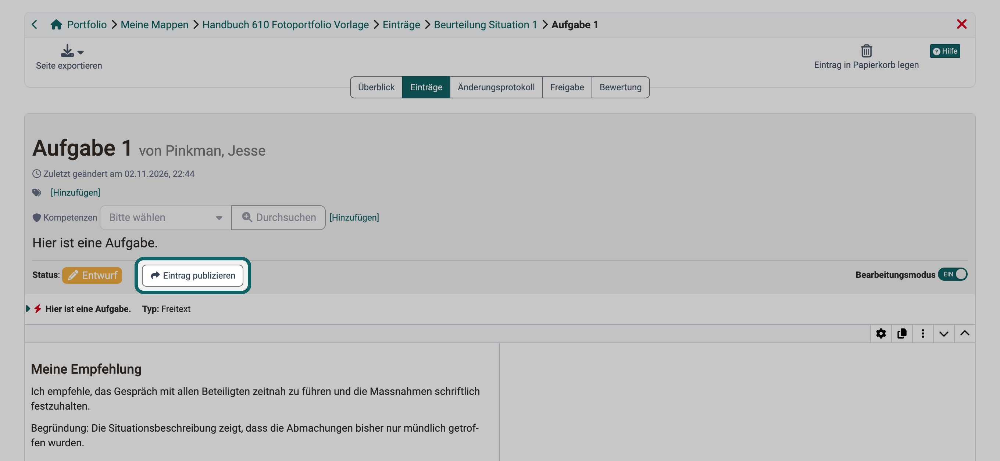{ class="shadow lightbox" title="Portfolio-Mappe, Eintrag vor dem Publizieren · 2026.11.02" }

!!! warning "Achtung"

    Einen publizierten Eintrag können Sie nicht mehr ändern, die Personen mit Zugang können ihn nur noch kommentieren. Bearbeitbar wird er erst wieder, wenn eine Betreuer:in ihn mit "Überarbeitung anfordern" an Sie zurückgibt, siehe [Portfolioaufgabe: kommentieren und bewerten](Portfolio_assignment_Grading.de.md#rework_request_rework). Publizieren Sie einen Eintrag deshalb erst, wenn er fertig ist.

[Zum Seitenanfang ^](#course_element_portfolio)

---

### Schritt 5: Zugangsrecht für die Portfolio-Mappe vergeben

Damit Ihre Betreuer:innen Ihre Mappe beurteilen können, geben Sie ihnen ein Zugangsrecht. Dasselbe gilt für alle weiteren Personen, die Ihre Mappe sehen sollen. Sie vergeben Zugangsrechte an zwei Orten:

**A) Freigabe Ihrer Portfolio-Mappe im Kurs**

Im Kursbaustein der Portfolioaufgabe steht unten der Abschnitt "Portfolio Überprüfung" mit dem Button "Zugangsrecht hinzufügen".

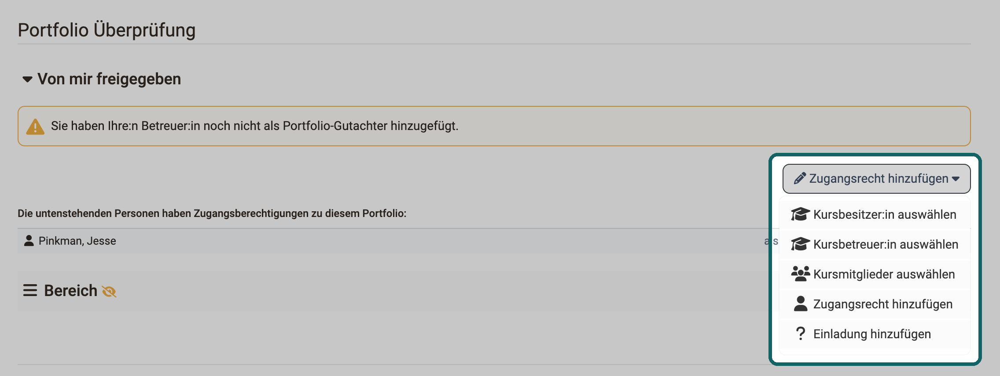{ class="shadow lightbox" title="Abschnitt Portfolio Überprüfung im Kursbaustein Portfolioaufgabe · 2026.11.02" }

 

**B) Freigabe Ihrer Portfolio-Mappe in den Einstellungen der Mappe**

Öffnen Sie die Mappe und wählen Sie den Tab "Freigabe". Dort erscheint der Button "Zugangsrecht hinzufügen".

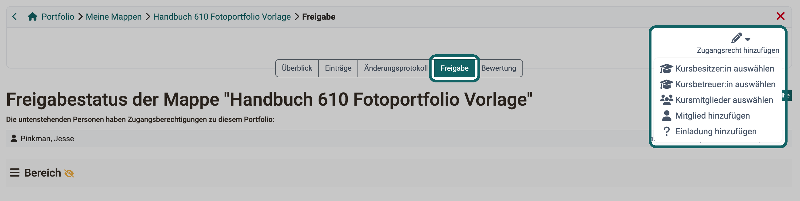{ class="shadow lightbox" title="Tab Freigabe einer Mappe · 2026.11.02" }

 

**Freigabe an externe Benutzer:innen**

Für die Freigabe an externe Personen ohne eigenes OpenOlat-Konto wählen Sie "Einladung hinzufügen". OpenOlat verschickt dann eine Einladung per E-Mail. Externe Personen erhalten den Zugang für höchstens 180 Tage.

[Zum Seitenanfang ^](#course_element_portfolio)

---

**Der Wizard zur Einrichtung der Freigabe**

"Zugangsrecht hinzufügen" führt Sie durch einen Wizard. Darin legen Sie fest,

* für welche Personen Sie Ihre Mappe freigeben.
* ob die Personen kommentieren, bewerten oder beides dürfen, getrennt nach Bereichen Ihrer Mappe. Externe Personen können nur kommentieren, aber nicht bewerten.
* ob OpenOlat eine E-Mail mit dem Link zur Mappe verschickt.

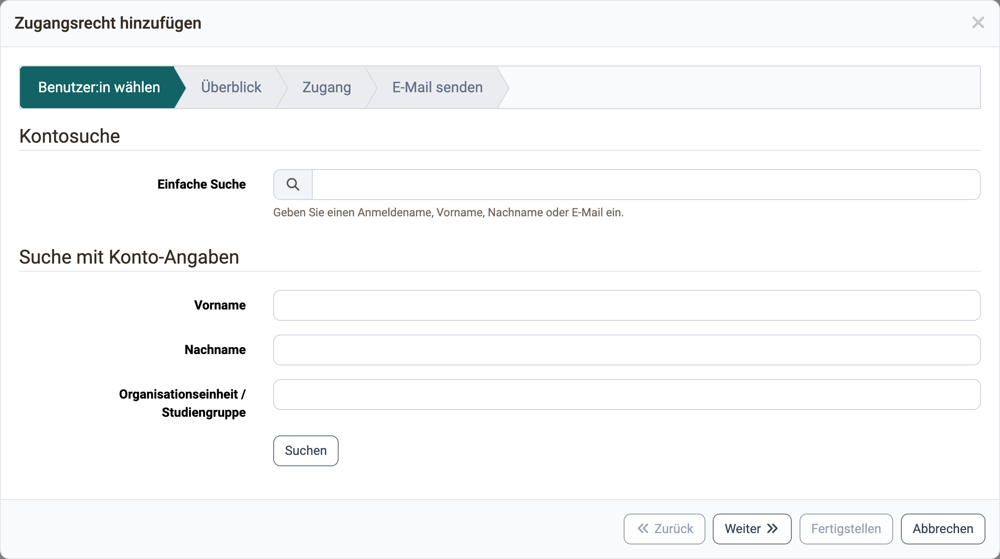{ class="shadow lightbox" title="Wizard Zugangsrecht hinzufügen · 2026.11.02" }

!!! tip "Tipp"

    Richten Sie die Freigabe für Ihre Betreuer:innen schon zu Beginn Ihrer Bearbeitung ein, begleiten diese Ihre Arbeit von Anfang an: Die Betreuer:innen sehen jeden Eintrag, den Sie publizieren. Einen publizierten Eintrag bearbeiten Sie allerdings erst wieder, wenn eine Betreuer:in eine Überarbeitung anfordert.

[Zum Seitenanfang ^](#course_element_portfolio)

---

## Sicht Betreuer:in {: #view_coach}

Wie Betreuer:innen eine Portfolioaufgabe kommentieren und bewerten, erfahren Sie auf der Seite [Portfolioaufgabe: kommentieren und bewerten](../learningresources/Portfolio_assignment_Grading.de.md).

[Zum Seitenanfang ^](#course_element_portfolio)

---

## Weiterführende Informationen {: #further_information}

**Auf dieser Seite erwähnt** 
[Portfoliovorlage: Erstellung >](Portfolio_template_Creation.de.md) 
[Wie erstelle ich eine Formular-Lernressource? >](../../manual_how-to/create_a_form/create_a_form.de.md) 
[Kursbausteine >](Course_Elements.de.md) 
[Portfolioaufgabe: kommentieren und bewerten >](Portfolio_assignment_Grading.de.md) 
[Erinnerungen >](Course_Reminders.de.md) 
[Kurseinstellungen - Tab Bewertung >](Course_Settings_Assessment.de.md) 
[Persönliche Werkzeuge >](../personal_menu/Personal_Tools.de.md) 
[Der Portfolio Editor >](../area_modules/The_portfolio_editor_17_1.de.md) 
[Portfoliovorlage: Administration und Bearbeitung >](Portfolio_template_Administration_and_editing.de.md)

**Weiterführend** 
[Allgemeines zum Portfolio >](../area_modules/Portfolio_General_Information.de.md) 
[Bestandteile des Portfolios >](../area_modules/Components_of_the_portfolio.de.md) 
[Meine Mappen >](../area_modules/My_portfolio_binders.de.md) 
[Meine Einträge >](../area_modules/My_entries.de.md) 
[Formulare - Übersicht >](Form.de.md) 
[Formular in der Portfolio 2.0 Vorlage >](Forms_in_the_ePortfolio_template.de.md) 
[Der Formulareditor >](Form_Editor.de.md) 
[Formular-Elemente >](Form_Elements.de.md) 
[Badges >](OpenBadges.de.md) 
[Zugangskonfiguration / Freigabe >](Access_configuration.de.md)

[Zum Seitenanfang ^](#course_element_portfolio)

