# Course Element "Portfolio Task" {: #course_element_portfolio}

## Profile

Name | Portfolio Task
---------|----------
Icon | :o_icon_o_ep_icon:
Available since | 
Functional group | Assessment
Purpose | Provision of a portfolio binder for each participant to work on
Assessable | yes
Specialty / Note |

### Functionality

* Authors use the "Portfolio Task" course element to provide a prepared binder for all participants.
* Participants collect the portfolio task in the course and receive their own binder in their portfolio.
* In this binder, they work on the assignments with content in different formats.
* If they wish, they share the binder with their coaches or other persons. Depending on the access right, these persons comment on or assess the binder.

!!! tip "Tip"

    For the portfolio task you need a learning resource ["Portfolio 2.0 template"](../learningresources/Portfolio_template_Creation.md). You create the template directly in the course element in the [tab "Learning content"](#tab_learning_content) or beforehand in the authoring area.

---

## Author perspective (Create portfolio task) {: #view_author}

### Tab title and description {: #tab_title}

As with all course elements, you determine the page title, the title on the left in the course menu and the description in this tab.

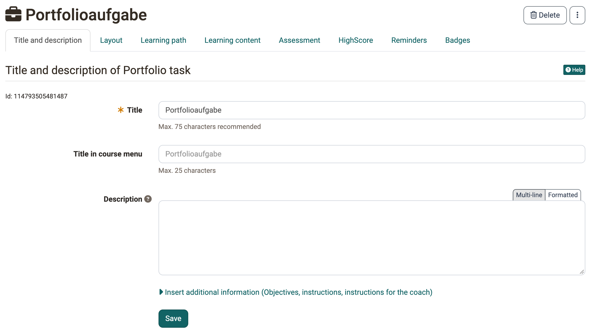{ class="shadow lightbox" title="Tab Title and description of the portfolio task in the course editor · 2026.11.02" }

### Tab Layout {: #tab_layout}

In this tab you define how the course element appears in the course. Under "Display" you choose whether the title and description are visible. With "Teaser image", "Teaser image style" and "Color category" you design the header of the course element. The "Preview" shows the result.

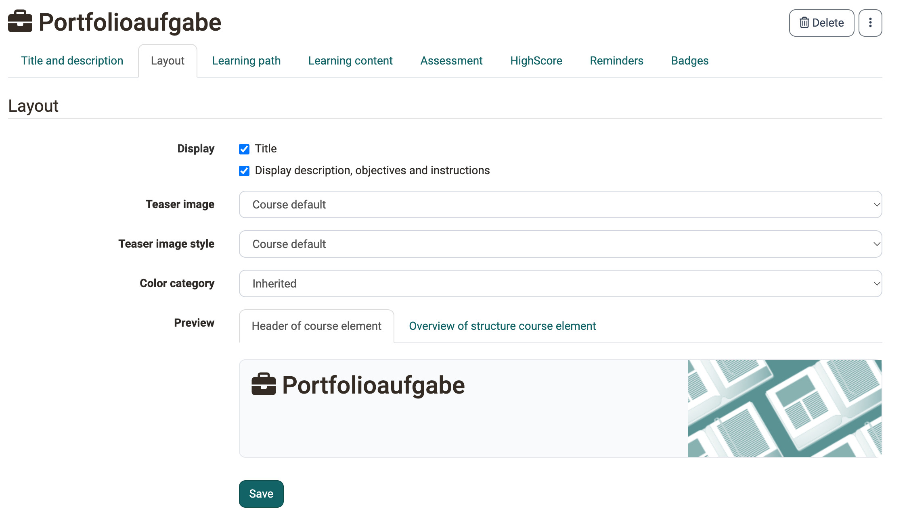{ class="shadow lightbox" title="Tab Layout of the portfolio task in the course editor · 2026.11.02" }

### Tab Learning path {: #tab_learning_path}

In this tab you define, among other things, the completion criterion, that is, when the portfolio task is considered completed.

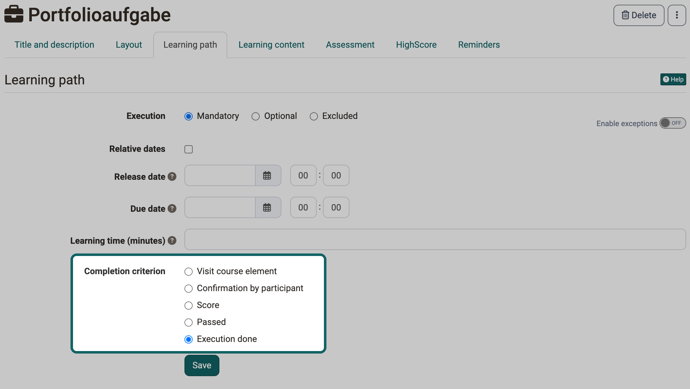{ class="shadow lightbox" title="Tab Learning path of the portfolio task in the course editor · 2026.11.02" }

### Tab Learning content {: #tab_learning_content}

Once you have added a "Portfolio Task" course element to the course, link it to a learning resource ["Portfolio 2.0 template"](../learningresources/Portfolio_template_Creation.md). To do this, open the "Learning content" tab in the course editor.

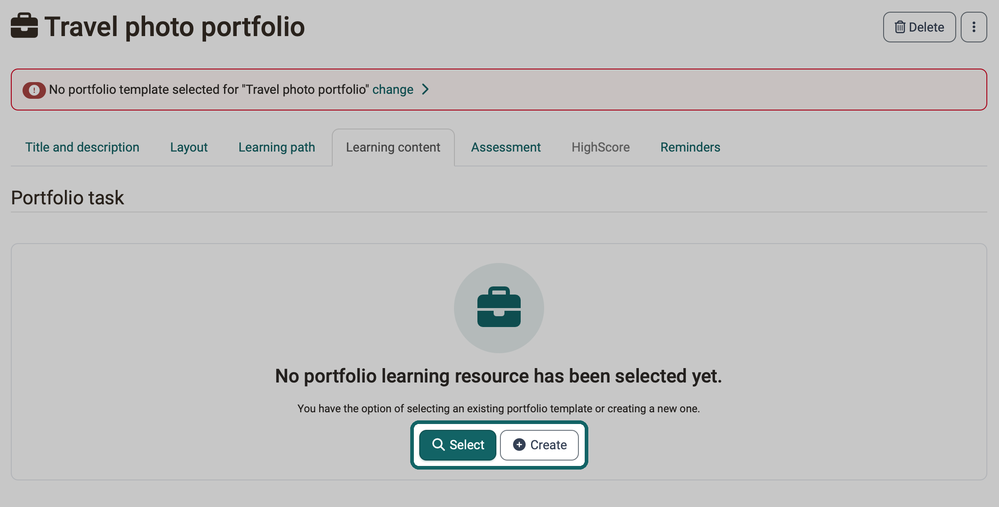{ class="shadow lightbox" title="Tab Learning content of the portfolio task without template · 2026.11.02" }

With "Create" you create a new portfolio template directly in the course. With "Select" you link a previously created template.

If the template is to contain a form, create the form as a learning resource "Form", not as a course element "Form". The instructions [How do I create a form learning resource?](../../manual_how-to/create_a_form/create_a_form.md) show how.

If you have added a template to the course element, the "Learning content" tab shows its name and, under "Collected", how often the template has already been collected. With "Edit learning resource" you edit the template. With "Preview" you view the template. With "Replace" you link a different template.

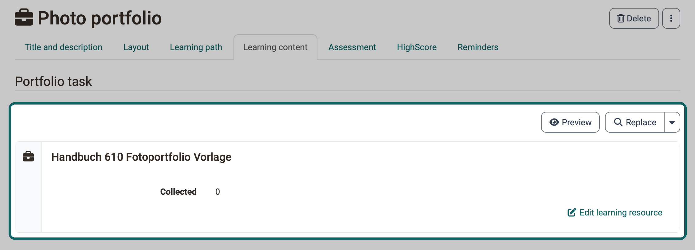{ class="shadow lightbox" title="Tab Learning content with the selected portfolio template · 2026.11.02" }

!!! info "Important"

    As soon as a participant has collected the portfolio task, the template can no longer be replaced. This way, all participants work with the same template.

### Tab Assessment {: #tab_assessment}

If the portfolio task is to be assessed, also configure the "Assessment" tab in the course editor.

If assessments already exist for the portfolio task, OpenOlat displays the settings under "Grading configuration" in this tab as read-only. The area "Assessment form" remains editable. With "Enable edit mode" you make the settings editable again, see [Read-only assessment configuration](Assessment.md#assessment_config_read_only). [:octicons-tag-16:{ title="from Release 21.1 (OO-9647)" }](https://track.frentix.com/issue/OO-9647)

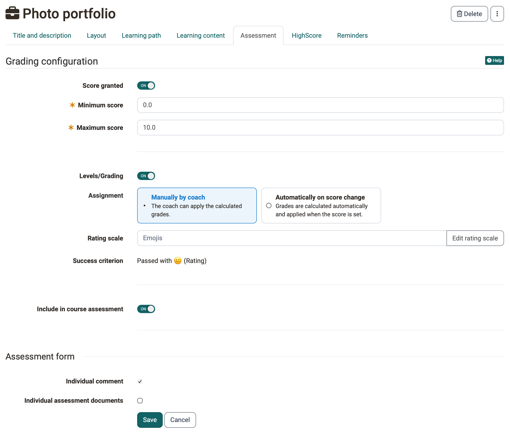{ class="shadow lightbox" title="Tab Assessment of the portfolio task in the course editor · 2026.11.02" }

You can find out how coaches comment on and assess a portfolio task on the page [Portfolio assignment: Grading](../learningresources/Portfolio_assignment_Grading.md).

### Tab HighScore [:octicons-tag-16:{ title="from Release 11.3 (OO-2133)" }](https://track.frentix.com/issue/OO-2133) {: #tab_highscore}

With the "HighScore" tab you show participants how their points compare with those of the others. The tab only becomes active once the awarding of points has been switched on in the "Assessment" tab. You then switch on one by one what the participants see, for example the podium or the "Top results listing".

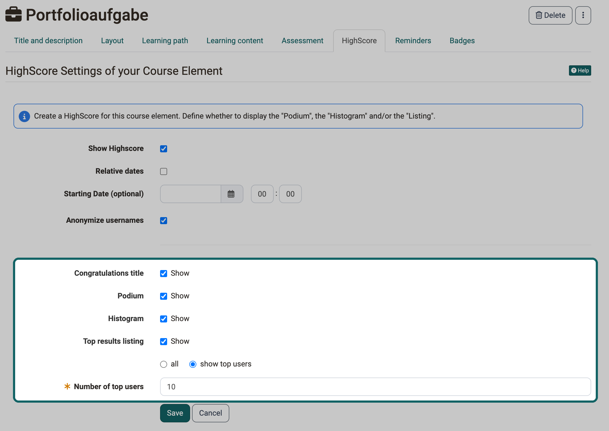{ class="shadow lightbox" title="Tab HighScore of the portfolio task in the course editor · 2026.11.02" }

### Tab Reminders {: #tab_reminders}

As with other course elements, you set up the automatic sending of [reminders](../learningresources/Course_Reminders.md) here. As a condition on the course element, "Score" and "Passed" are available, provided you have switched on score or passed/failed in the "Assessment" tab.

### Tab Badges {: #tab_badges}

If the owners of the course have switched on the awarding of badges under [`Course > Administration > Settings > Assessment > Badges`](../learningresources/Course_Settings_Assessment.md#section_badges), the course editor shows the tab "Badges" for this course element. There, the owners of the course create a badge specifically for this course element with "Create a new badge".

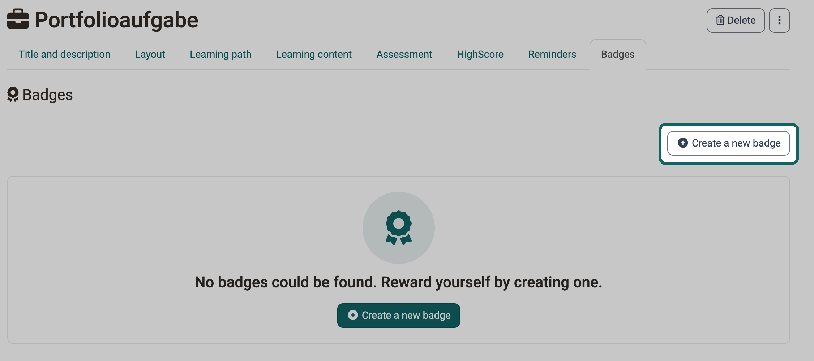{ class="shadow lightbox" title="Tab Badges of the portfolio task in the course editor · 2026.11.02" }

[To the top of the page ^](#course_element_portfolio)

---

## Participant perspective {: #view_participant}

### Step 1: Collect portfolio task

If an author has prepared a portfolio task in the course, open the course element in the course menu as a participant. With the "Collect portfolio task" button you receive a copy of the template for editing in your own portfolio.

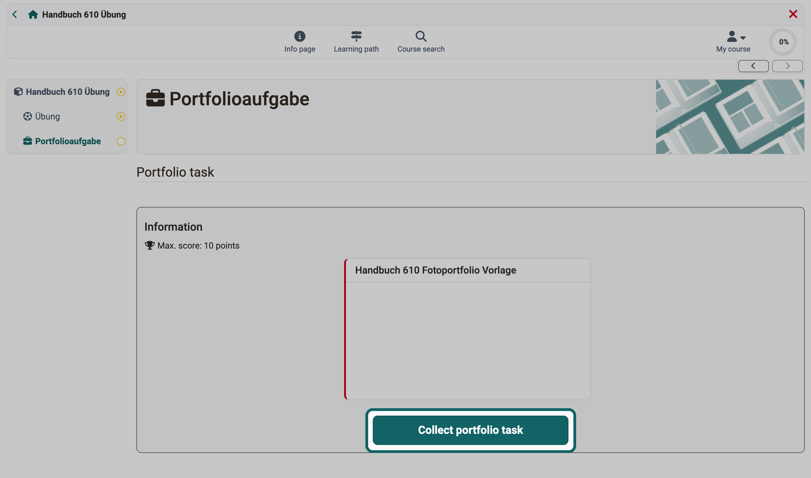{ class="shadow lightbox" title="Course element Portfolio Task in the course · 2026.11.02" }

[To the top of the page ^](#course_element_portfolio)

---

### Step 2: Overview and access after collection

After collecting, the course element shows the status of your work in the "Performance summary": success status, score and the date of collection. With "Open portfolio" you open the binder for editing.

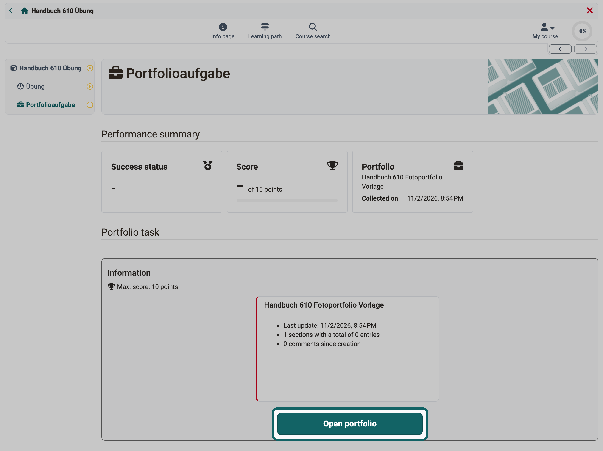{ class="shadow lightbox" title="Collected portfolio task in the course · 2026.11.02" }

You also find the collected binder in your [personal menu](../personal_menu/Personal_Tools.md) under: 
`Portfolio 2.0 > Go to my binders`

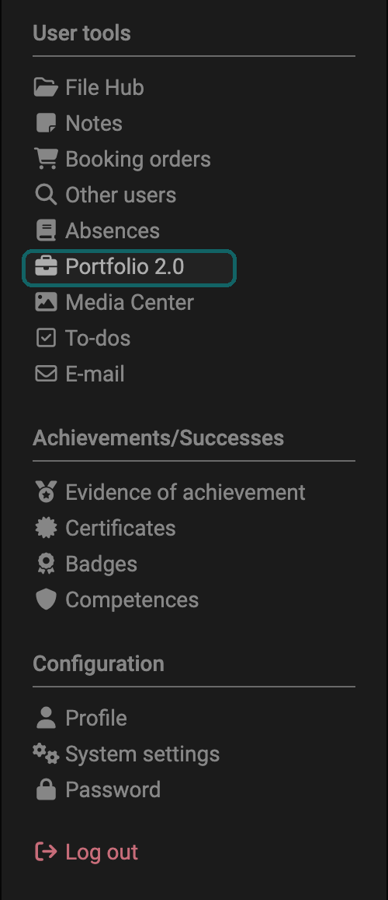{ width="250" class="shadow lightbox" title="Personal menu · 2026.11.02" }

!!! note "Note"

    Your other binders are also visible in your personal portfolio. All portfolio tasks collected from a course are marked with a red line in the left-hand margin and show the associated course below the title.

After collecting, you therefore open the binder in the course or via your personal menu.

[To the top of the page ^](#course_element_portfolio)

---

### Step 3: Edit portfolio task

**Step 3a:** Open the binder.

Depending on how the author has prepared the portfolio task, different sections with assignments are available to you as a participant:

* Has the author attached instructions and other documents for download?
* Did the author intend for you to create new entries? If so, you edit the assignments with the [Portfolio Editor](../area_modules/The_portfolio_editor_17_1.md) and add suitable content, such as texts, images or videos. The author allows this in the template with the option "Users are allowed to create new entries" under `Portfolio 2.0 template > Administration > Settings > Options`, see [Portfolio template: Administration and editing](Portfolio_template_Administration_and_editing.md).
* Did the author intend for you to be able to delete a binder? If so, the button "Delete binder" is available at the top left of the binder.
* Did the author intend for you to fill out a form? If so, you will find it in the sections shown.

**Example:** 

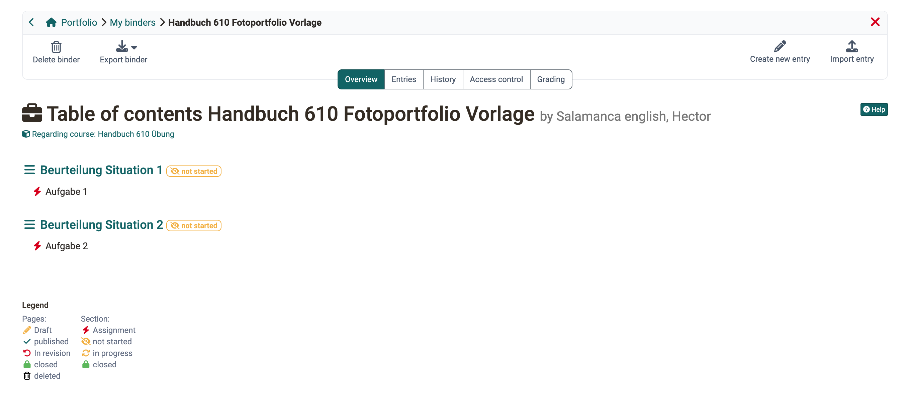{ class="shadow lightbox" title="Portfolio binder, tab Overview · 2026.11.02" }

**Step 3b:** Click on an area or on the "Entries" tab.

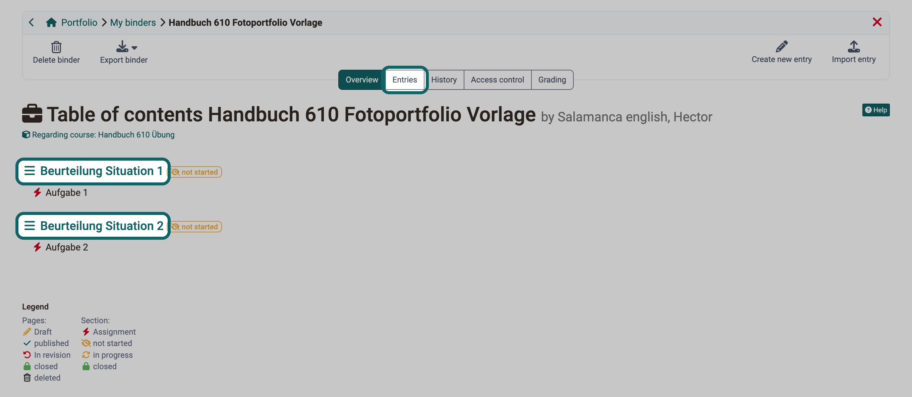{ class="shadow lightbox" title="Portfolio binder, tab Overview · 2026.11.02" }

**Step 3c:** Select a displayed task or search for the tasks in the other areas. In the table view, click the assignment directly.

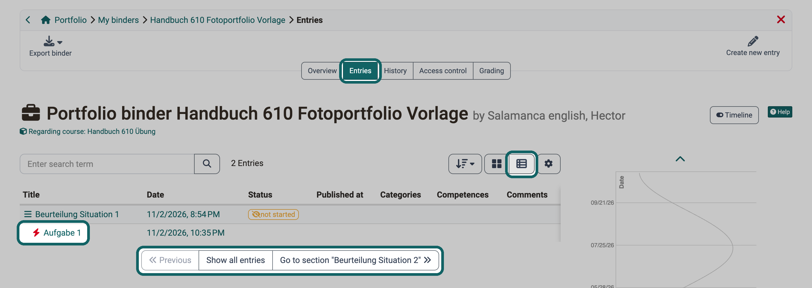{ class="shadow lightbox" title="Portfolio binder, tab Entries · 2026.11.02" }

In the list view, select the assignment in the selection field "Choose an assignment for editing".

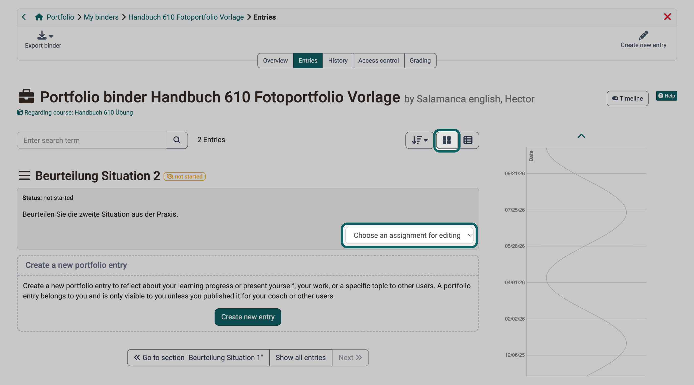{ class="shadow lightbox" title="Portfolio binder, tab Entries · 2026.11.02" }

**Step 3d:** Follow the instructions. Authors design assignments very differently. In the following example, you can download a document and complete your answer.

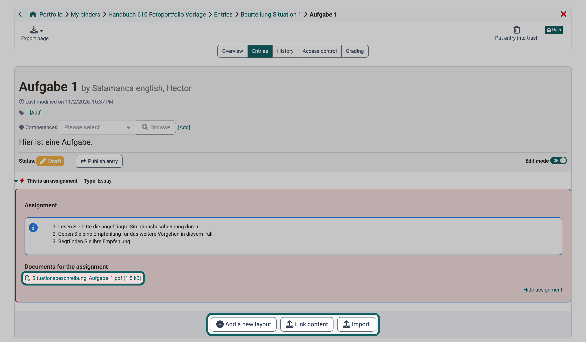{ class="shadow lightbox" title="Portfolio binder, entry of the assignment · 2026.11.02" }

#### Example: Answer in a layout block {: #answer_layout_block}

In the following example, you answer the assignment in a layout block that you fill with your own content.

**Step 3e:** With "Add a new layout" add a layout block and select the columns.

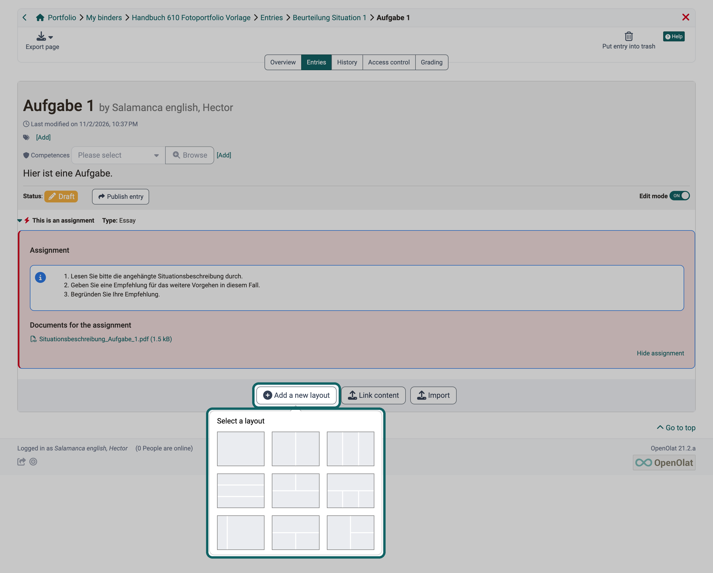{ class="shadow lightbox" title="Portfolio binder, entry of the assignment · 2026.11.02" }

**Step 3f:** With "Add content" insert content into the columns of the layout block.

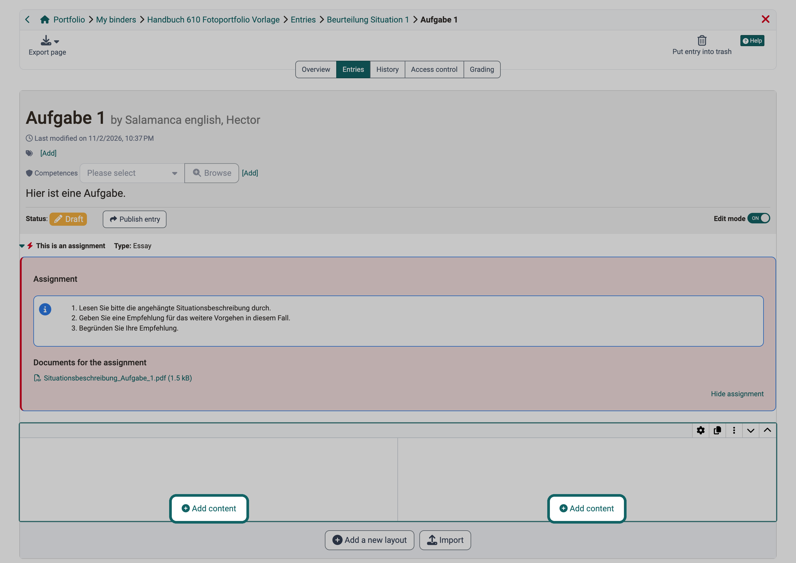{ class="shadow lightbox" title="Portfolio binder, entry of the assignment · 2026.11.02" }

**Step 3g:** In the dialog "Add content", select the suitable type of content.

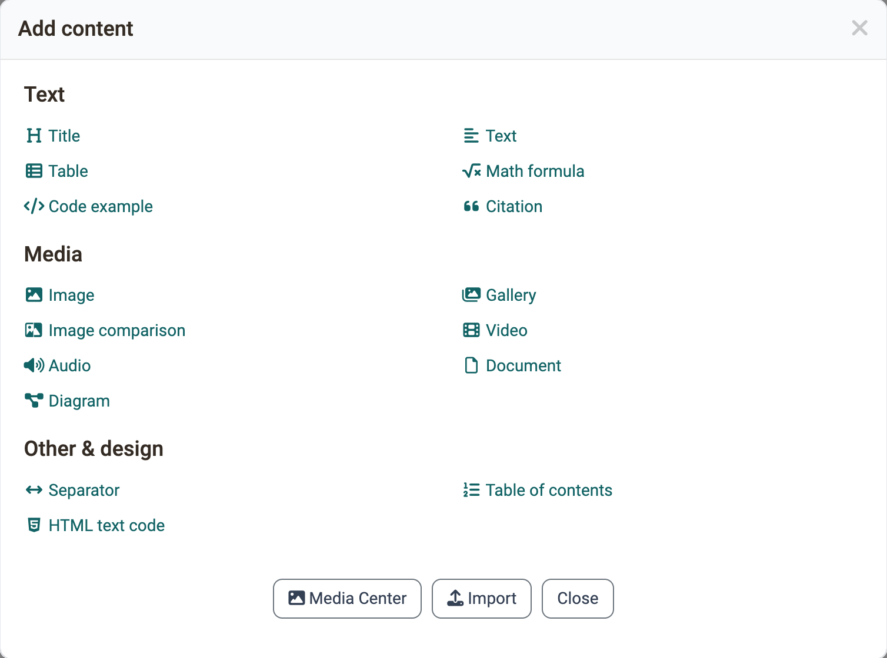{ class="shadow lightbox" title="Portfolio binder, dialog Add content · 2026.11.02" }

**Step 3h:** Here, the participant answers with a self-recorded video.

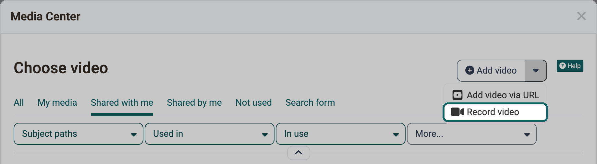{ class="shadow lightbox" title="Media Center in an entry · 2026.11.02" }

#### Example: Link content {: #reference_content}

If you have already created suitable content in another entry, reference it instead of creating it again. The entry then includes the content as a link. The button "Link content" is shown below the assignment as long as the entry has no content yet.

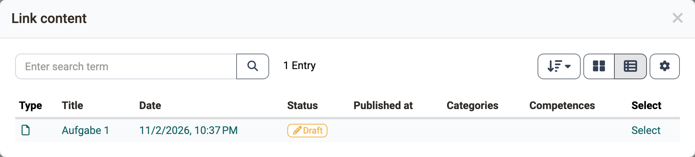{ class="shadow lightbox" title="Dialog Link content · 2026.11.02" }

#### Example: Fill in a form {: #fill_in_form}

If the portfolio task contains a form prepared by the author, fill it in directly in the entry. Click "Save" to keep your answers. The entry stays in the status "Draft" until you publish it.

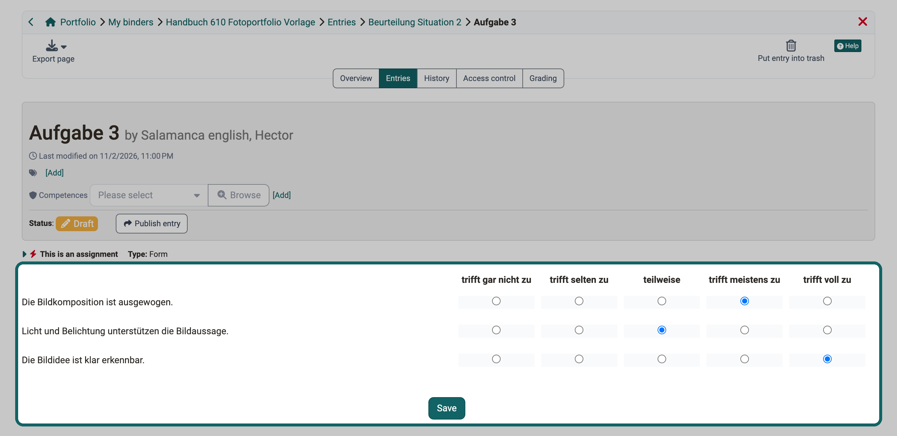{ class="shadow lightbox" title="Form in an entry · 2026.11.02" }

#### How do I keep track of the editing status? {: #editing_status}

In both the "Overview" tab and the "Entries" tab, symbols and status show you how far you have got with the individual sections and entries.

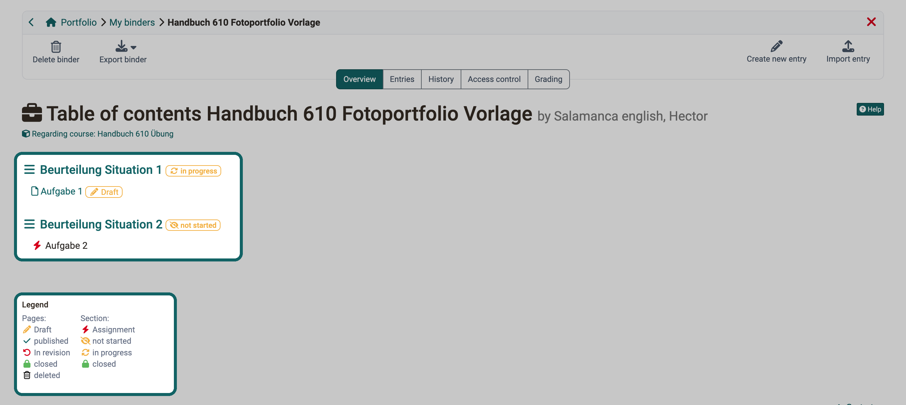{ class="shadow lightbox" title="Portfolio binder, tab Overview · 2026.11.02" }

[To the top of the page ^](#course_element_portfolio)

---

### Step 4: Publish entry {: #publish}

Once an entry is finished, publish it with "Publish entry". Only then can the persons who have access to your binder see it and comment on it. Until then, the entry has the status "Draft".

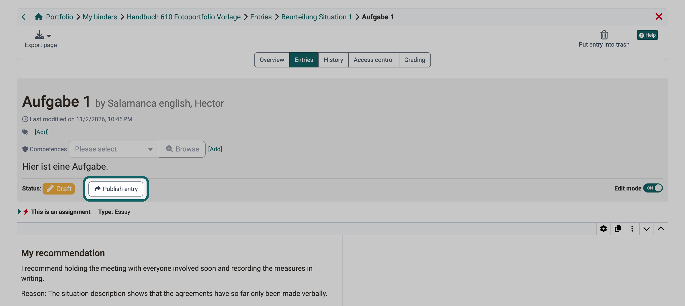{ class="shadow lightbox" title="Portfolio binder, entry before publishing · 2026.11.02" }

!!! warning "Attention"

    You can no longer change a published entry; the persons with access can only comment on it. It only becomes editable again when a coach returns it to you with "Revision", see [Portfolio assignment: Grading](Portfolio_assignment_Grading.md#rework_request_rework). Therefore only publish an entry once it is finished.

[To the top of the page ^](#course_element_portfolio)

---

### Step 5: Assign access rights for the portfolio binder

So that your coaches can assess your binder, give them an access right. The same applies to all other persons who are to see your binder. You assign access rights in two places:

**A) Release of your portfolio binder in the course**

In the course element of the portfolio task, the section "Portfolio review" with the button "Add access rights" is at the bottom.

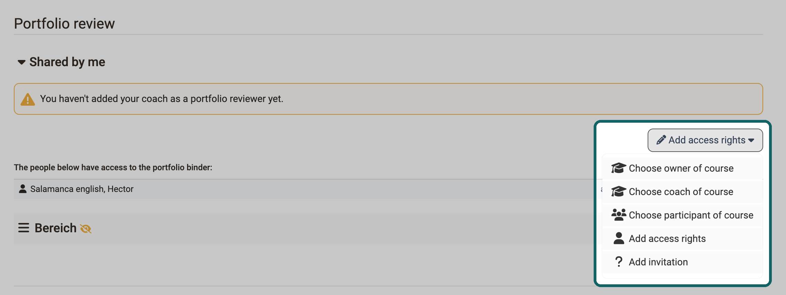{ class="shadow lightbox" title="Section Portfolio review in the course element Portfolio Task · 2026.11.02" }

 

**B) Release your portfolio binder in the binder settings**

Open the binder and select the "Access control" tab. The "Add access rights" button appears there.

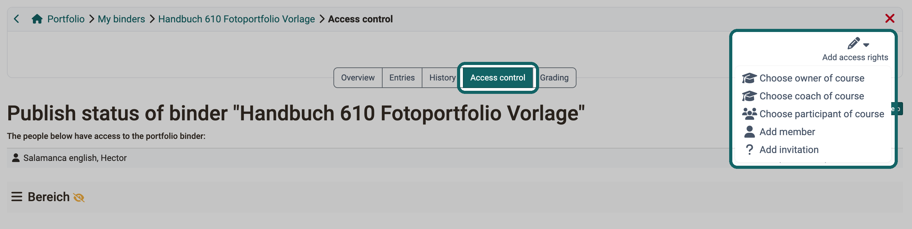{ class="shadow lightbox" title="Tab Access control of a binder · 2026.11.02" }

 

**Release to external users**

To share with external persons without their own OpenOlat account, select "Add invitation". OpenOlat then sends an invitation by e-mail. External persons receive access for a maximum of 180 days.

[To the top of the page ^](#course_element_portfolio)

---

**The wizard for setting up the release**

"Add access rights" guides you through a wizard. In it you define

* to whom you release your binder.
* whether the persons may comment, assess or both, separately for the sections of your binder. External persons can only comment, but not assess.
* whether OpenOlat sends an e-mail with the link to the binder.

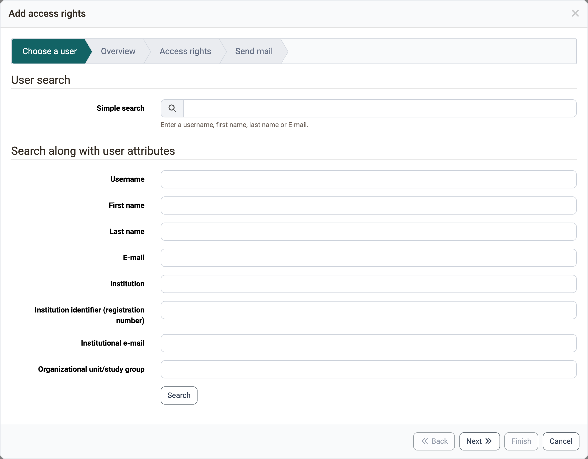{ class="shadow lightbox" title="Wizard Add access rights · 2026.11.02" }

!!! tip "Tip"

    If you set up the release for your coaches at the beginning of your work, they accompany your work from the start: the coaches see every entry you publish. However, you can only edit a published entry again once a coach requests a revision.

[To the top of the page ^](#course_element_portfolio)

---

## Coach perspective {: #view_coach}

You can find out how coaches comment on and assess a portfolio task on the page [Portfolio assignment: Grading](../learningresources/Portfolio_assignment_Grading.md).

[To the top of the page ^](#course_element_portfolio)

---

## Further information {: #further_information}

**Mentioned on this page** 
[Portfolio template: Creation >](Portfolio_template_Creation.md) 
[How do I create a form learning resource? >](../../manual_how-to/create_a_form/create_a_form.md) 
[Assessment >](Assessment.md) 
[Portfolio assignment: Grading >](Portfolio_assignment_Grading.md) 
[Course Reminders >](Course_Reminders.md) 
[Course Settings - Tab Assessment >](Course_Settings_Assessment.md) 
[User tools >](../personal_menu/Personal_Tools.md) 
[The Portfolio Editor >](../area_modules/The_portfolio_editor_17_1.md) 
[Portfolio template: Administration and editing >](Portfolio_template_Administration_and_editing.md)

**Further reading** 
[Portfolio - General Information >](../area_modules/Portfolio_General_Information.md) 
[Components of the portfolio >](../area_modules/Components_of_the_portfolio.md) 
[My binders >](../area_modules/My_portfolio_binders.md) 
[My entries >](../area_modules/My_entries.md) 
[Forms - Overview >](Form.md) 
[Form in the Portfolio 2.0 template >](Forms_in_the_ePortfolio_template.md) 
[The form editor >](Form_Editor.md) 
[Form elements >](Form_Elements.md) 
[Badges >](OpenBadges.md) 
[Access configuration >](Access_configuration.md)

[To the top of the page ^](#course_element_portfolio)
