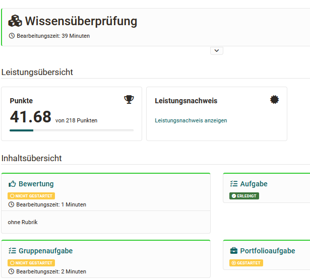
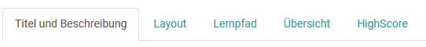
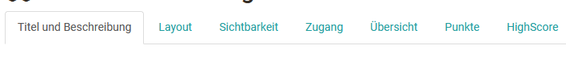
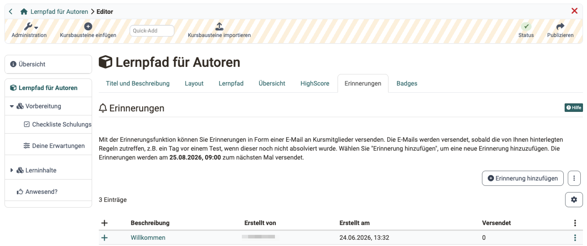
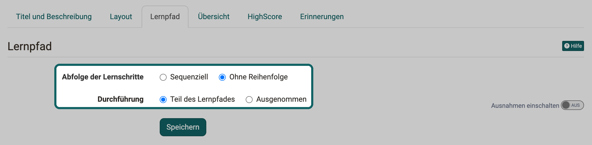
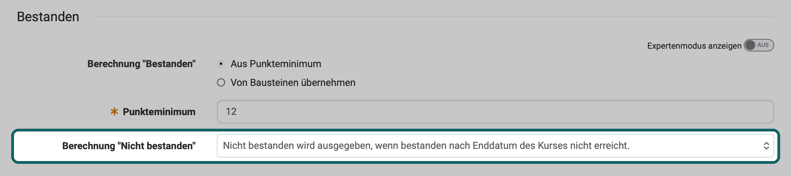
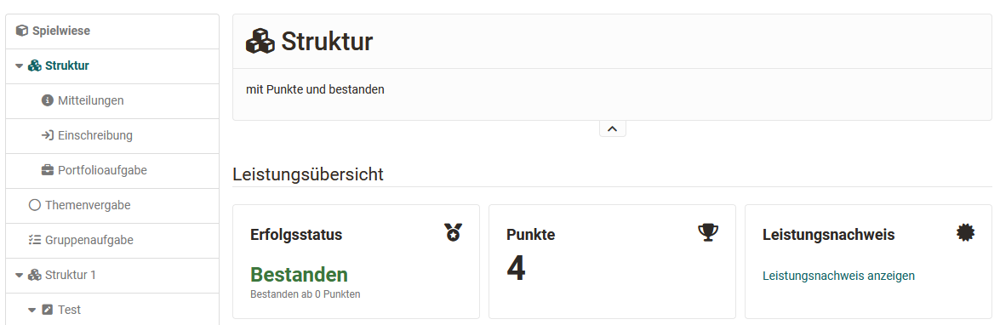

# Kursbaustein "Struktur" {: #course_element_structure}

## Steckbrief

Name | Struktur
---------|----------
Icon | :o_icon_o_st_icon:
Verfügbar seit | Release 7.1 oder früher
Funktionsgruppe | Wissensvermittlung
Verwendungszweck | Gliederung des Menüs in Kapitel, Zusammenfassung der Bewertungen frei gewählter bewertbarer Kursbausteine des Kurses
Bewertbar | ja
Spezialität / Hinweis | Generierung von automatischen Übersichten

Verwenden Sie diesen Kursbaustein, um Ihre Kursbausteine zu gliedern, zu strukturieren und/oder Bereiche klar zu trennen. Legen Sie zum Beispiel je einen Bereich für die Kommunikation, für Kursaktivitäten und für Inhalte an.

Der Kursbaustein Struktur bietet unter anderem eine automatische Übersicht über alle ihm untergeordneten Kursbausteine mit deren Kurztitel, Titel und Beschreibungen. Zur automatischen Übersicht gehört auch eine Leistungsübersicht mit Punkten, Status und Link zum Leistungsnachweis, sofern diese für den Kursbaustein oder den Kurs aktiviert sind.

Die Einstellungen des Kursbausteins legen Besitzer:innen des Kurses im Kurseditor fest: `Kurs > Administration > Kurseditor`. Betreuer:innen erreichen den Kurseditor nur, wenn ihnen im Kurs das Recht "Kurseditor" erteilt ist.

{ class="shadow lightbox" title="Automatische Übersicht des Strukturbausteins im Lernpfadkurs" }

### Das gewählte Kursformat

!!! tip "Lernpfad oder nicht?"

    Die konkreten Einstellungsmöglichkeiten sind davon abhängig, ob der Kursbaustein in herkömmlichen oder in Lernpfadkursen verwendet wird. An der Tab-Leiste des Kursbausteins erkennen Sie, welchen Kurstyp Sie vor sich haben: Ein Tab "Lernpfad" weist den Kurs als Lernpfadkurs aus, die Tabs "Sichtbarkeit", "Zugang" und "Punkte" weisen ihn als herkömmlichen Kurs aus. Hier die Tabs im Vergleich:

**Tabs in Lernpfadkursen**

{ class="shadow lightbox" title="Kursbaustein Struktur im Kurseditor eines Lernpfadkurses" }

**Tabs in herkömmlichen Kursen**

{ class="shadow lightbox" title="Kursbaustein Struktur im Kurseditor eines herkömmlichen Kurses" }

Einen weiteren Sonderfall stellt der oberste Eintrag im Kurseditor dar: der Kurshauptknoten. Auch er ist ein Strukturbaustein, obwohl man es ihm nicht ansieht: Er trägt das Symbol des Kurses :o_icon_o_CourseModule_icon: und nicht das Symbol des Strukturbausteins :o_icon_o_st_icon:. Er hat deshalb dieselben Tabs wie jeder andere Strukturbaustein, aber er trägt als einziger den Tab "[Erinnerungen](../learningresources/Course_Reminders.de.md)". Zudem lässt sich der Kurshauptknoten nicht löschen und nicht verschieben.

{ class="shadow lightbox" title="Kurshauptknoten im Kurseditor eines Lernpfadkurses" }

Im Kurseditor erscheinen die Tabs des Strukturbausteins in dieser Reihenfolge:

  1. "Titel und Beschreibung" und "Layout": in beiden Kurstypen gleich, beschrieben unter [Kursbausteine im Kurseditor](../learningresources/General_Configuration_of_Course_Elements.de.md).
  2. "Lernpfad" im Lernpfadkurs, oder "Sichtbarkeit" und "Zugang" im herkömmlichen Kurs. Zum Tab "Lernpfad" siehe [Einstellungen im Lernpfadkurs](#learning_path_course_settings), zu "Sichtbarkeit" und "Zugang" die [allgemeine Beschreibung](../learningresources/General_Configuration_of_Course_Elements.de.md#access) und für den Passwortschutz des Strukturbausteins den [Tab Zugang](#access).
  3. "Übersicht", "Punkte" nur im herkömmlichen Kurs, und "HighScore": die Tabs des Strukturbausteins selbst, auf dieser Seite beschrieben.
  4. "Erinnerungen" nur am Kurshauptknoten, "Badges" nur bei aktivierter Badge-Vergabe.

#### Tab Übersicht {: #overview}

Die zentralen Einstellungen legen Sie im Tab "Übersicht" fest. Sie wählen zwischen vier Darstellungsarten für den Baustein: die automatische Übersicht, die automatische Übersicht mit Vorschau, eine eigene HTML-Seite oder den ersten sichtbaren untergeordneten Kursbaustein.

  * **Automatische Übersicht** generiert ein Verzeichnis der untergeordneten Kursbausteine. Sie wählen zusätzlich, ob alle oder nur bestimmte Kursbausteine erscheinen und ob die Anzeige in einer oder zwei Spalten steht.
  * **Automatische Übersicht mit Vorschau** generiert ebenfalls ein Verzeichnis der untergeordneten Kursbausteine, zeigt aber zusätzlich bei einigen Kursbausteinen eine Vorschau. Wie die Vorschau aussieht, hängt vom Kursbaustein ab. Die Einstellungen sind ähnlich wie bei der automatischen Übersicht. Zudem legen Sie fest, ob die Vorschau für alle Kursbausteine oder nur für Strukturbausteine gilt. Teilnehmende sehen allerdings keine Vorschau für Kursbausteine, zu denen sie (noch) keinen Zugang haben.
  * **Eigene HTML-Seite** ermöglicht es anstatt der automatisch generierten Übersicht eine eigene Informationsseite zu erstellen. Dafür können Sie eine HTML-Seite aus dem Ablageordner wählen, eine neue HTML Datei erstellen oder eine passende Datei importieren. Im OpenOlat HTML-Editor fügen Sie dann ähnlich wie beim Kursbaustein HTML-Seite Text, Bilder u.ä. hinzu. Zusätzlich erscheint der Tab "Anzeige Inhalt", in dem Sie weitere Einstellungen für HTML-Seiten festlegen.
  * **Keine Übersicht, erster sichtbarer Kursbaustein aktivieren** zeigt anstelle einer Übersicht den ersten sichtbaren, untergeordneten Kursbaustein an.

!!! info "Wichtig"

    Wenn Sie sich für eine eigene HTML-Seite entschieden haben und diese Verknüpfungen zu in OpenOlat abgelegten Grafiken oder sonstigen Dateien beinhaltet, müssen Sie unter "Sicherheitseinstellungen" die Option "Link in gesamten Ablageordner erlauben" wählen. Ferner können Sie auch Betreuer:innen erlauben, die HTML-Seite ohne Zugriff auf den Kurseditor zu bearbeiten.

#### Tab HighScore [:octicons-tag-16:{ title="ab Release 11.3 (OO-2133)" }](https://track.frentix.com/issue/OO-2133) {: #highscore}

Hier können Sie die Anzeige der Highscore-Darstellung aktivieren und konfigurieren. Sie können einen Gratulationstitel, ein Siegertreppchen, ein Histogramm sowie eine Bestenliste anzeigen lassen. Auch eine anonymisierte Darstellung ist hier möglich.

#### Tab Badges {: #badges}

Hat die Besitzer:in des Kurses unter `Kurs > Administration > Einstellungen > Bewertung` im Abschnitt "Badges" die Vergabe von Badges aktiviert, zeigt der Kurseditor zu diesem Kursbaustein den Tab "Badges". Dort erstellen Sie einen Badge eigens für diesen Kursbaustein.

[Zum Seitenanfang ^](#course_element_structure)

---

## Einstellungen nach Kurstyp

Alle bisher beschriebenen Tabs verhalten sich in beiden Kurstypen gleich. Die Unterschiede betreffen nur wenige Tabs: Im Lernpfadkurs, dem Standardfall, kommt der Tab "Lernpfad" hinzu. Im herkömmlichen Kurs kommen stattdessen die Tabs "Sichtbarkeit", "Zugang" und "Punkte" hinzu.

### Einstellungen im Lernpfadkurs [:octicons-tag-16:{ title="ab Release 15.0 (OO-4206)" }](https://track.frentix.com/issue/OO-4206) {: #learning_path_course_settings}

Die Einstellungen im Tab "Lernpfad" unterscheiden sich grundsätzlich von den Einstellungen der anderen Kursbausteine in Lernpfadkursen. Unter "Abfolge der Lernschritte" legen Sie im Kursbaustein Struktur fest, ob die Teilnehmenden die untergeordneten Kursbausteine nacheinander bearbeiten ("Sequenziell") oder in beliebiger Reihenfolge ("Ohne Reihenfolge"). Unter "Durchführung" legen Sie zudem fest, ob der Strukturbaustein "Teil des Lernpfades" ist oder "Ausgenommen" wird. Bei Strukturbausteinen gibt es kein spezifisches Erledigungskriterium.

{ class="shadow lightbox" title="Tab Lernpfad des Kurshauptknotens im Kurseditor · 2026.11.03" }

Die übrigen Einstellungen des Tabs beschreibt die Seite [Lernpfadkurs - Kurseditor](../learningresources/Learning_path_course_Course_editor.de.md).

### Abweichungen im herkömmlichen Kurs {: #conventional_course_settings}

Der herkömmliche Kurs kennt am Strukturbaustein zwei Tabs, die es im Lernpfadkurs nicht gibt: "Punkte" und "Zugang".

#### Tab Punkte {: #score}

!!! note "Sie finden den Tab «Punkte» nicht?"

    Dann arbeiten Sie in einem Lernpfadkurs. Die Bewertung des Kurses stellen Sie dort an einem anderen Ort ein: `Kurs > Administration > Einstellungen > Bewertung`, Abschnitt "Einstellungen Bewertung". Die Beschreibung dazu finden Sie unter [Kurseinstellungen - Tab Bewertung](../learningresources/Course_Settings_Assessment.de.md#section_assessment_settings).

Herkömmliche Kurse verfügen über den Tab "Punkte". Hier zählt der Strukturbaustein die Punkte anderer bewertbarer Kursbausteine zusammen, zum Beispiel aus Bewertung, Aufgabe, Gruppenaufgabe, SCORM 1.2, Checkliste, LTI-Seite, Portfolioaufgabe und Test, und zeigt "Bestanden" oder "Nicht bestanden" an. Die zusammengefassten Resultate erscheinen beim Klick auf den Kursbaustein Struktur im laufenden Kurs.

Unter "Konfiguration" legen Sie fest, was der Strukturbaustein ausgibt: "Punkte", "Bestanden" und, nur am Kurshauptknoten, "Bewertung mit Einstufung/Noten". Zu jeder gewählten Ausgabe erscheinen darunter die folgenden Einstellungen.

##### Berechnung Punkte {: #score_calculation}

Mit "Summe" addiert OpenOlat die Punkte der gewählten Kursbausteine, mit "Durchschnitt" bildet es den Durchschnittswert. Der Durchschnitt ist zum Beispiel sinnvoll, wenn alle Kursbausteine dieselbe maximale Punktzahl haben. Unter "Punkte von" erscheint eine Übersicht aller bewertbaren Kursbausteine Ihres Kurses. Wählen Sie alle oder gezielt einzelne Kursbausteine aus. Kursbausteine, die (noch) keine Bewertung enthalten, bleiben bei der Berechnung unberücksichtigt. OpenOlat zeigt den Teilnehmenden den berechneten Wert nach der Bewertung unter "Punkte" an.

##### Berechnung "Bestanden" {: #passed_calculation}

Bestanden bzw. nicht bestanden kann sich auf eine Mindestpunktzahl beziehen, die Sie definieren, oder auf das Bestehen ausgewählter Kursbausteine. Wenn Sie "Aus Punkteminimum" wählen, geben Sie unter "Punkteminimum" den Wert ein. Er bezieht sich auf die unter "Punkte von" gewählten Kursbausteine: Der Kursbaustein Struktur zeigt "Bestanden" an, wenn deren Punktesumme grösser oder gleich dem Punkteminimum ist.

Wenn Sie "Von Bausteinen übernehmen" wählen, zeigt OpenOlat unter "Relevante Kursbausteine" die bewertbaren Kursbausteine Ihres Kurses an. Wählen Sie diejenigen aus, deren Bestanden-Wert zählen soll. Unter "Bestanden, wenn" legen Sie fest, wie viele davon bestanden sein müssen: [:octicons-tag-16:{ title="ab Release 19.0.3 (OO-7484)" }](https://track.frentix.com/issue/OO-7484)

  * **Alle relevanten Kursbausteine bestanden**: Der Kursbaustein Struktur zeigt erst "Bestanden" an, wenn jeder gewählte Kursbaustein bestanden ist.
  * **Eine bestimmte Anzahl der relevanten Kursbausteine bestanden**: Geben Sie unter "Anzahl Kursbausteine" ein, wie viele der gewählten Kursbausteine bestanden sein müssen. Die Zahl muss kleiner sein als die Anzahl der gewählten Kursbausteine. So bilden Sie zum Beispiel eine Wahlpflicht ab: Drei von fünf Tests müssen bestanden sein.

!!! tip "Die Auswahl umfasst die ganze Lernressource"

    Unter "Punkte von" und "Relevante Kursbausteine" bietet OpenOlat alle bewertbaren Kursbausteine des Kurses an, unabhängig davon, wo sie im Menü stehen. Ein Strukturbaustein kann darum "Nicht bestanden" anzeigen, obwohl alle Kursbausteine unterhalb bestanden sind: zum Beispiel, wenn ein Test aus einem anderen Kapitel ebenfalls als relevant gewählt ist. Prüfen Sie bei unerwarteten Ergebnissen zuerst die gewählten Kursbausteine im Tab "Punkte".

##### Berechnung "Nicht bestanden" {: #failed_calculation}

Es ist auch möglich, gezielt ein "Nicht bestanden" zu berechnen. Die Auswahlliste bietet zwei Varianten:

{ class="shadow lightbox" title="Tab Punkte des Strukturbausteins, Bereich Bestanden · 2026.11.02" }

  * OpenOlat zeigt "Nicht bestanden" so lange an, bis die Anforderungen für das Bestehen erfüllt sind.
  * OpenOlat zeigt "Nicht bestanden" erst dann an, wenn die Anforderungen an das Bestehen nicht erfüllt sind _und_ das Enddatum des Kurses erreicht ist. Sind die Bedingungen für "Bestanden" schon vor Kursende erfüllt, zeigt OpenOlat "Bestanden" schon während der Kurslaufzeit an.

Sollen für einen Kurs Leistungsnachweise ausgestellt werden, passen Sie die Einstellungen im Tab "Punkte" an.

Für Teilnehmende zeigt sich die Leistungsübersicht wie folgt:

{ class="shadow lightbox" title="Strukturbaustein im laufenden herkömmlichen Kurs" }

!!! tip "Tipp"

    Wenn Sie Leistungsnachweise verwenden oder den Bestanden-Status des Kurses zum Beispiel im Coaching Tool überprüfen wollen, wählen Sie im Tab "Punkte" des Kurshauptknotens unter "Konfiguration" die Option "Bestanden".

!!! tip "Tipp"

    Verwenden Sie für alle bewertbaren Kursbausteine eindeutige Kurztitel, um diese in der Auswahl im Tab "Punkte" rasch voneinander unterscheiden zu können.

##### Wenn die Konfiguration schreibgeschützt ist {: #score_read_only}

Die Konfiguration im Tab "Punkte" lässt sich nicht immer sofort ändern. Sobald für den Strukturbaustein Bewertungen vorhanden sind, zeigt OpenOlat die ganze Legende "Zusammengefasste Bewertung" schreibgeschützt an, also die Berechnung der Punkte und des Bestanden-Status. [:octicons-tag-16:{ title="ab Release 20.3.7 / 21.0.1 (OO-9646)" }](https://track.frentix.com/issue/OO-9646) [:octicons-tag-16:{ title="ab Release 21.1 (OO-9647)" }](https://track.frentix.com/issue/OO-9647)

Mit der Schaltfläche "Bearbeitungsmodus aktivieren" im Hinweis über der Legende machen Sie die Einstellungen wieder bearbeitbar. Der Schreibschutz gilt so in allen bewertbaren Kursbausteinen. Wann er greift, welche Meldungen OpenOlat zeigt und wie lange der Bearbeitungsmodus gilt, beschreibt der Abschnitt [Schreibschutz der Bewertungskonfiguration](Course_Elements.de.md#assessment_config_read_only).

!!! info "Wichtig"

    Denselben Schutz gibt es im Lernpfadkurs, nur an einem anderen Ort und zu einem anderen Zeitpunkt. Dort stellen Sie die Kursbewertung unter `Kurs > Administration > Einstellungen > Bewertung` ein. Sind Teilnehmende bereits bewertet, ist das Formular nicht schreibgeschützt: Stattdessen öffnet OpenOlat beim Speichern den Dialog "Einstellungen speichern" und Sie entscheiden dort zwischen "Übernehmen & neu berechnen" und "Verwerfen".

##### Neuberechnung beim Publizieren {: #recalculation_on_publish}

Publizieren Sie eine Änderung, die einen Strukturbaustein oder den Kurshauptknoten einschliesst, berechnet OpenOlat die Bewertungen aller betroffenen Teilnehmenden sofort neu: Punkte, Bestanden-Status und, wenn eine Einstufung konfiguriert ist, die Note. Auch die Leistungsnachweise werden aktualisiert.

Betreuer:innen sehen damit direkt nach dem Publizieren einen einheitlichen Stand. Die Teilnehmenden müssen den Kurs dafür nicht öffnen. Die Neuberechnung läuft im Hintergrund, eine manuelle Aktion ist dafür nicht nötig.

#### Tab Zugang {: #access}

In herkömmlichen Kursen schützen Sie den Kursbaustein "Struktur" und damit seine untergeordneten Kursbausteine mit einem Passwort. Setzen Sie dafür den Haken bei "Passwort" und hinterlegen Sie den gewünschten Code.

!!! info "Wichtig"

    Auf dem Kurshauptknoten lässt sich im Tab "Zugang" kein Passwort hinterlegen.

## Weiterführende Informationen {: #further_information}

**Auf dieser Seite erwähnt** 
[Erinnerungen >](../learningresources/Course_Reminders.de.md) 
[Kursbausteine im Kurseditor >](../learningresources/General_Configuration_of_Course_Elements.de.md) 
[Lernpfadkurs - Kurseditor >](../learningresources/Learning_path_course_Course_editor.de.md) 
[Kurseinstellungen - Tab Bewertung >](../learningresources/Course_Settings_Assessment.de.md) 
[Kursbausteine >](../learningresources/Course_Elements.de.md)

**Weiterführend** 
[Lernpfadkurs - Überblick >](../learningresources/Learning_path_course.de.md) 
[Bewertungswerkzeug - Übersicht >](../learningresources/Assessment_tool_overview.de.md)

[Zum Seitenanfang ^](#course_element_structure)
