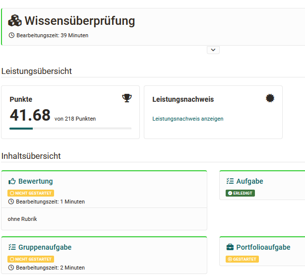
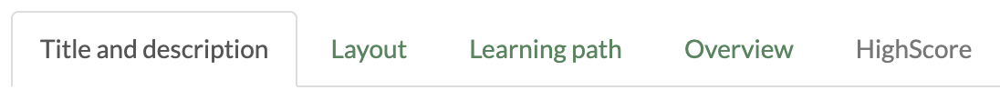
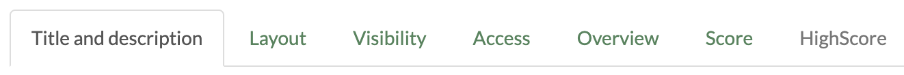
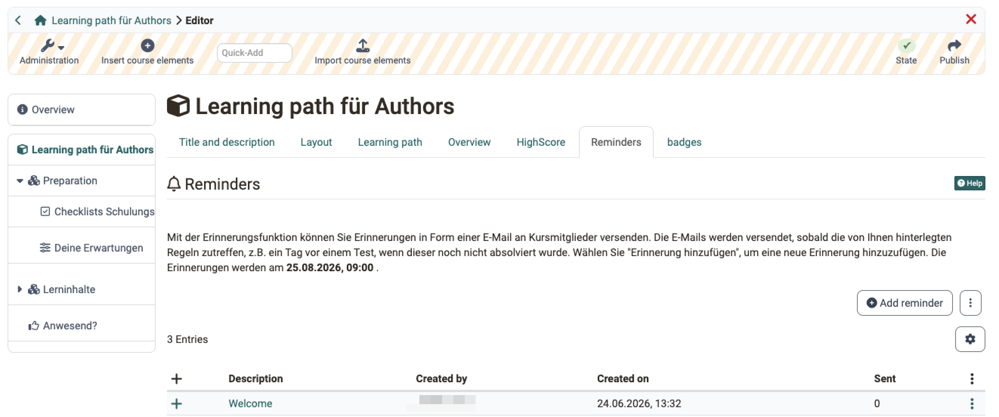
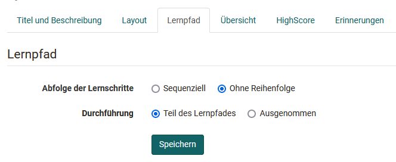
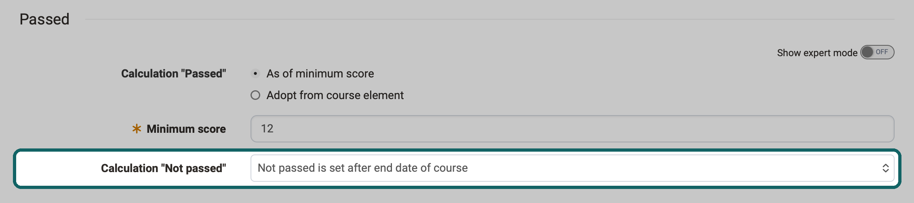
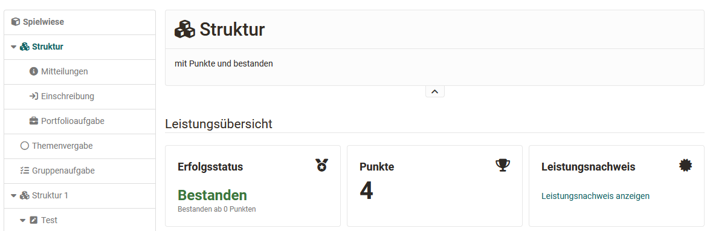

# Course Element "Structure" {: #course_element_structure}

## Profile

Name | Structure
---------|----------
Icon | :o_icon_o_st_icon:
Available since | Release 1
Functional group | Knowledge transfer
Purpose | Structuring of the menu into chapters, summary of the assessments of freely selected assessable course elements of the course
Assessable | yes
Specialty / Note | Generation of automatic overviews

Use this course element to organize and structure your course elements and/or to clearly separate areas. For example, create an area for communication, one for course activities and one for content.

The course element Structure offers, among other things, an automatic overview of course elements subordinate to it with their short titles, titles and descriptions. The automatic overview is also linked to an automatically generated performance overview with points, status and link to the performance record, provided these have been activated for the course element or the course in general. 

The owners of the course define the settings of the course element in the course editor: `Course > Administration > Course editor`. Coaches only reach the course editor if they have been granted the "Course editor" right in the course.

{ class="shadow lightbox" title="Automatic overview of the structure element in the learning path course" }

### The chosen course format

!!! tip "Learning path or not?"

    The concrete setting options depend on whether the course element is used in conventional or in learning path courses. The tab bar of the course element tells you which course format you are looking at: A tab "Learning path" identifies the course as a learning path course, the tabs "Visibility", "Access" and "Score" identify it as a conventional course. Here the tabs in comparison:

**Tabs in learning path courses**

{ class="shadow lightbox" title="Course element Structure in the course editor of a learning path course" }

**Tabs in conventional courses**

{ class="shadow lightbox" title="Course element Structure in the course editor of a conventional course" }

A further special case is the topmost entry in the course editor: the course root node. It is a structure element as well, even though it does not look like one: It carries the symbol of the course :o_icon_o_CourseModule_icon: and not the symbol of the structure element :o_icon_o_st_icon:. It therefore has the same tabs as any other structure element, but it is the only one that carries the tab "[Reminders](../learningresources/Course_Reminders.md)". In addition, the course root node cannot be deleted or moved.

{ class="shadow lightbox" title="Course root node in the course editor of a learning path course" }

In the course editor, the tabs of the structure element appear in this order:

  1. "Title and description" and "Layout": identical in both course formats, described under [Course elements in the course editor](../learningresources/General_Configuration_of_Course_Elements.md).
  2. "Learning path" in the learning path course, or "Visibility" and "Access" in the conventional course. On the tab "Learning path" see [Settings in the learning path course](#learning_path_course_settings), on "Visibility" and "Access" the [general description](../learningresources/General_Configuration_of_Course_Elements.md#access) and for the password protection of the structure element the [Tab Access](#access).
  3. "Overview", "Score" only in the conventional course, and "HighScore": the tabs of the structure element itself, described on this page.
  4. "Reminders" only on the course root node, "Badges" only if the awarding of badges is activated.

#### Tab Overview {: #overview}

You define the central settings in the "Overview" tab. You choose between four display modes for the element: an overview generated automatically by OpenOlat, your own HTML page or the first subordinate course element.

* **Automatic overview** generates a list of the subordinate course elements. You can additionally select whether all or only certain course elements are displayed and whether the display should be in one or two columns.
* **Automatically generated overview incl. preview**  also generates a directory of the subordinate course elements, but also displays a preview for some course elements. The exact preview varies depending on the course element. The configuration options for this setting are similar to those for the automatic overview. Furthermore, it can be set whether the preview refers to all course elements or only to structure elements. However, the user does not see a preview for course elements to which he does not (yet) have access.
* **Custom HTML page** allows you to create your own information page instead of the automatically generated overview. Therefore, you can select an HTML page from the storage folder, create a new HTML file or import a suitable file. You then add text, images etc. in the OpenOlat HTML editor in a similar way to the HTML page course element. In addition, the "Display content" tab appears, where you define further settings for HTML pages.
* **No overview, activate first visible child node** displays the first visible subordinate course element instead of an overview.

!!! info "Important"

    If you have chosen your own HTML page and this contains links to graphics or other files stored in OpenOlat, you must select the option "Allow links in the entire storage folder" under "Security settings". You can also allow coaches to edit the HTML page without access to the course editor.

#### Tab HighScore [:octicons-tag-16:{ title="from Release 11.3 (OO-2133)" }](https://track.frentix.com/issue/OO-2133) {: #highscore}

Here you can activate and configure the high score display. You can display a congratulation title, a winner's podium, a histogram as well as a highscore list. An anonymized representation is also possible here.

#### Tab Badges {: #badges}

If the owner of the course has activated the awarding of badges under `Course > Administration > Settings > Assessment` in the section "Badges", the course editor shows the tab "Badges" for this course element. There you create a badge specifically for this course element.

[To the top of the page ^](#course_element_structure)

---

## Settings by course format

All tabs described so far behave identically in both course formats. The differences concern only a few tabs: In the learning path course, the standard case, the tab "Learning path" is added. In the conventional course, the tabs "Visibility", "Access" and "Score" are added instead.

### Settings in the learning path course [:octicons-tag-16:{ title="from Release 15.0 (OO-4206)" }](https://track.frentix.com/issue/OO-4206) {: #learning_path_course_settings}

The settings in the tab "Learning path" basically differ from the settings of the other course elements in learning path courses. Under "Sequence of steps" you define in the course element Structure whether participants work through the subordinate course elements one after the other ("Sequential") or in any order ("No sequence"). Under "Execution" you additionally define whether the structure element is "Part of learning path" or "Excluded". There is no specific completion criterion for structure elements.

{ class="shadow lightbox" title="Tab Learning path of the course root node in the course editor" }

The page [Learning path course - Course editor](../learningresources/Learning_path_course_Course_editor.md) describes the other settings of the tab.

### Deviations in the conventional course {: #conventional_course_settings}

The conventional course has two tabs on the structure element that do not exist in the learning path course: "Score" and "Access".

#### Tab Score  {: #score}

!!! note "Can't find the «Score» tab?"

    Then you are working in a learning path course. There you set the assessment of the course in a different place: `Course > Administration > Settings > Assessment`, section "Assessment settings". You find the description under [Course settings - Assessment tab](../learningresources/Course_Settings_Assessment.md#section_assessment_settings).

Conventional courses have the "Score" tab. Here the structure element adds up the points of other assessable course elements, for example from Assessment, Task, Group task, SCORM 1.2, Checklist, LTI page, Portfolio task and Test, and displays "Passed" or "Failed". The summarized results appear when you click on the course element Structure in the running course.

Under "Configuration" you define what the structure element outputs: "Score", "Passed" and, only on the course root node, "Levels/Grading". For each selected output, the following settings appear below.

##### Score calculation {: #score_calculation}

With "Sum", OpenOlat adds up the points of the selected course elements, with "Average" it calculates the average value. The average makes sense, for example, if all course elements have the same maximum number of points. Under "Total score of", an overview of all assessable course elements of your course appears. Select all or specific course elements. Course elements that do not (yet) contain an assessment are not taken into account in the calculation. The calculated value is displayed to the participants after the assessment under "Score".

##### Calculation "Passed" {: #passed_calculation}

Pass or fail can refer to a minimum score that you define, or to passing selected course elements. If you select "As of minimum score", enter the value under "Minimum score". It refers to the course elements selected under "Total score of": The course element Structure shows "Passed" if their total score is greater than or equal to the minimum score.

If you select "Adopt from course element", OpenOlat shows the assessable course elements of your course under "Relevant course element". Select those whose "Passed" value should count. Under "Passed if" you define how many of them have to be passed: [:octicons-tag-16:{ title="from Release 19.0.3 (OO-7484)" }](https://track.frentix.com/issue/OO-7484)

  * **All relevant course elements passed**: The course element Structure shows "Passed" only when every selected course element is passed.
  * **A certain number of the relevant course elements passed**: Under "Number of course elements", enter how many of the selected course elements have to be passed. The number must be smaller than the number of selected course elements. This is how you model an elective requirement, for example: Three out of five tests must be passed.

!!! tip "The selection covers the whole learning resource"

    Under "Total score of" and "Relevant course element", OpenOlat offers all assessable course elements of the course, regardless of where they are located in the menu. A structure element can therefore show "Failed" although all course elements below it are passed: for example, if a test from another chapter is also selected as relevant. In case of unexpected results, first check the selected course elements in the "Score" tab.

##### Calculation "Not passed" {: #failed_calculation}

It is also possible to calculate "Not passed". The selection list offers two variants:

{ class="shadow lightbox" title="Tab Score of the structure element, area Passed · 2026.11.02" }

  * As long as the conditions for passed are not reached, the structure is shown as "Failed". 
  * As long as the conditions for passed are not reached _and_ the end date of the course is reached, the structure is shown as "Failed". If the conditions for "passed" have already been fulfilled before the end of the course, passed is already displayed during the course duration.

If certificates of achievement are to be issued for a course, it is necessary to adjust the settings in the "Score" tab accordingly.

For participants, the performance overview is as follows:

{ class="shadow lightbox" title="Structure element in the running conventional course" }

!!! tip "Tip"

    If you use evidences of achievement or want to check the passed status of the course, for example in the Coaching tool, select the option "Passed" under "Configuration" in the tab "Score" of the course root node.

!!! tip "Tip"

    Use distinct short titles for all of your assessable course elements to be able to clearly distinguish them in the tab "Score".

##### When the configuration is read-only {: #score_read_only}

The configuration in the tab "Score" cannot always be changed right away. As soon as assessments exist for the structure element, OpenOlat displays the whole legend "Combined assessment" as read-only, that is the calculation of the score and of the passed status. [:octicons-tag-16:{ title="from Release 20.3.7 / 21.0.1 (OO-9646)" }](https://track.frentix.com/issue/OO-9646) [:octicons-tag-16:{ title="from Release 21.1 (OO-9647)" }](https://track.frentix.com/issue/OO-9647)

With the button "Enable edit mode" in the message above the legend, you make the settings editable again. The read-only mode works this way in all assessable course elements. When it applies, which messages OpenOlat displays and how long the edit mode lasts is described in the section [Read-only assessment configuration](Assessment.md#assessment_config_read_only).

!!! info "Important"

    The same protection exists in the learning path course, only in a different place and at a different moment. There you set the course assessment under `Course > Administration > Settings > Assessment`. If participants have already been assessed, the form is not read-only: instead OpenOlat opens the dialog "Save settings" when you save, and there you decide between "Apply & recalculate" and "Discard".

##### Recalculation when publishing {: #recalculation_on_publish}

If you publish a change that includes a structure element or the course root node, OpenOlat immediately recalculates the assessments of all affected participants: score, success status and, if a grading is configured, the grade. The evidence of achievement is updated as well.

Coaches therefore see a consistent state directly after publishing. The participants do not have to open the course for this. The recalculation runs in the background, no manual action is needed.

#### Tab Access {: #access}

The course element "Structure" and thus its subordinate course elements can be protected with a password in conventional courses. To do so, tick the box "Password" and enter the code you want.

!!! info "Important"

    On the course root node, no password can be stored in the "Access" tab.

## Further information {: #further_information}

**Mentioned on this page** 
[Course Reminders >](../learningresources/Course_Reminders.md) 
[Course elements in the Course editor >](../learningresources/General_Configuration_of_Course_Elements.md) 
[Learning path course - Course editor >](../learningresources/Learning_path_course_Course_editor.md) 
[Course Settings - Tab Assessment >](../learningresources/Course_Settings_Assessment.md) 
[Assessment >](../learningresources/Assessment.md)

**Further reading** 
[Types of Course Elements >](../learningresources/Course_Elements.md) 
[Learning path course - Overview >](../learningresources/Learning_path_course.md) 
[Assessment tool - overview >](../learningresources/Assessment_tool_overview.md)

[To the top of the page ^](#course_element_structure)

