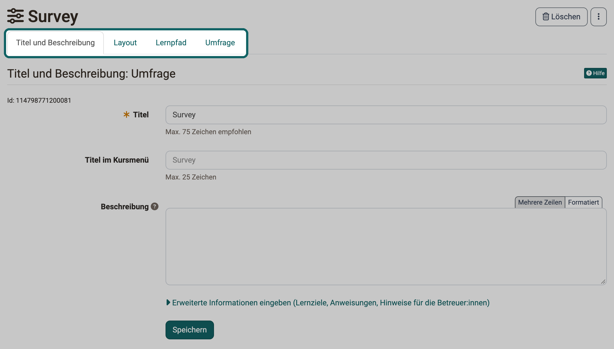
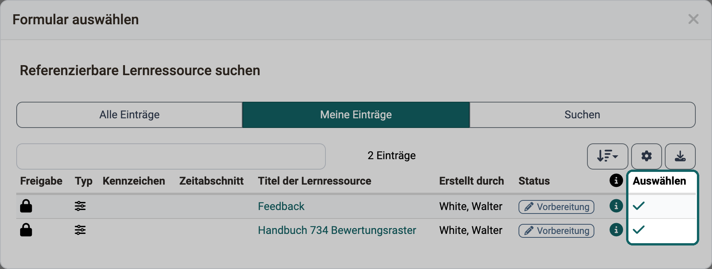
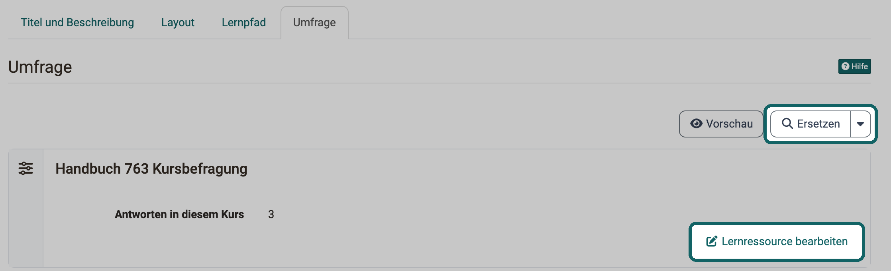
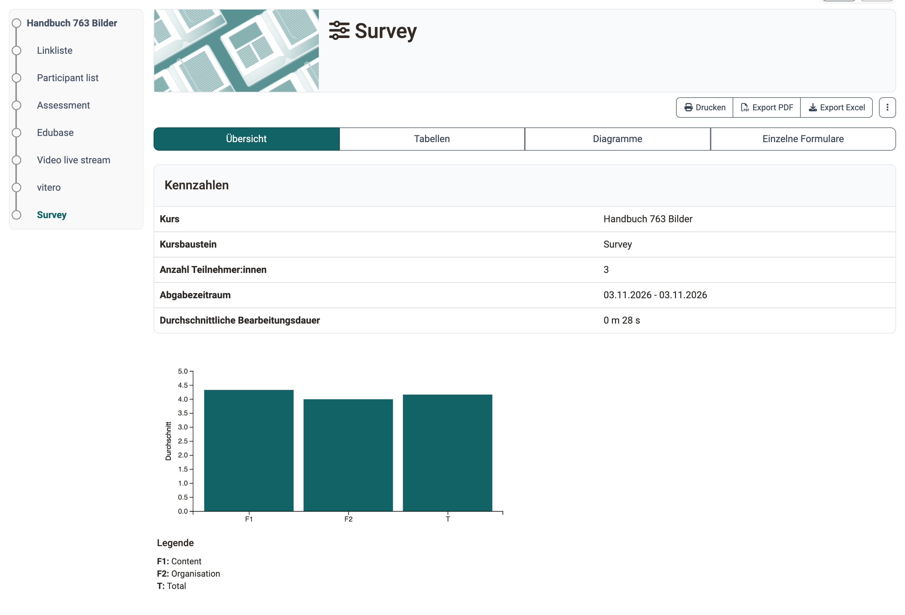
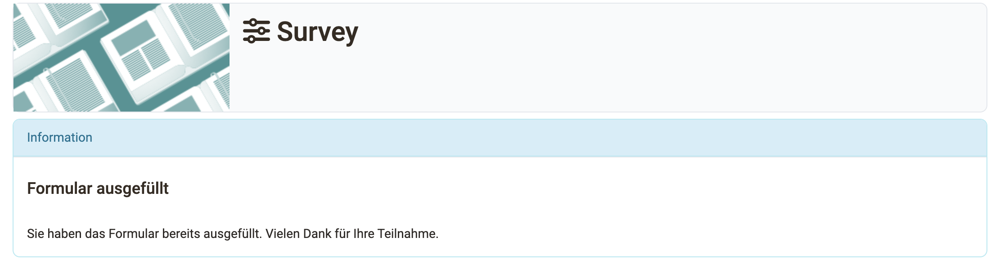
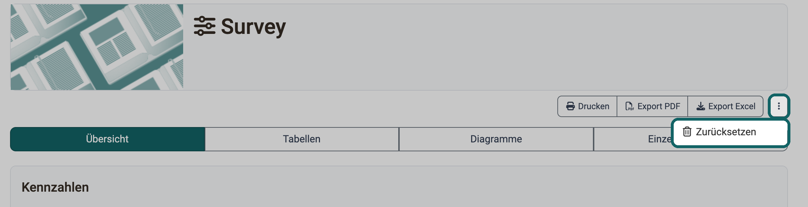

# Kursbaustein "Umfrage" {: #course_element_survey}

## Steckbrief {: #profile}

Name | Umfrage
---------|----------
Icon | :o_icon_o_survey_icon:
Verfügbar seit | Release 13.0 (OO-3676)
Funktionsgruppe | Wissensüberprüfung
Verwendungszweck | Kursbaustein zur Integration der Lernressource "Formular"
Bewertbar | nein
Spezialität / Hinweis |

Mit dem Kursbaustein "Umfrage" befragen Sie die Mitglieder Ihres Kurses mit einem Online-Fragebogen, etwa zur Zufriedenheit mit dem Kurs. Der Kursbaustein verknüpft dazu eine Lernressource "Formular". Die Resultate einer Umfrage speichert OpenOlat standardmässig anonymisiert.

Wenn Sie noch kein Formular für Ihre Umfrage erstellt haben, zeigt die Anleitung [Wie erstelle ich eine Formular-Lernressource?](../../manual_how-to/create_a_form/create_a_form.de.md), wie das geht.

!!! info "Wichtig"

    Ein Formular, das in einem Kurs verlinkt ist, bearbeiten Sie im [Formulareditor](../learningresources/Form_Editor.de.md) nur so lange vollständig, bis jemand das Formular zum ersten Mal aufgerufen hat. Danach ändern Sie nur noch Texte, etwa um Tippfehler zu korrigieren.

!!! warning "Achtung"

    Wenn Sie eine Umfrage [zurücksetzen](#reset_surveys), löscht OpenOlat alle Antworten, auch die mit "Zwischenspeichern" gesicherten Eingaben von Teilnehmenden, die die Umfrage noch nicht abgeschlossen haben. Wer den Fragebogen beim Zurücksetzen geöffnet hat, erhält beim nächsten Speichern die Meldung "Speichern fehlgeschlagen", und die Eingaben gehen verloren.

Weitere Informationen rund um Formulare finden Sie auf der Seite [Formulare - Übersicht](../learningresources/Form.de.md).

## Formular in Umfragen {: #forms_in_surveys}

Im Kursbaustein "Umfrage" dient die Lernressource "Formular" als Fragebogen. Besitzer:innen des Kurses binden so Fragebögen in ihren Kurs ein, und Teilnehmende füllen die bereitgestellten Umfragen aus. Wer die Ergebnisse sieht, legen Sie in den Berechtigungen des Kursbausteins fest.

OpenOlat stellt sicher, dass Teilnehmende die Umfrage nur einmal ausfüllen. Die Resultate speichert OpenOlat standardmässig anonymisiert. Sollen die Antworten einer Person zugeordnet werden, fügen Sie dem Formular im [Formulareditor](../learningresources/Form_Editor.de.md) passende Formular-Elemente hinzu.

### Im Kurseditor {: #course_editor}

Fügen Sie im Kurseditor den Kursbaustein "Umfrage" hinzu. Danach stehen Ihnen im Kurseditor folgende Tabs zur Verfügung:

{ class="shadow lightbox" title="Kursbaustein Umfrage im Kurseditor · 2026.11.03" }

In den Tabs "Titel und Beschreibung" und "Layout" hinterlegen Sie allgemeine Beschreibungen und Informationen zum Kursbaustein und legen seine Darstellung fest. Im [Tab Lernpfad](../learningresources/Learning_path_course_Course_editor.de.md) legen Sie die Einstellungen für Lernpfadkurse fest, zum Beispiel das Erledigungskriterium "Umfrage teilgenommen".

Herkömmliche Kurse haben stattdessen die Tabs "Sichtbarkeit" und "Zugang". Dort legen Sie fest, wer den Kursbaustein sieht und bearbeitet.

#### Tab "Umfrage" {: #survey}

Im Tab "Umfrage" konfigurieren Sie die Umfrage. Im ersten Schritt wählen Sie ein bestehendes Formular aus oder legen ein neues an. Solange kein Formular gewählt ist, bietet der Tab drei Wege an:

* **Auswählen**: Sie verbinden den Kursbaustein mit einem Formular, das bereits als Lernressource besteht. Der Dialog "Formular auswählen" zeigt unter "Meine Einträge" alle Formulare, deren Besitzer:in Sie sind. Mit einem Klick auf den Haken in der Spalte "Auswählen" fügen Sie ein Formular dem Kurs hinzu.
* **Erstellen**: Sie legen eine neue Lernressource "Formular" an, die OpenOlat gleich mit dem Kursbaustein verbindet.
* **Import**: Sie importieren ein Formular, das als Datei vorliegt.

{ class="shadow lightbox" title="Dialog Formular auswählen · 2026.11.03" }

Ein neu erstelltes Formular enthält zunächst noch keine Elemente, Fragen oder Textfelder. Diese fügen Sie im [Formulareditor](../learningresources/Form_Editor.de.md) hinzu.

Ein Formular, das Sie direkt im Kurseditor erstellen, legt OpenOlat als neue Lernressource "Formular" an. Sie finden es auch im [Autorenbereich](../area_modules/Authoring/index.de.md) unter "Meine Einträge" und binden es in weiteren Kursen ein.

Ist ein Formular gewählt, zeigt der Tab seinen Titel und die Zahl der "Antworten in diesem Kurs". Mit "Vorschau" sehen Sie das Formular so, wie Teilnehmende es ausfüllen. Mit dem Button "Lernressource bearbeiten" öffnen Sie die Lernressource "Formular" und gestalten das Formular im Formulareditor. Ist das Formular schon passend eingerichtet, ist keine Bearbeitung nötig. Den Button sehen Besitzer:innen des Formulars, Lernressourcenverwalter:innen und Administrator:innen. Mit "Ersetzen" wählen Sie ein anderes Formular, über den Pfeil daneben importieren Sie eines mit "Import".

{ class="shadow lightbox" title="Tab Umfrage im Kurseditor · 2026.11.03" }

!!! warning "Achtung"

    Sobald mindestens eine Person das Formular geöffnet hat, lässt es sich nicht mehr ersetzen. Klicken Sie dann auf "Ersetzen", zeigt OpenOlat die Meldung "Das Formular kann nicht mehr geändert werden." Brauchen Sie ein anderes Formular, legen Sie einen neuen Kursbaustein "Umfrage" an und binden das gewünschte Formular dort ein.

Im Bereich "Berechtigungen" des Tabs "Umfrage" legen Sie fest, wer an der Umfrage teilnimmt ("Teilnahme durch") und für wen die Resultate sichtbar sind ("Resultate sichtbar für"). Folgende Rollen stehen jeweils zur Auswahl:

* die Besitzer:innen des Kurses
* die Betreuer:innen des Kurses
* die Teilnehmer:innen des Kurses: alle Personen, die in der Rolle "Teilnehmer:in" im Kurs eingetragen sind
* Gäste: Personen ohne OpenOlat-Konto

Mit "Erweiterte Konfiguration anzeigen" legen Sie zusätzlich fest, welche Gruppen oder einzelnen Benutzer:innen teilnehmen, und begrenzen die Teilnahme einer Rolle auf einen Zeitraum mit Beginn und Ende.

Auch die Resultate geben Sie für diese Rollen, Gruppen und Benutzer:innen frei und verbinden die Freigabe in der erweiterten Konfiguration mit einem Beginn und einem Ende.

Welche Rollen in einem neu eingefügten Kursbaustein vorgewählt sind, gibt die System-Administration unter `Administration > Module > Kursbausteine` vor, siehe [Modul Kursbausteine](../../manual_admin/administration/Modules.de.md#course_element_survey) [:octicons-tag-16:{ title="ab Release 18.2 (OO-7529)" }](https://track.frentix.com/issue/OO-7529){:target="_blank"}.

!!! tip "Tipp"

    Damit eine Personengruppe die Umfrage ausfüllen kann, muss auch der Kurs für diese Personengruppe freigegeben sein. Sollen zum Beispiel auch externe Personen (Gäste) die Umfrage ausfüllen, braucht der Kurs ein Angebot für Gäste, siehe [Zugangskonfiguration / Freigabe](../learningresources/Access_configuration.de.md). Eine Freigabe für Gäste gibt es nur bei herkömmlichen Kursen, nicht bei Lernpfadkursen.

Sobald jemand das Formular aufgerufen hat, ändern Sie das Formular im Kurs mit dem Button "Lernressource bearbeiten" nur noch eingeschränkt: Texte lassen sich ändern, Blöcke aber nicht mehr verschieben, hinzufügen oder löschen. Im Formular erscheint dann die Meldung "Die Ressource wird bereits verwendet. Die Bearbeitung ist beschränkt."

### Ansicht {: #view}

Was Besitzer:innen, Betreuer:innen und Teilnehmende bei geschlossenem Editor sehen, hängt von den Berechtigungen im Tab "Umfrage" ab. Darf eine Personengruppe den Fragebogen ausfüllen ("Teilnahme durch"), sieht sie zuerst den Fragebogen. Hat die Person den Fragebogen ausgefüllt, zeigt der Kursbaustein die Auswertung der Umfrage, sofern die Resultate für ihre Personengruppe sichtbar sind.

{ class="shadow lightbox" title="Auswertung im Kursbaustein Umfrage · 2026.11.03" }

Darf eine Personengruppe (zum Beispiel Teilnehmende) die Umfrage ausfüllen, aber die Resultate nicht sehen, erscheint *nach* dem Ausfüllen diese Meldung:

{ class="shadow lightbox" title="Kursbaustein Umfrage nach dem Ausfüllen · 2026.11.03" }

Eine Umfrage füllt jede Person nur einmal aus. Nach dem Abschicken lassen sich die Antworten nicht mehr ändern, darauf weist OpenOlat hin. Wollen Sie den Fragebogen noch nicht abschicken, sichern Sie Ihre Antworten mit "Zwischenspeichern".

Darf eine Personengruppe weder den Fragebogen ausfüllen noch die Resultate sehen, erscheint die Meldung "Kein Zugang".

### Ansicht der Resultate einer Umfrage {: #view_survey_results}

Folgende Tabs zeigen den Berechtigten die Auswertung:

**Übersicht**: wie viele Personen den Fragebogen ausgefüllt haben, den Abgabezeitraum und die Bearbeitungsdauer. Je nach Fragetyp zeigt der Tab weitere Kennzahlen.

**Tabellen**: die einzelnen Fragen und Antworten, bei Rubriken mit weiteren statistischen Auswertungen. Freitexte laden Sie zusätzlich als Excel-Tabelle herunter.

**Diagramme**: eine grafische Darstellung der einzelnen Fragen.

**Einzelne Formulare**: die vollständigen, anonym ausgefüllten Fragebögen einzelner Personen.

Mit "Drucken", "Export PDF" und "Export Excel" drucken Sie die Inhalte der vier Tabs oder laden sie herunter.

**Weitere Bereiche für die Ansicht der Ergebnisse**

Dieselbe Auswertung finden Sie auch unter `Kurs > Administration > Fragebogen Statistiken`.

Die Ergebnisse speichern Sie auch über die [Kursarchivierung](../learningresources/Course_Archiving.de.md). Dabei bündeln Sie die Ergebnisse mehrerer Kursbausteine in einer ZIP-Datei.

### Umfragen zurücksetzen {: #reset_surveys}

Besitzer:innen des Kurses setzen eine Umfrage im Menü mit den drei Punkten des Kursbausteins mit "Zurücksetzen" zurück. Dabei löscht OpenOlat alle Antworten dieser Umfrage. Einzelne Fragebögen lassen sich nicht zurücksetzen, weil die Abgabe anonym erfolgt.

{ class="shadow lightbox" title="Auswertung im Kursbaustein Umfrage, Sicht der Besitzer:innen · 2026.11.03" }

## Weiterführende Informationen {: #further_information}

**Auf dieser Seite erwähnt** 
[Wie erstelle ich eine Formular-Lernressource? >](../../manual_how-to/create_a_form/create_a_form.de.md) 
[Der Formulareditor >](../learningresources/Form_Editor.de.md) 
[Formulare - Übersicht >](../learningresources/Form.de.md) 
[Lernpfadkurs - Kurseditor >](../learningresources/Learning_path_course_Course_editor.de.md) 
[Autorenbereich - Übersicht >](../area_modules/Authoring/index.de.md) 
[Module: Übersicht >](../../manual_admin/administration/Modules.de.md) 
[Zugangskonfiguration / Freigabe >](../learningresources/Access_configuration.de.md) 
[Kursadministration - Archivierung & Reports >](../learningresources/Course_Archiving.de.md)

**Weiterführend** 
[Formular-Elemente >](Form_Elements.de.md) 
[Kursbausteine im Überblick >](Course_Elements.de.md)

[Zum Seitenanfang ^](#course_element_survey)
