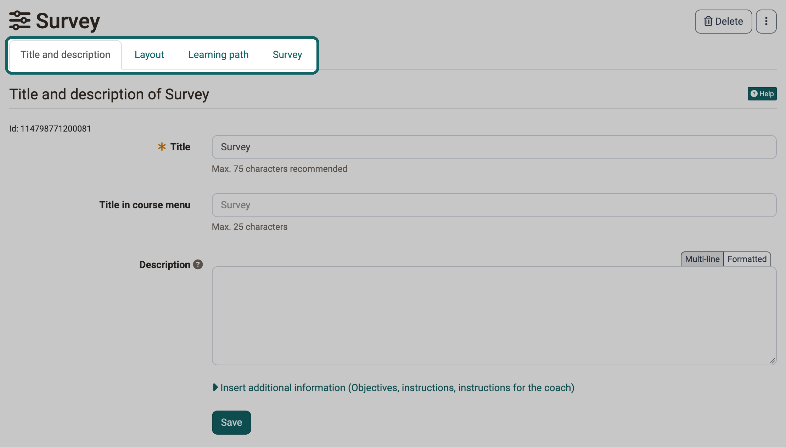
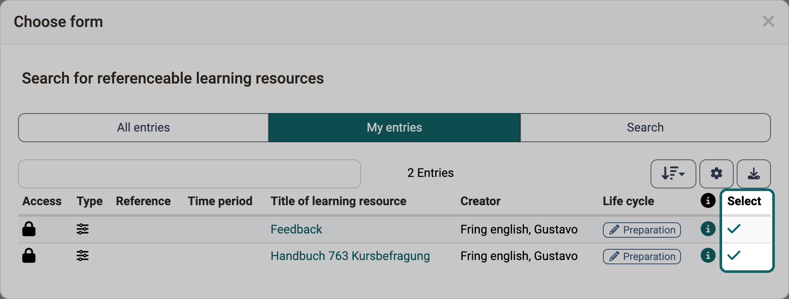
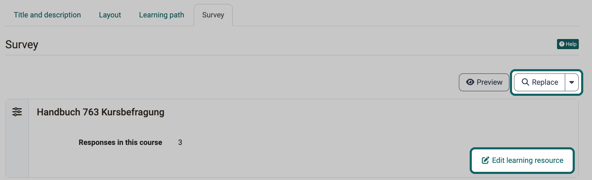
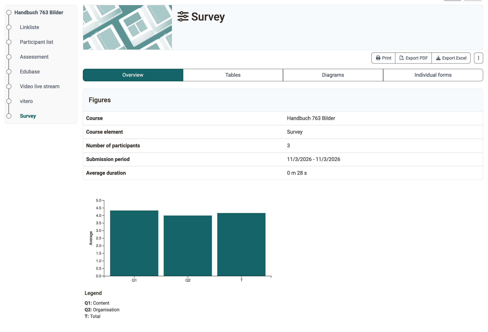
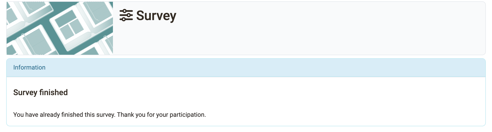
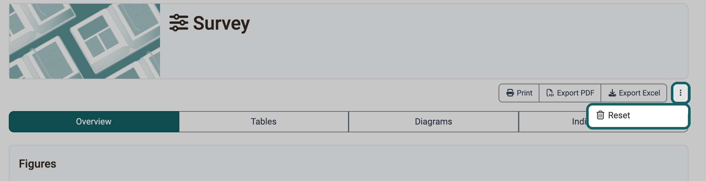

# Course Element "Survey" {: #course_element_survey}

## Profile {: #profile}

Name | Survey
---------|----------
Icon | :o_icon_o_survey_icon:
Available since | Release 13.0 (OO-3676)
Functional group | Assessment
Purpose | Course element for integration of learning resource "form"
Assessable | no
Specialty / Note | 

With the course element "Survey" you question the members of your course with an online questionnaire, for example on their satisfaction with the course. For this, the course element links a learning resource "Form". OpenOlat stores the results of a survey anonymised by default.

If you have not yet created a form for your survey, the instructions [How do I create a form learning resource?](../../manual_how-to/create_a_form/create_a_form.md) show how.

!!! info "Important"

    You can edit a form that is linked in a course completely in the [form editor](../learningresources/Form_Editor.md) only until someone opens the form for the first time. After that, you can only change texts, for example to correct typing errors.

!!! warning "Attention"

    If you [reset](#reset_surveys) a survey, OpenOlat deletes all responses, including the entries saved with "Quick save" by participants who have not yet completed the survey. Whoever has the questionnaire open during the reset receives the message "Error while saving." at the next save, and the entries are lost.

Further information on forms can be found on the page [Forms - Overview](../learningresources/Form.md).

## Forms in surveys {: #forms_in_surveys}

In the course element "Survey", the learning resource "Form" serves as the questionnaire. Owners of the course include questionnaires in their course this way, and participants fill in the surveys provided. You define who sees the results in the user rights of the course element.

OpenOlat ensures that participants fill in the survey only once. OpenOlat stores the results anonymised by default. If the answers are to be assigned to a person, add suitable form elements to the form in the [form editor](../learningresources/Form_Editor.md).

### Course editor {: #course_editor}

Add the course element "Survey" in the course editor. The following tabs are then available in the course editor:

{ class="shadow lightbox" title="Course element Survey in the course editor · 2026.11.03" }

In the tabs "Title and description" and "Layout" you store general descriptions and information about the course element and define its presentation. In the [Tab Learning path](../learningresources/Learning_path_course_Course_editor.md) you define the settings for learning path courses, for example the completion criterion "Survey finished".

Conventional courses have the tabs "Visibility" and "Access" instead. There you define who sees and edits the course element.

#### Tab "Survey" {: #survey}

In the tab "Survey" you configure the survey. In the first step, you select an existing form or create a new one. As long as no form is selected, the tab offers three options:

* **Select**: You connect the course element with a form that already exists as a learning resource. Under "My entries", the dialog "Choose form" shows all forms you own. With a click on the checkmark in the column "Select" you add a form to the course.
* **Create**: You create a new learning resource "Form", which OpenOlat connects with the course element right away.
* **Import**: You import a form that exists as a file.

{ class="shadow lightbox" title="Dialog Choose form · 2026.11.03" }

A newly created form does not yet contain any elements, questions or text fields. You add them in the [form editor](../learningresources/Form_Editor.md).

OpenOlat creates a form that you create directly in the course editor as a new learning resource "Form". You also find it in the [Authoring area](../area_modules/Authoring.md) under "My entries" and include it in further courses.

Once a form is selected, the tab shows its title and the number of "Responses in this course". With "Preview" you see the form the way participants fill it in. With the button "Edit learning resource" you open the learning resource "Form" and design the form in the form editor. If the form has already been set up appropriately, no editing is necessary. Owners of the form, learning resource managers and administrators see the button. With "Replace" you select a different form, with the arrow next to it you import one with "Import".

{ class="shadow lightbox" title="Tab Survey in the course editor · 2026.11.03" }

!!! warning "Attention"

    As soon as at least one person has opened the form, it can no longer be replaced. If you then click "Replace", OpenOlat shows the message "The form can not be replaced anymore." If you need a different form, create a new course element "Survey" and include the desired form there.

In the section "User rights" of the tab "Survey", you define who takes part in the survey ("Participation by") and for whom the results are visible ("Results visible for"). The following roles are available for each:

* the owners of the course
* the coaches of the course
* the participants of the course: all persons registered in the role "Participant" in the course
* Guests: persons without an OpenOlat account

With "Show advanced configuration" you also define which groups or individual users take part, and limit the participation of a role to a period with a start and an end.

You also release the results to these roles, groups and users and link the release to a start and an end in the advanced configuration.

Which roles are preselected in a newly inserted course element is defined in the system administration under `Administration > Modules > Course elements`, see [Module Course elements](../../manual_admin/administration/Modules.md#course_element_survey) [:octicons-tag-16:{ title="from Release 18.2 (OO-7529)" }](https://track.frentix.com/issue/OO-7529){:target="_blank"}.

!!! tip "Tip"

    For a group of persons to be able to fill in the survey, the course must also be released for this group of persons. For example, if external persons (guests) are also to fill in the survey, the course needs an offer for guests, see [Access configuration](../learningresources/Access_configuration.md). A release for guests only exists for conventional courses, not for learning path courses.

As soon as someone has opened the form, you can only change the form in the course to a limited extent with the button "Edit learning resource": texts can be changed, but blocks can no longer be moved, added or deleted. The form then shows the message "The resource is already used. Editing is limited."

### View {: #view}

What owners, coaches and participants see when the editor is closed depends on the user rights in the tab "Survey". If a group of persons may fill in the questionnaire ("Participation by"), it first sees the questionnaire. Once the person has filled in the questionnaire, the course element shows the evaluation of the survey, provided that the results are visible for their group of persons.

{ class="shadow lightbox" title="Evaluation in the course element Survey · 2026.11.03" }

If a group of persons (for example participants) may fill in the survey but may not see the results, this message appears *after* filling it in:

{ class="shadow lightbox" title="Course element Survey after filling in · 2026.11.03" }

Each person fills in a survey only once. After submitting, the answers can no longer be changed, OpenOlat points this out. If you do not want to submit the questionnaire yet, save your answers with "Quick save".

If a group of persons may neither fill in the questionnaire nor see the results, the message "No access" appears.

### View the results of a survey {: #view_survey_results}

The following tabs show the evaluation to the authorised persons:

**Overview**: how many persons have filled in the questionnaire, the submission period and the processing time. Depending on the question type, the tab shows further key figures.

**Tables**: the individual questions and answers, for rubrics with further statistical evaluations. You can also download free texts as an Excel table.

**Diagrams**: a graphical representation of the individual questions.

**Individual forms**: the complete, anonymously filled-in questionnaires of individual persons.

With "Print", "Export PDF" and "Export Excel" you print the contents of the four tabs or download them.

**Further areas for viewing the results**

The same evaluation is also available under `Course > Administration > Survey statistics`.

You also save the results via the [course archiving](../learningresources/Course_Archiving.md). There you bundle the results of several course elements in one ZIP file.

### Reset surveys {: #reset_surveys}

Owners of the course reset a survey with "Reset" in the menu with the three dots of the course element. OpenOlat then deletes all answers of this survey. Individual questionnaires cannot be reset because the submission is anonymous.

{ class="shadow lightbox" title="Evaluation in the course element Survey, owner view · 2026.11.03" }

## Further information {: #further_information}

**Mentioned on this page** 
[How do I create a form learning resource? >](../../manual_how-to/create_a_form/create_a_form.md) 
[The form editor >](../learningresources/Form_Editor.md) 
[Forms - Overview >](../learningresources/Form.md) 
[Learning path course - Course editor >](../learningresources/Learning_path_course_Course_editor.md) 
[Authoring - Overview >](../area_modules/Authoring.md) 
[Modules: Overview >](../../manual_admin/administration/Modules.md) 
[Access configuration >](../learningresources/Access_configuration.md) 
[Course administration - Archiving & Reports >](../learningresources/Course_Archiving.md)

**Further reading** 
[Form elements >](Form_Elements.md) 
[Course elements at a glance >](Course_Elements.md)

[To the top of the page ^](#course_element_survey)
