# Kursbaustein "Aufgabe" {: #course_element_task}

## Steckbrief {: #profile}

Name | Aufgabe
---------|----------
Icon | :o_icon_o_gta_icon:
Verfügbar seit | Neuauflage mit Release 19
Funktionsgruppe | Wissensüberprüfung
Verwendungszweck | Abbildung komplexer Aufgabenworkflows mit konfigurierbaren Teilschritten, wie Abgabe von Lösungsdokumenten, Feedback (auch als Peer-Review) und Überarbeitungsschlaufe, Bereitstellung der Musterlösung und Bewertung
Bewertbar | ja
Spezialität / Hinweis | auch als [Gruppenaufgabe](../learningresources/Course_Element_Grouptask.de.md) verfügbar

Mit dem Kursbaustein "Aufgabe" organisieren Sie Dateiabgaben und Einsendeaufgaben in Ihrem Kurs. Teilnehmende laden ihre Lösung in den Kurs hoch und erhalten Feedback und eine Bewertung. Auch [Peer-Reviews](../../manual_how-to/peer_review/peer_review.de.md) sind möglich, ebenso Überarbeitungen und Musterlösungen.

Kursbesitzer:innen richten die Aufgabe im Kurseditor ein, Teilnehmende bearbeiten sie im Kurs, und Betreuer:innen begleiten und bewerten die Abgaben. Die drei Hauptabschnitte dieser Seite folgen diesen drei Sichten.

---

## Aufgabe erstellen (Perspektive Autor:in) {: #create_task}

Sie erstellen und konfigurieren die Aufgabe wie alle Kursbausteine im Kurseditor.

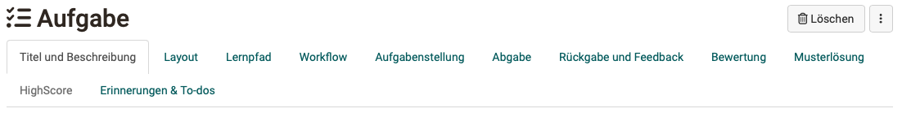{ class="shadow lightbox" title="Kurseditor, Kursbaustein Aufgabe" }

!!! note "Quick Links: Aufgabe erstellen (Perspektive Autor:in)"

    * [Tab Titel und Beschreibung](#title)  Allgemeine Angaben über den Kursbaustein
    * [Tab Layout](#layout) Allgemeine Einstellungen im Layout
    * [Tab Lernpfad](#learningpath) Soll die Aufgabe freiwillig, Pflicht oder nur für bestimmte Personengruppen sein?
    * [Tab Workflow](#workflow) Hier bestimmen Sie, welche Schritte die Aufgabe enthalten soll.
    * [Tab Aufgabenstellung](#assignment) Erstellung oder Upload der Aufgabenstellung, Zuweisung verschiedener Aufgaben oder Ziehung, usw.
    * [Tab Abgabe](#submission) Definition der erwarteten Einsendungen (mit Vorlage?, als Audio-/Videoaufnahme?, usw.)
    * [Tab Rückgabe und Feedback](#revisions) Z.B. Definition des Prozesses für einen Peer-Review.
    * [Tab Bewertung](#grading)  Konfiguration der Punktevergabe, Kriterium für Bestanden, Berücksichtigung in der Kursbewertung usw.
    * [Tab Musterlösung](#sample) Z.B. Bereitstellung einer pdf-Datei.
    * [Tab HighScore](#highscore) Visualisierung der Resultate, falls Punkte vergeben werden.
    * [Tab Erinnerungen & To-dos](#reminders) Vorbereitung automatischer Erinnerungsmails und To-dos
    * [Tab Badges](#tab-badges) Erstellung von Badges für die Bearbeitung/Erledigung der Aufgabe

### Tab "Titel und Beschreibung"  {: #title}

Die Angaben über den Kursbaustein entsprechen denen, wie sie in allen Kursbausteinen enthalten sind.

[nach oben (Perspektive Autor:in) ^](#create_task) 
[zum Seitenanfang ^](#course_element_task)

### Tab "Layout"  {: #layout}

Die Optionen zum Layout entsprechen denen, wie sie in allen Kursbausteinen enthalten sind.

[nach oben (Perspektive Autor:in) ^](#create_task) 
[zum Seitenanfang ^](#course_element_task)

---

### Tab "Lernpfad" {: #learningpath}

!!! info "Herkömmliche Kurse"

    Herkömmliche Kurse verfügen nicht über den Tab "Lernpfad" und haben stattdessen die Tabs "Sichtbarkeit" und "Zugang", inklusive Expertenmodus.

Definieren Sie, ob die Bearbeitung der Aufgabe obligatorisch oder freiwillig ist oder ob der Kursbaustein nicht angezeigt (ausgenommen) werden soll. Obligatorische Aufgaben werden bei der Fortschrittsanzeige berücksichtigt, freiwillige nicht.

Das "Freigabedatum" verwenden Sie, wenn der Kursbaustein erst ab einem bestimmten Datum geöffnet und gestartet werden soll. Der Baustein selbst erscheint aber bereits in der Kursstruktur.

Die Zeitangabe unter "Zu bearbeiten bis" bezieht sich auf die Frist für das Abholen bzw. den Start des Kursbausteins Aufgabe, nicht auf den Abgabetermin für den Dateiupload (siehe [Tab "Workflow"](#workflow)).

Unter "Bearbeitungszeit (Minuten)" tragen Sie ein, wie lange Teilnehmende für die Aufgabe voraussichtlich brauchen. Der Eintrag ist vor allem dann wichtig, wenn sich der Fortschritt im Kurs nach der Bearbeitungszeit der Kursbausteine richtet. Diese Einstellung liegt in den [Kurseinstellungen](../learningresources/Course_Settings.de.md) unter: 
`Kurs > Administration > Einstellungen > Tab "Durchführung"`

Im Tab "Lernpfad" wird auch definiert, welches Kriterium erfüllt sein muss, damit die Aufgabe als "erledigt" gilt. Folgende Optionen stehen zur Wahl:

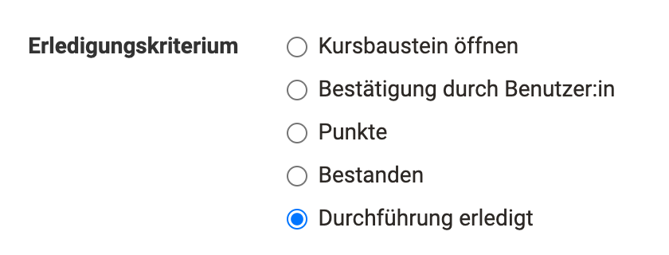{ class="shadow lightbox" title="Kurseditor, Kursbaustein Aufgabe, Tab Lernpfad · 2026.11.02" }

* **Kursbaustein öffnen**: Die Person hat den Kursbaustein geöffnet.
* **Bestätigung durch Benutzer:in**: Die Person hat die Lesebestätigung angeklickt.
* **Punkte**: Die Person hat bei der Bearbeitung der Aufgabe mindestens die angegebene Punktzahl erreicht.
* **Bestanden**: Die Person hat die im Tab "Bewertung" konfigurierten Anforderungen an "Bestanden" erfüllt, oder eine betreuende Person hat die Aufgabe manuell auf bestanden gesetzt.
* **Durchführung erledigt**: Die Person hat alle Schritte des Workflows durchlaufen.

[nach oben (Perspektive Autor:in) ^](#create_task) 
[zum Seitenanfang ^](#course_element_task)

### Tab "Workflow"  {: #workflow}

Im Tab "Workflow" legen Sie fest, aus welchen Schritten die Aufgabe besteht. Soll eine konkrete Aufgabenstellung im Kursbaustein hinterlegt werden, oder finden die Teilnehmenden die Aufgabe woanders? Sollen sie ein Dokument abgeben? Soll es ein Feedback von Betreuenden geben, und dürfen die Teilnehmenden ihre Abgabe überarbeiten? Soll eine Musterlösung bereitstehen? Soll eine Bewertung mit Punkten oder Bestanden möglich sein? Sollen bestimmte Teilnehmende von bestimmten Betreuenden bewertet werden? Schalten Sie die Schritte ein, die Sie benötigen, und konfigurieren Sie danach die zugehörigen Tabs.

!!! tip "Tipp"

    Dies ist der erste Tab des Kursbausteins, den Sie konfigurieren sollten. Wählen Sie hier die konkreten Funktionen aus, die Sie benötigen. Anschliessend sind die passenden Tabs aktiv/inaktiv und können weiter konfiguriert werden.

Folgende Optionen stehen Ihnen zur Verfügung:
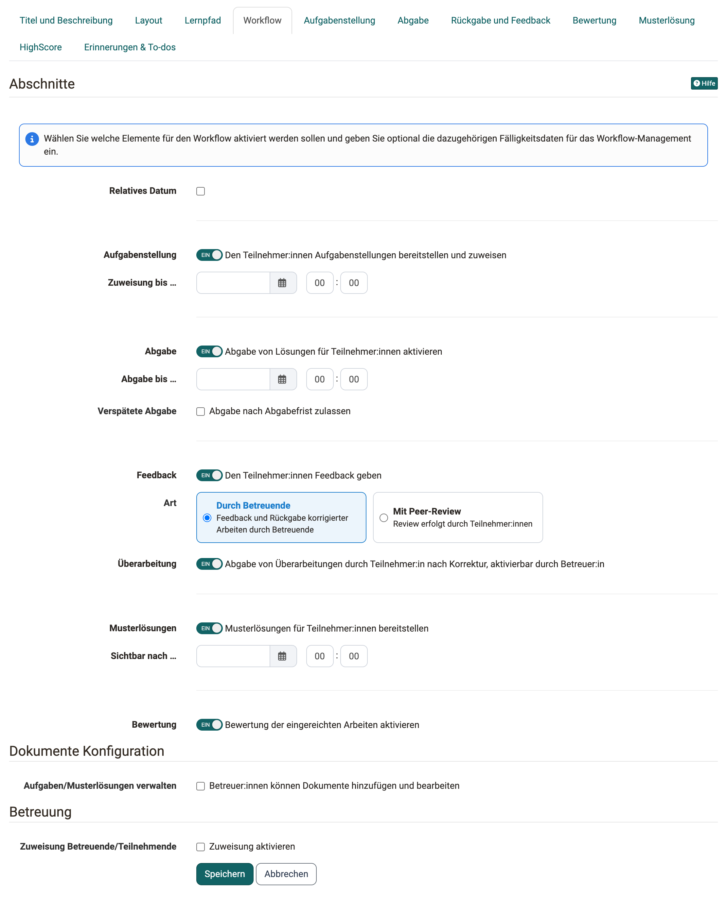{ class="shadow lightbox" title="Kurseditor, Kursbaustein Aufgabe, Tab Workflow · 2026.11.02" }

#### Relatives Datum {: #workflow_relative_dates}

Statt Kalenderdaten einzutragen, können Sie auch mit _relativen Daten_ arbeiten. Legen Sie fest, wie viele Tage nach dem ersten Kursbesuch oder nach der Einschreibung / Buchung die Aufgabenstellung geöffnet bleibt. Alle eingestellten Zeitvorgaben können auch individuell angepasst werden, z.B. wenn eine teilnehmende Person aufgrund bestimmter Umstände eine Verlängerung benötigt. Dies gilt für alle Prozessschritte. Wenn Sie das Abgabedatum verlängern, wird die Aufgabe neu eröffnet. Auch ein Datum für eine verspätete Abgabe ist möglich.

=== "Mit fixem Datum"

    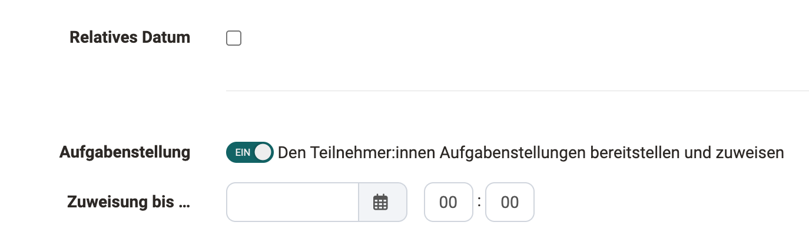{ class="shadow lightbox" title="Kurseditor, Kursbaustein Aufgabe, Tab Workflow · 2026.11.02" }

=== "Mit relativem Datum"

    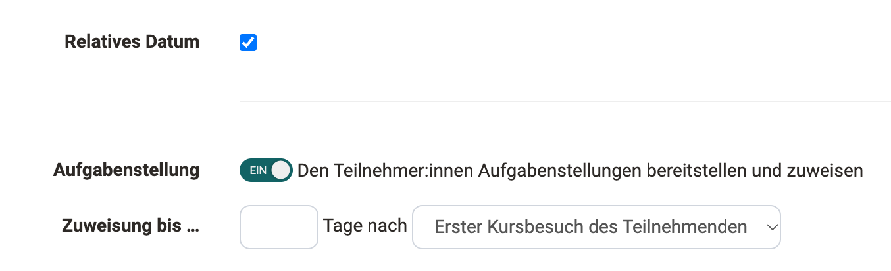{ class="shadow lightbox" title="Kurseditor, Kursbaustein Aufgabe, Tab Workflow · 2026.11.02" }

Die Umstellung auf relative Daten betrifft die Eingabefelder für "Aufgabenstellung", "Abgabe" und "Musterlösungen".

#### Aufgabenstellung {: #workflow_assignment}

Mit diesem Schalter stellen Sie den Teilnehmenden Aufgabenstellungen bereit und weisen sie zu. Die Aufgabenstellung ist bis zum Datum unter "Zuweisung bis …" verfügbar. Die Aufgaben selbst hinterlegen Sie danach im [Tab "Aufgabenstellung"](#assignment).

#### Abgabe {: #workflow_submission}

Mit diesem Schalter geben Teilnehmende ihre Lösung im Kursbaustein ab. Die Abgabe ist bis zum Datum unter "Abgabe bis …" möglich.

Ist "Abgabe nach Abgabefrist zulassen" aktiviert und unter "Letzte Abgabemöglichkeit bis …" ein Termin hinterlegt, können Teilnehmende ihre Lösung noch bis zu diesem Termin einreichen. Teilnehmende sehen den normalen und den verspäteten Abgabetermin, solange diese in der Zukunft liegen. Die verspätete Abgabe sehen auch Betreuer:innen und Kursbesitzer:innen.

#### Feedback {: #workflow_feedback}

Unter "Art" wählen Sie, wer das Feedback gibt: "Durch Betreuende" oder "Mit Peer-Review", also durch die anderen Teilnehmer:innen. Beim Peer-Review legen Sie zusätzlich den "Peer-Review-Zeitraum" fest.

#### Überarbeitung {: #workflow_revision}

Hier erlauben Sie, dass Teilnehmer:innen nach der Korrektur eine Überarbeitung abgeben. Ob eine Überarbeitung nötig ist, entscheiden die Betreuer:innen bei jeder Abgabe. Der Schalter erscheint, wenn das Feedback eingeschaltet ist und unter "Art" die Option "Durch Betreuende" gewählt ist.

#### Musterlösungen {: #workflow_sample_solution}

Eine Musterlösung kann für alle Teilnehmenden oder nur diejenigen, die die Aufgabe bearbeitet haben, ab dem eingetragenen Datum bereitgestellt werden. Die Auswahl "Sichtbar für …" erscheint erst, wenn unter "Sichtbar nach …" ein Kalenderdatum eingetragen ist oder die Aufgabe freiwillig ist.

#### Bewertung {: #workflow_grading}

Mit diesem Schalter aktivieren Sie den [Tab "Bewertung"](#grading), in dem Sie die Details der Bewertung konfigurieren.

#### Dokumente Konfiguration {: #workflow_documents_configuration}

Dieser Bereich erscheint nur, wenn "Aufgabenstellung" oder "Musterlösungen" eingeschaltet ist, denn dann werden Dokumente hochgeladen. Unter "Aufgaben/Musterlösungen verwalten" erlauben Sie mit "Betreuer:innen können Dokumente hinzufügen und bearbeiten", dass neben Kursbesitzer:innen auch Betreuer:innen Dokumente hinzufügen und bearbeiten.

#### Betreuung {: #workflow_coaching}

Im Bereich "Betreuung" aktivieren Sie eine teilnehmerabhängige Betreuung: Jeder teilnehmenden Person ist dann eine bestimmte betreuende Person zugewiesen.

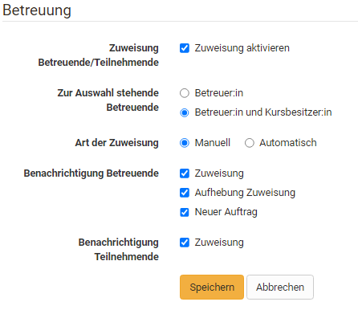{ class="shadow lightbox" title="Kurseditor, Kursbaustein Aufgabe, Tab Workflow" }

* **Zuweisung Betreuende/Teilnehmende** 
Mit "Zuweisung aktivieren" blenden Sie die weiteren Optionen zur Betreuung ein. Die Personen ordnen Sie danach bei geschlossenem Kurseditor zu, siehe [Tabelle "Zuweisung Betreuende/Teilnehmende"](#coach_assignment_table).

* **Zur Auswahl stehende Betreuende** 
Hier wählen Sie zwischen "Betreuer:in" und "Betreuer:in und Kursbesitzer:in". Bei der zweiten Option stehen auch Kursbesitzer:innen für die Betreuung der Teilnehmer:innen zur Wahl.

* **Art der Zuweisung** 
Hier legen Sie fest, ob Sie die betreuenden Personen "Manuell" zuweisen oder OpenOlat sie "Automatisch" zuweist.

* **Benachrichtigung Betreuende** 
Wählen Sie hier, in welchen Fällen Betreuende eine Benachrichtigung per Mail erhalten: "Zuweisung", "Neuer Auftrag" und "Aufhebung Zuweisung".

* **Benachrichtigung Teilnehmende** 
Wählen Sie hier, ob Teilnehmende über die Zuweisung zu einer betreuenden Person per Mail informiert werden.

#### Tabelle "Zuweisung Betreuende/Teilnehmende" [:octicons-tag-16:{ title="ab Release 17.2.1 (OO-6698)" }](https://track.frentix.com/issue/OO-6698) {: #coach_assignment_table}

Die eigentliche Zuordnung nehmen Kursbesitzer:innen bei geschlossenem Kurseditor vor: `Kurs > "Aufgabenbaustein" > Tab "Teilnehmer:innen" > Button "Zuweisung Betreuende/Teilnehmende"`.

Die Tabelle ist eine Matrix: Jede Zeile ist eine teilnehmende Person, jede Spalte eine zur Auswahl stehende betreuende Person, dazu die Spalte "Nicht zugewiesen". Sie setzen die Zuordnung, indem Sie in der Zeile den Punkt in der gewünschten Spalte wählen. Hinter jedem Namen steht in Klammern, wie viele Personen dieser Betreuerin oder diesem Betreuer aktuell zugewiesen sind. So erkennen Sie eine ungleiche Verteilung auf einen Blick.

Über "Nicht zugewiesene zufällig zuweisen" verteilt OpenOlat alle noch offenen Personen automatisch. Die Reiter "Alle" und "Nicht zugewiesen" sowie die Filter "Teilnehmer:innen" und "Betreuer:in" grenzen die Liste ein. Gehören dem Kurs Gruppen oder Curriculum-Elemente an, kommt der Filter "Gruppen" hinzu.

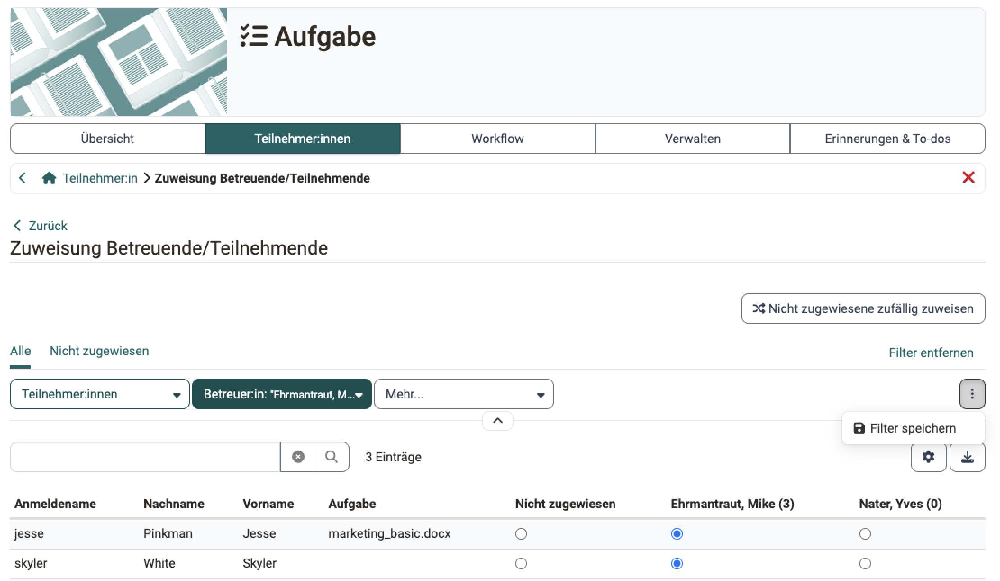{ class="shadow lightbox" title="Zuweisung Betreuende/Teilnehmende im Tab Teilnehmer:innen" }

!!! note "Hinweis"

    Betreuende sehen den Button "Zuweisung Betreuende/Teilnehmende" nicht. Die Zuordnung ist Kursbesitzer:innen vorbehalten; Betreuende erkennen ihre eigene Zuordnung in der Spalte "Betreuer:in" der Teilnehmerliste.

Zwei Funktionen unterstützen die Arbeit mit grossen Listen:

* **Export**: Über das Export-Symbol rechts über der Tabelle laden Sie die aktuelle Tabellenansicht als Excel-Datei herunter, zum Beispiel als Nachweis der Zuordnung.
* **Filter speichern**: Eine eingestellte Filterkombination sichern Sie über das Drei-Punkte-Menü rechts neben den Filtern mit "Filter speichern" unter einem eigenen Namen. Der gespeicherte Filter erscheint danach als eigener Reiter und steht beim nächsten Aufruf der Tabelle wieder bereit. [:octicons-tag-16:{ title="ab Release 21.0.2 (OO-9601)" }](https://track.frentix.com/issue/OO-9601)

Der Button erscheint nur beim Kursbaustein Aufgabe und nur, wenn die Zuweisung Betreuende/Teilnehmende aktiviert ist. Bei der [Gruppenaufgabe](../learningresources/Course_Element_Grouptask.de.md) ergibt sich die Zuordnung aus der Betreuung der Gruppe.

!!! warning "Achtung"

    Nachträgliche Änderungen am Workflow wirken sich auf alle Teilnehmenden aus, auch wenn diese den Workflow bereits begonnen haben.

    Bei Änderungen am Workflow, z.B. dem Entfernen der Aufgabenstellung, wird bei allen Teilnehmenden des Kurses dieser Bestandteil des Workflows entfernt. Die Information über bereits gewählte Aufgaben ist dann nicht mehr sichtbar. Wird der Bestandteil des Workflows wieder eingefügt, ist diese Information aber wieder zugänglich.

    Wird jedoch z.B. die Aufgabenstellung nachträglich hinzugefügt und ein/e Teilnehmer:in ist im persönlichen Workflow bereits weiter fortgeschritten, so muss nachträglich keine Aufgabe mehr ausgewählt werden.

!!! warning "Achtung"

    Wenn unter den Kursmitgliedern keine Person die Rolle Betreuer:in hat und gleichzeitig Kursbesitzer:innen keine Betreuungsaufgaben wahrnehmen, dann kann keine Betreuerzuweisung stattfinden. Ob Kursbesitzer:innen Betreuungsaufgaben wahrnehmen, legen Sie unter `Tab Workflow > Abschnitt "Betreuung" > "Zur Auswahl stehende Betreuende"` fest.

!!! info "Hinweis"

    Die im Tab Workflow angezeigten und durch die Autor:innen wählbaren Optionen können durch Administrator:innen vorkonfiguriert werden. Siehe Administrationshandbuch, `Module > Kursbausteine`

[nach oben (Perspektive Autor:in) ^](#create_task) 
[zum Seitenanfang ^](#course_element_task)

---

### Tab "Aufgabenstellung"  {: #assignment}

!!! info "Voraussetzung"

    Im Tab "Workflow" muss zunächst die "Aufgabenstellung" eingeschaltet sein, damit Sie die konkrete Aufgabenstellung im Tab "Aufgabenstellung" bereitstellen können.

**a) Aufgabe hochladen**

Sie können eine oder mehrere zuvor erstellte Aufgaben-Dateien hochladen. Jede hochgeladene Aufgabe gilt dann als eine zu bearbeitende Alternative. Werden für die Bearbeitung einer Aufgabe mehrere ergänzende Dateien benötigt, sollten Sie alle benötigten Dateien als Zip-Datei bündeln und diese Zip-Datei als Aufgabendatei hochladen.

Generell sollte jede Aufgaben-Datei einen passenden Titel und eventuell eine kurze Beschreibung umfassen.

**b) Dateien unterschiedlicher Formate erstellen**

Neben dem Upload können Dateien auch direkt in OpenOlat erstellt werden. Welche Formate genau zur Verfügung stehen hängt davon ab welche von der OpenOlat Administration aktiviert wurden. In der Regel steht mindestens ein HTML-Editor zur Verfügung. Aber auch die Erstellung von Word, Excel, PowerPoint sowie Diagrammen oder Whiteboards ist möglich. Zusätzlich können eine spezifische Video- und auch eine Audio-Aufgabe erstellt werden.

Wird eine Aufgabe mit dem internen HTML-Editor erstellt, können Sie ebenfalls mehrere Dateien (z.B. Bilder oder PDFs) zur Verfügung stellen, in dem Sie diese im HTML-Editor hochladen und dann in der HTML-Seite verlinken bzw. direkt anzeigen. So erstellte Aufgaben werden von den Teilnehmenden dann im .zip Format heruntergeladen. Wird der HTML-Editor verwendet, wird automatisch der hinterlegte Titel auch als Dateiname übernommen. Dies kann aber jederzeit wieder geändert werden.

!!! info "Mehrere Dateien"

    Bitte beachten: Werden mehrere Dateien im Tab Aufgabenstellung hinterlegt, werden diese als mehrere verschiedene Aufgabenstellungen betrachtet. Es handelt sich _nicht_ um eine Aufgabe mit mehreren ergänzenden Dateien.

Im Feld "Art der Zuweisung" bestimmen Sie, ob einer teilnehmenden Person alle zur Verfügung stehenden Aufgaben zur Auswahl angeboten werden ("Benutzer:in wählt die Aufgabe manuell") oder ob OpenOlat ihr eine Aufgabe per Zufallsauswahl zuweist ("Automatische Zuweisung einer Aufgabe").

Wählen Sie im Feld "Typ der Ziehung", ob mehrere Teilnehmende die gleiche Aufgabe lösen können oder ob jede teilnehmende Person eine andere Aufgabe lösen soll. Wenn die Aufgabe manuell gewählt wird, können Sie im Feld "Vorschau" weiter festlegen, ob die Teilnehmenden vor der Wahl einer Aufgabe diese einsehen dürfen. Wenn bei "Typ der Ziehung" jede Person eine andere Aufgabe lösen soll, müssen mindestens so viele Aufgaben hinterlegt werden, wie es Teilnehmende gibt, die diese Aufgabe lösen sollen.

!!! tip "Tipp"

    Wenn der Kursbaustein nur _eine_ Aufgabe beinhaltet ist eine manuelle Wahl wenig sinnvoll. Nutzen Sie in diesem Fall am besten die automatische Zuweisung.

Im Feld "Mitteilung an Benutzer:in" hinterlegen Sie für alle Teilnehmenden allgemeine Hinweise zur Bearbeitung der Aufgaben.

Wählt eine teilnehmende Person bei der manuellen Auswahl aus Versehen die falsche Aufgabenstellung, können Kursbesitzer:innen ihr im [Bewertungswerkzeug](../learningresources/Assessment_tool_overview.de.md) das Zurücksetzen erlauben.

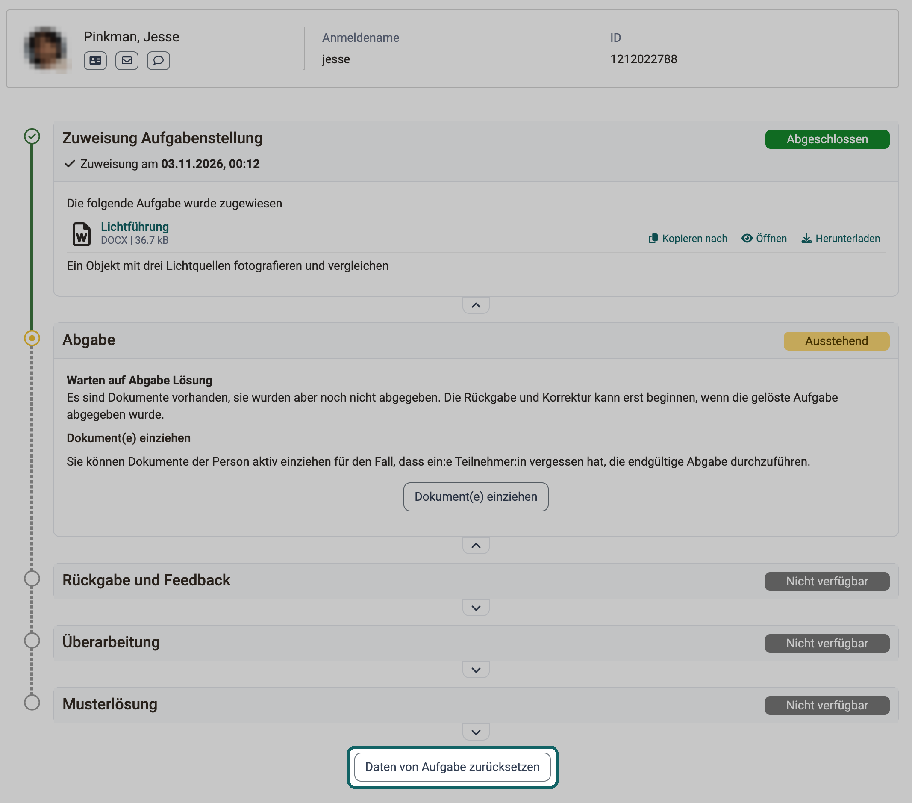{ class="shadow lightbox" title="Bewertungswerkzeug, Kursbaustein Aufgabe, Person · 2026.11.03" }

Die Wahl ändert sich dabei _nicht automatisch_. Die teilnehmende Person erhält aber die Möglichkeit, ihre bisherigen Schritte mit "Daten zurücksetzen" rückgängig zu machen.

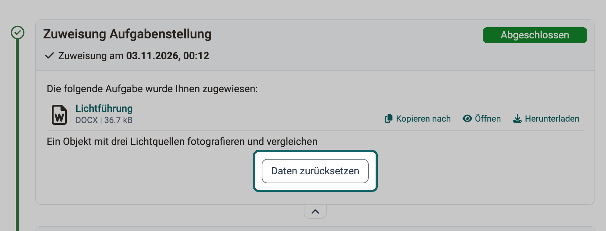{ class="shadow lightbox" title="Kursbaustein Aufgabe, Sicht der Teilnehmenden · 2026.11.03" }

[nach oben (Perspektive Autor:in) ^](#create_task) 
[zum Seitenanfang ^](#course_element_task)

---

### Tab "Abgabe"  {: #submission}

Hier definieren Sie Art und Umfang der Einsendemöglichkeiten für die Teilnehmenden.

!!! info "Voraussetzung"

    Im Tab "Workflow" muss

    * "Abgabe" aktiviert worden sein, damit Sie diese nun einrichten können.

    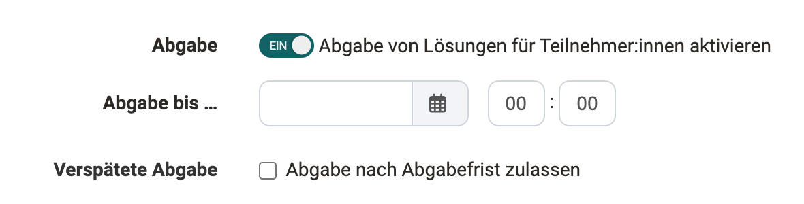{ class="shadow lightbox" title="Kurseditor, Kursbaustein Aufgabe, Tab Workflow · 2026.11.02" }

Danach aktivieren Sie mindestens eine der beiden Möglichkeiten: Dokumente hochladen oder den OpenOlat Editor für die Abgabe nutzen.

Im Tab "Abgabe" stehen folgende Optionen zur Wahl:

**"Dokumente hochladen (z.B. PDF)"**: Teilnehmende laden ausserhalb von OpenOlat erstellte Dokumente hoch und geben sie ab.

**"Abgabe mit OpenOlat Editor"**: Teilnehmende erstellen Dokumente direkt im Kursbaustein. Standardmässig steht dafür ein HTML-Editor zur Verfügung. Sind weitere Dokument-Editoren in OpenOlat eingebunden, können sie auch Dokumente in weiteren Formaten wie Word oder Excel erstellen, ebenso draw.io-Diagramme.

Aktivieren Sie **"Aufgabe ist Vorlage für die Abgabe"**, wenn die Lernenden die hinterlegte Aufgabendatei als Basis für ihre Bearbeitung nutzen sollen, beispielsweise wenn die Aufgabenstellung eine auszufüllende vorstrukturierte Tabelle beinhaltet. Voraussetzung ist, dass diese Option von den OpenOlat Administrationen freigeschaltet wurde.

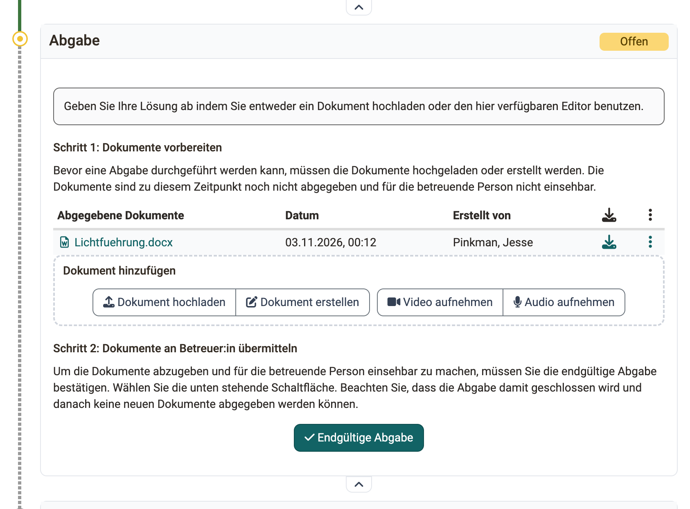{ class="shadow lightbox" title="Kursbaustein Aufgabe, Sicht der Teilnehmenden · 2026.11.03" }

**"Videoaufnahmen zulassen"**: Teilnehmende nehmen zusätzlich Videos per Webcam auf und reichen sie ein. Unter "Max. Länge der Aufzeichnung (in Sek.)" begrenzen Sie die Dauer, unter "Videoqualität" wählen Sie die Qualitätsstufe.

**"Audioaufnahmen zulassen"**: Teilnehmende nehmen zusätzlich Audios mit dem Audio-Recorder auf und geben sie ab. Auch hier begrenzen Sie die Dauer unter "Max. Länge der Aufzeichnung (in Sek.)".

Unter "Min. Anzahl von Dokumenten" und "Max. Anzahl von Dokumenten" legen Sie fest, wie viele Dokumente eine Abgabe enthalten muss oder darf. Soll es keine Einschränkung geben, lassen Sie die Felder frei.

Aktivieren Sie die E-Mail-Bestätigung, damit Personen, die eine Aufgabe abgegeben haben, eine Nachricht erhalten. Den vorformulierten Text der E-Mail passen Sie bei Bedarf an.

[nach oben (Perspektive Autor:in) ^](#create_task) 
[zum Seitenanfang ^](#course_element_task)

---

### Tab "Rückgabe und Feedback"  {: #revisions}

!!! info "Voraussetzung"

    Im Tab "Workflow" muss

    * das Feedback eingeschaltet sein.
    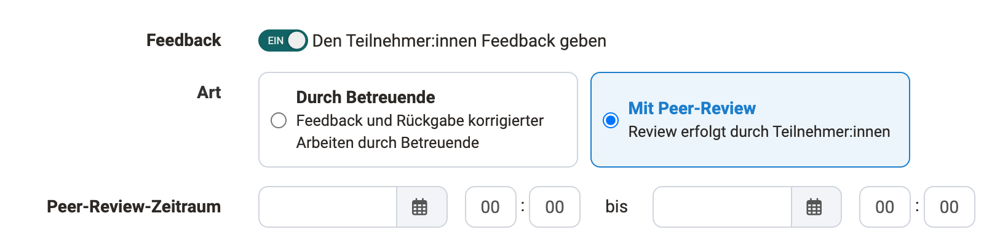{ class="shadow lightbox" title="Kurseditor, Kursbaustein Aufgabe, Tab Workflow · 2026.11.02" }
    * Je nach Wahl wer das Feedback geben soll, erscheinen im Tab "Rückgabe und Feedback" unterschiedliche Optionen

**Rückgabe und Feedback durch Betreuer:innen**

Wurde im Tab "Workflow" die Option "Durch Betreuende" gewählt, legen Sie im Tab "Rückgabe und Feedback" unter "Rückgabe Konfiguration" die minimale und die maximale Anzahl von Rückgabedokumenten fest, die die Teilnehmenden während der Schritte "Rückgabe und Feedback" und "Überarbeitung" abgeben dürfen.

**Rückgabe und Feedback durch Peer-Review**

Wurde im Tab "Workflow" die Option "Mit Peer-Review" gewählt, legen Sie im Tab "Rückgabe und Feedback" die Regeln fest, nach denen andere Teilnehmer:innen Feedback geben. Die Reviewer:innen geben ihr Feedback in einem [Formular](../learningresources/Form_Element_Rubric.de.md), meist mit Hilfe einer Rubrik. Als Kursbesitzer:in geben Sie dieses Review-Formular vor.

Ist im Tab "Workflow" auch die Bewertung eingeschaltet und sollen die Punkte für das Peer-Review automatisch aus dem Formular übernommen werden, muss das Formular mindestens ein Rubrik-Element enthalten. Nur über ein Rubrik-Element vergibt OpenOlat automatisch Punkte.

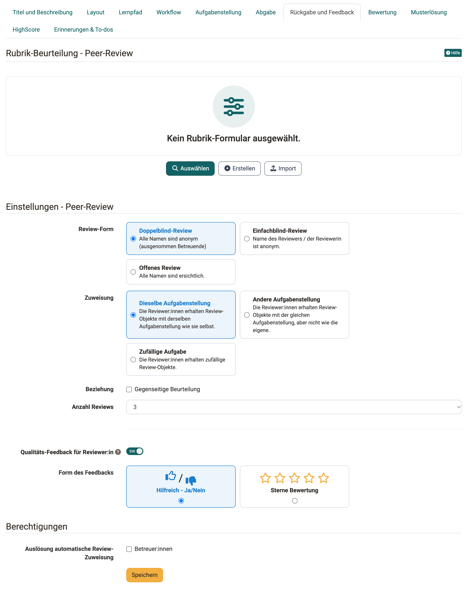{ class="shadow lightbox" title="Kurseditor, Kursbaustein Aufgabe, Tab Rückgabe und Feedback · 2026.11.02" }

#### Rubrik-Beurteilung - Peer-Review {: #peer_review_rubric}

Für Peer-Reviews wird ein geeignetes Rubrik-Formular benötigt. Solange keines gewählt ist, zeigt der Bereich "Kein Rubrik-Formular ausgewählt.". Mit "Auswählen" übernehmen Sie ein bestehendes Formular, mit "Erstellen" legen Sie ein neues an, mit "Import" importieren Sie ein Formular. Hier finden Sie ein [Musterformular](assets/Example_PeerReview_v1_de.zip) (zip-Datei zum Import in Ihr OpenOlat).

Unter "Einstellungen - Peer-Review" legen Sie das Verfahren mit den folgenden Feldern fest.

#### Review-Form {: #peer_review_form}

Hier legen Sie fest, welche Namen sichtbar sind: 
\- Doppelblind-Review: Alle Namen sind anonym (ausgenommen Betreuende). 
\- Einfachblind-Review: Der Name des Reviewers/der Reviewerin ist anonym. 
\- Offenes Review: Alle Namen sind ersichtlich.

#### Zuweisung {: #peer_review_assignment}

Hier bestimmen Sie, welche Aufgabenstellungen die Reviewer:innen zum Review erhalten: 
\- **Dieselbe Aufgabenstellung**: Wenn eine Person z.B. Aufgabe 1 gezogen und bearbeitet hat, erhält sie auch nur Aufgabe 1 zum Review. Sie muss sich dann nicht in eine andere Thematik einarbeiten. 
\- **Andere Aufgabenstellung**: Das Review gilt einer anderen Aufgabenstellung als der, die man selbst gezogen hat. Sind mehrere Reviews zu erledigen, gelten sie alle derselben Aufgabenstellung. 
\- **Zufällige Aufgabe**: Die Reviewer:innen erhalten zufällige Aufgaben zum Review.

#### Beziehung {: #peer_review_relationship}

Ist "Gegenseitige Beurteilung" gewählt, können sich Teilnehmer:innen gegenseitig beurteilen, müssen es aber nicht.

#### Anzahl Reviews {: #peer_review_number}

Hier geben Sie an, wie viele Reviews für jede teilnehmende Person vorgesehen sind. Je nach Anzahl der Teilnehmer:innen kann die tatsächlich zu erledigende Zahl der Reviews abweichen. Im Idealfall entspricht die Anzahl der zu erledigenden Reviews der Anzahl Reviews, die man selbst von anderen erhält.

#### Qualitäts-Feedback für Reviewer:in {: #peer_review_quality_feedback}

Hier geben Sie den Teilnehmer:innen die Möglichkeit, ihren Reviewer:innen nach dem Erhalt eines Reviews eine Rückmeldung zu geben. Ob das erhaltene Review hilfreich war, zeigen sie mit dem Daumensymbol oder mit Sternen an.

#### Form des Feedbacks {: #peer_review_feedback_form}

Ist "Qualitäts-Feedback für Reviewer:in" eingeschaltet, erscheint dieses Feld. Wählen Sie, mit welchen Symbolen die Teilnehmer:innen den Reviewer:innen dieses Feedback geben: "Hilfreich - Ja/Nein" oder "Sterne Bewertung".
Als empfehlenswert hat sich die Symbolik mit "Daumen hoch" / "Daumen nach unten" herausgestellt.

#### Auslösung automatische Review-Zuweisung {: #peer_review_permissions}

Dieses Feld steht im Bereich "Berechtigungen". Autor:innen sehen alle Teilnehmer:innen eines Kurses, Betreuer:innen sehen aber eventuell nur ihre betreute Gruppe.
Damit Betreuer:innen die Reviews der betreuten Teilnehmer:innen ansehen können, muss die Zuweisung von Reviews innerhalb ihrer Gruppen erfolgen. (Nur dann können Betreuer:innen alle Reviews mitverfolgen.) 
Wird die automatische Review-Zuweisung ausgelöst, sehen Betreuer:innen zwar jeweils nur ihre Gruppe, die Zuweisung von Review-Aufträgen erfolgt aber unter allen Teilnehmer:innen. Betreuer:innen sehen dann, dass eine betreute Person von jemand aus der anderen Gruppe ein Review erhalten hat. Der Name der Person, die das Review gemacht hat, ist aber nicht ersichtlich. 
Damit neben Kursbesitzer:innen auch Betreuer:innen die automatische Review-Zuweisung auslösen können, wählen Sie unter "Auslösung automatische Review-Zuweisung" die Option "Betreuer:innen".

Das Peer-Review nutzt das Rubrik-Formular unter "Rubrik-Beurteilung - Peer-Review". Betreuer:innen können dieses Formular zusätzlich selbst ausfüllen, mit "Eigenes Review erstellen". Unabhängig davon bewerten sie die Aufgabe mit der "Rubrik-Bewertung", wenn Sie diese im Tab "Bewertung" einschalten. Die Rubrik-Bewertung kann ein anderes Rubrik-Formular verwenden.

* Betreuer:innen können so z.B. ein Review erstellen, falls ein/eine Teilnehmer:in zu wenig Reviews erhalten hat.
* Auch wenn ein Review als "nicht gültig" markiert wurde, können Betreuer:innen so ggf. ein Formular als Ersatz ausfüllen.
* Das Formular der Rubrik-Bewertung kann andere Kriterien enthalten als das Formular des Peer-Reviews. Auch in diesem Fall ist es sinnvoll, wenn Betreuer:innen beide Formulare verwenden.

!!! info "Wichtig"

    Kursbesitzer:innen legen im Tab "Bewertung" unter "Gesamtpunkte aus" fest, welche Punkte zählen: "Rubrik-Bewertung", "Rubrik-Peer-Review", "Abgegebene Reviews" oder eine Kombination davon. Berücksichtigen Sie diese Einstellung beim Planen eines Peer-Reviews. Siehe auch [Wie führe ich ein Peer-Review durch? >](../../manual_how-to/peer_review/peer_review.de.md)

**Weitere Informationen**

[Musterformular für Peer-Review (zip-Datei zum Import in Ihr OpenOlat) >](assets/Example_PeerReview_v1_de.zip) 
[Wie erstelle ich eine Formular-Lernressource? >](../../manual_how-to/create_a_form/create_a_form.de.md) 
[Wie führe ich ein Peer-Review durch? >](../../manual_how-to/peer_review/peer_review.de.md)

[nach oben (Perspektive Autor:in) ^](#create_task) 
[zum Seitenanfang ^](#course_element_task)

---

### Tab "Bewertung"  {: #grading}

Hier legen Sie fest, _wie_ die Teilnehmenden bewertet werden. Soll es Punkte geben? Soll es ein Bestanden/Nicht bestanden für den Kursbaustein geben? Soll die Punktebewertung mit einer Bewertungsskala verbunden werden, und wenn ja, mit welcher? Sollen Betreuende weitere individuelle Kommentare oder Dokumente bereitstellen können? Entscheiden Sie jeweils, was zu Ihrem Szenario passt.

Sind für die Aufgabe bereits Bewertungen vorhanden, zeigt OpenOlat in diesem Tab die Einstellungen unter "Konfiguration Bewertung" schreibgeschützt an. Bearbeitbar bleibt der Bereich "Bewertungsformular". Mit "Bearbeitungsmodus aktivieren" machen Sie die Einstellungen wieder bearbeitbar, siehe [Schreibschutz der Bewertungskonfiguration](Assessment.de.md#assessment_config_read_only). [:octicons-tag-16:{ title="ab Release 21.1 (OO-9647)" }](https://track.frentix.com/issue/OO-9647)

Für die Bewertung kann auch ein Formular mit Rubrik verwendet werden. Die Punkte können dann aus dem Rubrik-Formular für die Bewertung des Kursbausteins übernommen werden. Das hier im Tab "Bewertung" eingebundene Rubrik-Formular ist zu unterscheiden von dem Rubrik-Formular, das im Tab "Rückgabe und Feedback" für Peer-Reviews verwendet wird.

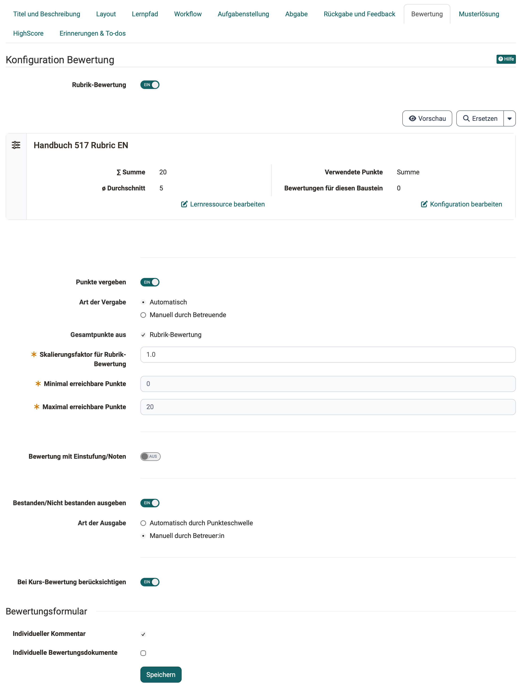{ class="shadow lightbox" title="Tab Bewertung der Aufgabe im Kurseditor · 2026.11.02" }

#### Punkte vergeben

Im Feld "Art der Vergabe" legen Sie fest, ob OpenOlat die Punkte "Automatisch" aus den gewählten Quellen berechnet oder ob sie "Manuell durch Betreuende" eingetragen werden.

Wenn die Punktevergabe aktiviert wurde, müssen die minimale und die maximale Punktzahl angegeben werden. Zusätzlich können Sie dann auch die Option "Bewertung mit Einstufung/Noten" wählen und weiter konfigurieren. So können den jeweiligen Punkten bestimmte Bewertungsskalen wie Level, Noten, (Kompetenz-)Stufen oder Label zugeordnet werden. Die zur Verfügung stehenden Bewertungsskalen werden vom OpenOlat Administrator definiert und können über den Button "Bewertungsskala bearbeiten" ausgewählt sowie die Punkte im Detail angepasst werden. Ferner muss definiert werden ob die Zuordnung zur berechneten Einstufung manuell durch den Betreuer erfolgt oder automatisch bei Punktänderung angezeigt werden soll.

#### Gesamtpunkte aus ...

Die Gesamtpunktzahl kann aus einer oder mehreren Quellen errechnet werden:

* **Rubrik-Bewertung**: Wird im Tab "Bewertung" ein Rubrik-Formular verwendet, können von dort Punkte übernommen werden.
* **Rubrik-Peer-Review**: Ein Peer-Review verwendet das Rubrik-Formular, das im Tab "Rückgabe und Feedback" eingebunden wird.
* **Abgegebene Reviews**: Für das Reviewen von anderen Teilnehmer:innen können der Person zusätzliche Punkte angerechnet werden (Punkte pro erledigtem Review, konfiguriert unterhalb dieser Auswahl, sobald die Option markiert wurde).

Für die beiden Rubrik-Quellen erscheint je ein Gewichtungsfeld: "Skalierungsfaktor für Rubrik-Bewertung" und "Skalierungsfaktor für Rubrik-Peer-Review". Damit bestimmen Sie, mit welchem Faktor die Punkte der jeweiligen Quelle in die Gesamtpunktzahl eingehen.

#### Bestanden/Nicht bestanden
Ist "Bestanden/Nicht bestanden ausgeben" eingeschaltet, wählen Sie unter "Art der Ausgabe" zwischen "Automatisch durch Punkteschwelle" und "Manuell durch Betreuer:in". Für die automatische Ausgabe müssen die Punktevergabe aktiviert und eine Punkteschwelle für das Bestehen angegeben sein.

#### Bei Kurs-Bewertung berücksichtigen
Hier legen Sie fest, ob das Ergebnis dieses Kursbausteins in die Bewertung des gesamten Kurses einfliesst.

#### Bewertungsformular {: #assessment_form}
Unter "Bewertungsformular" aktivieren Sie optional "Individueller Kommentar" und "Individuelle Bewertungsdokumente", sodass Betreuende noch weitere flexible Rückmeldungsmöglichkeiten haben.

[nach oben (Perspektive Autor:in) ^](#create_task) 
[zum Seitenanfang ^](#course_element_task)

---

### Tab "Musterlösung" {: #sample}

Um allen Teilnehmenden eine Musterlösung zu den gestellten Aufgaben anzubieten, erstellen Sie entweder die Musterlösung direkt mit dem internen Editor oder Sie nehmen ein Video mit Ihrer Webcam auf oder Sie laden Dateien mit den Musterlösungen hoch.

!!! info "Voraussetzung"

    Im Tab "Workflow" muss

    * "Musterlösungen" aktiviert worden sein, damit Sie diese nun einrichten können.

    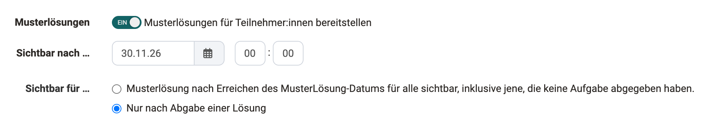{ class="shadow lightbox" title="Kurseditor, Kursbaustein Aufgabe, Tab Workflow · 2026.11.02" }

Standardmässig sehen Teilnehmende die Musterlösung erst, wenn sie die vorherigen Schritte abgeschlossen haben. Gibt es ein Feedback durch Betreuende, ist das nach der Annahme ihrer Abgabe. Wählen Sie im Tab "Workflow" unter "Sichtbar für …" die Sichtbarkeit für alle, sehen auch Personen ohne Abgabe die Musterlösung ab dem eingetragenen Datum.

!!! tip "Tipp"

    Sollen die Teilnehmenden vorab bereits Hilfestellungen zur Bearbeitung der Aufgabe erhalten, laden Sie diese zusammen mit der Aufgabenstellung als ZIP-Datei hoch oder nutzen Sie das Feld "Mitteilung an Benutzer:in" im [Tab "Aufgabenstellung"](#assignment).

[nach oben (Perspektive Autor:in) ^](#create_task) 
[zum Seitenanfang ^](#course_element_task)

---

### Tab "HighScore"  {: #highscore}

Sofern für die Aufgabe Punkte vergeben werden, können Sie diese mit den HighScore-Optionen visualisieren.

Voraussetzung ist, dass für die Aufgabe im Tab "Bewertung" die Vergabe von Punkten aktiviert wurde. Erst dann wird der Tab "HighScore" aktiv und kann konfiguriert werden. Sie bestimmen hier,

* welche Elemente angezeigt werden,
* ob die Darstellung anonym sein soll und
* ab welchem Zeitpunkt die Highscore-Liste sichtbar sein soll.

Weitere Informationen zu diesem Tab, der in den meisten Assessment Kursbausteinen zur Verfügung steht, finden Sie [hier](../learningresources/Course_Elements.de.md).

[nach oben (Perspektive Autor:in) ^](#create_task) 
[zum Seitenanfang ^](#course_element_task)

---

### Tab "Erinnerungen & To-dos" [:octicons-tag-16:{ title="ab Release 18.2 (OO-7040)" }](https://track.frentix.com/issue/OO-7040) {: #reminders}

Mit der Erinnerungsfunktion können Sie [Erinnerungen](../learningresources/Course_Reminders.de.md) in Form einer E-Mail an Kursmitglieder versenden und automatische [To-dos](../learningresources/Course_todos.de.md) für die Aufgabe generieren. To-dos werden den Teilnehmenden im persönlichen Menü unter "[To-dos](../personal_menu/To-Dos.de.md)" hinterlegt.

Wird die automatische Erstellung von To-dos aktiviert, sehen die Lernenden unter `Mein Kurs > To-dos` den aktuellen Stand (Schritt) des Workflows der entsprechenden Aufgabe und erkennen so rasch, ob bzw. welche Aktionen aktuell von ihnen vorgenommen werden müssen. Darüber hinaus erscheinen diese To-dos auch bei den persönlichen To-dos in den persönlichen Werkzeugen.

Die To-dos helfen also den Lernenden den Überblick über ihre Aufgaben zu behalten.
Weitere Informationen zu To-dos finden Sie [hier](../basic_concepts/To_Dos_Basics.de.md).

!!! note "Hinweis"

    Ob auch Betreuende To-dos bearbeiten dürfen, legen Sie in den Kurseinstellungen mit der Checkbox "To-dos bearbeiten" fest: 
    `Kurs > Administration > Einstellungen > Tab "Optionen"`

[nach oben (Perspektive Autor:in) ^](#create_task) 
[zum Seitenanfang ^](#course_element_task)

---

### Tab Badges
Ist in den Kurseinstellungen "Badges vergeben" eingeschaltet, zeigt der Kurseditor zu diesem Kursbaustein den Tab "Badges", und Sie können einen eigenen Badge für diesen Kursbaustein erstellen. Die Einstellung finden Sie unter: 
`Kurs > Administration > Einstellungen > Tab "Bewertung" > Abschnitt "Badges"`

[nach oben (Perspektive Autor:in) ^](#create_task) 
[Zum Seitenanfang ^](#course_element_task)

!!! note "Hinweis"

    Die Funktionsweise und der Aufbau der Kursbausteine "Aufgabe" und "[Gruppenaufgabe](../learningresources/Course_Element_Grouptask.de.md)" sind ähnlich.

---

## Aufgabe erledigen (Perspektive Kursteilnehmer:in)  {: #process_task}

Alle Schritte einer Aufgabe (Workflow) zeigen sich für Kursteilnehmer:innen direkt im Kursbaustein, je nach Konfiguration des Kursbausteins. Nach Erledigung eines Schrittes wird der nächste Schritt angezeigt und zugänglich.

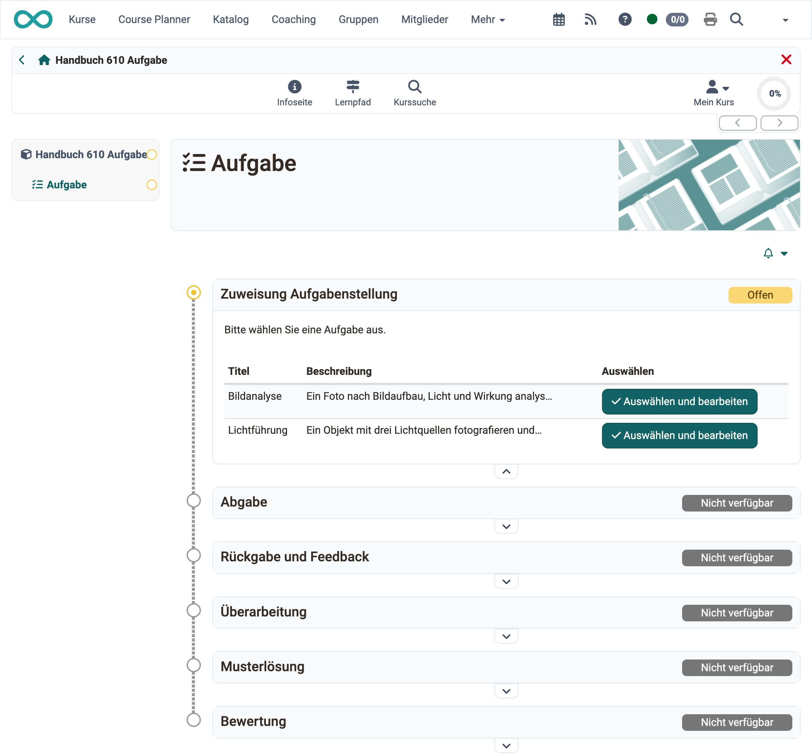{ class="shadow lightbox" title="Kursbaustein Aufgabe, Sicht der Teilnehmenden · 2026.11.03" }

!!! note "Quick Links: Aufgabe erledigen (Perspektive Kursteilnehmer:in)"

    * [Zugewiesene Aufgabe herunterladen](#process_task_download)
    * [Von wem werde ich betreut?](#process_task_my_coach)
    * [Lösung abgeben](#process_task_solution)
    * [Rückgabe und Feedback](#process_task_feedback)
    * [Peer-Review durchführen](#process_task_make_reviews)
    * [Ergebnisse des Peer-Reviews ansehen](#process_task_view_reviews)
    * [Aufgabe überarbeiten](#process_task_rework)
    * [Musterlösung betrachten](#process_task_view_example)
    * ["Bewertung" der betreuenden Person lesen](#process_task_view_coach_assessment)

!!! tip "Tipp"

    Abonnieren Sie den jeweiligen Aufgabenbaustein um schnell per Mail über Änderungen informiert zu werden. Die Benachrichtigung erreicht Sie, sobald eine Aktion abgeschlossen ist, nicht bei jedem Zwischenschritt. Wollen Sie die Einreichungen aller bewertbaren Kursbausteine im Blick behalten, abonnieren Sie stattdessen das [Bewertungswerkzeug](../learningresources/Assessment_tool_overview.de.md).

### Zugewiesene Aufgabe herunterladen {: #process_task_download}

Je nach Konfiguration stehen im Schritt "Zuweisung Aufgabenstellung" eine oder mehrere Aufgaben zur Auswahl, oder Ihnen wird eine Aufgabe automatisch zugewiesen. Wenn bei mehreren Aufgaben der Titel der Aufgabendatei verlinkt ist, können Sie die Aufgabenstellung vor der Auswahl ansehen. Wenn Sie nur die Schaltfläche "Auswählen" haben, können Sie die Aufgabe nicht im Vorfeld ansehen. Ist die Aufgabe Vorlage für die Abgabe, heisst die Schaltfläche "Auswählen und bearbeiten". Bei automatischer Zuweisung erhalten Sie die Aufgabe, sobald Sie den Kursbaustein vor Ablauf der Frist öffnen.

Wenn Sie eine Aufgabe gewählt haben oder Ihnen eine Aufgabe automatisch zugewiesen wurde, klicken Sie auf "Aufgabe herunterladen", um die Aufgabenstellung herunterzuladen bzw. anzeigen zu lassen. Wenn Sie auf den Dateinamen der Aufgabenstellung klicken wird die Aufgabe angezeigt. Die Aufgabe können Sie dann jederzeit wiederholt herunterladen.

HTML-Dateien, ob Aufgabenstellung, abgegebenes Dokument oder Musterlösung, öffnen sich in einer Lightbox, und Skripte darin laufen nur, wenn eine [Inhaltsdomäne](../basic_concepts/Folder_Concept.de.md#open_html) eingerichtet ist. [:octicons-tag-16:{ title="ab Release 21.0 (OO-7554)" }](https://track.frentix.com/issue/OO-7554)

Es ist auch möglich, dass Ihre Lehrperson die Aufgabenstellung nicht in dem Kursbaustein "Aufgabe" hinterlegt hat, sondern einen anderen Ort, z.B. einen anderen Kursbaustein, eine HTML-Seite oder eine externe Webseite, gewählt hat oder die Aufgabenstellung mündlich in Präsenz oder in einem Online-Meeting gestellt hat. In diesem Fall erscheint der Abschnitt "Zuweisung Aufgabenstellung" nicht.

[nach oben (Perspektive Kursteilnehmer:in) ^](#process_task) 
[zum Seitenanfang ^](#course_element_task)

### Von wem werde ich betreut? {: #process_task_my_coach}

In Kursen mit sehr vielen Teilnehmenden betreuen häufig mehrere Lehrpersonen die Aufgabe. Ist die Zuweisung Betreuende/Teilnehmende aktiviert, ist Ihnen als Teilnehmer:in eine betreuende Person zugewiesen.

Sie sehen die Ihnen zugewiesene betreuende Person oberhalb der Aufgabe. Wird keine betreuende Person angezeigt, wurde Ihnen noch niemand zugeteilt.

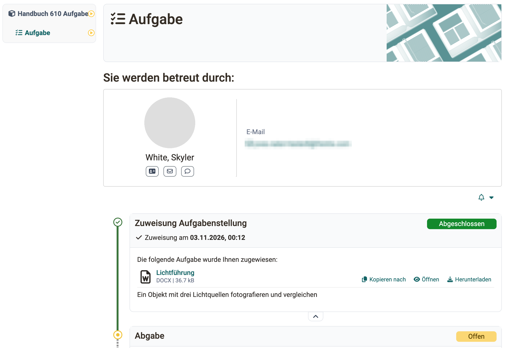{ class="shadow lightbox" title="Kursbaustein Aufgabe, Sicht der Teilnehmenden · 2026.11.03" }

Über das Peer-Review können auch Teilnehmende gegenseitig Feedback zu den gelösten Aufgaben abgeben.

[nach oben (Perspektive Kursteilnehmer:in) ^](#process_task) 
[zum Seitenanfang ^](#course_element_task)

### Lösung abgeben {: #process_task_solution}

Im Schritt "Abgabe" reichen Sie Ihre Lösung ein. Je nach Konfiguration laden Sie Dokumente hoch, erstellen Dateien mit dem OpenOlat Editor oder nehmen kurze Audio- und Video-Aufnahmen direkt in OpenOlat auf.

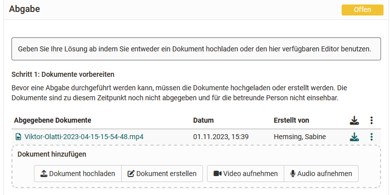{ class="shadow lightbox" title="Kursbaustein Aufgabe, Sicht der Teilnehmenden" }

In der Regel wird nur ein Teil der vier Optionen für Sie verfügbar sein.
Laden Sie Ihre Lösung hoch bzw. erstellen Sie sie direkt in OpenOlat und das Dokument wird zwischengespeichert. Die Dokumente bleiben solange für Sie bearbeitbar bis Sie über die Schaltfläche "Endgültige Abgabe" Ihre Aufgabe einreichen. Sie erhalten eine Bestätigung, dass Sie Dokumente abgegeben haben.

Im Abgabe-Schritt, der nun mit einem grünen Häkchen als erledigt markiert wird, erhalten Sie eine Übersicht über abgegebenen Dateien. Sie können sich die Dateien zwar noch ansehen aber keine Änderungen mehr vornehmen.

[nach oben (Perspektive Kursteilnehmer:in) ^](#process_task) 
[zum Seitenanfang ^](#course_element_task)

### Rückgabe und Feedback {: #process_task_feedback}

Solange Sie noch _nichts_ eingereicht haben und keine Rückmeldung der betreuenden Person vorliegt, ist dieser Bereich leer.

Haben Sie eine Lösung eingereicht und die betreuende Person hat noch keine Rückmeldung erstellt, erscheint ein entsprechender Hinweis.

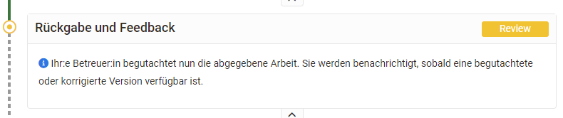{ class="shadow lightbox" title="Kursbaustein Aufgabe, Sicht der Teilnehmenden" }

Sobald die betreuende Person ein Feedback erstellt hat, finden Sie es im Schritt "Rückgabe und Feedback".

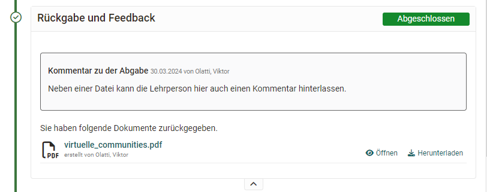{ class="shadow lightbox" title="Kursbaustein Aufgabe, Sicht der Teilnehmenden" }

Reicht Ihre Lösung nicht aus und fordert die betreuende Person eine Überarbeitung ein, erscheint die Meldung "Die Abgabe wurde zur Überarbeitung zurückgewiesen.". Sie können dann im Schritt "Überarbeitung" eine neue Fassung einreichen, eventuell bis zu einer Frist.

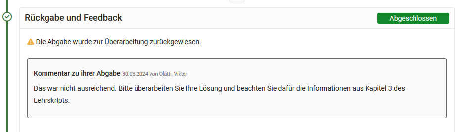{ class="shadow lightbox" title="Kursbaustein Aufgabe, Sicht der Teilnehmenden" }

[nach oben (Perspektive Kursteilnehmer:in) ^](#process_task) 
[zum Seitenanfang ^](#course_element_task)

### Peer-Review durchführen [:octicons-tag-16:{ title="ab Release 19.0 (OO-7680)" }](https://track.frentix.com/issue/OO-7680) {: #process_task_make_reviews}

Wurde ein Peer-Review für die Aufgabe vorgesehen, erhalten Sie nun Review-Aufgaben zugewiesen. Sie sollen die abgegebenen Dokumente anderer Kursmitglieder beurteilen. Wessen Dokumente Sie reviewen sollen, kann Ihnen automatisch oder manuell durch Betreuer:innen zugeteilt werden.

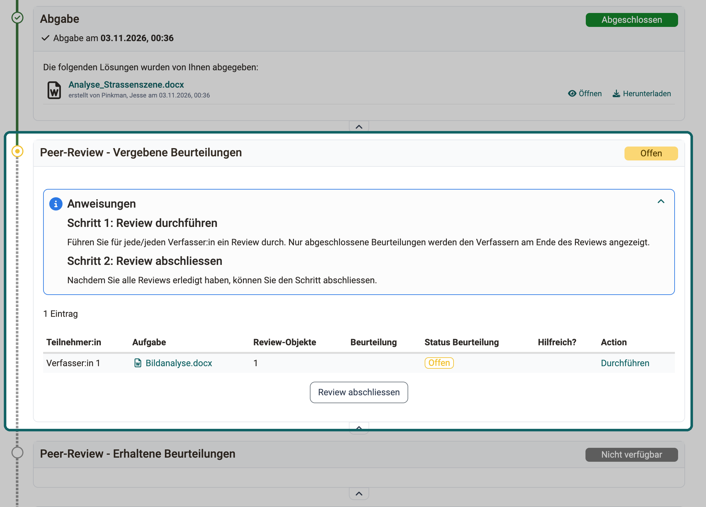{ class="shadow lightbox" title="Kursbaustein Aufgabe, Sicht der Teilnehmenden · 2026.11.03" }

Wenn Sie alle Reviews durchgeführt haben, schliessen Sie diesen Arbeitsschritt ab durch Klick auf den Button "Review abschliessen".

[nach oben (Perspektive Kursteilnehmer:in) ^](#process_task) 
[zum Seitenanfang ^](#course_element_task)

### Ergebnisse des Peer-Reviews ansehen {: #process_task_view_reviews}

Wurde ein Peer-Review vorgesehen, sehen Sie eine Übersicht über Ihre vergebenen und erhaltenen Beurteilungen.

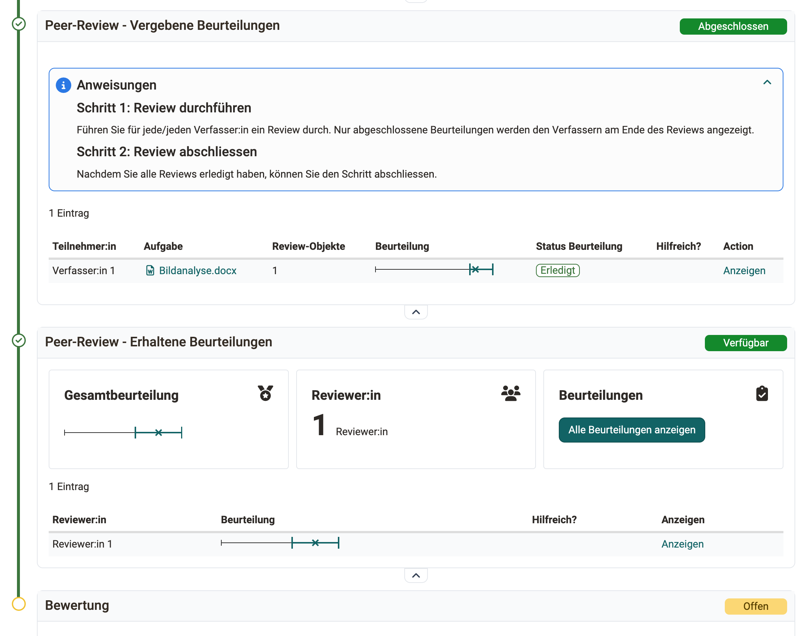{ class="shadow lightbox" title="Kursbaustein Aufgabe, Sicht der Teilnehmenden · 2026.11.03" }

[nach oben (Perspektive Kursteilnehmer:in) ^](#process_task) 
[zum Seitenanfang ^](#course_element_task)

### Aufgabe überarbeiten {: #process_task_rework}

Müssen Sie Ihre Lösung überarbeiten, gehen Sie wie unter [Lösung abgeben](#process_task_solution) beschrieben vor. Im Schritt "Überarbeitung" kann die betreuende Person Ihnen Ihre Arbeit auch mehrfach zur Korrektur zurückgeben.

Sobald die betreuende Person die Aufgabe als gelöst ansieht, schliesst sie die Überarbeitung ab. Sie sehen jederzeit, welche Dokumente Sie und Ihre betreuende Person abgegeben haben, und können diese öffnen.

[nach oben (Perspektive Kursteilnehmer:in) ^](#process_task) 
[zum Seitenanfang ^](#course_element_task)

### Musterlösung betrachten {: #process_task_view_example}

Ihre Lehrperson kann der Aufgabe eine Musterlösung anfügen, die ab einem festgelegten Zeitpunkt sichtbar wird. Je nach Einstellung sehen Sie sie erst, _nachdem_ Ihre Lösung akzeptiert wurde, oder auch ohne eigene Abgabe. Klicken Sie auf den Dateinamen bzw. den Button "Musterlösungen herunterladen", um die Musterlösung anzuschauen oder herunterzuladen.

[nach oben (Perspektive Kursteilnehmer:in) ^](#process_task) 
[zum Seitenanfang ^](#course_element_task)

### "Bewertung" der betreuenden Person lesen {: #process_task_view_coach_assessment}

Der Schritt "Bewertung" zeigt die Leistungsübersicht mit Status, Punktestand und Einstufung der gewählten Bewertungsskala, je nach Konfiguration des Kursbausteins. Darunter stehen der Kommentar und die Bewertungsdokumente, die die betreuende Person hinterlegt hat.

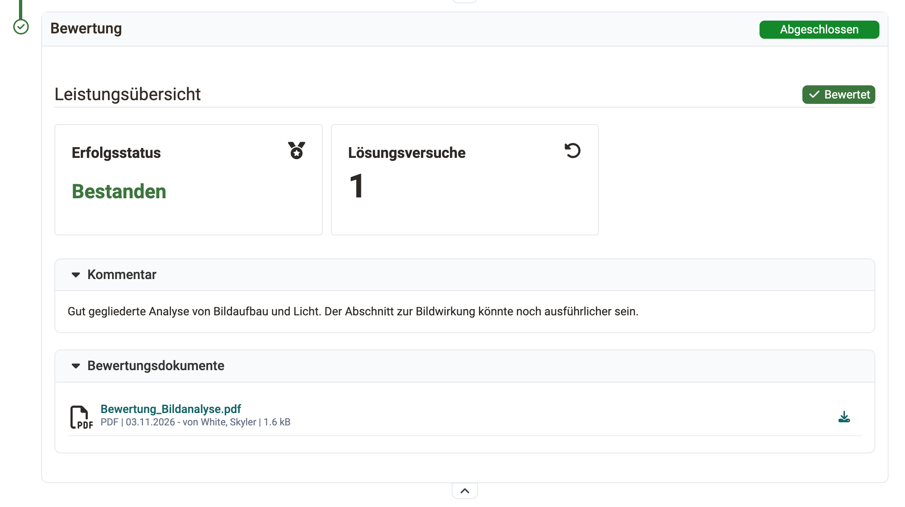{ class="shadow lightbox" title="Kursbaustein Aufgabe, Sicht der Teilnehmenden · 2026.11.03" }

[nach oben (Perspektive Kursteilnehmer:in) ^](#process_task) 
[zum Seitenanfang ^](#course_element_task)

---

## Aufgaben betreuen (Perspektive Betreuer:in) {: #coach_task}

!!! note "Quick Links: Aufgaben betreuen (Perspektive Betreuer:in)"

    * [Zuweisung der Aufgaben kontrollieren](#coach_task_peer_review_check_assingment)
    * [Abgabe kontrollieren](#coach_task_peer_review_check_delivery)
    * [Review durch Betreuer:in](#coach_task_peer_review_by_coach)
    * [Regeln eines Peer-Reviews](#coach_task_peer_review_rules)
    * [Peer-Review betreuen](#coach_task_peer_review_supervise)
    * [Manuelle Zuweisung von Peer-Reviewer:innen](#coach_task_peer_review_assign_manually)
    * [Automatische Zuweisung von Peer-Reviewer:innen](#coach_task_peer_review_assign_automatically)
    * [Peer-Reviews abschliessen](#coach_task_peer_review_close)
    * [Betreuer:in nimmt an Peer-Review teil](#coach_task_peer_review_reviewer_participates)
    * [Rubrik-Bewertung durch Betreuer:innen](#coach_task_peer_review_expert)
    * [Bewertung der Aufgabe](#coach_task_peer_review_evaluate)

### Zuweisung der Aufgaben kontrollieren {: #coach_task_peer_review_check_assingment}

Für Betreuer:innen stellen sich folgende Fragen und Kontrollaufgaben:

* Ist eine automatische Zuweisung erfolgt?
* Haben alle Teilnehmer:innen eine Aufgabe gezogen?
* Wer hat welche Aufgabe gezogen? => Besteht bei den Zuordnungen Korrekturbedarf?
* Wer hat noch keine Aufgabe gezogen? => Weshalb? => Die Personen können in der Liste selektiert und per Mail kontaktiert werden. => Evtl. ist eine Verlängerung zu machen, damit eine Person noch eine Aufgabe ziehen kann. (Eine automatische Zuweisung ist nicht möglich.)

[nach oben (Perspektive Betreuer:in) ^](#coach_task) 
[zum Seitenanfang ^](#course_element_task)

### Abgabe kontrollieren {: #coach_task_peer_review_check_delivery}

* Erfolgte die Abgabe innerhalb der gesetzten Abgabefrist?
* Erfolgte eine verspätete Abgabe?
* Gibt es für die Abgabe einen Grund zu individueller Verlängerung? Eine Verlängerung kann für Zuweisung, Abgabe und Lösungseinsicht gewährt werden. Eine Verlängerung der Überarbeitungszeit ist nicht möglich, denn die Überarbeitungszeit ist bereits eine Art Verlängerung.
* Wenn Teilnehmer:innen aus Versehen abgegeben oder etwas vergessen haben, kann die Abgabemöglichkeit wieder eröffnet werden.
* Ist ein vorzeitiges Einziehen der Aufgaben erforderlich? Das kann z.B. bei einem Betrugsversuch der Fall sein.
* Ist die Abgabefrist offen und es soll ein manuelles Einziehen erfolgen? (Wenn eine Abgabefrist gesetzt wurde, erfolgt immer ein automatischer Einzug, wenn jemand noch nicht selbst abgegeben hat.)

!!! note "Hinweis"

    Eine **Verlängerung** kann auch durch Betreuer:innen eingerichtet werden. Die **Abgabefrist** kann dagegen nur durch Kursbesitzer:innen festgelegt werden.

!!! note "Hinweis"

    Bei unbegrenzt laufenden Kursen kann kein Abgabetermin gesetzt werden. Eine Alternative kann in diesem Fall ein Zertifikat mit Rezertifizierung sein.

[nach oben (Perspektive Betreuer:in) ^](#coach_task) 
[zum Seitenanfang ^](#course_element_task)

### Review durch Betreuer:in {: #coach_task_peer_review_by_coach}

Ein Review ist nur möglich, wenn der oder die Teilnehmer:in abgegeben hat.

Ein Review ist auch schon möglich, wenn bereits vor Ablauf der Abgabefrist abgegeben wurde.

Der "Peer-Review-Zeitraum", den Besitzer:innen im Tab "Workflow" setzen, gilt nicht für Betreuer:innen: Sie erstellen ein eigenes Review auch vor Beginn und nach Ende des Zeitraums. Dazu öffnen Sie die Person, im Schritt "Peer-Review" den Reiter "Erhaltene Beurteilungen" und in der Zeile der Person unter "Weitere Aktionen" den Eintrag "Eigenes Review erstellen".

[nach oben (Perspektive Betreuer:in) ^](#coach_task) 
[zum Seitenanfang ^](#course_element_task)

### Regeln eines Peer-Reviews [:octicons-tag-16:{ title="ab Release 19.0 (OO-7680)" }](https://track.frentix.com/issue/OO-7680) {: #coach_task_peer_review_rules}

Bei einem Peer-Review geben sich die Teilnehmer:innen eines Kurses gegenseitig ein Feedback oder eine Bewertung. Das Feedback kann allgemeiner Art sein (z.B. in einem Textfeld) oder zusätzlich auch eine Bewertung mit Punkten umfassen.

Dabei muss nicht von jedem/jeder Teilnehmer:in ein Review aller anderen Teilnehmer:innen gemacht werden. Es kann bestimmt werden, für wieviele andere Personen ein Review gemacht werden muss.

Ob die Reviewer die Namen der zugewiesenen Personen sehen, nur ihr eigener Name als Reviewer:in ersichtlich ist oder vollständig offen gelegt wird, wer wen reviewt, kann ebenfalls konfiguriert werden.

Als Betreuer:in überwachen Sie die gegenseitigen Reviews und können ggf. auch eingreifen.

[nach oben (Perspektive Betreuer:in) ^](#coach_task) 
[zum Seitenanfang ^](#course_element_task)

### Peer-Review betreuen {: #coach_task_peer_review_supervise}

Der Ablauf eines Peer-Reviews wurde von dem/der Kursbesitzer:in festgelegt. Entsprechend finden Sie als Betreuer:in die Optionen für Ihre Betreuungsaufgabe vor.

* In einer Übersicht sehen Sie den Stand der Peer-Reviews. In zwei Tabs finden Sie erhaltene und vergebene Beurteilungen der Teilnehmer:innen.
* Als Betreuer:in können Sie manuell Reviewer:innen zuweisen.

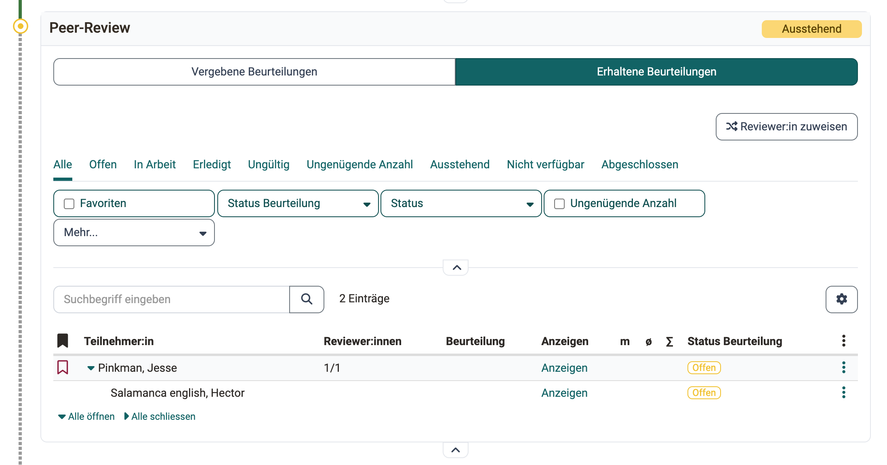{ class="shadow lightbox" title="Kursbaustein Aufgabe, Betreueransicht, Detailansicht einer Person · 2026.11.03" }

!!! note "Hinweis"

    Betreuer:innen sehen nur Gruppen, in denen sie selbst Mitglied sind. Reviewen Mitglieder anderer Gruppen, sind die Bewertungen dieser Teilnehmer:innen für Betreuer:innen nicht vollständig ersichtlich.

[nach oben (Perspektive Betreuer:in) ^](#coach_task) 
[zum Seitenanfang ^](#course_element_task)

### Manuelle Zuweisung von Peer-Reviewer:innen {: #coach_task_peer_review_assign_manually}

Wenn Sie als Betreuer:in bestimmen wollen, wer von wem ein Review erhält, ordnen Sie die Reviewer:innen selbst zu.

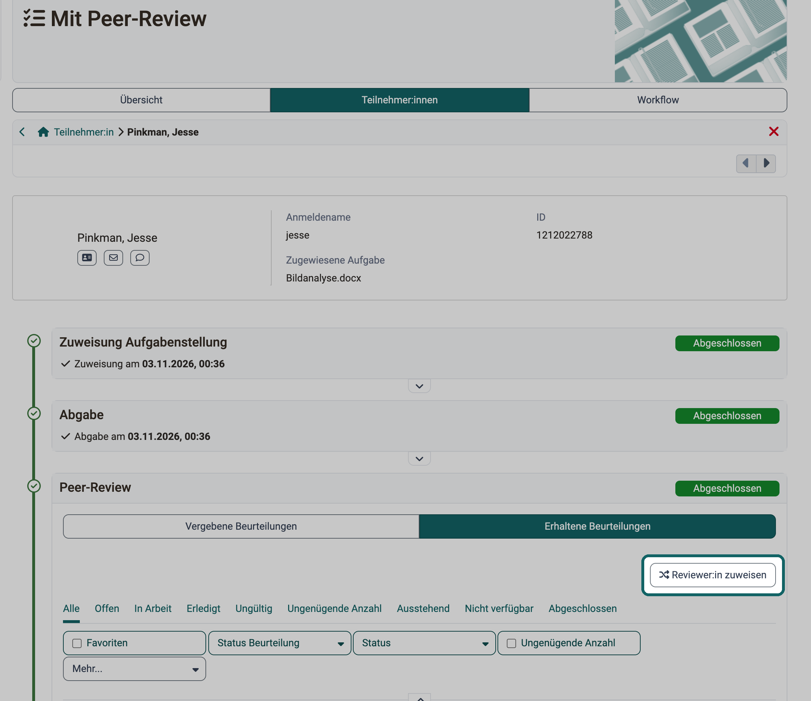{ class="shadow lightbox" title="Kursbaustein Aufgabe, Betreueransicht, Tab Teilnehmer:innen · 2026.11.03" }

Im Reiter "Erhaltene Beurteilungen" heisst der Button "Reviewer:in zuweisen", im Reiter "Vergebene Beurteilungen" heisst er "Reviews zuweisen".

Eine manuelle Zuweisung ist auch in der Tabelle möglich. Klicken Sie dazu in der Zeile der Person auf das Drei-Punkte-Menü.

[nach oben (Perspektive Betreuer:in) ^](#coach_task) 
[zum Seitenanfang ^](#course_element_task)

### Automatische Zuweisung von Peer-Reviewer:innen {: #coach_task_peer_review_assign_automatically}

Die Zuordnung von Peer-Reviewer:innen zu Teilnehmer:innen kann auch durch OpenOlat automatisch vorgenommen werden. Sie erfolgt gemäss den eingestellten Regeln. (Z.B. der definierten Anzahl der Personen, die pro Teilnehmer:in zu reviewen sind.) Auch wenn vorab schon manuelle Zuordnungen durch Betreuer:innen gemacht wurden, werden diese bei den verbleibenden automatischen Zuordnungen berücksichtigt.

Die automatische Zuordnung lösen Kursbesitzer:innen oder Betreuer:innen mit dem Button "Review-Zuweisung auslösen" aus.

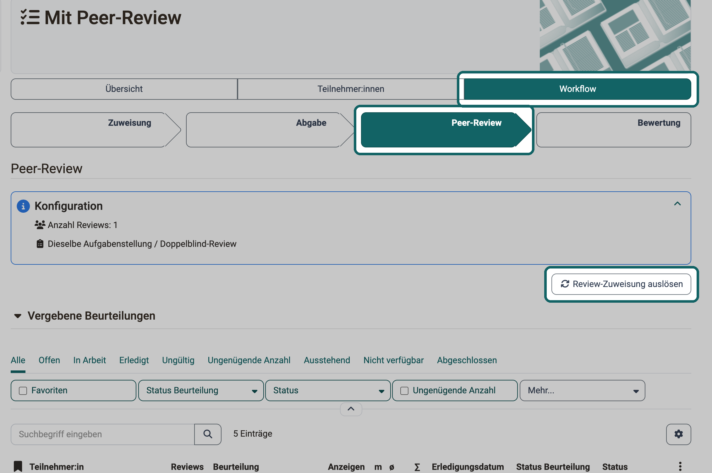{ class="shadow lightbox" title="Kursbaustein Aufgabe, Betreueransicht, Tab Workflow · 2026.11.03" }

!!! info "Wichtig"

    Damit auch Betreuer:innen die automatische Review-Zuweisung auslösen können, müssen Kursbesitzer:innen im Tab "Rückgabe und Feedback" unter [Auslösung automatische Review-Zuweisung](#peer_review_permissions) die Option "Betreuer:innen" gewählt haben.

!!! info "Wichtig"

    Der Button "Review-Zuweisung auslösen" wird nach einer durchgeführten Zuweisung nicht deaktiviert und ist weiterhin verfügbar. Der Grund dafür ist, dass Teilnehmende auch später noch hinzukommen können oder jemand eine Verlängerung erhalten hat.

[nach oben (Perspektive Betreuer:in) ^](#coach_task) 
[zum Seitenanfang ^](#course_element_task)

### Peer-Reviews abschliessen {: #coach_task_peer_review_close}

Haben Teilnehmer:innen alle ihre Reviews erledigt, müssen sie die Reviews mit "Review abschliessen" abgeben. Erst dann zählen sie. Die anderen Teilnehmer:innen werden nur mit abgeschlossenen Reviews beurteilt.

Wenn die vorgegebene Zeit für Reviews abgelaufen ist, können Teilnehmer:innen keine Reviews mehr machen.

Haben Teilnehmer:innen Reviews gemacht, aber nicht abgegeben, dann können diese Reviews nicht von Betreuer:innen eingezogen werden. Der Grund: Die Betreuer:innen können nicht wissen, ob ein nicht abgeschlossenes Review bereits final sein sollte und welche Qualität das Review zum aktuellen Zeitpunkt hat.

Betreuer:innen können die Reviews nicht alle abschliessen. Sie müssen lediglich warten, bis der Zeitraum für die Reviews abgelaufen ist.

Es ist nicht möglich, dass nach einem Peer-Review eine Überarbeitung erfolgt und dann nochmals ein zweites Review gemacht wird.

[nach oben (Perspektive Betreuer:in) ^](#coach_task) 
[zum Seitenanfang ^](#course_element_task)

### Betreuer:in nimmt an Peer-Review teil {: #coach_task_peer_review_reviewer_participates}

Es ist möglich, dass Betreuer:innen am Review teilnehmen wie Teilnehmer:innen. Sie haben dann für das Review sozusagen die Rolle eines/einer Teilnehmer:in und verwenden die gleichen Kriterien.

Das Review des/der Betreuer:in zählt in diesem Fall, wie die Reviews der übrigen Teilnehmer:innen.

**Beispiel 1:** 
Ein/e Reviewer:in fällt wegen Krankheit aus und der/die Betreuer:in springt als Reviewer:in ein. So wird sichergestellt, dass alle die gleiche Anzahl Reviews erhalten.

**Beispiel 2:** 
Ein/eine Betreuer:in sieht, dass ein/e Reviewer:in ein Review falsch oder schlecht ausgeführt hat. Der/die Betreuer:in markiert darauf hin dieses Review als ungültig und macht selbst ein Review, damit diese Person wieder gleich viele Reviews erhalten hat.

**Beispiel 3:** 
Es liegen aus dem Peer-Review zwei völlig gegensätzliche Reviews vor. Der/die Betreuer:in gibt deshalb ein vermittelndes oder korrigierendes Review dazu. (Im Unterschied zur Rubrik-Bewertung wird hier das gleiche Bewertungsraster verwendet.)

[nach oben (Perspektive Betreuer:in) ^](#coach_task) 
[zum Seitenanfang ^](#course_element_task)

### Rubrik-Bewertung durch Betreuer:innen {: #coach_task_peer_review_expert}

Ist im Tab "Bewertung" die "Rubrik-Bewertung" eingeschaltet, bewerten Betreuer:innen die Aufgabe zusätzlich zum Peer-Review mit einem eigenen Rubrik-Formular.

Sie funktioniert wie beim [Kursbaustein "Bewertung"](../learningresources/Course_Element_Assessment.de.md#rubrik-bewertung), mit einem hinterlegten [Rubrik-Formular](../learningresources/Forms_in_Rubric_Scoring.de.md). Dieses Formular kann sich vom Formular der Peer-Reviewer:innen unterscheiden.

[nach oben (Perspektive Betreuer:in) ^](#coach_task) 
[zum Seitenanfang ^](#course_element_task)

### Bewertung der Aufgabe {: #coach_task_peer_review_evaluate}

Wenn ein Peer-Review durchgeführt wurde, müssen die Ergebnisse nicht zwangsläufig in die Bewertung einfliessen. Es sind auch Reviews und Peer-Reviews ohne Bewertung möglich. Kursbesitzer:innen legen im Tab "Bewertung" unter ["Gesamtpunkte aus"](#grading) fest, welche Punkte zählen:

* "Rubrik-Bewertung": die Punkte aus der Rubrik-Bewertung durch Betreuer:innen,
* "Rubrik-Peer-Review": die Punkte aus den Peer-Reviews, welche die Person erhalten hat,
* "Abgegebene Reviews": Punkte für die Reviews, welche die Person selbst abgegeben hat.

Kombinationen sind möglich. Ist nur "Rubrik-Bewertung" gewählt, fliessen die Peer-Reviews nicht in die Bewertung ein.

[nach oben (Perspektive Betreuer:in) ^](#coach_task) 
[zum Seitenanfang ^](#course_element_task)

## Weiterführende Informationen {: #further_information}

**Auf dieser Seite erwähnt** 
[Kursbaustein "Gruppenaufgabe" >](../learningresources/Course_Element_Grouptask.de.md) 
[Wie führe ich ein Peer-Review durch? >](../../manual_how-to/peer_review/peer_review.de.md) 
[Kurseinstellungen >](../learningresources/Course_Settings.de.md) 
[Bewertungswerkzeug - Übersicht >](../learningresources/Assessment_tool_overview.de.md) 
[Das Formular-Element Rubrik >](../learningresources/Form_Element_Rubric.de.md) 
[Wie erstelle ich eine Formular-Lernressource? >](../../manual_how-to/create_a_form/create_a_form.de.md) 
[Wissensüberprüfung >](../learningresources/Assessment.de.md) 
[Kursbausteine >](../learningresources/Course_Elements.de.md) 
[Erinnerungen >](../learningresources/Course_Reminders.de.md) 
[To-dos im Kurs >](../learningresources/Course_todos.de.md) 
[Persönliche Werkzeuge: To-dos >](../personal_menu/To-Dos.de.md) 
[To-dos: Grundlagen >](../basic_concepts/To_Dos_Basics.de.md) 
[Ordnerkonzept >](../basic_concepts/Folder_Concept.de.md) 
[Kursbaustein "Bewertung" >](../learningresources/Course_Element_Assessment.de.md) 
[Formular als Rubrik-Bewertung >](../learningresources/Forms_in_Rubric_Scoring.de.md)

**Weiterführend** 
[Kursbaustein "Portfolioaufgabe" >](../learningresources/Course_Element_Portfolio_Task.de.md) 
[Kursbaustein "Videoaufgabe" >](../learningresources/Course_Element_Video_Task.de.md)

[Zum Seitenanfang ^](#course_element_task)

