# Course Element "Task" {: #course_element_task}

## Profile {: #profile}

Name | Task
---------|----------
Icon | :o_icon_o_gta_icon:
Available since | New edition with release 19
Functional group | Assessment
Purpose | Modeling of complex task workflows with configurable substeps such as submission of solution documents, feedback and revision loop, provision of sample solution and assessment
Assessable | yes
Specialty / Note | also available as [group task](../learningresources/Course_Element_Grouptask.md)

With the course element "Task" you organize file submissions and submission assignments in your course. Participants upload their solution to the course and receive feedback and an assessment. [Peer reviews](../../manual_how-to/peer_review/peer_review.md) are also possible, as are revisions and sample solutions.

Course owners set up the task in the course editor, participants work on it in the course, and coaches accompany and assess the submissions. The three main sections of this page follow these three perspectives.

---

## Create task (Author perspective) {: #create_task}

You create and configure the task in the course editor, like all course elements.

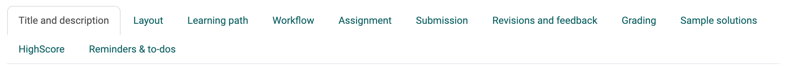{ class="shadow lightbox" title="Course editor, course element Task · 2026.11.02" }

!!! note "Quick Links: Create tasks (Author perspective)"

    * [Tab Title and description](#title)  General information about the course element
    * [Tab Layout](#layout)  General settings in the layout
    * [Tab Learning path](#learningpath)  Should the task be voluntary, mandatory or only for certain groups of people?
    * [Tab Workflow](#workflow)  Here you determine which steps the task should contain.
    * [Tab Assignment](#assignment)  Creation or upload of the task, assignment of different tasks or drawing, etc.
    * [Tab Submission](#submission)  Definition of expected submissions (with template?, as audio/video recording?, etc.)
    * [Tab Revisions and feedback](#revisions)  E.g. definition of the process for a peer review.
    * [Tab Grading](#grading)  Configuration of the grading, criterion for passing, consideration in the course evaluation, etc.
    * [Tab Sample solutions](#sample)  E.g. provision of a pdf file.
    * [Tab HighScore](#highscore)  Visualization of the results if points are awarded.
    * [Tab Reminders & to-dos](#reminders)  Preparation of automatic reminder emails and to-dos
    * [Tab Badges](#tab-badges) Creation of badges for the processing/completion of the task

### Tab "Title and description"  {: #title}

The information about the course element is the same as in all course elements.

[Up (Author perspective) ^](#create_task) 
[To the top of the page ^](#course_element_task)

### Tab "Layout"  {: #layout}

The layout options are the same as those contained in all course elements.

[Up (Author perspective) ^](#create_task) 
[To the top of the page ^](#course_element_task)

---

### Tab "Learning path"  {: #learningpath}

!!! info "Traditional courses"

    Traditional courses do not have the "Learning path" tab and instead have the "Visibility" and "Access" tabs, including expert mode.

Here you define whether working on the task is mandatory or optional, or whether the course element is not displayed (excluded). Mandatory tasks are taken into account in the progress display, optional ones are not.

You use the "Release date" if the course element is to be opened and started only from a certain date. However, the course element itself already appears in the course structure.

The time entered under "Due date" refers to the deadline for picking up or starting the course element Task, not to the deadline for file upload (see [tab "Workflow"](#workflow)).

Under "Learning time (minutes)" you enter how long participants are expected to need for the task. The entry is especially important if the progress in the course depends on the learning time of the course elements. You find this setting in the [course settings](../learningresources/Course_Settings.md) under: 
`Course > Administration > Settings > Tab "Execution"`

The "Learning Path" tab also defines which criterion must be met for the task to be considered "completed". The following options are available:

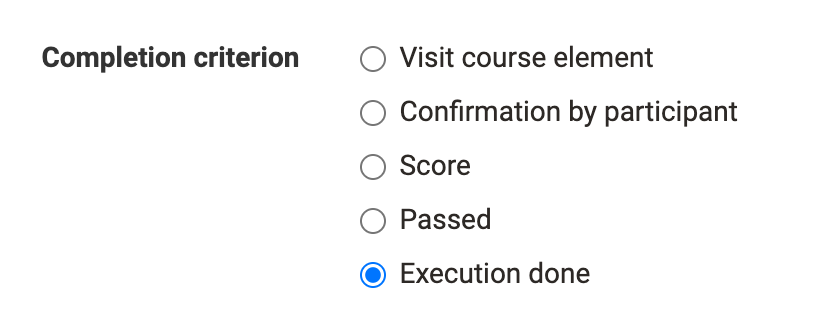{ class="shadow lightbox" title="Course editor, course element Task, tab Learning path · 2026.11.02" }

* **Visit course element**: The person has opened the course element.
* **Confirmation by participant**: The person has clicked on the confirmation of reading.
* **Score**: The person has achieved at least the specified score while completing the task.
* **Passed**: The person has fulfilled the "passed" requirements configured in the "Grading" tab, or a coach has manually set the task to passed.
* **Execution done**: The person has run through all steps of the workflow.

[Up (Author perspective) ^](#create_task) 
[To the top of the page ^](#course_element_task)

### Tab "Workflow"  {: #workflow}

In the "Workflow" tab, you define which steps the task consists of. Should a specific task be stored in the course element, or do the participants find the task elsewhere? Should they submit a document? Should there be feedback from coaches, and may participants revise their submission? Should a sample solution be available? Should an assessment with points or passed be possible? Should certain participants be assessed by certain coaches? Switch on the steps you need, and then configure the corresponding tabs.

!!! tip "Tip"

    This is the first tab of the course element that you should configure. Select the functions you require here. The matching tabs are then active/inactive and can be configured further.

The following options are available to you:
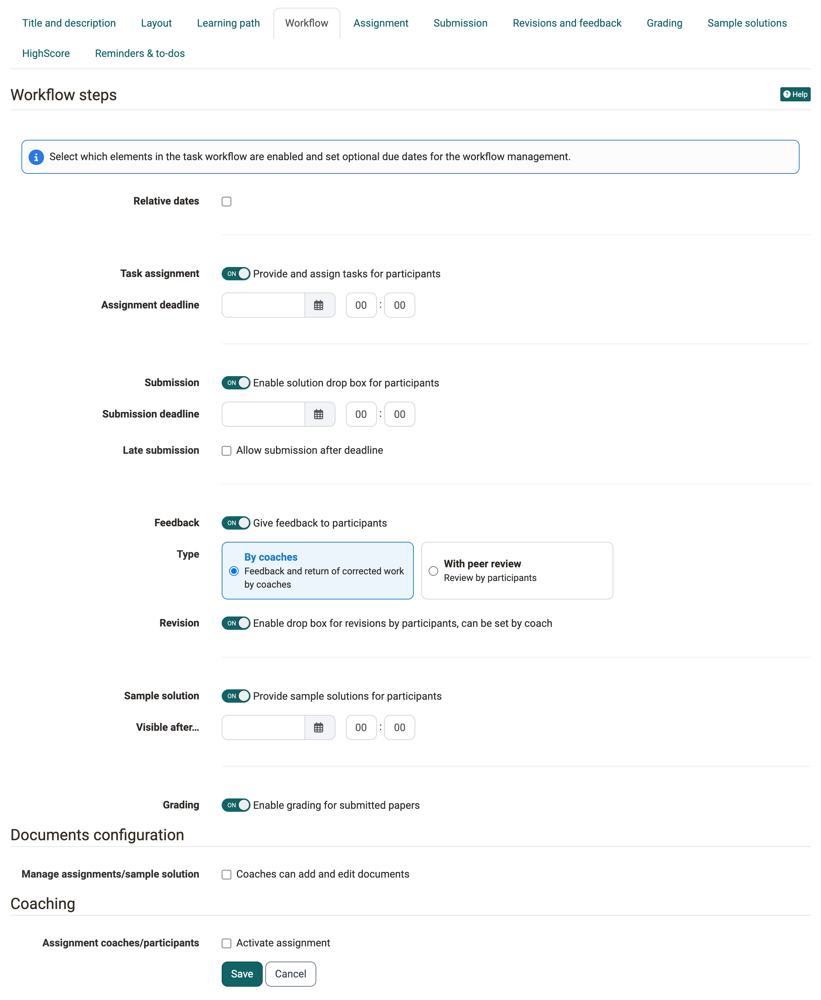{ class="shadow lightbox" title="Course editor, course element Task, tab Workflow · 2026.11.02" }

#### Relative dates {: #workflow_relative_dates}

Instead of entering calendar dates, you can also work with _relative dates_. Specify how many days after the first course launch or the enrollment the task assignment remains open. All set times can also be adjusted individually, e.g. if a participant needs an extension due to certain circumstances. This applies to all process steps. If you extend the submission date, the task is reopened. A late submission date is also possible.

=== "With fixed date"

    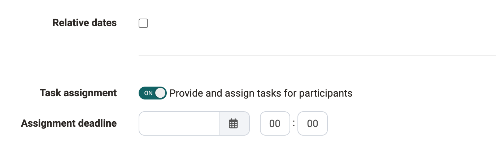{ class="shadow lightbox" title="Course editor, course element Task, tab Workflow · 2026.11.02" }

=== "With relative date"

    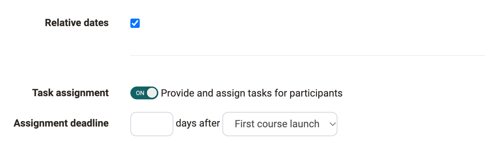{ class="shadow lightbox" title="Course editor, course element Task, tab Workflow · 2026.11.02" }

The changeover to relative dates affects the input fields for "Task assignment", "Submission" and "Sample solution".

#### Task assignment {: #workflow_assignment}

With this switch you provide the participants with tasks and assign them. The task assignment is available until the date under "Assignment deadline". You then store the tasks themselves in the [tab "Assignment"](#assignment).

#### Submission {: #workflow_submission}

With this switch participants submit their solution in the course element. Submission is possible until the date under "Submission deadline".

If "Allow submission after deadline" is activated and a date is set under "Last submission until…", participants can still submit their solution up to this date. Participants see the normal and the late submission deadline as long as they are in the future. Coaches and course owners also see the late submission.

#### Feedback {: #workflow_feedback}

Under "Type" you choose who gives the feedback: "By coaches" or "With peer review", i.e. by the other participants. With peer review you also set the "Peer review time period".

#### Revision {: #workflow_revision}

Here you allow participants to submit a revision after the correction. Whether a revision is needed is decided by the coaches for each submission. The switch appears if feedback is switched on and the option "By coaches" is selected under "Type".

#### Sample solution {: #workflow_sample_solution}

A sample solution can be provided for all participants or only those who have completed the task from the date entered. The selection "Visible for …" only appears when a calendar date is entered under "Visible after…" or the task is optional.

#### Grading {: #workflow_grading}

With this switch you activate the [tab "Grading"](#grading), in which you configure the details of the assessment.

#### Documents configuration {: #workflow_documents_configuration}

This area only appears if "Task assignment" or "Sample solution" is switched on, because documents are uploaded then. Under "Manage assignments/sample solution" you allow with "Coaches can add and edit documents" that coaches as well as course owners add and edit documents.

#### Coaching {: #workflow_coaching}

In the area "Coaching" you activate participant-dependent coaching: each participant is then assigned a specific coach.

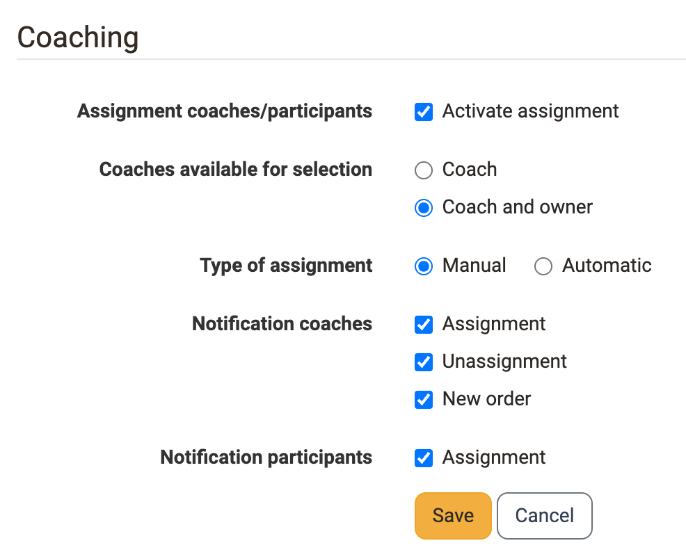{ class="shadow lightbox" title="Course editor, course element Task, tab Workflow · 2026.11.02" }

* **Assignment coaches/participants** 
With "Activate assignment" you display the other options for coaching. You then assign the persons when the course editor is closed, see [table "Assignment coaches/participants"](#coach_assignment_table).

* **Coaches available for selection** 
Here you choose between "Coach" and "Coach and owner". With the second option, course owners are also available for coaching the participants.

* **Type of assignment** 
Here you define whether you assign the coaches "Manual" or OpenOlat assigns them "Automatic".

* **Notification coaches** 
Select here in which cases coaches receive a notification by e-mail: "Assignment", "New order" and "Unassignment".

* **Notification participants** 
Select here whether participants should be informed by e-mail about the assignment to a coach.

#### Table "Assignment coaches/participants" [:octicons-tag-16:{ title="from Release 17.2.1 (OO-6698)" }](https://track.frentix.com/issue/OO-6698) {: #coach_assignment_table}

The actual assignment is made by course owners when the course editor is closed: `Course > "Task element" > Tab "Participants" > Button "Assignment coaches/participants"`.

The table is a matrix: each row is a participant, each column a coach available for selection, plus the column "Not assigned". You set the assignment by choosing the radio button in the desired column of the row. Behind every name, brackets state how many people are currently assigned to that coach. This makes an uneven distribution visible at a glance.

Via "Randomly assign unassigned", OpenOlat distributes all people still open automatically. The tabs "All" and "Not assigned" as well as the filters "Participants" and "Coach" narrow down the list. If the course has groups or curriculum elements, the filter "Groups" is added.

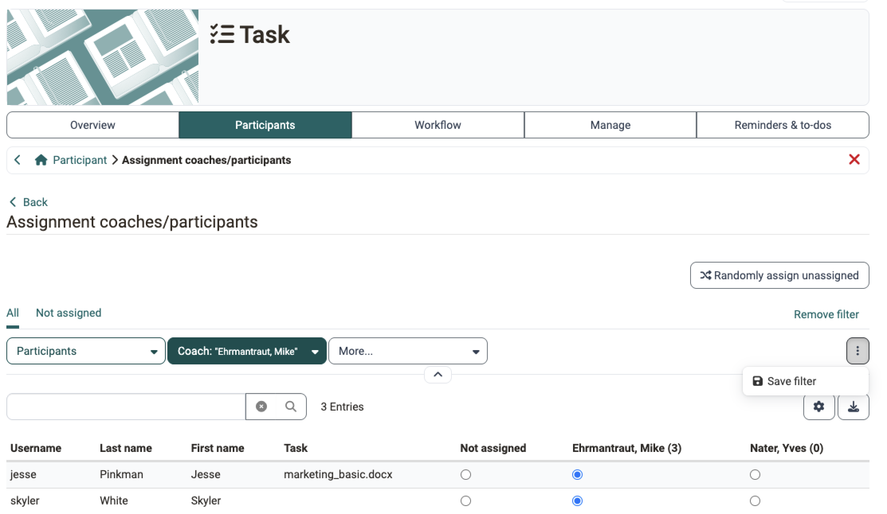{ class="shadow lightbox" title="Assignment coaches/participants in the tab Participants" }

!!! note "Note"

    Coaches do not see the button "Assignment coaches/participants". The assignment is reserved for course owners; coaches recognise their own assignment in the column "Coach" of the participant list.

Two functions support the work with large lists:

* **Export**: via the export symbol above the table on the right, you download the current table view as an Excel file, for example as proof of the assignment.
* **Save filter**: you store a set filter combination via the three-dot menu on the right next to the filters with "Save filter" under a name of your own. The stored filter then appears as a tab of its own and is available again the next time the table is opened. [:octicons-tag-16:{ title="from Release 21.0.2 (OO-9601)" }](https://track.frentix.com/issue/OO-9601)

The button appears only for the course element Task and only if the assignment of coaches and participants is activated. For the [group task](../learningresources/Course_Element_Grouptask.md), the assignment follows from the coaching of the group.

!!! warning "Attention"

    Subsequent changes to the workflow affect all participants, even if they have already started the workflow.

    When changes are made to the workflow, e.g. removing the assignment, this workflow component is removed for all participants in the course. The information about already selected tasks is then no longer visible. However, if the workflow component is inserted again, this information will be accessible again.

    However, if the assignment is added later and a participant is already further along in their personal workflow, no assignment needs to be selected afterwards.

!!! warning "Attention"

    If no person has the role of coach among the course members and at the same time course owners do not perform any coach tasks, then no coach assignment can take place. Whether course owners perform coach tasks is set under `Tab Workflow > Section "Coaching" > "Coaches available for selection"`.

!!! info "Note"

    The options displayed in the Workflow tab and selectable by the author can be preconfigured by the administrator. See Admin manual, `Modules > Course elements`

[Up (Author perspective) ^](#create_task) 
[To the top of the page ^](#course_element_task)

---

### Tab "Assignment"   {: #assignment}

!!! info "Requirement"

    In the tab "Workflow", "Task assignment" must first be switched on so that you can provide the specific task in the tab "Assignment".

**a) Upload files**

You can upload one or more task files created beforehand. Each uploaded task then counts as an alternative to be worked on. If several complementary files are needed for one task, bundle all required files as a zip file and upload this zip file as the task file.

In general, each task file should have a suitable title and possibly a short description.

**b) Create files in different formats**

Create files directly in OpenOlat. Exactly which formats are available depends on which have been activated by the OpenOlat administration. In most cases, at least one HTML editor is available. But it is also possible to create Word, Excel, PowerPoint and diagrams or whiteboards. In addition, a specific video task or an audio task can also be created.

If a task is created with the internal OpenOlat HTML editor, multiple files such as images or PDF files can be provided by first uploading them in the HTML editor and then linking them in the corresponding html page. Such a task will then be downloaded in .zip file format as well. If the HTML editor is used, the stored title is automatically used as the file name. However, this can be changed at any time.

!!! info "Multiple files"

    Please note: If multiple files are stored in the Task tab, they will be considered as multiple different tasks. It is _not_ a task with several complementary files.

In the field "Type of assignment" you determine whether a participant is offered all available tasks for selection ("Selection of task by user") or whether OpenOlat assigns a task by random selection ("Automatic task assignment").

In the field "Type of sampling", select whether several participants can solve the same task or whether each participant should solve a different task. If the task is selected manually, you can also specify in the "Preview" field whether the participants can view the task before selecting it. If each participant is to solve a different task for "Type of sampling", at least as many tasks must be entered as there are participants who are to solve this task.

!!! tip "Tip"

    If the course element contains only one task, manual selection is not very useful. In this case, it is best to use the automatic assignment.

In the field "Message for users" you provide general information for all participants on working on the tasks.

If a participant chooses the wrong task by mistake during manual selection, course owners can allow them to reset it in the [assessment tool](../learningresources/Assessment_tool_overview.md).

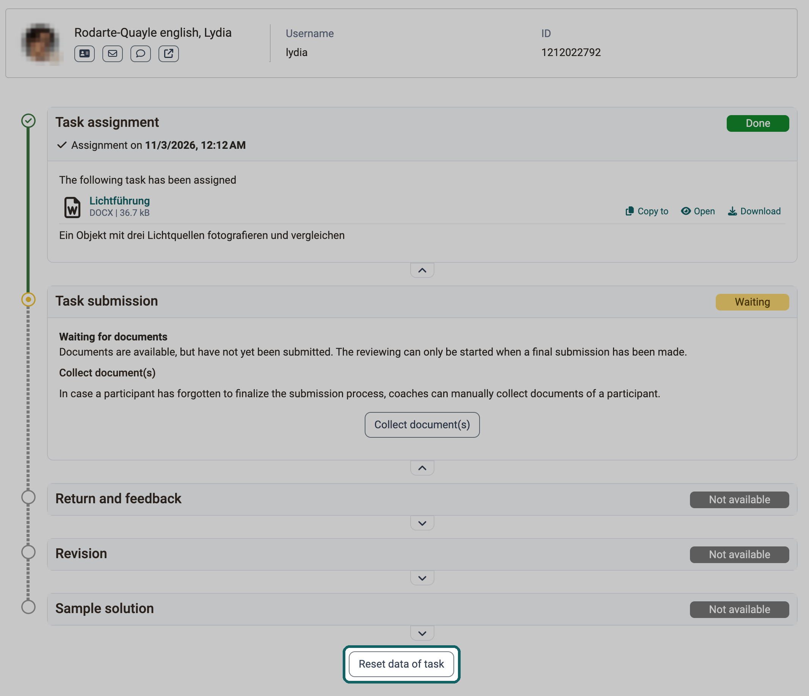{ class="shadow lightbox" title="Assessment tool, course element Task, person · 2026.11.03" }

The choice does _not change automatically_. The participant gets the opportunity to undo their previous steps with "Reset task".

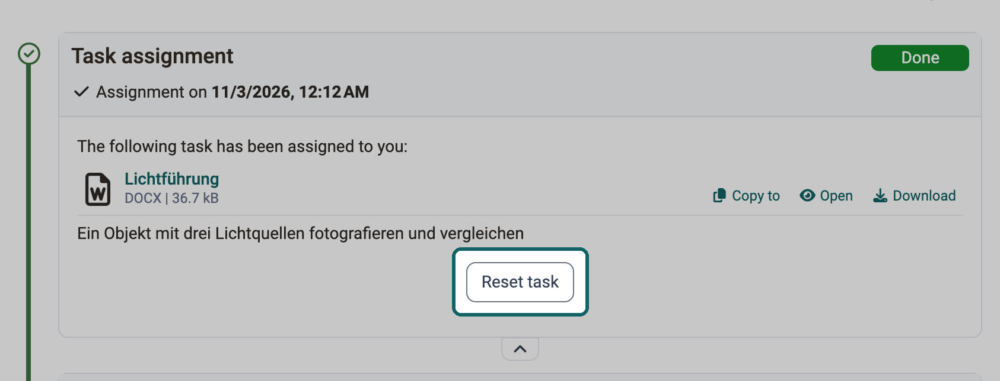{ class="shadow lightbox" title="Course element Task, participants' view · 2026.11.03" }

[Up (Author perspective) ^](#create_task) 
[To the top of the page ^](#course_element_task)

---

### Tab "Submission"  {: #submission}

Here you define the type and scope of the submission options for the participants.

!!! info "Requirements"

    In the tab "Workflow"

    * "Submission" must be activated so that you can set it up now.

    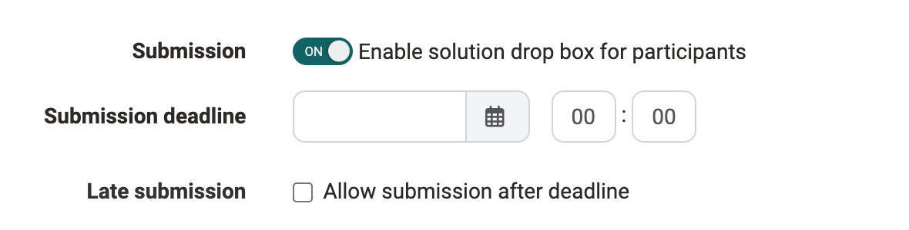{ class="shadow lightbox" title="Course editor, course element Task, tab Workflow · 2026.11.02" }

Then activate at least one of the two options: uploading documents or using the OpenOlat editor for the submission.

The following options are available in the "Submission" tab:

**"Upload files (e.g. PDF)"**: Participants upload documents created outside of OpenOlat and submit them.

**"Submit with OpenOlat editor"**: Participants create documents directly in the course element. By default, an HTML editor is available for this. If other document editors are integrated in OpenOlat, they can also create documents in other formats such as Word or Excel, as well as draw.io diagrams.

Activate **"Task is template for submission"** if learners are to use the stored task file as the basis for their work, for example if the task contains a pre-structured table to be filled in. The prerequisite is that this option has been enabled by the OpenOlat administrators.

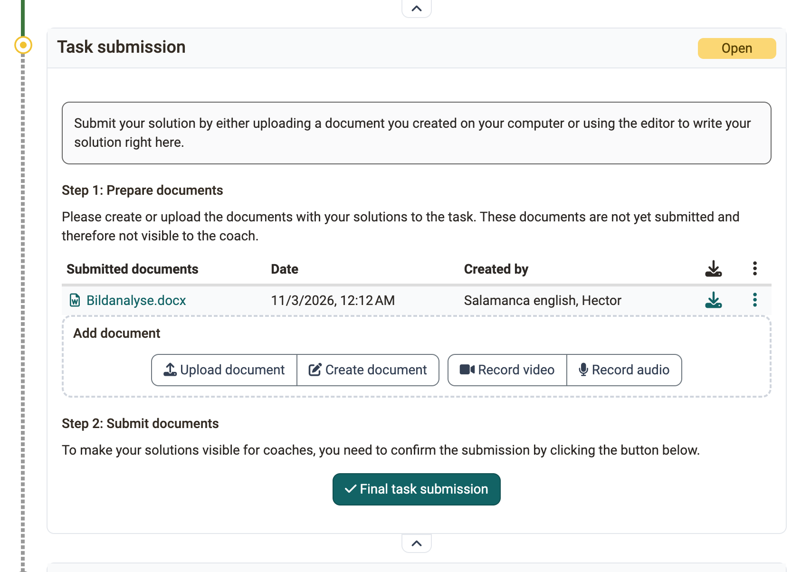{ class="shadow lightbox" title="Course element Task, participants' view · 2026.11.03" }

**"Allow video recordings"**: Participants additionally record videos via webcam and submit them. Under "Max. length of recording (in sec)" you limit the duration, under "Video quality" you choose the quality level.

**"Allow audio recordings"**: Participants additionally record audios with the audio recorder and submit them. Here, too, you limit the duration under "Max. length of recording (in sec)".

Under "Min. number of documents" and "Max. number of documents" you define how many documents a submission must or may contain. If there is to be no restriction, leave the fields blank.

Activate the e-mail confirmation so that people who have submitted a task receive a message. You adapt the pre-formulated text of the e-mail if required.

[Up (Author perspective) ^](#create_task) 
[To the top of the page ^](#course_element_task)

---

### Tab "Revisions and feedback"  {: #revisions}

!!! info "Requirements"

    In the tab "Workflow"

    * "Feedback" must be switched on.
    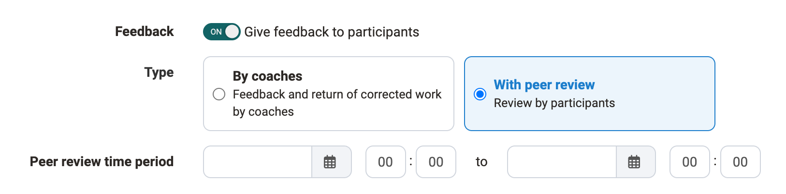{ class="shadow lightbox" title="Course editor, course element Task, tab Workflow · 2026.11.02" }
    * Depending on who is providing the feedback, different options appear in the tab "Revisions and feedback".

**Revisions and feedback by coaches**

If the option "By coaches" was selected in the tab "Workflow", you define in the tab "Revisions and feedback" under "Revision configuration" the minimum and maximum number of return documents that participants are allowed to submit during the steps "Return and feedback" and "Revision".

**Revisions and feedback by means of peer review**

If the option "With peer review" was selected in the tab "Workflow", you define in the tab "Revisions and feedback" the rules by which other participants give feedback. The reviewers give their feedback in a [form](../learningresources/Form_Element_Rubric.md), usually with the help of a rubric. As the course owner, you provide this review form.

If grading is also switched on in the tab "Workflow" and the points for the peer review are to be taken over automatically from the form, the form must contain at least one rubric element. OpenOlat only awards points automatically via a rubric element.

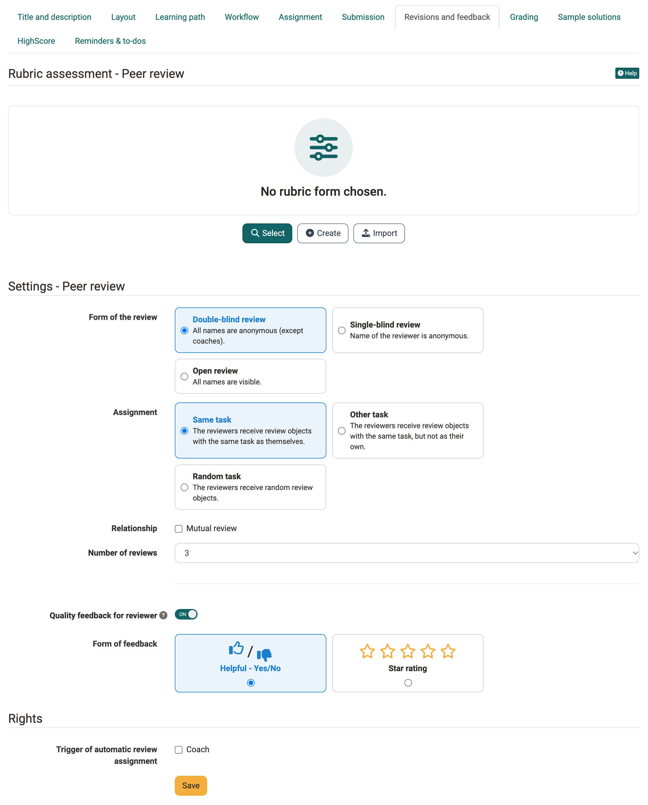{ class="shadow lightbox" title="Course editor, course element Task, tab Revisions and feedback · 2026.11.02" }

#### Rubric assessment - Peer review {: #peer_review_rubric}

A suitable rubric form is required for peer reviews. As long as none is chosen, the area shows "No rubric form chosen.". With "Select" you take over an existing form, with "Create" you create a new one, with "Import" you import a form. Here you will find a [sample form](assets/Example_PeerReview_v1_de.zip) (zip file for importing into your OpenOlat).

Under "Settings - Peer review" you define the procedure with the following fields.

#### Form of the review {: #peer_review_form}

Here you define which names are visible: 
\- Double-blind review: All names are anonymous (except coaches). 
\- Single-blind review: The name of the reviewer is anonymous. 
\- Open review: All names are visible.

#### Assignment {: #peer_review_assignment}

Here you determine which tasks the reviewers receive for review: 
\- **Same task**: For example, if a person has drawn and worked on task 1, they will only be given task 1 to review. They do not then have to familiarize themselves with another topic. 
\- **Other task**: The review concerns a different task than the one you have drawn yourself. If several reviews are to be done, they all concern the same task. 
\- **Random task**: The reviewers are given random tasks to review.

#### Relationship {: #peer_review_relationship}

If "Mutual review" is selected, participants can assess each other, but do not have to.

#### Number of reviews {: #peer_review_number}

Here you specify how many reviews are planned for each participant. Depending on the number of participants, the actual number of reviews to be completed may vary. Ideally, the number of reviews to be completed corresponds to the number of reviews you receive from others.

#### Quality feedback for reviewer {: #peer_review_quality_feedback}

Here you give participants the opportunity to give their reviewers feedback after receiving a review. Whether the review received was helpful, they indicate with the thumb symbol or with stars.

#### Form of feedback {: #peer_review_feedback_form}

This field appears when "Quality feedback for reviewer" is switched on. Choose which symbols participants use to give the reviewers this feedback: "Helpful - Yes/No" or "Star rating".
The "thumbs up" / "thumbs down" symbol has proven to be recommendable.

#### Trigger of automatic review assignment {: #peer_review_permissions}

This field is in the area "Rights". Authors see all participants of a course, but coaches may only see their coached group.
In order for coaches to be able to view the reviews of the supervised participants, reviews must be assigned within their groups. (Only then can coaches follow all reviews). 
If the automatic review assignment is triggered, coaches will only see their group, but review assignments will be assigned among all participants. Coaches will then see that a coached person has received a review from someone in the other group. However, the name of the person who did the review is not visible.  
In order for coaches as well as course owners to be able to trigger the automatic review assignment, select the option "Coach" under "Trigger of automatic review assignment".

There is a **Participant Review** and an **Expert Review**, each with its own form. However, the participant review can also (additionally) be completed by coaches. 

* Coaches can do a participant review, for example, if a participant has received too few reviews. 
* Even if a participant review has been marked as "not valid", coaches can fill out a form as a replacement if necessary.
* An expert form for coaches may contain different criteria than the form for participants. In this case, it may also make sense for coaches to be able to use both forms.

!!! info "Important"

    Course owners can configure which review counts. (Only that of the participants, only that of the experts or both.) This configuration should be taken into account when planning a peer review. See also [How do I perform a peer review? >](../../manual_how-to/peer_review/peer_review.md) 

**Further information**

[Sample form for peer review (zip file for import into your OpenOlat) >](assets/Example_PeerReview_v1_de.zip) 
[How do I create a form learning resource? >](../../manual_how-to/create_a_form/create_a_form.md) 
[How do I perform a peer review? >](../../manual_how-to/peer_review/peer_review.md)

[Up (Author perspective) ^](#create_task) 
[To the top of the page ^](#course_element_task)

---

### Tab "Grading"  {: #grading}

Here you define _how_ the participants are assessed. Should there be points? Should there be a passed/not passed for the course element? Should the point evaluation be linked to a rating scale, and if so, with which? Should coaches be able to provide further individual comments or documents? Decide in each case what suits your scenario.

If assessments already exist for the task, OpenOlat displays the settings under "Grading configuration" in this tab as read-only. The area "Assessment form" remains editable. With "Enable edit mode" you make the settings editable again, see [Read-only assessment configuration](Assessment.md#assessment_config_read_only). [:octicons-tag-16:{ title="from Release 21.1 (OO-9647)" }](https://track.frentix.com/issue/OO-9647)

A form with a rubric can also be used for the assessment. The points can then be taken from the rubric form for the assessment of the course element. The rubric form included here in the "Grading" tab is to be distinguished from the rubric form used in the "Revisions and feedback" tab for peer reviews.

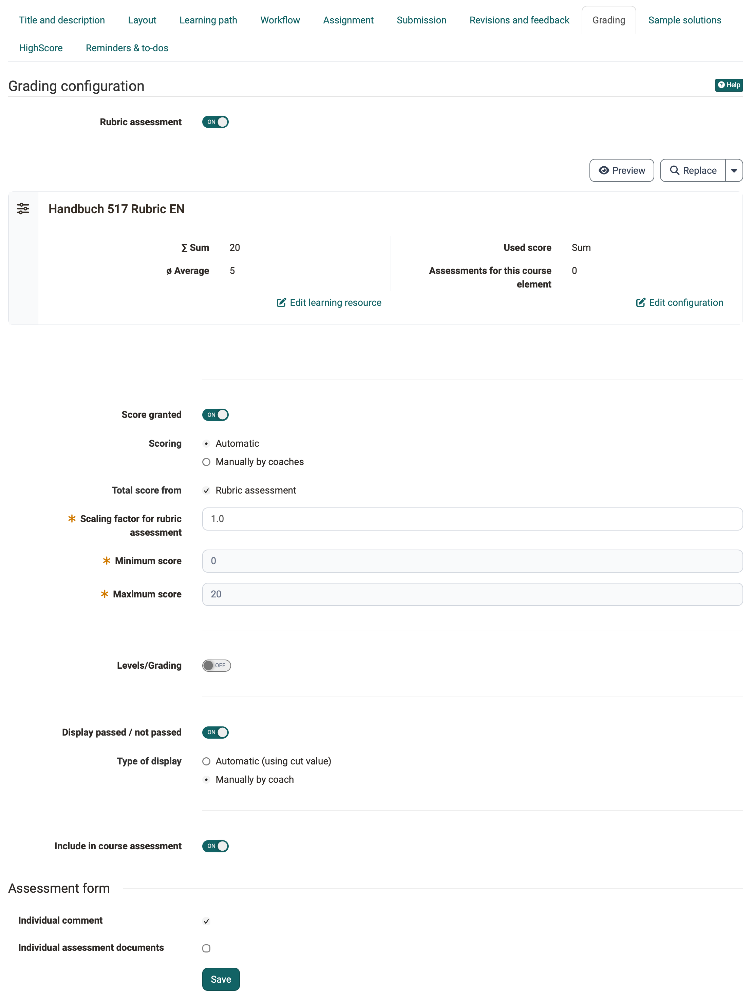{ class="shadow lightbox" title="Tab Grading of the task in the course editor · 2026.11.02" }

#### Awarding points

In the field "Scoring" you define whether OpenOlat calculates the points "Automatic" from the selected sources or whether they are entered "Manually by coaches".

If scoring has been activated, the minimum and maximum number of points must be specified. You can then also select the "Assessment with grading/marks" option and configure it further. The respective points can be assigned specific evaluation scales such as levels, grades, (competence) levels or labels. The available rating scales are defined by the OpenOlat administrator and can be selected via the "Edit rating scale" button and the points can be adjusted in detail. It must also be defined whether the assignment to the calculated classification is made manually by the coach or whether it should be displayed automatically when points are changed.

#### Total score from ...

The total score can be calculated from one or more sources:

* **Rubric assessment**: If a rubric form is used in the "Grading" tab, points can be transferred from there.
* **Rubric peer review**: A peer review uses the rubric form, which is included in the "Revisions and feedback" tab.
* **Submitted reviews**: Additional points can be awarded to the person for reviewing other participants (points per completed review, configured below this selection as soon as the option has been selected).

For both rubric sources, one weighting field each appears: "Scaling factor for rubric assessment" and "Scaling factor for rubric peer review". With them you determine the factor with which the points of the respective source enter the total score.

#### Passed/Failed
If "Display passed / not passed" is switched on, you choose under "Type of display" between "Automatic (using cut value)" and "Manually by coach". For the automatic display, scoring must be activated and a cut value for passing must be specified.

#### Include in course assessment
Here you define whether the result of this course element is included in the assessment of the entire course.

#### Assessment form {: #assessment_form}
Under "Assessment form" you optionally activate "Individual comment" and "Individual assessment documents" so that coaches have even more flexible feedback options.

[Up (Author perspective) ^](#create_task) 
[To the top of the page ^](#course_element_task)

---

### Tab "Sample solutions"  {: #sample}

To offer all participants a sample solution for the tasks set, you either create the sample solution directly with the internal editor, record a video with your webcam, or upload files with the sample solutions.

!!! info "Requirements"

    In the tab "Workflow"

    * "Sample solutions" must be activated in order to be configurated.

    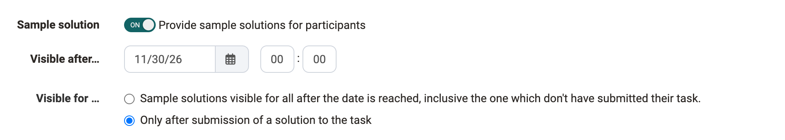{ class="shadow lightbox" title="Course editor, course element Task, tab Workflow · 2026.11.02" }

By default, participants only see the sample solution once they have completed the previous steps. If there is feedback by coaches, this is after their submission has been accepted. If you choose visibility for all in the tab "Workflow" under "Visible for …", persons without a submission also see the sample solution from the date entered.

!!! tip "Tip"

    If the participants are to receive help with the task in advance, upload it together with the task as a ZIP file or use the field "Message for users" in the [tab "Assignment"](#assignment).

[Up (Author perspective) ^](#create_task) 
[To the top of the page ^](#course_element_task)

---

### Tab "HighScore" {: #highscore}

If points are awarded for the task, you can visualize them with the HighScore options. 

The prerequisite is that the awarding of points has been activated for the task in the "Grading" tab. Only then does the tab "HighScore" become active and can be configured. Here you determine

* which elements are displayed,
* whether the display should be anonymous and
* from which point in time the high score list should be visible.

For more information on this tab, which is available in several course elements, see [here](../learningresources/Course_Elements.md).

[Up (Author perspective) ^](#create_task) 
[To the top of the page ^](#course_element_task)

---

### Tab "Reminders & to-dos" [:octicons-tag-16:{ title="from Release 18.2 (OO-7040)" }](https://track.frentix.com/issue/OO-7040) {: #reminders}

With the reminder function, you can send [Reminders](../learningresources/Course_Reminders.md) to course members in the form of an e-mail and generate automatic [To-dos](../learningresources/Course_todos.md) for the task. To-dos are stored for participants in the personal menu under "[To-dos](../personal_menu/To-Dos.md)".

If the automatic creation of to-dos is activated, learners can see the current status (step) of the workflow of the corresponding task under `My course > To-dos` and thus quickly recognize whether or which actions currently need to be taken by them. In addition, these to-dos also appear among the personal to-dos in the user tools.

The to-dos therefore help learners to keep track of their tasks.
Further information on To-dos can be found [here](../basic_concepts/To_Dos_Basics.md).

!!! note "Note"

    Whether coaches are also allowed to edit to-dos, you define in the course settings with the checkbox "Edit to-dos": 
    `Course > Administration > Settings > Tab "Options"`

[Up (Author perspective) ^](#create_task) 
[To the top of the page ^](#course_element_task)

---

### Tab Badges

If "Award badges" is switched on in the course settings, the course editor shows the tab "Badges" for this course element, and you can create a badge of its own for this course element. You find the setting under: 
`Course > Administration > Settings > Tab "Assessment" > Section "Badges"`

[Up (Author perspective) ^](#create_task) 
[To the top of the page ^](#course_element_task)

!!! note "Note"

    The functionality and structure of the course elements "Task" and "[Group task](../learningresources/Course_Element_Grouptask.md)" are similar.

---

## Complete tasks (Course participant perspective)  {: #process_task}

All steps of a task (workflow) are displayed to course participants directly in the course element, depending on the configuration of the course element. Once a step has been completed, the next step is displayed and accessible.

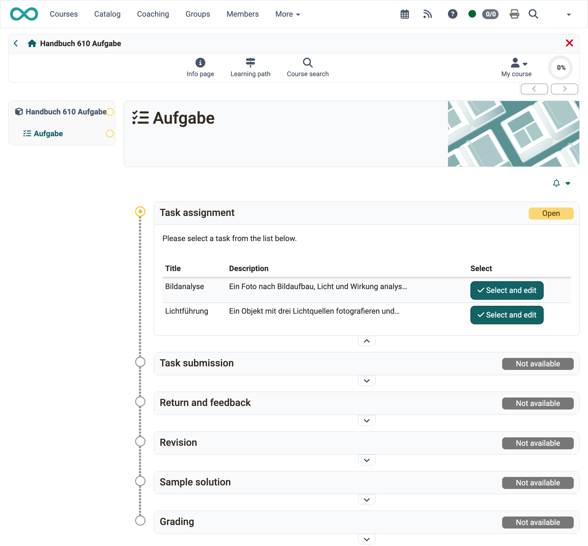{ class="shadow lightbox" title="Course element Task, participants' view · 2026.11.03" }

!!! note "Quick Links: Complete tasks (Course participant perspective)"

    * [Download assigned tasks](#process_task_download)
    * [Who coaches me?](#process_task_my_coach)
    * [Submit solution](#process_task_solution)
    * [Return and feedback](#process_task_feedback)
    * [Carry out a peer review](#process_task_make_reviews)
    * [View results of a peer review](#process_task_view_reviews)
    * [Rework task](#process_task_rework)
    * [View sample solution](#process_task_view_example)
    * [Read "Grading" of the coach](#process_task_view_coach_assessment)

!!! tip "Tip"

    Subscribe to the respective task module to be informed quickly by e-mail about changes. The notification reaches you as soon as an action has been completed, not at every intermediate step. If you want to keep track of the submissions of all assessable course elements, subscribe to the [assessment tool](../learningresources/Assessment_tool_overview.md) instead.

### Download assigned tasks {: #process_task_download}

Depending on the configuration, one or more tasks are available for selection in the step "Task assignment", or a task is automatically assigned to you. If the title of the task file is linked for several tasks, you can view the task before selecting it. If you only have the "Select" button, you cannot view the task in advance. If the task is the template for the submission, the button is called "Select and edit". With automatic assignment you receive the task as soon as you open the course element before the deadline.

If you have selected a task or a task has been automatically assigned to you, click on "Download task" to download or display the task. If you click on the file name of the task, the task is displayed. You can then download the task again at any time.

HTML files, whether assignment, submitted document or sample solution, open in a lightbox, and scripts in them only run if a [content domain](../basic_concepts/Folder_Concept.md#open_html) is set up. [:octicons-tag-16:{ title="from Release 21.0 (OO-7554)" }](https://track.frentix.com/issue/OO-7554)

It is also possible that your teacher has not stored the task in the course element "Task", but has chosen a different location, e.g. another course element, an HTML page, an external website or has set the task orally in presence or in an online meeting. In this case, the "Task assignment" section does not appear.

[Up (Participant perspective) ^](#process_task) 
[To the top of the page ^](#course_element_task)

### Who coaches me? {: #process_task_my_coach}

In courses with a large number of participants, several teachers often coach the task. If the assignment of coaches and participants is activated, a coach is assigned to you as a participant.

You see the coach assigned to you above the task. If no coach is displayed, no one has been assigned to you yet.

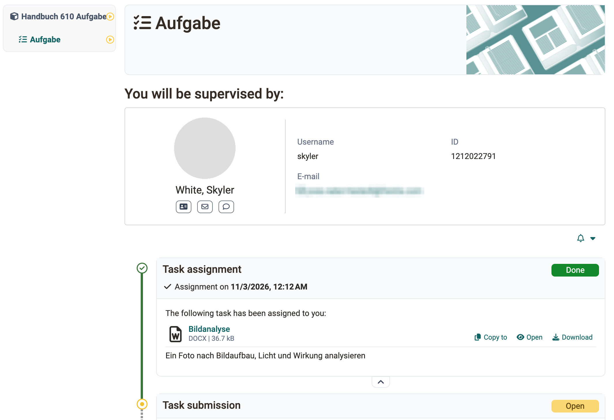{ class="shadow lightbox" title="Course element Task, participants' view · 2026.11.03" }

Peer review also allows participants to give each other feedback on the tasks they have completed.

[Up (Participant perspective) ^](#process_task) 
[To the top of the page ^](#course_element_task)

### Submit solution {: #process_task_solution}

In the step "Task submission" you submit your solution. Depending on the configuration, you upload documents, create files with the OpenOlat editor or record short audio and video recordings directly in OpenOlat.

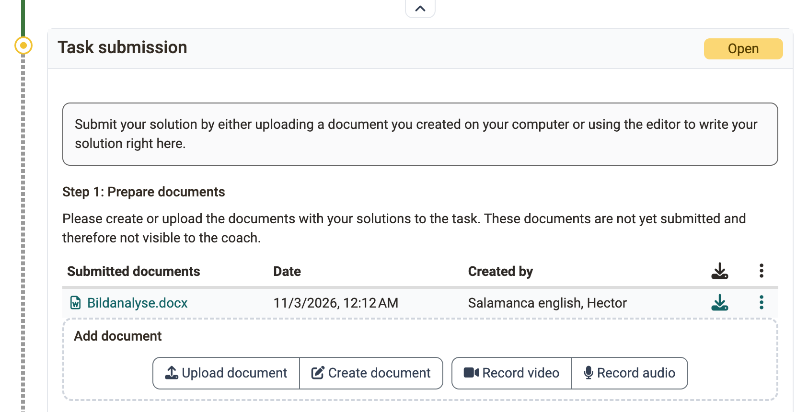{ class="shadow lightbox" title="Course element Task, participants' view · 2026.11.03" }

As a rule, only some of the four options will be available to you.
Upload your solution or create it directly in OpenOlat and the document will be saved temporarily. The documents remain editable for you until you submit your task via the "Final task submission" button. You will receive confirmation that you have submitted documents.

In the submission step, which is now marked as completed with a green tick, you will receive an overview of the submitted files. You can still view the files but can no longer make any changes.

[Up (Participant perspective) ^](#process_task) 
[To the top of the page ^](#course_element_task)

### Return and feedback {: #process_task_feedback}

As long as you have _not_ submitted anything yet and there is no feedback from the coach, this area is empty.

If you have submitted a solution and the coach has not yet created feedback, a corresponding note appears.

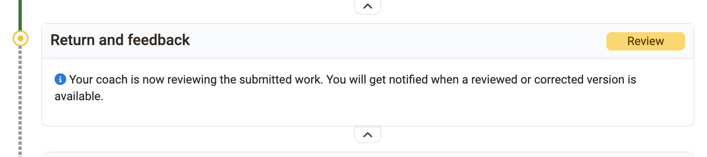{ class="shadow lightbox" title="Course element Task, participants' view · 2026.11.03" }

As soon as the coach has created feedback, you find it in the step "Return and feedback".

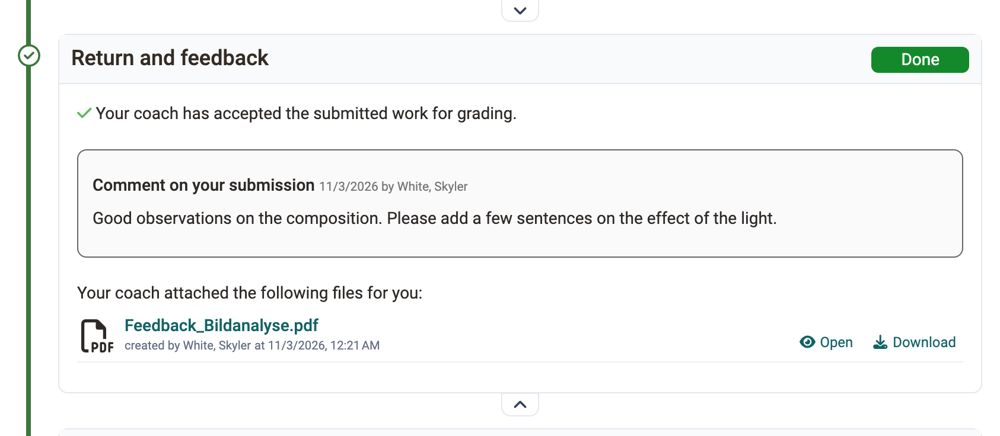{ class="shadow lightbox" title="Course element Task, participants' view · 2026.11.03" }

If your solution is not sufficient and the coach requests a revision, the message "Your submission has been returned." appears. You can then submit a new version in the step "Revision", possibly up to a deadline.

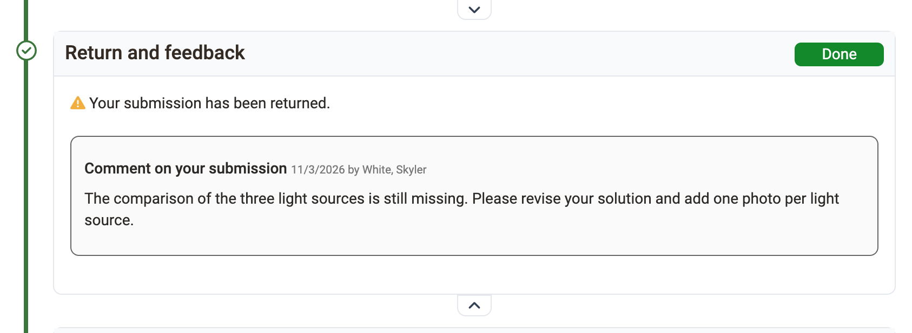{ class="shadow lightbox" title="Course element Task, participants' view · 2026.11.03" }

[Up (Participant perspective) ^](#process_task) 
[To the top of the page ^](#course_element_task)

### Carry out a peer review [:octicons-tag-16:{ title="from Release 19.0 (OO-7680)" }](https://track.frentix.com/issue/OO-7680) {: #process_task_make_reviews}

If a peer review was planned for the task, you will now be assigned review tasks. You are to assess the documents submitted by other course members. The documents you are to review can be assigned to you automatically or manually by coaches. 

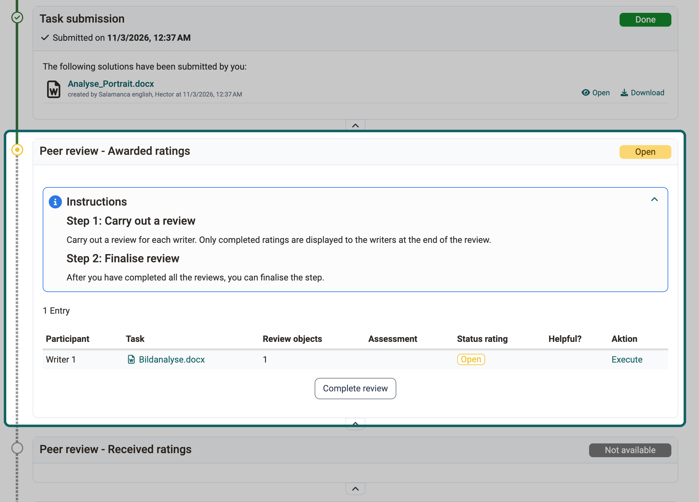{ class="shadow lightbox" title="Course element Task, participants' view · 2026.11.03" }

Once you have completed all the reviews, finalise this step by clicking on the "Complete review" button.

[Up (Participant perspective) ^](#process_task) 
[To the top of the page ^](#course_element_task)

### View results of a peer review {: #process_task_view_reviews}

If a peer review has been scheduled, you will see an overview of the assessments you have given and received.

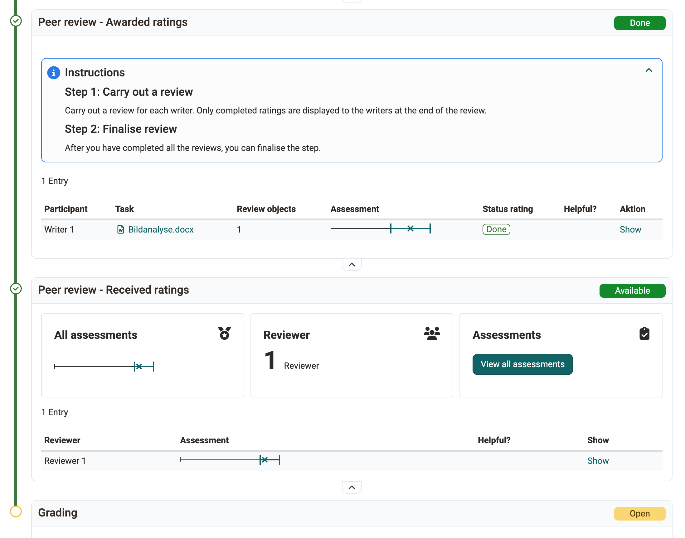{ class="shadow lightbox" title="Course element Task, participants' view · 2026.11.03" }

[Up (Participant perspective) ^](#process_task) 
[To the top of the page ^](#course_element_task)

### Rework task {: #process_task_rework}

If you have to revise your solution, proceed as described under [Submit solution](#process_task_solution). In the step "Revision", the coach may also return your work to you several times for correction.

As soon as the coach considers the task to be solved, they close the revision. At any time, you see which documents you and your coach have submitted, and you can open them.

[Up (Participant perspective) ^](#process_task) 
[To the top of the page ^](#course_element_task)

### View sample solution {: #process_task_view_example}

Your teacher can attach a sample solution to the task, which becomes visible from a specified point in time. Depending on the setting, you only see it _after_ your solution has been accepted, or also without a submission of your own. Click on the file name or the button "Download sample solutions" to view or download the sample solution.

[Up (Participant perspective) ^](#process_task) 
[To the top of the page ^](#course_element_task)

### Read "Grading" of the coach {: #process_task_view_coach_assessment}

The step "Grading" shows the performance summary with status, score and classification of the selected rating scale, depending on the configuration of the course element. Below it are the comment and the assessment documents that the coach has stored.

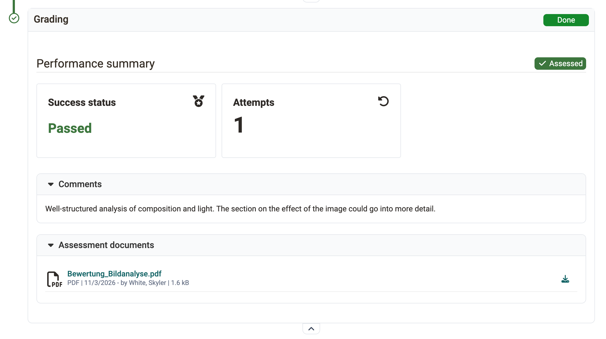{ class="shadow lightbox" title="Course element Task, participants' view · 2026.11.03" }

[Up (Participant perspective) ^](#process_task) 
[To the top of the page ^](#course_element_task)

---

## Coaching tasks (Coach perspective) {: #coach_task}

!!! note "Quick links: Coaching tasks (Coach perspective)"

    * [Check assignment of tasks](#coach_task_peer_review_check_assingment)
    * [Check submission](#coach_task_peer_review_check_delivery)
    * [Review by coach](#coach_task_peer_review_by_coach)
    * [Rules of a peer review](#coach_task_peer_review_rules)
    * [Supervise peer review](#coach_task_peer_review_supervise)
    * [Manual assignment of peer reviewers](#coach_task_peer_review_assign_manually)
    * [Automatic assignment of peer reviewers](#coach_task_peer_review_assign_automatically)
    * [Close peer review](#coach_task_peer_review_close)
    * [Coach participates in peer review](#coach_task_peer_review_reviewer_participates)
    * [Expert review](#coach_task_peer_review_expert)
    * [Task assessment](#coach_task_peer_review_evaluate)

### Check assignment of tasks {: #coach_task_peer_review_check_assingment}

The following questions and control tasks arise for coaches:

* Has an automatic assignment been made?
* Have all participants drawn a task?
* Who drew which assignment? => Is there a need to correct the assignments?
* Who has not yet drawn a task? => Why? => The persons can be selected in the list and contacted by e-mail. => Possibly an extension should be made so that one person can still draw a task. (Automatic assignment is not possible.)

[Up (Coach perspective) ^](#coach_task) 
[To the top of the page ^](#course_element_task)

### Check submission {: #coach_task_peer_review_check_delivery}

* Was the submission made within the deadline?
* Was there a late submission?
* Is there a reason for an individual extension for the submission? An extension can be granted for assignment, submission and solution viewing. An extension of the revision period is not possible, as the revision period is already a type of extension.
* If participants have accidentally submitted or forgotten something, the submission option can be reopened.
* Is it necessary to withdraw the tasks prematurely? This may be the case in the event of attempted fraud, for example. 
* Is the submission deadline open and should a manual collection take place? (If a submission deadline has been set, an automatic collection will always take place if someone has not yet submitted the return themselves).

!!! note "Note"

    An **extension** can also be set up by coaches. The **submission deadline**, on the other hand, can only be set by course owners.

!!! note "Note"

    No deadline can be set for courses that run indefinitely. An alternative in this case may be a certificate with recertification.

[Up (Coach perspective) ^](#coach_task) 
[To the top of the page ^](#course_element_task)

### Review by coach {: #coach_task_peer_review_by_coach}

A review is only possible if the participant has submitted.

A review is also possible if it has already been submitted before the deadline.

If a time period has been set for the review (by the owner), the review cannot be carried out.

[Up (Coach perspective) ^](#coach_task) 
[To the top of the page ^](#course_element_task)

### Rules of a peer review [:octicons-tag-16:{ title="from Release 19.0 (OO-7680)" }](https://track.frentix.com/issue/OO-7680) {: #coach_task_peer_review_rules}

In a peer review, the participants in a course give each other feedback or an assessment. The feedback can be of a general nature (e.g. in a text field) or also include an assessment with points.

It is not necessary for each participant to review all other participants. It can be determined for how many other people a review must be made.

You can also configure whether the reviewers see the names of the assigned persons, whether only their own name is visible as a reviewer or whether it is fully disclosed who is reviewing whom.

As a coach, you monitor the mutual reviews and can also intervene if necessary.

[Up (Coach perspective) ^](#coach_task) 
[To the top of the page ^](#course_element_task)

### Supervise peer review {: #coach_task_peer_review_supervise}

The procedure for a peer review was determined by the course owner. As a coach, you will find the options for your supervision task accordingly.

* You can see the status of the peer reviews in an overview. In two tabs you will find the assessments received and awarded by the participants.
* As a coach, you can manually assign reviewers.

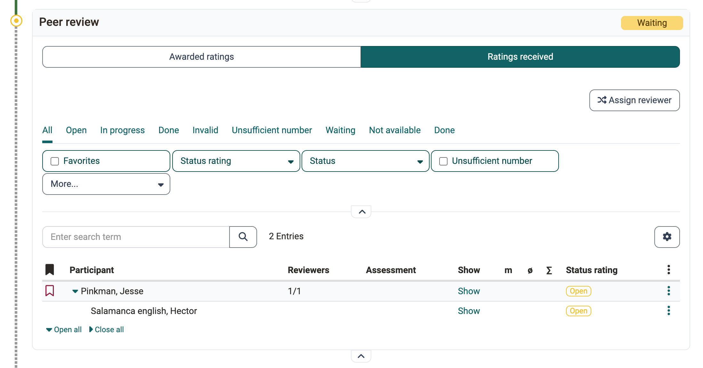{ class="shadow lightbox" title="Course element Task, coach view, detail view of a person · 2026.11.03" }

!!! note "Note"

    Coaches only see groups in which they themselves are members. If members of other groups review, the evaluations of these participants are not fully visible to coaches.

[Up (Coach perspective) ^](#coach_task) 
[To the top of the page ^](#course_element_task)

### Manual assignment of peer reviewers {: #coach_task_peer_review_assign_manually}

If you as a coach want to determine who receives a review from whom, you assign the reviewers yourself.

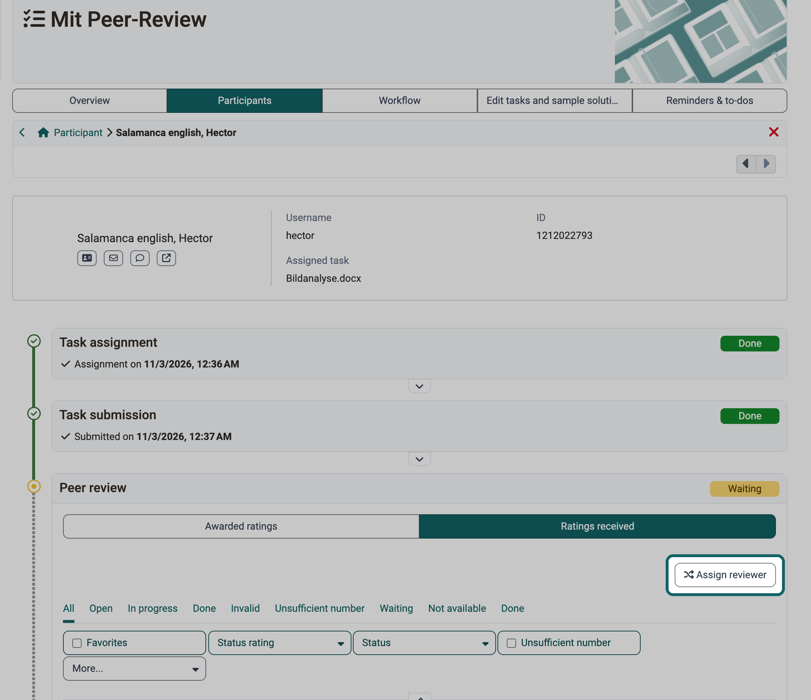{ class="shadow lightbox" title="Course element Task, coach view, tab Participants · 2026.11.03" }

In the tab "Ratings received" the button is called "Assign reviewer", in the tab "Awarded ratings" it is called "Assign reviews".

A manual assignment is also possible in the table. To do this, click on the three-dot menu in the row of the person.

[Up (Coach perspective) ^](#coach_task) 
[To the top of the page ^](#course_element_task)

### Automatic assignment of peer reviewers {: #coach_task_peer_review_assign_automatically}

The assignment of peer reviewers to participants can also be carried out automatically by OpenOlat. It is carried out according to the set rules. (E.g. defined number of people to be reviewed per participant). Even if manual assignments have already been made by coaches, these are taken into account in the remaining automatic assignments.

Course owners or coaches trigger the automatic assignment with the button "Trigger review assignment".

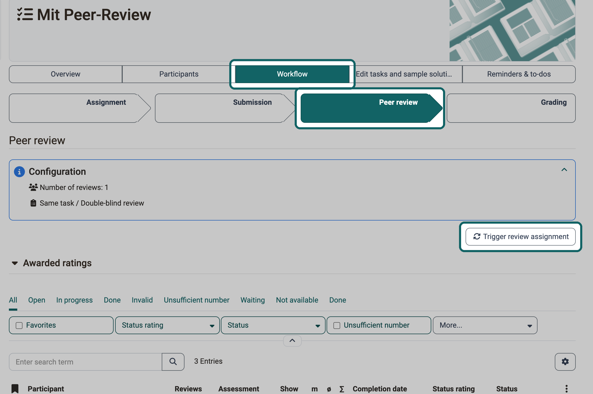{ class="shadow lightbox" title="Course element Task, coach view, tab Workflow · 2026.11.03" }

!!! info "Important"

    In order for coaches to be able to trigger the automatic review assignment, course owners must have selected the option "Coach" under [Trigger of automatic review assignment](#peer_review_permissions) in the tab "Revisions and feedback".

!!! info "Important"

    The "Trigger review assignment" button is not deactivated after an assignment has been made and is still available. The reason for this is that participants can still be added later or someone has received an extension.

[Up (Coach perspective) ^](#coach_task) 
[To the top of the page ^](#course_element_task)

### Close peer review {: #coach_task_peer_review_close}

When participants have done all their reviews, they must submit the reviews with "Complete review". Only then do they count. The other participants will only be judged with completed reviews.

If the specified time for reviews has expired, participants can no longer make reviews.

If participants have completed reviews but not submitted them, these reviews cannot be collected by coaches. The reason: The coaches cannot know whether a review that has not been completed should already be final and what quality the review has at the current time.

Coaches cannot complete all the reviews. They simply have to wait until the period for the reviews has expired.

It is not possible for a peer review to be followed by a revision and then a second review.

[Up (Coach perspective) ^](#coach_task) 
[To the top of the page ^](#course_element_task)

### Coach participates in peer review {: #coach_task_peer_review_reviewer_participates}

It is possible for coaches to participate in the review in the same way as participants. They then have the role of a participant for the review, so to speak, and use the same criteria. 

In this case, the coaches' review counts in the same way as the reviews of the other participants.

**Example 1:** 
One reviewer is absent due to illness and the coach steps in as reviewer. This ensures that everyone receives the same number of reviews.

**Example 2:** 
A coach sees that a reviewer has performed a review incorrectly or poorly. The coach then marks this review as invalid and makes a review themselves so that this person has received the same number of reviews again.

**Example 3:** 
There are two completely contradictory reviews from the peer review. The coach therefore provides a mediating or corrective review. (In contrast to an expert review, the same assessment grid is used here).

[Up (Coach perspective) ^](#coach_task) 
[To the top of the page ^](#course_element_task)

### Expert review {: #coach_task_peer_review_expert}

An expert review is carried out by coaches after a peer review has taken place.

It is analogous to the [course element "Assessment"](../learningresources/Course_Element_Assessment.md#rubric-assessment), with a stored [rubric form](../learningresources/Forms_in_Rubric_Scoring.md). (In other words, a different questionnaire than the peer reviewers used).

[Up (Coach perspective) ^](#coach_task) 
[To the top of the page ^](#course_element_task)

### Task assessment {: #coach_task_peer_review_evaluate}

If a peer review has been carried out, the results do not necessarily have to be included in the **assessment**. Reviews and peer reviews without an assessment are also possible. You can choose, 

* whether the reviews from a peer review are included in the assessment,
* are not included in the assessment,
* or only the expert review counts.

[Up (Coach perspective) ^](#coach_task) 
[To the top of the page ^](#course_element_task)

## Further information {: #further_information}

**Mentioned on this page** 
[Course element "Group task" >](../learningresources/Course_Element_Grouptask.md) 
[How do I perform a peer review? >](../../manual_how-to/peer_review/peer_review.md) 
[Course settings >](../learningresources/Course_Settings.md) 
[Assessment tool - overview >](../learningresources/Assessment_tool_overview.md) 
[The form element rubric >](../learningresources/Form_Element_Rubric.md) 
[How do I create a form learning resource? >](../../manual_how-to/create_a_form/create_a_form.md) 
[Assessment >](../learningresources/Assessment.md) 
[Types of course elements >](../learningresources/Course_Elements.md) 
[Course reminders >](../learningresources/Course_Reminders.md) 
[To-dos in the course >](../learningresources/Course_todos.md) 
[User tools: To-dos >](../personal_menu/To-Dos.md) 
[To-dos: basics >](../basic_concepts/To_Dos_Basics.md) 
[Folder concept >](../basic_concepts/Folder_Concept.md) 
[Course element "Assessment" >](../learningresources/Course_Element_Assessment.md) 
[Forms in rubric scoring >](../learningresources/Forms_in_Rubric_Scoring.md)

**Further reading** 
[Course element "Portfolio task" >](../learningresources/Course_Element_Portfolio_Task.md) 
[Course element "Video task" >](../learningresources/Course_Element_Video_Task.md)

[To the top of the page ^](#course_element_task)

