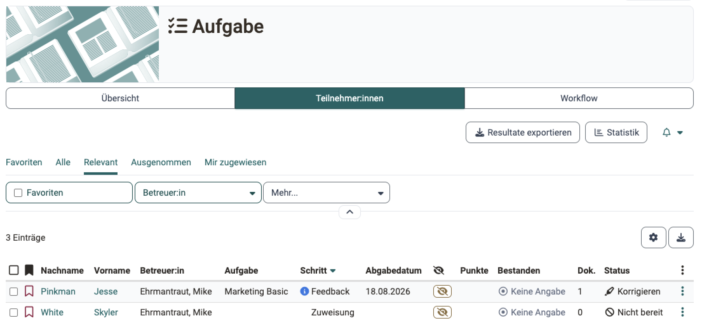
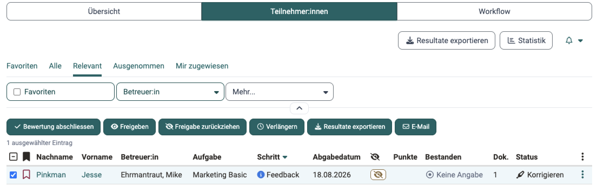
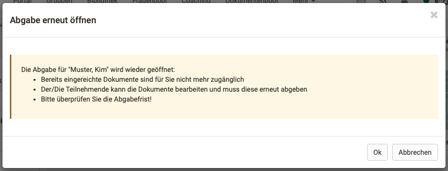

# Aufgabe betreuen {: #coach_task}

Diese Seite richtet sich an Betreuer:innen. Sie beschreibt, wie Sie im [Kursbaustein "Aufgabe"](index.de.md) den Stand aller Teilnehmenden überblicken, die Zuweisung der Aufgaben und die Abgaben kontrollieren und eine Abgabe erneut öffnen. Wie Sie ein Peer-Review betreuen, beschreibt die Seite [Aufgabe mit Peer-Review](Task_Peer_Review.de.md), wie Sie Abgaben bewerten, die Seite [Aufgaben bewerten](../Assess_tasks.de.md).

Sie arbeiten bei geschlossenem Kurseditor direkt im Kursbaustein. Der Tab "Teilnehmer:innen" listet die Teilnehmenden mit dem Schritt, in dem sie sich befinden: 
`Kurs > "Titel des Kursbausteins" > Tab "Teilnehmer:innen"`

Aufgaben bewerten und Abgaben herunterladen können Sie auch im Bewertungswerkzeug des Kurses, siehe [Aufgaben und Gruppenaufgaben bewerten](../Assessing_tasks_and_group_tasks.de.md).

!!! note "Quick Links: Aufgabe betreuen"

    * [Tab "Teilnehmer:innen"](#coach_overview)
    * [Zuweisung der Aufgaben kontrollieren](#coach_task_peer_review_check_assingment)
    * [Abgabe kontrollieren](#coach_task_peer_review_check_delivery)
    * [Abgabe erneut öffnen und Feedback-Dokumente ändern](#coach_task_reopen_submission)
    * [Review durch Betreuer:in](Task_Peer_Review.de.md#coach_task_peer_review_by_coach)
    * [Regeln eines Peer-Reviews](Task_Peer_Review.de.md#coach_task_peer_review_rules)
    * [Peer-Review betreuen](Task_Peer_Review.de.md#coach_task_peer_review_supervise)
    * [Manuelle Zuweisung von Peer-Reviewer:innen](Task_Peer_Review.de.md#coach_task_peer_review_assign_manually)
    * [Automatische Zuweisung von Peer-Reviewer:innen](Task_Peer_Review.de.md#coach_task_peer_review_assign_automatically)
    * [Peer-Reviews abschliessen](Task_Peer_Review.de.md#coach_task_peer_review_close)
    * [Betreuer:in nimmt an Peer-Review teil](Task_Peer_Review.de.md#coach_task_peer_review_reviewer_participates)
    * [Rubrik-Bewertung durch Betreuer:innen](Task_Peer_Review.de.md#coach_task_peer_review_expert)
    * [Bewertung der Aufgabe](Task_Peer_Review.de.md#coach_task_peer_review_evaluate)

## Tab "Teilnehmer:innen" {: #coach_overview}

Im Tab "Teilnehmer:innen" sehen Sie auf einen Blick, in welchem Schritt jede Person steht und wo eine Aktion von Ihnen nötig ist. Von hier aus öffnen Sie eine einzelne Person oder bearbeiten mehrere Personen auf einmal.

Neben "Teilnehmer:innen" zeigt der Kursbaustein immer den Tab "Übersicht", beim Kursbaustein "Aufgabe" zusätzlich den Tab "Workflow". Je nach Konfiguration kommen weitere Tabs dazu:

* **Verwalten**: wenn im [Tab "Workflow"](Task_Setup.de.md#workflow) des Kurseditors die Aufgabenstellung oder die Musterlösung eingeschaltet ist. Kursbesitzer:innen sehen den Tab dann immer, Betreuer:innen nur mit der Option "Betreuer:innen können Dokumente hinzufügen und bearbeiten" unter ["Dokumente Konfiguration"](Task_Setup.de.md#workflow_documents_configuration).
* **Erinnerungen**, im Lernpfadkurs "Erinnerungen & To-dos": für Kursbesitzer:innen. Hier richten sie Erinnerungen zu diesem Kursbaustein ein.
* **Badges**: wenn im Kurs Badges vergeben werden.

Reiter über der Liste grenzen die Personen ein. "Favoriten" zeigt die Personen, die Sie als Favoriten markiert haben, "Alle" zeigt alle. Im Lernpfadkurs blendet "Relevant" die Personen aus, die vom Kursbaustein ausgenommen sind, und "Ausgenommen" zeigt genau diese. In herkömmlichen Kursen erscheint "Relevant", sobald Einträge "Aus Teilnehmer:innenansicht" vorliegen, und blendet diese aus. Ist die [Zuweisung Betreuende/Teilnehmende](Task_Setup.de.md#workflow_coaching) eingeschaltet, zeigt "Mir zugewiesen" die Personen, die Sie betreuen.

{ class="shadow lightbox" title="Tab Teilnehmer:innen in der Kursansicht" }

Beim [Kursbaustein "Gruppenaufgabe"](../Course_Element_Grouptask.de.md#tab_assessment) listet der Tab "Teilnehmer:innen" Gruppen statt Personen, mit den Spalten "Schritt" und "Abgabedatum".

### Spalten {: #coach_overview_columns}

Die Spalte "Schritt" zeigt, in welchem Schritt des Workflows eine Person steht. Wer noch keine Aufgabe hat, steht im Schritt "Zuweisung". Das Symbol :o_icon_o_icon_info: vor dem Schritt zeigt, dass eine Aktion von Ihnen nötig ist: in den Schritten "Feedback", "Korrektur", "Peer-Review" und "Bewertung". Ob im Schritt "Lösung" eine Bewertung nötig ist, hängt von der Konfiguration der Aufgabe ab. Erfasste Punkte allein schliessen die Bewertung nicht ab: Der Schritt "Bewertung" bleibt stehen, bis Sie die Bewertung abschliessen, bei eingeschalteter Musterlösung der Schritt "Lösung". Danach zeigt die Spalte "Bewertet".

Die Spalte "Abgabedatum" zeigt, wann eine Person abgegeben hat. Ging die Abgabe nach der Abgabefrist ein, steht daneben "Verspätet", ging sie innerhalb einer verlängerten Frist ein, "Verlängert". Wurde die Abgabe ohne Dokumente abgeschlossen, zum Beispiel nach Ablauf der Abgabefrist, zeigt die Spalte "Nicht abgegeben".

Ist im Tab "Workflow" die Zuweisung Betreuende/Teilnehmende eingeschaltet, zeigt die Spalte "Betreuer:in", wer eine Person betreut. Die Zuordnung selbst nehmen Kursbesitzer:innen über die [Tabelle "Zuweisung Betreuende/Teilnehmende"](Task_Setup.de.md#coach_assignment_table) vor.

Weitere Spalten wie "Punkte", "Bestanden" und "Status" blenden Sie über :o_icon_o_icon_customize: ein oder aus.

### Aktionen {: #coach_overview_actions}

Mit Klick auf eine Person öffnen Sie ihren Workflow. Dort laden Sie je nach Konfiguration der Aufgabe Feedback-Dokumente hoch und vergeben Punkte, siehe [Aufgaben bewerten](../Assess_tasks.de.md#assess_in_course). Über :o_icon_o_icon_actions: am Ende der Zeile erreichen Sie für eine einzelne Person "Details anzeigen / bewerten" und, sobald für die Aufgabe eine Frist gilt, "Verlängern". Kursbesitzer:innen ordnen dort mit "Betreuer:in zuordnen" eine betreuende Person zu.

Um mehrere Personen auf einmal zu bearbeiten, wählen Sie die Zeilen aus. Über der Liste erscheinen dann die Aktionen, die zur Konfiguration der Aufgabe passen:

* **Bewertung abschliessen**: schliesst die Bewertung der gewählten Personen ab.
* **Freigeben** und **Freigabe zurückziehen**: machen die Bewertung für die gewählten Personen sichtbar oder verbergen sie wieder. Betreuer:innen sehen beide Aktionen, wenn Kursbesitzer:innen ihnen im [Abschnitt Berechtigungen](../Course_Settings_Assessment/index.de.md#section_assessment_rights) "Bewertung freigeben" erlauben.
* **Verlängern**: verschiebt die Fristen der gewählten Personen. Die Aktion steht bei festen Fristen bereit. Bei einem [relativen Datum](Task_Setup.de.md#workflow_relative_dates) verlängern Sie je Person über :o_icon_o_icon_actions:.
* **Resultate exportieren**: lädt die Dokumente der gewählten Personen als ZIP-Datei herunter.
* **E-Mail**: schreibt den gewählten Personen eine E-Mail.

{ class="shadow lightbox" title="Aktionsleiste im Tab Teilnehmer:innen" }

Alle Abgaben auf einmal laden Sie mit dem Button "Resultate exportieren" oberhalb der Reiter herunter. Die ZIP-Datei enthält je Person einen Unterordner, benannt nach Nachname, Vorname und Benutzername. Dazu kommt ein Excel-Report: Er führt für jeden eingeschalteten Schritt des Workflows eine eigene Datumsspalte, also genau für die Schritte, welche die Spalte "Schritt" anzeigt. Ist die Zuweisung Betreuende/Teilnehmende eingeschaltet, nennt der Report zudem die zugewiesene betreuende Person. Die einzelnen Spalten sind unter [Excel-Report der Resultate](../Assessing_tasks_and_group_tasks.de.md#results_export) beschrieben. Der Button "Statistik" daneben öffnet die Statistik des Kursbausteins.

Wie Teilnehmende die Aufgabe bearbeiten, beschreibt die Seite [Aufgabe bearbeiten (Teilnehmende)](Task_Participants.de.md).

!!! tip "Tipp"

    Sind Sie im Kurs gleichzeitig als Kursbesitzer:in oder Betreuer:in und als Teilnehmer:in eingetragen, wechseln Sie die Rolle und sehen die Aufgabe aus Sicht der Teilnehmenden.

[zum Seitenanfang ^](#coach_task)

## Zuweisung der Aufgaben kontrollieren {: #coach_task_peer_review_check_assingment}

Bis zur Frist "Zuweisung bis …" wählen die Teilnehmenden eine Aufgabe, oder OpenOlat weist ihnen eine zu. Prüfen Sie vor Ablauf der Frist, ob alle eine Aufgabe haben, dann bleibt Zeit zum Nachfassen. Folgende Fragen helfen dabei:

* Hat OpenOlat die Aufgaben automatisch zugewiesen?
* Haben alle Teilnehmer:innen eine Aufgabe gezogen?
* Wer hat welche Aufgabe gezogen, und braucht eine Zuordnung eine Korrektur? Wie eine Person eine falsch gewählte Aufgabe zurücksetzt, beschreibt der [Tab "Aufgabenstellung"](Task_Setup.de.md#assignment).
* Wer hat noch keine Aufgabe gezogen, und weshalb? Diese Personen stehen in der Spalte "Schritt" im Schritt "Zuweisung". Wählen Sie sie in der Liste aus und schreiben Sie ihnen mit "E-Mail". Nach Ablauf der Frist erhält die Person keine Aufgabe mehr, auch nicht automatisch, und Betreuer:innen können ihr keine Aufgabe zuweisen. Mit "Verlängern" geben Sie ihr mehr Zeit für die Wahl.

[zum Seitenanfang ^](#coach_task)

## Abgabe kontrollieren {: #coach_task_peer_review_check_delivery}

Rund um die Abgabefrist prüfen Sie, ob die Abgaben vollständig und rechtzeitig eingegangen sind, und greifen bei Bedarf ein:

* Ist die Abgabe innerhalb der Abgabefrist eingegangen?
* Ist eine Abgabe verspätet eingegangen?
* Gibt es einen Grund für eine individuelle Verlängerung? Mit "Verlängern" verschieben Sie die Fristen einer Person für die Zuweisung, die Abgabe, die Überarbeitung und das Peer-Review sowie den Zeitpunkt der Musterlösung. Der Dialog zeigt ein Feld nur für die eingeschalteten Schritte, für die eine Frist eingetragen ist; das Feld "Überarbeitung bis…" erscheint, sobald die Überarbeitung eingeschaltet ist. Verlängern Sie das Abgabedatum, öffnet OpenOlat die Abgabe neu.
* Haben Teilnehmer:innen aus Versehen abgegeben oder etwas vergessen, öffnen Sie die Abgabe mit "Abgabe erneut öffnen" wieder, siehe [Abgabe erneut öffnen und Feedback-Dokumente ändern](#coach_task_reopen_submission).
* Müssen Sie die Abgabe vorzeitig einziehen, zum Beispiel bei einem Betrugsversuch? Dafür steht "Dokument(e) einziehen" bereit.
* Läuft die Abgabefrist noch, und sollen Sie die Dokumente von Hand einziehen? Ist eine Abgabefrist gesetzt, zieht OpenOlat nach ihrem Ablauf die Dokumente automatisch ein, wenn eine Person nicht selbst abgegeben hat.

!!! note "Hinweis"

    Eine Verlängerung richten auch Betreuer:innen ein. Die Abgabefrist selbst legen nur Kursbesitzer:innen im [Tab "Workflow"](Task_Setup.de.md#workflow_submission) fest.

!!! note "Hinweis"

    In Kursen ohne festes Ende passt eine einheitliche Abgabefrist selten. Mit einem [relativen Datum](Task_Setup.de.md#workflow_relative_dates) gilt die Frist für jede Person ab ihrem ersten Kursbesuch oder ab ihrer Einschreibung. Eine Alternative kann in diesem Fall ein Zertifikat mit Rezertifizierung sein.

### Abgabe erneut öffnen und Feedback-Dokumente ändern {: #coach_task_reopen_submission}

Eine Person hat aus Versehen abgegeben, oder Sie möchten bei einer abgeschlossenen Aufgabe die Feedback-Dokumente im Schritt "Rückgabe und Feedback" ändern. In beiden Fällen öffnen Sie die Abgabe der Person wieder.

"Abgabe erneut öffnen" steht bereit, solange die Abgabefrist der Person läuft oder keine Abgabefrist gesetzt ist. Ist die Frist abgelaufen, setzen Sie zuerst mit "Verlängern" eine neue Abgabefrist für die Person. Liegt sie in der Zukunft, öffnet OpenOlat die Abgabe beim Speichern selbst wieder, und die Schritte 2 und 3 entfallen.

1. Klicken Sie im Tab "Teilnehmer:innen" auf die Person.
2. Klicken Sie im Schritt "Abgabe" auf "Abgabe erneut öffnen".
3. Bestätigen Sie die Meldung mit "Ok". Die eingereichten Dokumente sind danach für Sie nicht mehr zugänglich, die Person kann sie bearbeiten und muss sie erneut abgeben. Hat die Person aus Versehen abgegeben, sind Sie hier fertig.

    { class="shadow lightbox aside-right-sm" }

4. Um Feedback-Dokumente zu ändern, klicken Sie im Schritt "Abgabe" auf "Dokument(e) einziehen" und bestätigen die Meldung. Die Dokumente der Person stehen Ihnen wieder zur Verfügung, und die Aufgabe geht in den Schritt "Rückgabe und Feedback".
5. Bearbeiten, ersetzen, ergänzen oder löschen Sie im Schritt "Rückgabe und Feedback" die Feedback-Dokumente.

Mit "Dokument(e) einziehen" ist die Abgabe wieder geschlossen. Eine verlängerte Abgabefrist bleibt für die Person eingetragen; mit "Verlängern" setzen Sie sie bei Bedarf auf den ursprünglichen Wert zurück.

!!! warning "Achtung"

    Zwischen dem erneuten Öffnen und dem Einziehen kann die Person ihre Dokumente bearbeiten und abgeben. Soll sie das nicht, sperren Sie in einem herkömmlichen Kurs den Kursbaustein vorher mit der Option "Für Teilnehmende gesperrt": `Kurs > Administration > Kurseditor > "Titel des Kursbausteins" > Tab "Sichtbarkeit"`. Die Sperre gilt für alle Teilnehmenden; heben Sie sie nach dem Ändern wieder auf. Den [Tab "Sichtbarkeit"](../General_Configuration_of_Course_Elements.de.md#access) gibt es nur in herkömmlichen Kursen, im Lernpfadkurs ziehen Sie die Dokumente gleich nach dem erneuten Öffnen ein.

[zum Seitenanfang ^](#coach_task)

## Weiterführende Informationen {: #further_information}

**Auf dieser Seite erwähnt** 
[Kursbaustein "Aufgabe" >](index.de.md) 
[Aufgabe mit Peer-Review >](Task_Peer_Review.de.md) 
[Aufgaben bewerten >](../Assess_tasks.de.md) 
[Aufgaben und Gruppenaufgaben bewerten >](../Assessing_tasks_and_group_tasks.de.md) 
[Aufgabe einrichten >](Task_Setup.de.md) 
[Kursbaustein "Gruppenaufgabe" >](../Course_Element_Grouptask.de.md) 
[Kurseinstellungen - Tab Bewertung >](../Course_Settings_Assessment/index.de.md) 
[Aufgabe bearbeiten (Teilnehmende) >](Task_Participants.de.md) 
[Kursbausteine im Kurseditor >](../General_Configuration_of_Course_Elements.de.md)

**Weiterführend** 
[Bewertungswerkzeug - Übersicht >](../Assessment_tool_overview/index.de.md) 
[Kursbausteine im Überblick >](../Course_Elements/index.de.md)

[Zum Seitenanfang ^](#coach_task)
