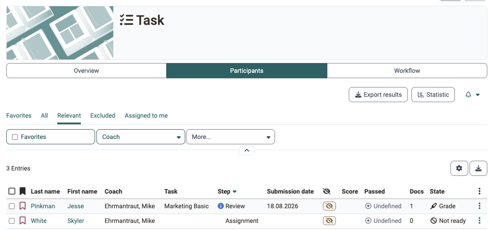
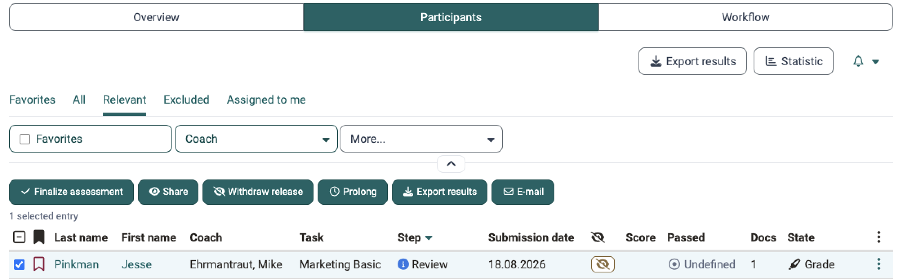
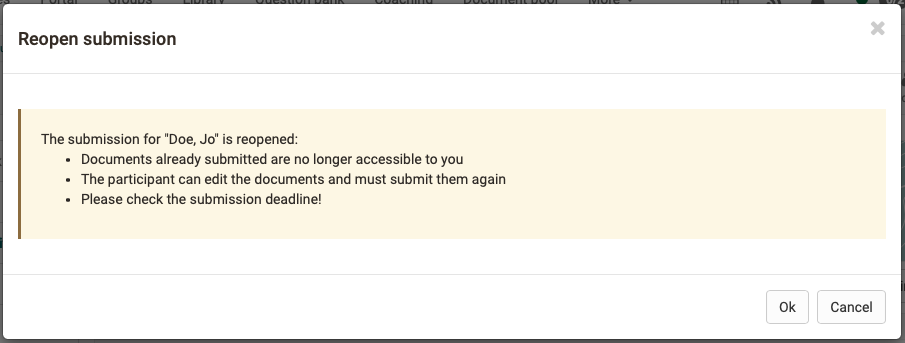

# Supervise a task {: #coach_task}

This page is intended for coaches. It describes how you keep track of all participants in the [course element "Task"](index.md), check the assignment of tasks and the submissions, and reopen a submission. How you supervise a peer review is described on the page [Task with peer review](Task_Peer_Review.md), how you assess submissions on the page [Assess tasks](../Assess_tasks.md).

You work directly in the course element with the course editor closed. The tab "Participants" lists the participants with the step they are in: 
`Course > "Title of the course element" > Tab "Participants"`

You can also assess tasks and download submissions in the assessment tool of the course, see [Assessing tasks and group tasks](../Assessing_tasks_and_group_tasks.md).

!!! note "Quick links: Supervise a task"

    * [Tab "Participants"](#coach_overview)
    * [Check assignment of tasks](#coach_task_peer_review_check_assingment)
    * [Check submission](#coach_task_peer_review_check_delivery)
    * [Reopen submission and change feedback documents](#coach_task_reopen_submission)
    * [Review by coach](Task_Peer_Review.md#coach_task_peer_review_by_coach)
    * [Rules of a peer review](Task_Peer_Review.md#coach_task_peer_review_rules)
    * [Supervise peer review](Task_Peer_Review.md#coach_task_peer_review_supervise)
    * [Manual assignment of peer reviewers](Task_Peer_Review.md#coach_task_peer_review_assign_manually)
    * [Automatic assignment of peer reviewers](Task_Peer_Review.md#coach_task_peer_review_assign_automatically)
    * [Close peer review](Task_Peer_Review.md#coach_task_peer_review_close)
    * [Coach participates in peer review](Task_Peer_Review.md#coach_task_peer_review_reviewer_participates)
    * [Rubric assessment by coaches](Task_Peer_Review.md#coach_task_peer_review_expert)
    * [Task assessment](Task_Peer_Review.md#coach_task_peer_review_evaluate)

## Tab "Participants" {: #coach_overview}

In the tab "Participants" you see at a glance which step each person is in and where an action of yours is required. From here you open a single person or process several persons at once.

Besides "Participants", the course element always shows the tab "Overview", and for the course element "Task" also the tab "Workflow". Depending on the configuration, further tabs are added:

* **Edit tasks and sample solutions**: if the task assignment or the sample solution is switched on in the [tab "Workflow"](Task_Setup.md#workflow) of the course editor. Course owners then always see the tab, coaches only with the option "Coaches can add and edit documents" under ["Documents configuration"](Task_Setup.md#workflow_documents_configuration).
* **Reminders**, in the learning path course "Reminders & to-dos": for course owners. Here they set up reminders for this course element.
* **Badges**: if badges are awarded in the course.

Tabs above the list narrow down the persons. "Favorites" shows the persons you have marked as favorites, "All" shows everyone. In the learning path course, "Relevant" hides the persons who are excluded from the course element, and "Excluded" shows exactly these. In conventional courses, "Relevant" appears as soon as entries "From participant view" exist, and hides them. If the [assignment coaches/participants](Task_Setup.md#workflow_coaching) is switched on, "Assigned to me" shows the persons you coach.

{ class="shadow lightbox" title="Participants tab in the course view" }

For the [course element "Group task"](../Course_Element_Grouptask.md#tab_assessment), the tab "Participants" lists groups instead of persons, with the columns "Step" and "Submission date".

### Columns {: #coach_overview_columns}

The column "Step" shows which step of the workflow a person is in. Anyone who does not have a task yet is in the step "Assignment". The symbol :o_icon_o_icon_info: in front of the step shows that an action of yours is required: in the steps "Review", "Correction", "Peer review" and "Grading". Whether an assessment is required in the step "Solution" depends on the configuration of the task. Entered points alone do not finalize the assessment: the step "Grading" remains until you finalize the assessment, with the sample solution switched on the step "Solution". After that, the column shows "Graded".

The column "Submission date" shows when a person submitted. If the submission arrived after the submission deadline, "Late" appears next to it; if it arrived within an extended deadline, "Extended". If the submission was closed without documents, for example after the submission deadline expired, the column shows "No submission".

If the assignment coaches/participants is switched on in the tab "Workflow", the column "Coach" shows who coaches a person. Course owners make the assignment itself in the [table "Assignment coaches/participants"](Task_Setup.md#coach_assignment_table).

You show or hide further columns such as "Points", "Passed" and "Status" via :o_icon_o_icon_customize:.

### Actions {: #coach_overview_actions}

Clicking on a person opens their workflow. There, depending on the configuration of the task, you upload feedback documents and assign points, see [Assess tasks](../Assess_tasks.md#assess_in_course). Via :o_icon_o_icon_actions: at the end of the row you reach "Show details / assess" for a single person and, as soon as a deadline applies to the task, "Extend". Course owners assign a coach there with "Assign coach".

To process several persons at once, select the rows. The actions that match the configuration of the task then appear above the list:

* **Finalize assessment**: finalizes the assessment of the selected persons.
* **Release** and **Withdraw release**: make the assessment visible to the selected persons or hide it again. Coaches see both actions if course owners allow them "release assessment" in the [section User rights](../Course_Settings_Assessment/index.md#section_assessment_rights).
* **Extend**: moves the deadlines of the selected persons. The action is available with fixed deadlines. With a [relative date](Task_Setup.md#workflow_relative_dates), you extend per person via :o_icon_o_icon_actions:.
* **Export results**: downloads the documents of the selected persons as a ZIP file.
* **E-Mail**: writes an e-mail to the selected persons.

{ class="shadow lightbox" title="Action bar in the Participants tab" }

You download all submissions at once with the button "Export results" above the tabs. The ZIP file contains a subfolder per person, named after last name, first name and username. It also contains an Excel report: it carries a separate date column for every switched-on step of the workflow, that is exactly for the steps that the column "Step" shows. If the assignment coaches/participants is switched on, the report also names the assigned coach. The individual columns are described under [Excel report of the results](../Assessing_tasks_and_group_tasks.md#results_export). The button "Statistic" next to it opens the statistics of the course element.

How participants work on the task is described on the page [Work on a task (participants)](Task_Participants.md).

!!! tip "Tip"

    If you are registered in the course as a course owner or coach and also as a participant, you switch the role and see the task from the participants' point of view.

[To the top of the page ^](#coach_task)

## Check assignment of tasks {: #coach_task_peer_review_check_assingment}

Until the "Assignment deadline", participants choose a task, or OpenOlat assigns one to them. Check before the deadline expires whether everyone has a task, so that there is time to follow up. The following questions help:

* Has OpenOlat assigned the tasks automatically?
* Have all participants drawn a task?
* Who drew which task, and does an assignment need a correction? How a person resets a wrongly chosen task is described in the [tab "Assignment"](Task_Setup.md#assignment).
* Who has not yet drawn a task, and why? These persons are in the step "Assignment" in the column "Step". Select them in the list and write to them with "E-Mail". After the deadline the person no longer receives a task, not even automatically, and coaches cannot assign a task to them. With "Extend" you give them more time for the choice.

[To the top of the page ^](#coach_task)

## Check submission {: #coach_task_peer_review_check_delivery}

Around the submission deadline you check whether the submissions have arrived completely and on time, and intervene if necessary:

* Did the submission arrive within the submission deadline?
* Did a submission arrive late?
* Is there a reason for an individual extension? With "Extend" you move the deadlines of a person for the assignment, the submission, the revision and the peer review as well as the date of the sample solution. The dialog shows a field only for the switched-on steps that have a deadline; the field "Revision until…" appears as soon as the revision is switched on. If you extend the submission date, OpenOlat reopens the submission.
* If participants have accidentally submitted or forgotten something, you reopen the submission with "Reopen submission", see [Reopen submission and change feedback documents](#coach_task_reopen_submission).
* Do you have to collect the submission early, for example in the event of attempted fraud? For this, "Collect document(s)" is available.
* Is the submission deadline still running, and should you collect the documents manually? If a submission deadline is set, OpenOlat collects the documents automatically after it expires if a person has not submitted them.

!!! note "Note"

    Coaches can also set up an extension. Only course owners define the submission deadline itself, in the [tab "Workflow"](Task_Setup.md#workflow_submission).

!!! note "Note"

    In courses without a fixed end, a uniform submission deadline rarely fits. With a [relative date](Task_Setup.md#workflow_relative_dates), the deadline applies to each person from their first course visit or from their enrolment. An alternative in this case may be a certificate with recertification.

### Reopen submission and change feedback documents {: #coach_task_reopen_submission}

A person has submitted by accident, or you want to change the feedback documents in the step "Return and feedback" of a completed task. In both cases you reopen the submission of the person.

"Reopen submission" is available as long as the submission deadline of the person is running or no submission deadline is set. If the deadline has expired, first set a new submission deadline for the person with "Extend". If it lies in the future, OpenOlat reopens the submission itself when saving, and steps 2 and 3 are not needed.

1. In the tab "Participants", click on the person.
2. In the step "Task submission", click on "Reopen submission".
3. Confirm the message with "Ok". The submitted documents are then no longer accessible to you, the person can edit them and must submit them again. If the person submitted by accident, you are done here.

    { class="shadow lightbox aside-right-sm" }

4. To change feedback documents, click on "Collect document(s)" in the step "Task submission" and confirm the message. The documents of the person are available to you again, and the task moves to the step "Return and feedback".
5. In the step "Return and feedback", edit, replace, add or delete the feedback documents.

With "Collect document(s)" the submission is closed again. An extended submission deadline remains set for the person; with "Extend" you set it back to the original value if required.

!!! warning "Attention"

    Between reopening and collecting, the person can edit and submit their documents. If they should not, block the course element beforehand in a conventional course with the option "Blocked for learners": `Course > Administration > Course editor > "Title of the course element" > Tab "Visibility"`. The block applies to all participants; remove it again after the change. The [tab "Visibility"](../General_Configuration_of_Course_Elements.md#access) only exists in conventional courses, in the learning path course you collect the documents right after reopening.

[To the top of the page ^](#coach_task)

## Further information {: #further_information}

**Mentioned on this page** 
[Course Element "Task" >](index.md) 
[Task with peer review >](Task_Peer_Review.md) 
[Assess tasks >](../Assess_tasks.md) 
[Assessing tasks and group tasks >](../Assessing_tasks_and_group_tasks.md) 
[Set up a task >](Task_Setup.md) 
[Course Element "Group Task" >](../Course_Element_Grouptask.md) 
[Course Settings - Tab Assessment >](../Course_Settings_Assessment/index.md) 
[Work on a task (participants) >](Task_Participants.md) 
[Course elements in the Course editor >](../General_Configuration_of_Course_Elements.md)

**Further reading** 
[Assessment tool - overview >](../Assessment_tool_overview/index.md) 
[Course elements at a glance >](../Course_Elements/index.md)

[To the top of the page ^](#coach_task)
