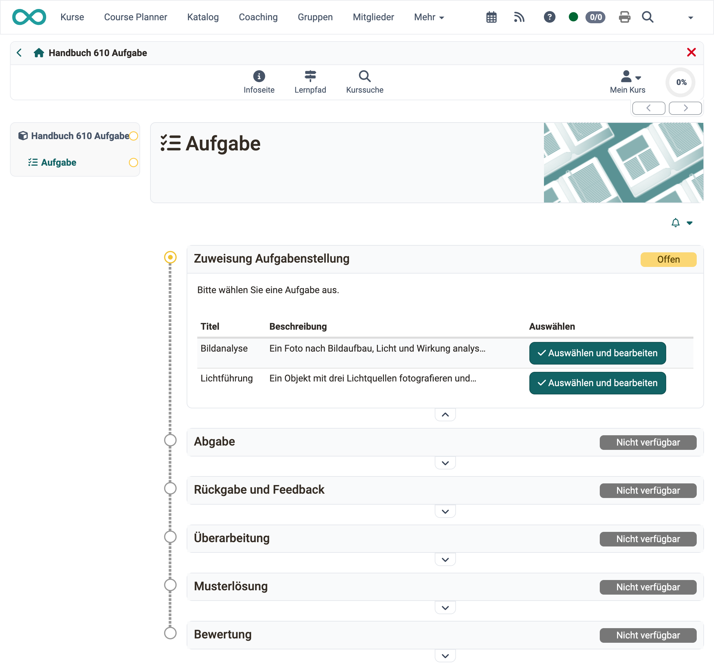
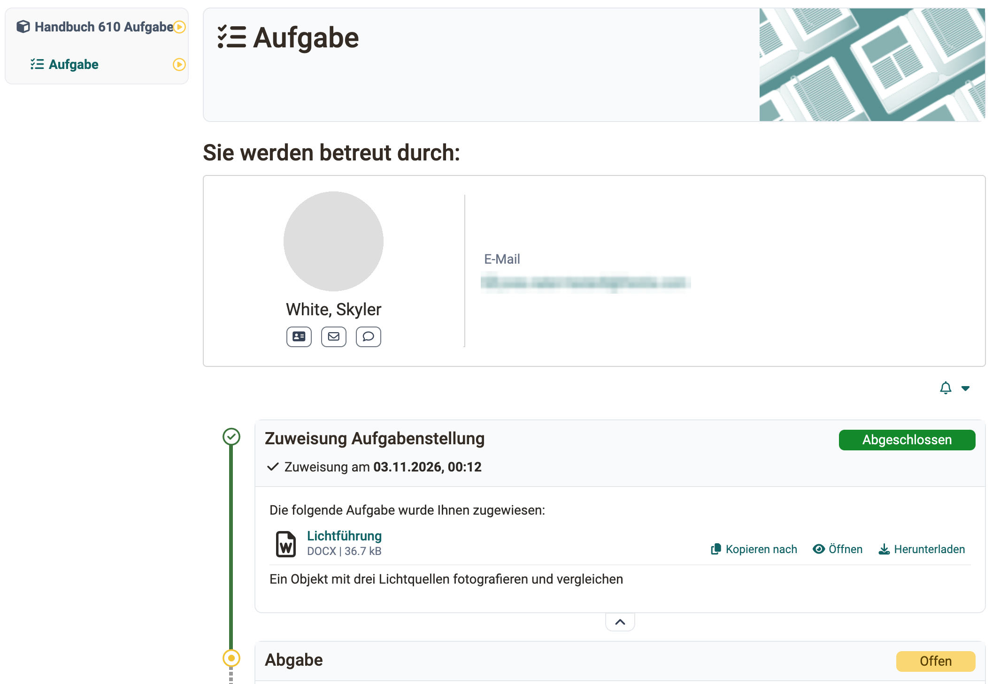
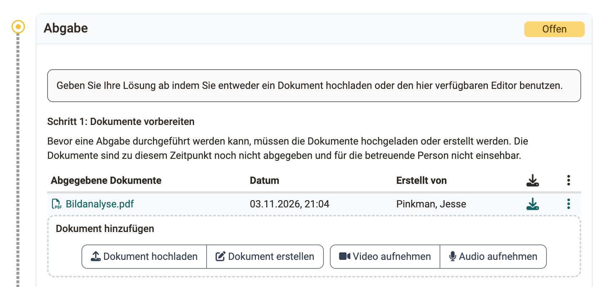
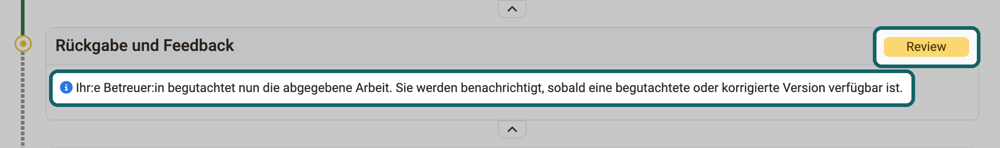
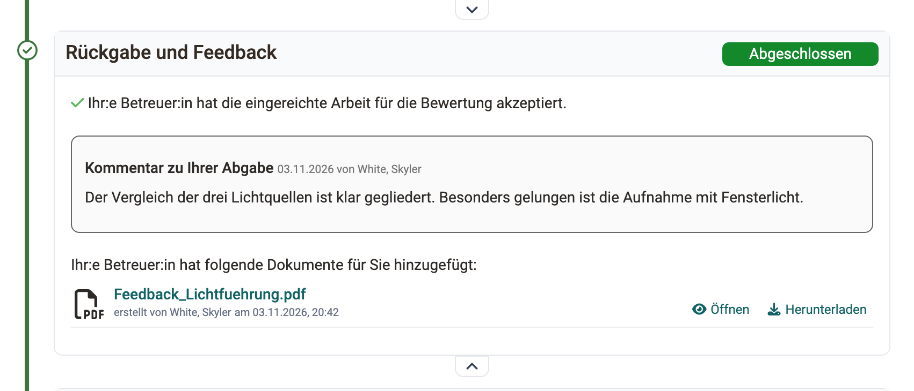
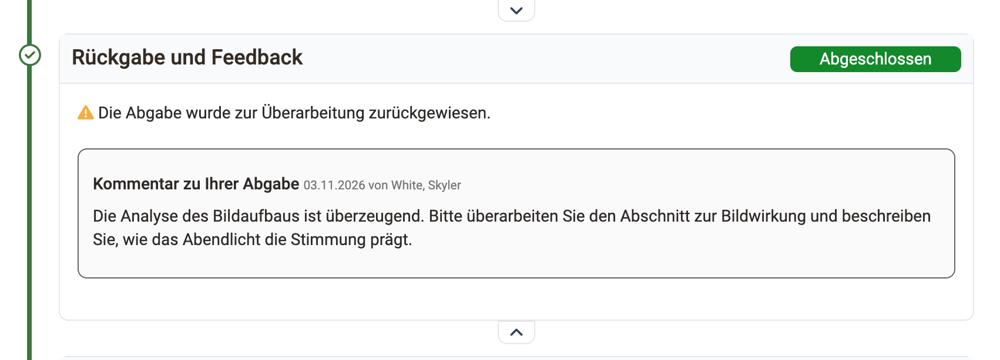
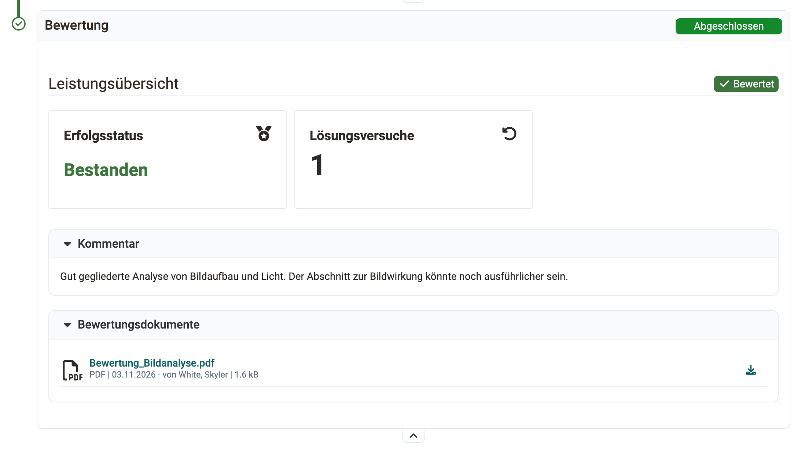

# Aufgabe bearbeiten (Teilnehmende) {: #process_task}

Diese Seite richtet sich an Kursteilnehmer:innen. Sie beschreibt die Schritte, mit denen Sie eine Aufgabe im [Kursbaustein "Aufgabe"](index.de.md) bearbeiten und abgeben. Wie Sie im Peer-Review die Abgaben anderer Teilnehmender beurteilen, beschreibt die Seite [Aufgabe mit Peer-Review](Task_Peer_Review.de.md).

Im Kursbaustein sehen Sie alle Schritte der Aufgabe (Workflow) untereinander, je nach Konfiguration des Kursbausteins. Sobald Sie einen Schritt erledigt haben, öffnet sich der nächste.

{ class="shadow lightbox" title="Kursbaustein Aufgabe, Sicht der Teilnehmenden · 2026.11.03" }

!!! note "Quick Links: Aufgabe bearbeiten"

    * [Zugewiesene Aufgabe herunterladen](#process_task_download)
    * [Von wem werde ich betreut?](#process_task_my_coach)
    * [Lösung abgeben](#process_task_solution)
    * [Rückgabe und Feedback](#process_task_feedback)
    * [Peer-Review durchführen](Task_Peer_Review.de.md#process_task_make_reviews)
    * [Ergebnisse des Peer-Reviews ansehen](Task_Peer_Review.de.md#process_task_view_reviews)
    * [Aufgabe überarbeiten](#process_task_rework)
    * [Musterlösung betrachten](#process_task_view_example)
    * ["Bewertung" der betreuenden Person lesen](#process_task_view_coach_assessment)

!!! tip "Tipp"

    Abonnieren Sie den Kursbaustein, dann informiert Sie OpenOlat per E-Mail über Änderungen. Die Benachrichtigung erreicht Sie, sobald eine Aktion abgeschlossen ist, nicht bei jedem Zwischenschritt. Wollen Sie die Einreichungen aller bewertbaren Kursbausteine im Blick behalten, abonnieren Sie stattdessen das [Bewertungswerkzeug](../Assessment_tool_overview/index.de.md).

## Zugewiesene Aufgabe herunterladen {: #process_task_download}

Je nach Konfiguration stehen im Schritt "Zuweisung Aufgabenstellung" eine oder mehrere Aufgaben zur Auswahl, oder Ihnen wird eine Aufgabe automatisch zugewiesen. Wenn bei mehreren Aufgaben der Titel der Aufgabendatei verlinkt ist, können Sie die Aufgabenstellung vor der Auswahl ansehen. Wenn Sie nur die Schaltfläche "Auswählen" haben, können Sie die Aufgabe nicht im Vorfeld ansehen. Ist die Aufgabe Vorlage für die Abgabe, heisst die Schaltfläche "Auswählen und bearbeiten". Bei automatischer Zuweisung erhalten Sie die Aufgabe, sobald Sie den Kursbaustein vor Ablauf der Frist öffnen.

Wenn Sie eine Aufgabe gewählt haben oder Ihnen eine Aufgabe automatisch zugewiesen wurde, klicken Sie auf "Aufgabe herunterladen", um die Aufgabenstellung herunterzuladen oder anzuzeigen. Klicken Sie auf den Dateinamen der Aufgabenstellung, zeigt OpenOlat die Aufgabe an. Die Aufgabe können Sie dann jederzeit wiederholt herunterladen.

HTML-Dateien, ob Aufgabenstellung, abgegebenes Dokument oder Musterlösung, öffnen sich in einer Lightbox, und Skripte darin laufen nur, wenn eine [Inhaltsdomäne](../../basic_concepts/Content_Domain.de.md) (separate Adresse für Inhalte) eingerichtet ist. [:octicons-tag-16:{ title="ab Release 21.0 (OO-7554)" }](https://track.frentix.com/issue/OO-7554)

Es ist auch möglich, dass Ihre Lehrperson die Aufgabenstellung nicht in dem Kursbaustein "Aufgabe" hinterlegt hat, sondern einen anderen Ort, z.B. einen anderen Kursbaustein, eine HTML-Seite oder eine externe Webseite, gewählt hat oder die Aufgabenstellung mündlich in Präsenz oder in einem Online-Meeting gestellt hat. In diesem Fall erscheint der Abschnitt "Zuweisung Aufgabenstellung" nicht.

[zum Seitenanfang ^](#process_task)

## Von wem werde ich betreut? [:octicons-tag-16:{ title="ab Release 17.2.1 (OO-6698)" }](https://track.frentix.com/issue/OO-6698) {: #process_task_my_coach}

In Kursen mit sehr vielen Teilnehmenden betreuen häufig mehrere Lehrpersonen die Aufgabe. Ist die Zuweisung Betreuende/Teilnehmende aktiviert, ist Ihnen als Teilnehmer:in eine betreuende Person zugewiesen.

Sie sehen die Ihnen zugewiesene betreuende Person oberhalb der Aufgabe. Wird keine betreuende Person angezeigt, wurde Ihnen noch niemand zugeteilt.

{ class="shadow lightbox" title="Kursbaustein Aufgabe, Sicht der Teilnehmenden · 2026.11.03" }

Ist für die Aufgabe ein Peer-Review eingerichtet, geben sich die Teilnehmenden gegenseitig Feedback zu ihren Abgaben, siehe [Aufgabe mit Peer-Review](Task_Peer_Review.de.md).

[zum Seitenanfang ^](#process_task)

## Lösung abgeben {: #process_task_solution}

Im Schritt "Abgabe" reichen Sie Ihre Lösung ein. Je nach Konfiguration laden Sie Dokumente hoch, erstellen Dateien mit dem OpenOlat Editor oder nehmen kurze Audio- und Video-Aufnahmen direkt in OpenOlat auf.

{ class="shadow lightbox" title="Schritt Abgabe, Sicht der Teilnehmenden · 2026.11.03" }

In der Regel stehen Ihnen nur einige dieser vier Wege zur Verfügung. Laden Sie Ihre Lösung hoch oder erstellen Sie sie direkt in OpenOlat, dann speichert OpenOlat das Dokument zwischen. Die Dokumente bleiben für Sie bearbeitbar, bis Sie Ihre Aufgabe mit der Schaltfläche "Endgültige Abgabe" einreichen. Sie erhalten eine Bestätigung, dass Sie Dokumente abgegeben haben.

Danach markiert ein grünes Häkchen den Schritt "Abgabe" als erledigt, und er zeigt eine Übersicht über die abgegebenen Dateien. Sie können die Dateien noch ansehen, aber nicht mehr ändern.

[zum Seitenanfang ^](#process_task)

## Rückgabe und Feedback {: #process_task_feedback}

Solange Sie noch _nichts_ eingereicht haben und keine Rückmeldung der betreuenden Person vorliegt, ist dieser Bereich leer.

Haben Sie eine Lösung eingereicht und die betreuende Person hat noch keine Rückmeldung erstellt, trägt der Schritt "Rückgabe und Feedback" den Status "Review". Darunter steht der Hinweis "Ihr:e Betreuer:in begutachtet nun die abgegebene Arbeit. Sie werden benachrichtigt, sobald eine begutachtete oder korrigierte Version verfügbar ist."

{ class="shadow lightbox" title="Schritt Rückgabe und Feedback, Sicht der Teilnehmenden · 2026.11.06" }

Sobald die betreuende Person ein Feedback erstellt hat, finden Sie es im Schritt "Rückgabe und Feedback". Hat sie Ihre Abgabe akzeptiert, meldet der Schritt "Ihr:e Betreuer:in hat die eingereichte Arbeit für die Bewertung akzeptiert.".

{ class="shadow lightbox" title="Schritt Rückgabe und Feedback, Sicht der Teilnehmenden · 2026.11.03" }

Reicht Ihre Lösung nicht aus und fordert die betreuende Person eine Überarbeitung ein, erscheint die Meldung "Die Abgabe wurde zur Überarbeitung zurückgewiesen.". Sie können dann im Schritt "Überarbeitung" eine neue Fassung einreichen, je nach Einstellung bis zu einer Frist.

{ class="shadow lightbox" title="Schritt Rückgabe und Feedback, Sicht der Teilnehmenden · 2026.11.03" }

[zum Seitenanfang ^](#process_task)

## Aufgabe überarbeiten {: #process_task_rework}

Müssen Sie Ihre Lösung überarbeiten, gehen Sie wie unter [Lösung abgeben](#process_task_solution) beschrieben vor. Im Schritt "Überarbeitung" kann die betreuende Person Ihnen Ihre Arbeit auch mehrfach zur Korrektur zurückgeben.

Sobald die betreuende Person die Aufgabe als gelöst ansieht, schliesst sie die Überarbeitung ab. Sie sehen jederzeit, welche Dokumente Sie und Ihre betreuende Person abgegeben haben, und können diese öffnen.

[zum Seitenanfang ^](#process_task)

## Musterlösung betrachten {: #process_task_view_example}

Ihre Lehrperson kann der Aufgabe eine Musterlösung anfügen, die ab einem festgelegten Zeitpunkt sichtbar wird. Je nach Einstellung sehen Sie sie erst, _nachdem_ Ihre Lösung akzeptiert wurde, oder auch ohne eigene Abgabe. Klicken Sie auf den Dateinamen oder den Button "Musterlösungen herunterladen", um die Musterlösung anzuschauen oder herunterzuladen.

[zum Seitenanfang ^](#process_task)

## "Bewertung" der betreuenden Person lesen {: #process_task_view_coach_assessment}

Der Schritt "Bewertung" zeigt die Leistungsübersicht mit Status, Punktestand und Einstufung der gewählten Bewertungsskala, je nach Konfiguration des Kursbausteins. Darunter stehen der Kommentar und die Bewertungsdokumente, die die betreuende Person hinterlegt hat.

{ class="shadow lightbox" title="Schritt Bewertung, Sicht der Teilnehmenden · 2026.11.03" }

[zum Seitenanfang ^](#process_task)

## Weiterführende Informationen {: #further_information}

[Kursbaustein "Aufgabe" >](index.de.md) 
[Aufgabe mit Peer-Review >](Task_Peer_Review.de.md) 
[Bewertungswerkzeug - Übersicht >](../Assessment_tool_overview/index.de.md) 
[Inhaltsdomäne >](../../basic_concepts/Content_Domain.de.md) 
[Ordnerkonzept >](../../basic_concepts/Folder_Concept.de.md) 
[Aufgabe einrichten >](Task_Setup.de.md) 
[Aufgabe betreuen >](Task_Coaching.de.md)

[Zum Seitenanfang ^](#process_task)
