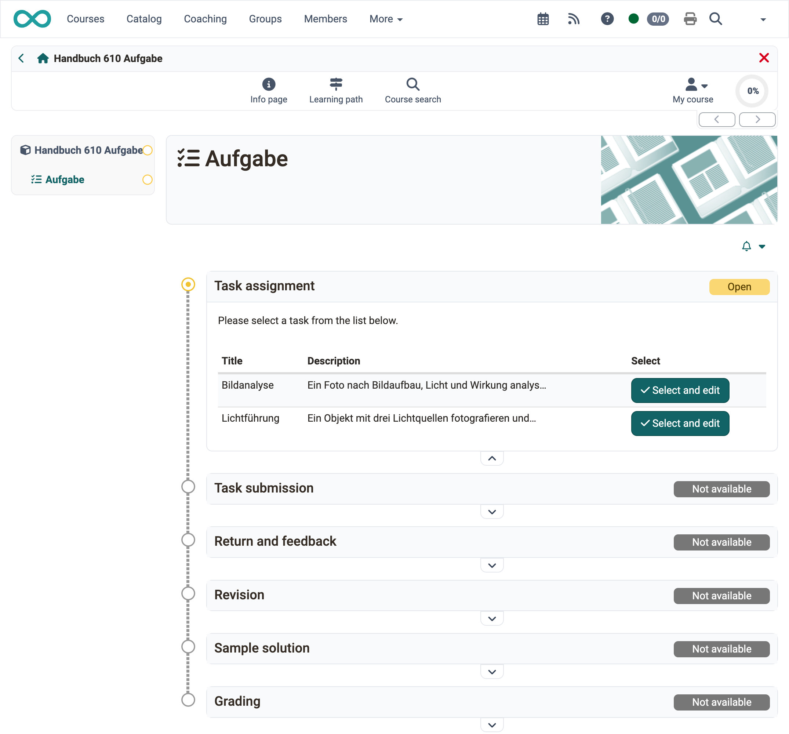
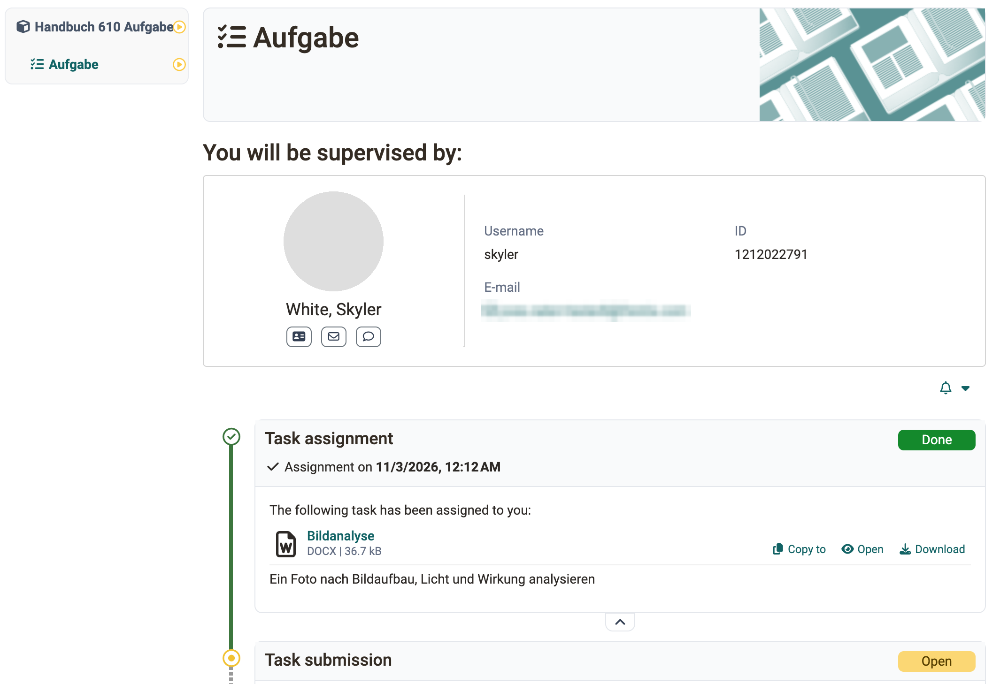
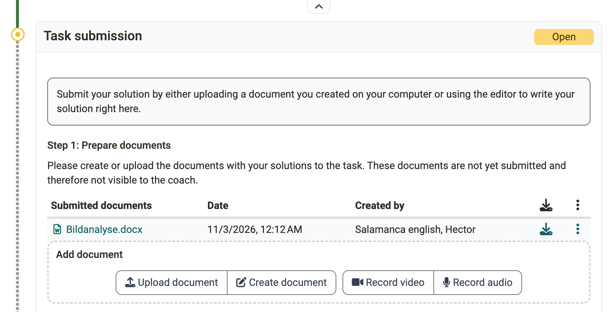
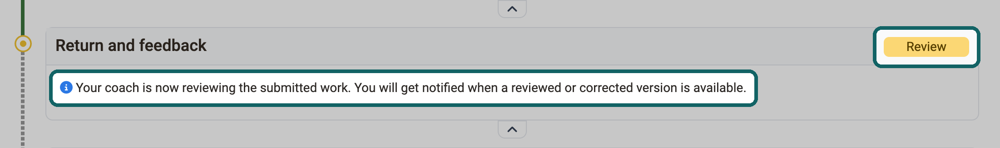
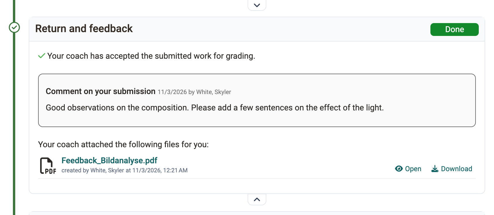
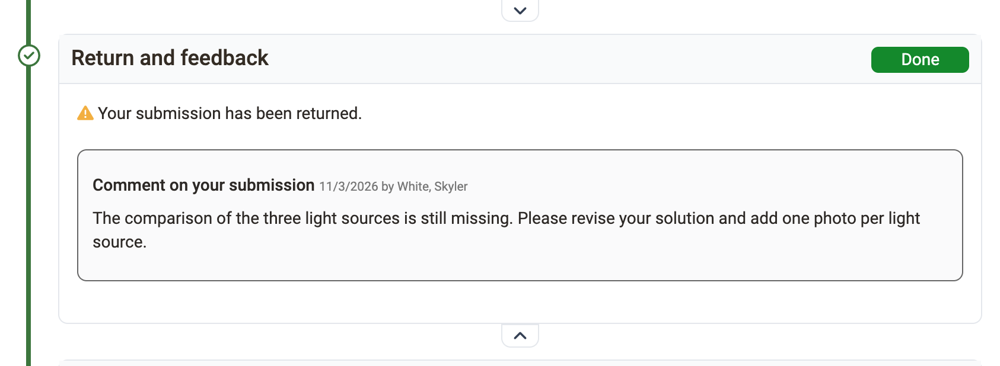
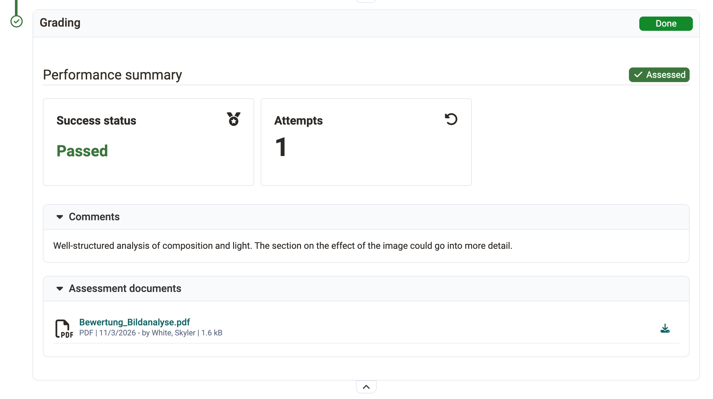

# Work on a task (participants) {: #process_task}

This page is intended for course participants. It describes the steps with which you work on and submit a task in the [course element "Task"](index.md). How you assess the submissions of other participants in a peer review is described on the page [Task with peer review](Task_Peer_Review.md).

In the course element you see all steps of the task (workflow) one below the other, depending on the configuration of the course element. As soon as you have completed a step, the next one opens.

{ class="shadow lightbox" title="Course element Task, participants' view · 2026.11.03" }

!!! note "Quick Links: Work on a task"

    * [Download assigned tasks](#process_task_download)
    * [Who coaches me?](#process_task_my_coach)
    * [Submit solution](#process_task_solution)
    * [Return and feedback](#process_task_feedback)
    * [Carry out a peer review](Task_Peer_Review.md#process_task_make_reviews)
    * [View results of a peer review](Task_Peer_Review.md#process_task_view_reviews)
    * [Rework task](#process_task_rework)
    * [View sample solution](#process_task_view_example)
    * [Read "Grading" of the coach](#process_task_view_coach_assessment)

!!! tip "Tip"

    Subscribe to the course element, then OpenOlat informs you by e-mail about changes. The notification reaches you as soon as an action has been completed, not at every intermediate step. If you want to keep track of the submissions of all assessable course elements, subscribe to the [assessment tool](../Assessment_tool_overview/index.md) instead.

## Download assigned tasks {: #process_task_download}

Depending on the configuration, one or more tasks are available for selection in the step "Task assignment", or a task is automatically assigned to you. If the title of the task file is linked for several tasks, you can view the task before selecting it. If you only have the "Select" button, you cannot view the task in advance. If the task is the template for the submission, the button is called "Select and edit". With automatic assignment you receive the task as soon as you open the course element before the deadline.

If you have selected a task or a task has been automatically assigned to you, click on "Download task" to download or display the task. If you click on the file name of the task, OpenOlat displays the task. You can then download the task again at any time.

HTML files, whether assignment, submitted document or sample solution, open in a lightbox, and scripts in them only run if a [content domain](../../basic_concepts/Folder_Concept.md#open_html) is set up. [:octicons-tag-16:{ title="from Release 21.0 (OO-7554)" }](https://track.frentix.com/issue/OO-7554)

It is also possible that your teacher has not stored the task in the course element "Task", but has chosen a different location, e.g. another course element, an HTML page, an external website or has set the task orally in presence or in an online meeting. In this case, the "Task assignment" section does not appear.

[To the top of the page ^](#process_task)

## Who coaches me? [:octicons-tag-16:{ title="from Release 17.2.1 (OO-6698)" }](https://track.frentix.com/issue/OO-6698) {: #process_task_my_coach}

In courses with a large number of participants, several teachers often coach the task. If the assignment of coaches and participants is activated, a coach is assigned to you as a participant.

You see the coach assigned to you above the task. If no coach is displayed, no one has been assigned to you yet.

{ class="shadow lightbox" title="Course element Task, participants' view · 2026.11.03" }

If a peer review is set up for the task, the participants give each other feedback on their submissions, see [Task with peer review](Task_Peer_Review.md).

[To the top of the page ^](#process_task)

## Submit solution {: #process_task_solution}

In the step "Task submission" you submit your solution. Depending on the configuration, you upload documents, create files with the OpenOlat editor or record short audio and video recordings directly in OpenOlat.

{ class="shadow lightbox" title="Step Task submission, participants' view · 2026.11.03" }

As a rule, only some of these four ways are available to you. Upload your solution or create it directly in OpenOlat, then OpenOlat saves the document temporarily. The documents remain editable for you until you submit your task with the button "Final task submission". You will receive confirmation that you have submitted documents.

Afterwards, a green tick marks the submission step as completed, and it shows an overview of the submitted files. You can still view the files, but no longer change them.

[To the top of the page ^](#process_task)

## Return and feedback {: #process_task_feedback}

As long as you have _not_ submitted anything yet and there is no feedback from the coach, this area is empty.

If you have submitted a solution and the coach has not yet created feedback, the step "Return and feedback" carries the status "Review". Below it is the note "Your coach is now reviewing the submitted work. You will get notified when a reviewed or corrected version is available."

{ class="shadow lightbox" title="Step Return and feedback, participants' view · 2026.11.06" }

As soon as the coach has created feedback, you find it in the step "Return and feedback". If the coach has accepted your submission, the step reports "Your coach has accepted the submitted work for grading.".

{ class="shadow lightbox" title="Step Return and feedback, participants' view · 2026.11.03" }

If your solution is not sufficient and the coach requests a revision, the message "Your submission has been returned." appears. You can then submit a new version in the step "Revision", depending on the setting up to a deadline.

{ class="shadow lightbox" title="Step Return and feedback, participants' view · 2026.11.03" }

[To the top of the page ^](#process_task)

## Rework task {: #process_task_rework}

If you have to revise your solution, proceed as described under [Submit solution](#process_task_solution). In the step "Revision", the coach may also return your work to you several times for correction.

As soon as the coach considers the task to be solved, they close the revision. At any time, you see which documents you and your coach have submitted, and you can open them.

[To the top of the page ^](#process_task)

## View sample solution {: #process_task_view_example}

Your teacher can attach a sample solution to the task, which becomes visible from a specified point in time. Depending on the setting, you only see it _after_ your solution has been accepted, or also without a submission of your own. Click on the file name or the button "Download sample solutions" to view or download the sample solution.

[To the top of the page ^](#process_task)

## Read "Grading" of the coach {: #process_task_view_coach_assessment}

The step "Grading" shows the performance summary with status, score and classification of the selected rating scale, depending on the configuration of the course element. Below it are the comment and the assessment documents that the coach has stored.

{ class="shadow lightbox" title="Step Grading, participants' view · 2026.11.03" }

[To the top of the page ^](#process_task)

## Further information {: #further_information}

[Course Element "Task" >](index.md) 
[Task with peer review >](Task_Peer_Review.md) 
[Assessment tool - overview >](../Assessment_tool_overview/index.md) 
[Folder concept >](../../basic_concepts/Folder_Concept.md) 
[Set up a task >](Task_Setup.md) 
[Supervise a task >](Task_Coaching.md)

[To the top of the page ^](#process_task)
