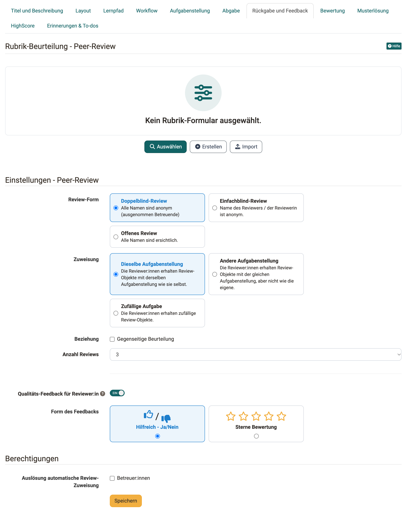
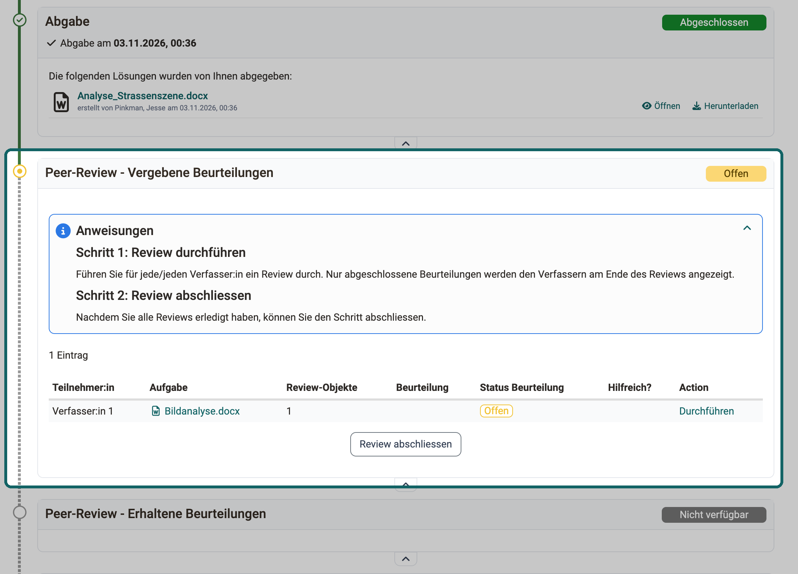
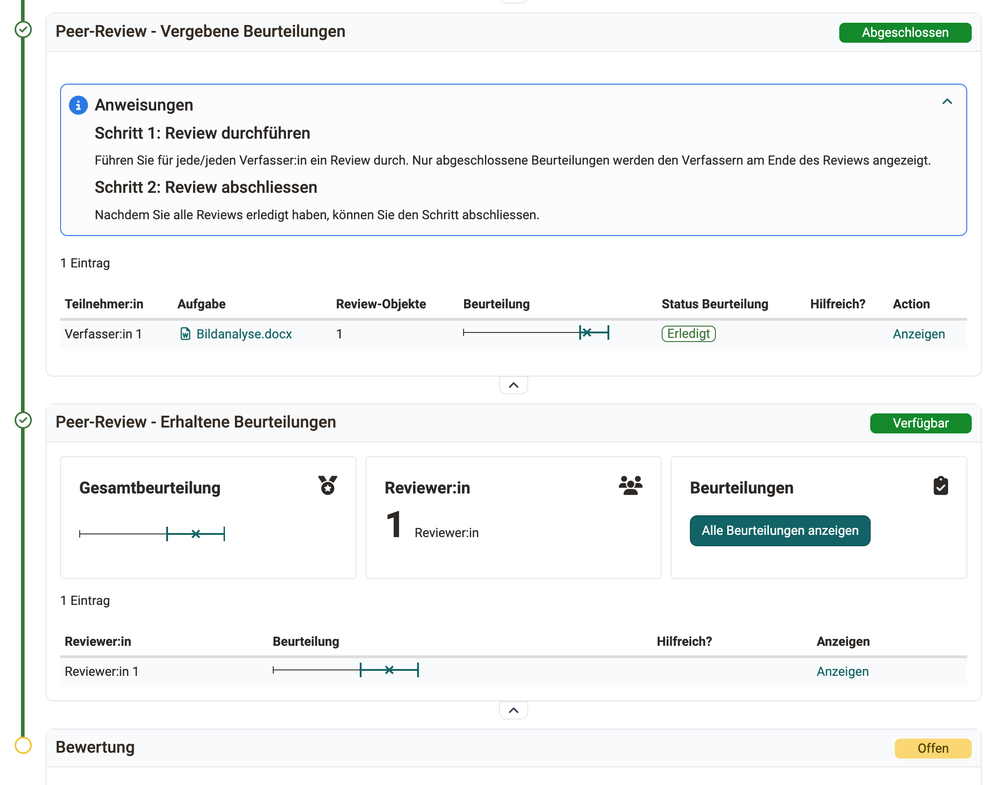
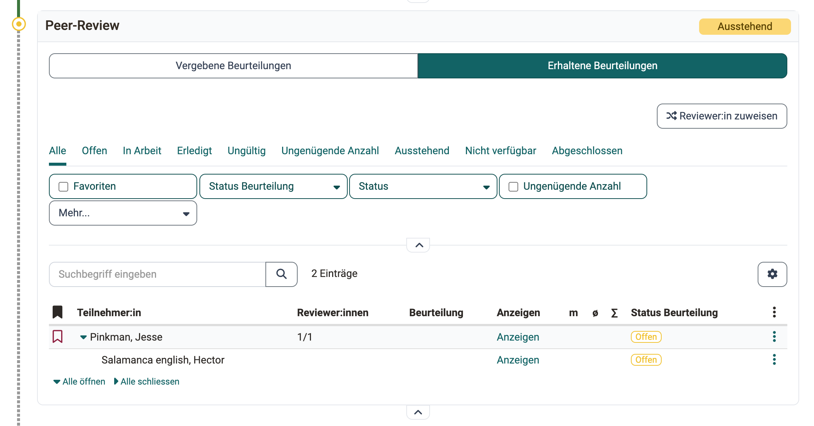
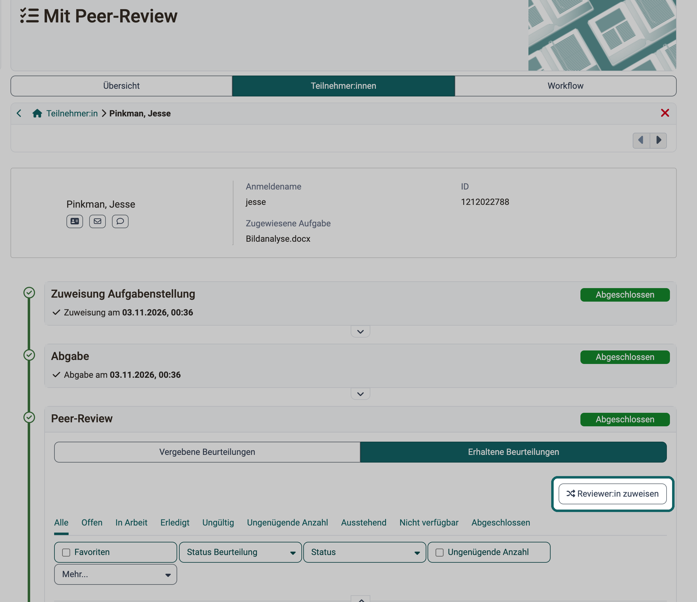
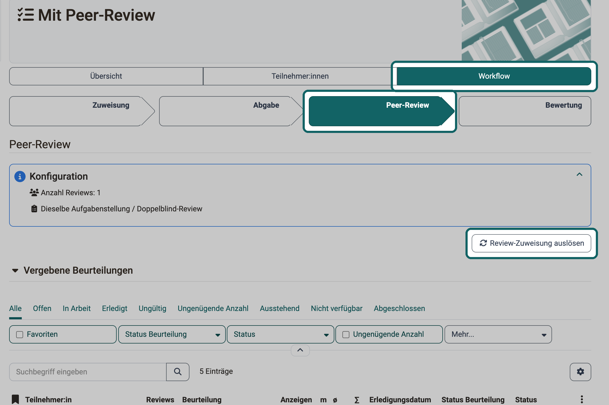

# Aufgabe mit Peer-Review {: #task_peer_review}

Beim Peer-Review beurteilen sich die Teilnehmenden einer Aufgabe gegenseitig. Diese Seite richtet sich an alle drei Rollen des [Kursbausteins "Aufgabe"](index.de.md): Kursbesitzer:innen richten das Peer-Review im Kurseditor ein, Teilnehmende führen die Reviews durch, und Betreuer:innen begleiten die Reviews und ergänzen sie mit eigenen Reviews oder einer Rubrik-Bewertung.

Das Peer-Review ist eine Art des Feedbacks. Kursbesitzer:innen wählen es im Tab "Workflow" unter "Feedback" mit der Option "Mit Peer-Review", siehe [Aufgabe einrichten](Task_Setup.de.md#workflow_feedback).

## Regeln eines Peer-Reviews [:octicons-tag-16:{ title="ab Release 19.0 (OO-7680)" }](https://track.frentix.com/issue/OO-7680) {: #coach_task_peer_review_rules}

Bei einem Peer-Review geben sich die Teilnehmer:innen eines Kurses gegenseitig ein Feedback oder eine Bewertung. Das Feedback kann allgemeiner Art sein, zum Beispiel in einem Textfeld, oder zusätzlich eine Bewertung mit Punkten umfassen.

Nicht jede Person muss die Abgaben aller anderen beurteilen. Kursbesitzer:innen legen fest, wie viele Reviews jede Person erledigt.

Ebenso legen sie fest, welche Namen sichtbar sind, vom Doppelblind-Review mit anonymen Namen bis zum offenen Review, siehe [Review-Form](#peer_review_form).

Als Betreuer:in überwachen Sie die gegenseitigen Reviews und greifen bei Bedarf ein.

[zum Seitenanfang ^](#task_peer_review)

## Einstellungen im Tab "Rückgabe und Feedback" {: #peer_review_settings}

Wurde im Tab "Workflow" die Option "Mit Peer-Review" gewählt, legen Sie im Tab "Rückgabe und Feedback" die Regeln fest, nach denen andere Teilnehmer:innen Feedback geben. Die Reviewer:innen geben ihr Feedback in einem [Formular](../Form_Element_Rubric.de.md), meist mit Hilfe einer Rubrik. Als Kursbesitzer:in geben Sie dieses Review-Formular vor.

Ist im Tab "Workflow" auch die Bewertung eingeschaltet und sollen die Punkte für das Peer-Review automatisch aus dem Formular übernommen werden, muss das Formular mindestens ein Rubrik-Element enthalten. Nur über ein Rubrik-Element vergibt OpenOlat automatisch Punkte.

{ class="shadow lightbox" title="Kurseditor, Kursbaustein Aufgabe, Tab Rückgabe und Feedback · 2026.11.02" }

### Rubrik-Beurteilung - Peer-Review {: #peer_review_rubric}

Für Peer-Reviews wird ein geeignetes Rubrik-Formular benötigt. Solange keines gewählt ist, zeigt der Bereich "Kein Rubrik-Formular ausgewählt.". Mit "Auswählen" übernehmen Sie ein bestehendes Formular, mit "Erstellen" legen Sie ein neues an, mit "Import" importieren Sie ein Formular. Hier finden Sie ein [Musterformular](../assets/Example_PeerReview_v1_de.zip) (zip-Datei zum Import in Ihr OpenOlat).

Betreuer:innen können dieses Formular zusätzlich selbst ausfüllen, mit "Eigenes Review erstellen". Unabhängig davon bewerten sie die Aufgabe mit der "Rubrik-Bewertung", wenn Kursbesitzer:innen diese im Tab "Bewertung" einschalten. Die Rubrik-Bewertung kann ein anderes Rubrik-Formular verwenden.

* Betreuer:innen können so zum Beispiel ein Review erstellen, wenn eine teilnehmende Person zu wenige Reviews erhalten hat.
* Ist ein Review als "nicht gültig" markiert, füllen Betreuer:innen bei Bedarf ein Formular als Ersatz aus.
* Das Formular der Rubrik-Bewertung kann andere Kriterien enthalten als das Formular des Peer-Reviews. Auch in diesem Fall ist es sinnvoll, wenn Betreuer:innen beide Formulare verwenden.

!!! info "Wichtig"

    Kursbesitzer:innen legen im Tab "Bewertung" unter "Gesamtpunkte aus" fest, welche Punkte zählen: "Rubrik-Bewertung", "Rubrik-Peer-Review", "Abgegebene Reviews" oder eine Kombination davon. Berücksichtigen Sie diese Einstellung beim Planen eines Peer-Reviews. Siehe auch [Wie führe ich ein Peer-Review durch? >](../../../manual_how-to/peer_review/peer_review.de.md)

**Weitere Informationen**

[Musterformular für Peer-Review (zip-Datei zum Import in Ihr OpenOlat) >](../assets/Example_PeerReview_v1_de.zip) 
[Wie erstelle ich eine Formular-Lernressource? >](../../../manual_how-to/create_a_form/create_a_form.de.md) 
[Wie führe ich ein Peer-Review durch? >](../../../manual_how-to/peer_review/peer_review.de.md)

Unter "Einstellungen - Peer-Review" legen Sie das Verfahren mit den folgenden Feldern fest.

### Review-Form {: #peer_review_form}

Hier legen Sie fest, welche Namen sichtbar sind: 
\- Doppelblind-Review: Alle Namen sind anonym (ausgenommen Betreuende). 
\- Einfachblind-Review: Der Name des Reviewers/der Reviewerin ist anonym. 
\- Offenes Review: Alle Namen sind ersichtlich.

### Zuweisung {: #peer_review_assignment}

Hier bestimmen Sie, welche Aufgabenstellungen die Reviewer:innen zum Review erhalten: 
\- **Dieselbe Aufgabenstellung**: Wenn eine Person z.B. Aufgabe 1 gezogen und bearbeitet hat, erhält sie auch nur Aufgabe 1 zum Review. Sie muss sich dann nicht in eine andere Thematik einarbeiten. 
\- **Andere Aufgabenstellung**: Das Review gilt einer anderen Aufgabenstellung als der, die man selbst gezogen hat. Sind mehrere Reviews zu erledigen, gelten sie alle derselben Aufgabenstellung. 
\- **Zufällige Aufgabe**: Die Reviewer:innen erhalten zufällige Aufgaben zum Review.

### Beziehung {: #peer_review_relationship}

Ist "Gegenseitige Beurteilung" gewählt, können sich Teilnehmer:innen gegenseitig beurteilen, müssen es aber nicht.

### Anzahl Reviews {: #peer_review_number}

Hier geben Sie an, wie viele Reviews für jede teilnehmende Person vorgesehen sind. Zur Wahl stehen 1 bis 5 Reviews, voreingestellt sind 3. Je nach Anzahl der Teilnehmer:innen kann die tatsächlich zu erledigende Zahl der Reviews abweichen. Im Idealfall entspricht die Anzahl der zu erledigenden Reviews der Anzahl Reviews, die man selbst von anderen erhält.

### Qualitäts-Feedback für Reviewer:in {: #peer_review_quality_feedback}

Hier geben Sie den Teilnehmer:innen die Möglichkeit, ihren Reviewer:innen nach dem Erhalt eines Reviews eine Rückmeldung zu geben. Ob das erhaltene Review hilfreich war, zeigen sie mit dem Daumensymbol oder mit Sternen an.

### Form des Feedbacks {: #peer_review_feedback_form}

Ist "Qualitäts-Feedback für Reviewer:in" eingeschaltet, erscheint dieses Feld. Wählen Sie, mit welchen Symbolen die Teilnehmer:innen den Reviewer:innen dieses Feedback geben: "Hilfreich - Ja/Nein" oder "Sterne Bewertung". Bewährt hat sich **"Hilfreich - Ja/Nein"** mit Daumen hoch und Daumen nach unten.

### Auslösung automatische Review-Zuweisung {: #peer_review_permissions}

Dieses Feld steht im Bereich "Berechtigungen". Autor:innen sehen alle Teilnehmer:innen eines Kurses, Betreuer:innen sehen aber eventuell nur ihre betreute Gruppe. 
Damit Betreuer:innen die Reviews der betreuten Teilnehmer:innen ansehen können, muss die Zuweisung von Reviews innerhalb ihrer Gruppen erfolgen. (Nur dann können Betreuer:innen alle Reviews mitverfolgen.) 
Wird die automatische Review-Zuweisung ausgelöst, sehen Betreuer:innen zwar jeweils nur ihre Gruppe, die Zuweisung von Review-Aufträgen erfolgt aber unter allen Teilnehmer:innen. Betreuer:innen sehen dann, dass eine betreute Person von jemand aus der anderen Gruppe ein Review erhalten hat. Der Name der Person, die das Review gemacht hat, ist aber nicht ersichtlich. 
Damit neben Kursbesitzer:innen auch Betreuer:innen die automatische Review-Zuweisung auslösen können, wählen Sie unter "Auslösung automatische Review-Zuweisung" die Option "Betreuer:innen".

[Zum Seitenanfang ^](#task_peer_review)

---

## Peer-Review durchführen {: #process_task_make_reviews}

Ist für die Aufgabe ein Peer-Review eingerichtet, erhalten Sie als Teilnehmer:in Review-Aufträge: Sie beurteilen die abgegebenen Dokumente anderer Kursmitglieder. Wessen Dokumente Sie beurteilen, legt OpenOlat automatisch fest, oder Betreuer:innen teilen sie Ihnen zu.

{ class="shadow lightbox" title="Kursbaustein Aufgabe, Sicht der Teilnehmenden · 2026.11.03" }

Haben Sie alle Reviews erledigt, schliessen Sie den Schritt mit dem Button "Review abschliessen" ab.

[zum Seitenanfang ^](#task_peer_review)

## Ergebnisse des Peer-Reviews ansehen {: #process_task_view_reviews}

In den Schritten "Peer-Review - Vergebene Beurteilungen" und "Peer-Review - Erhaltene Beurteilungen" sehen Sie als Teilnehmer:in, welche Beurteilungen Sie abgegeben und welche Sie erhalten haben.

{ class="shadow lightbox" title="Kursbaustein Aufgabe, Sicht der Teilnehmenden · 2026.11.03" }

[zum Seitenanfang ^](#task_peer_review)

---

## Peer-Review betreuen {: #coach_task_peer_review_supervise}

Kursbesitzer:innen legen den Ablauf des Peer-Reviews fest. Danach richten sich die Möglichkeiten, die Sie als Betreuer:in haben:

* Im Tab "Workflow" zeigt der Schritt "Peer-Review" den Stand aller Peer-Reviews, mit den Listen "Vergebene Beurteilungen" und "Erhaltene Beurteilungen".
* Im Tab "Teilnehmer:innen" öffnen Sie eine Person. Im Schritt "Peer-Review" zeigen die Reiter "Vergebene Beurteilungen" und "Erhaltene Beurteilungen" ihre Reviews mit Status.
* Sie weisen Reviewer:innen auch manuell zu, siehe [Manuelle Zuweisung von Peer-Reviewer:innen](#coach_task_peer_review_assign_manually).

{ class="shadow lightbox" title="Kursbaustein Aufgabe, Betreueransicht, Detailansicht einer Person · 2026.11.03" }

!!! note "Hinweis"

    Betreuer:innen sehen nur Gruppen, in denen sie selbst Mitglied sind. Reviewen Mitglieder anderer Gruppen, sind die Bewertungen dieser Teilnehmer:innen für Betreuer:innen nicht vollständig ersichtlich.

[zum Seitenanfang ^](#task_peer_review)

## Review durch Betreuer:in {: #coach_task_peer_review_by_coach}

Als Betreuer:in erstellen Sie ein eigenes Review, sobald eine Person abgegeben hat, auch schon vor Ablauf der Abgabefrist.

Der "Peer-Review-Zeitraum", den Kursbesitzer:innen im Tab "Workflow" setzen, gilt nicht für Betreuer:innen: Sie erstellen ein eigenes Review auch vor Beginn und nach Ende des Zeitraums. Dazu öffnen Sie die Person, im Schritt "Peer-Review" den Reiter "Erhaltene Beurteilungen" und in der Zeile der Person unter "Weitere Aktionen" den Eintrag "Eigenes Review erstellen".

[zum Seitenanfang ^](#task_peer_review)

## Manuelle Zuweisung von Peer-Reviewer:innen {: #coach_task_peer_review_assign_manually}

Wenn Sie als Betreuer:in bestimmen wollen, wer von wem ein Review erhält, ordnen Sie die Reviewer:innen selbst zu.

{ class="shadow lightbox" title="Kursbaustein Aufgabe, Betreueransicht, Tab Teilnehmer:innen · 2026.11.03" }

Im Reiter "Erhaltene Beurteilungen" heisst der Button "Reviewer:in zuweisen", im Reiter "Vergebene Beurteilungen" heisst er "Reviews zuweisen".

Eine manuelle Zuweisung ist auch in der Tabelle möglich. Klicken Sie dazu in der Zeile der Person auf das Drei-Punkte-Menü.

[zum Seitenanfang ^](#task_peer_review)

## Automatische Zuweisung von Peer-Reviewer:innen {: #coach_task_peer_review_assign_automatically}

OpenOlat ordnet Peer-Reviewer:innen auch automatisch zu, nach den eingestellten Regeln, zum Beispiel der Anzahl Reviews je Person. Manuelle Zuordnungen, die Betreuer:innen schon getroffen haben, berücksichtigt OpenOlat bei den übrigen Zuordnungen.

Die automatische Zuordnung lösen Kursbesitzer:innen oder Betreuer:innen im Tab "Workflow" mit dem Button "Review-Zuweisung auslösen" aus.

{ class="shadow lightbox" title="Kursbaustein Aufgabe, Betreueransicht, Tab Workflow · 2026.11.03" }

!!! info "Wichtig"

    Damit auch Betreuer:innen die automatische Review-Zuweisung auslösen können, müssen Kursbesitzer:innen im Tab "Rückgabe und Feedback" unter [Auslösung automatische Review-Zuweisung](#peer_review_permissions) die Option "Betreuer:innen" gewählt haben.

!!! info "Wichtig"

    Der Button "Review-Zuweisung auslösen" bleibt nach einer Zuweisung verfügbar, weil später noch Teilnehmende hinzukommen oder eine Verlängerung erhalten können.

[zum Seitenanfang ^](#task_peer_review)

## Peer-Reviews abschliessen {: #coach_task_peer_review_close}

Haben Teilnehmer:innen alle ihre Reviews erledigt, geben sie die Reviews mit "Review abschliessen" ab. Erst dann zählen sie. Beurteilt werden die anderen Teilnehmer:innen nur mit abgeschlossenen Reviews.

Ist der Peer-Review-Zeitraum abgelaufen, können Teilnehmer:innen keine Reviews mehr erstellen.

Haben Teilnehmer:innen Reviews begonnen, aber nicht abgeschlossen, können Betreuer:innen diese Reviews nicht einziehen. Der Grund: Betreuer:innen können nicht wissen, ob ein nicht abgeschlossenes Review bereits final sein sollte und welche Qualität es zum aktuellen Zeitpunkt hat.

Betreuer:innen können die Reviews nicht für alle abschliessen. Sie warten, bis der Peer-Review-Zeitraum abgelaufen ist.

Nach einem Peer-Review ist keine Überarbeitung mit einem zweiten Review möglich.

[zum Seitenanfang ^](#task_peer_review)

## Betreuer:in nimmt an Peer-Review teil {: #coach_task_peer_review_reviewer_participates}

Betreuer:innen können am Peer-Review teilnehmen wie Teilnehmer:innen. Sie verwenden dann dieselben Kriterien, und ihr Review zählt wie die Reviews der übrigen Teilnehmer:innen.

**Beispiel 1:** 
Eine Reviewerin fällt wegen Krankheit aus, und ein Betreuer springt als Reviewer ein. So erhalten alle die gleiche Anzahl Reviews.

**Beispiel 2:** 
Eine Betreuerin sieht, dass ein Reviewer ein Review falsch oder mangelhaft erstellt hat. Sie markiert dieses Review als ungültig und erstellt selbst ein Review, damit die beurteilte Person wieder gleich viele Reviews erhält.

**Beispiel 3:** 
Aus dem Peer-Review liegen zwei völlig gegensätzliche Reviews vor. Ein Betreuer ergänzt deshalb ein vermittelndes oder korrigierendes Review. Anders als bei der Rubrik-Bewertung verwendet er dabei dasselbe Bewertungsraster wie die Teilnehmer:innen.

[zum Seitenanfang ^](#task_peer_review)

## Rubrik-Bewertung durch Betreuer:innen [:octicons-tag-16:{ title="ab Release 19.0 (OO-7682)" }](https://track.frentix.com/issue/OO-7682) {: #coach_task_peer_review_expert}

Ist im Tab "Bewertung" die "Rubrik-Bewertung" eingeschaltet, bewerten Betreuer:innen die Aufgabe zusätzlich zum Peer-Review mit einem eigenen Rubrik-Formular.

Sie funktioniert wie beim [Kursbaustein "Bewertung"](../Course_Element_Assessment.de.md#rubrik-bewertung), mit einem hinterlegten [Rubrik-Formular](../Forms_in_Rubric_Scoring.de.md). Dieses Formular kann sich vom Formular der Peer-Reviewer:innen unterscheiden.

[zum Seitenanfang ^](#task_peer_review)

## Bewertung der Aufgabe {: #coach_task_peer_review_evaluate}

Die Ergebnisse eines Peer-Reviews müssen nicht in die Bewertung einfliessen, Reviews und Peer-Reviews ohne Bewertung sind ebenso möglich. Kursbesitzer:innen legen im Tab "Bewertung" unter ["Gesamtpunkte aus"](Task_Setup.de.md#grading) fest, welche Punkte zählen:

* "Rubrik-Bewertung": die Punkte aus der Rubrik-Bewertung durch Betreuer:innen,
* "Rubrik-Peer-Review": die Punkte aus den Peer-Reviews, welche die Person erhalten hat,
* "Abgegebene Reviews": Punkte für die Reviews, welche die Person selbst abgegeben hat.

Kombinationen sind möglich. Ist nur "Rubrik-Bewertung" gewählt, fliessen die Peer-Reviews nicht in die Bewertung ein.

[zum Seitenanfang ^](#task_peer_review)

## Weiterführende Informationen {: #further_information}

**Auf dieser Seite erwähnt** 
[Kursbaustein "Aufgabe" >](index.de.md) 
[Aufgabe einrichten >](Task_Setup.de.md) 
[Das Formular-Element Rubrik >](../Form_Element_Rubric.de.md) 
[Wie führe ich ein Peer-Review durch? >](../../../manual_how-to/peer_review/peer_review.de.md) 
[Wie erstelle ich eine Formular-Lernressource? >](../../../manual_how-to/create_a_form/create_a_form.de.md) 
[Kursbaustein "Bewertung" >](../Course_Element_Assessment.de.md) 
[Formular als Rubrik-Bewertung >](../Forms_in_Rubric_Scoring.de.md)

**Weiterführend** 
[Aufgabe bearbeiten (Teilnehmende) >](Task_Participants.de.md) 
[Aufgabe betreuen >](Task_Coaching.de.md)

[Zum Seitenanfang ^](#task_peer_review)
