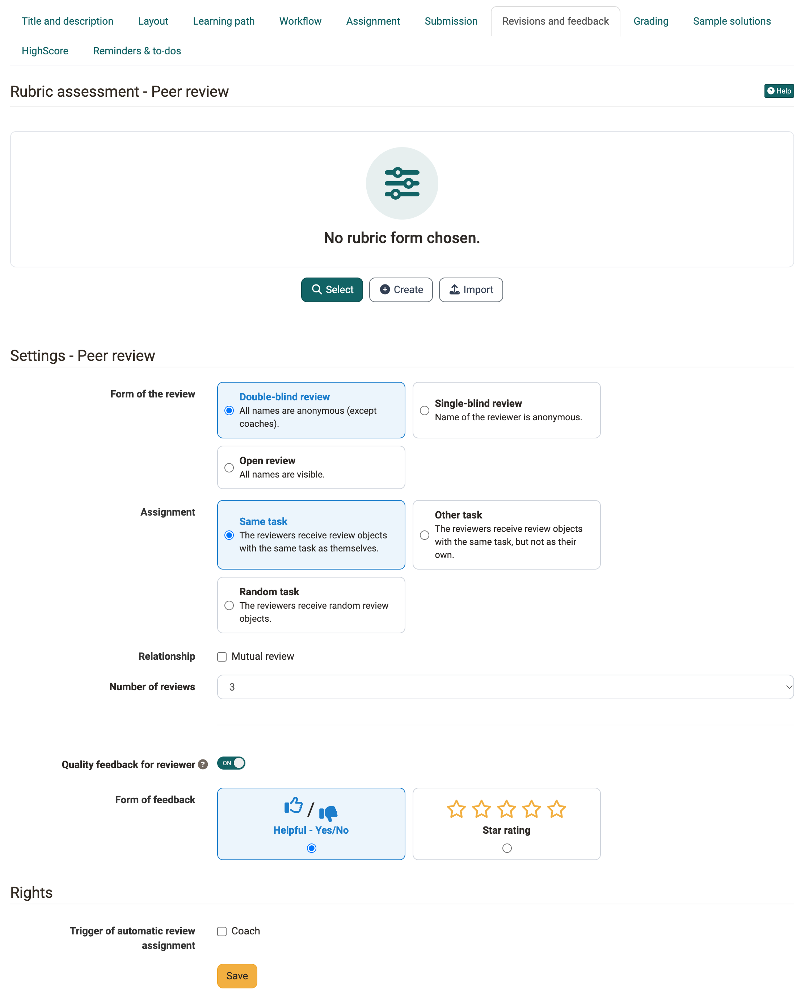
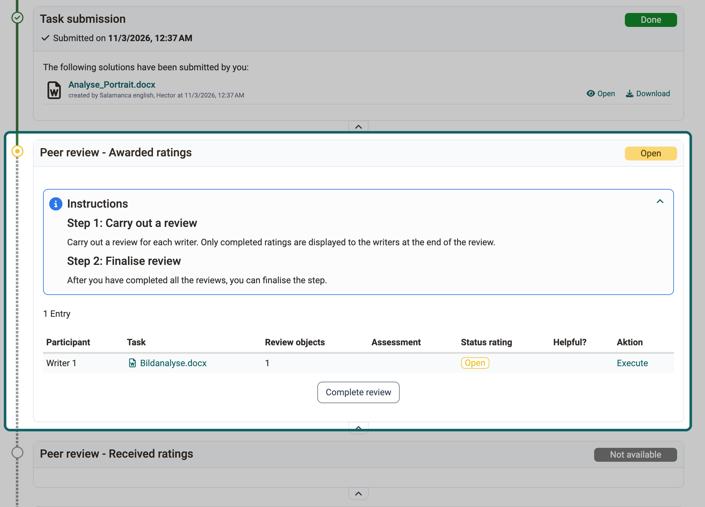
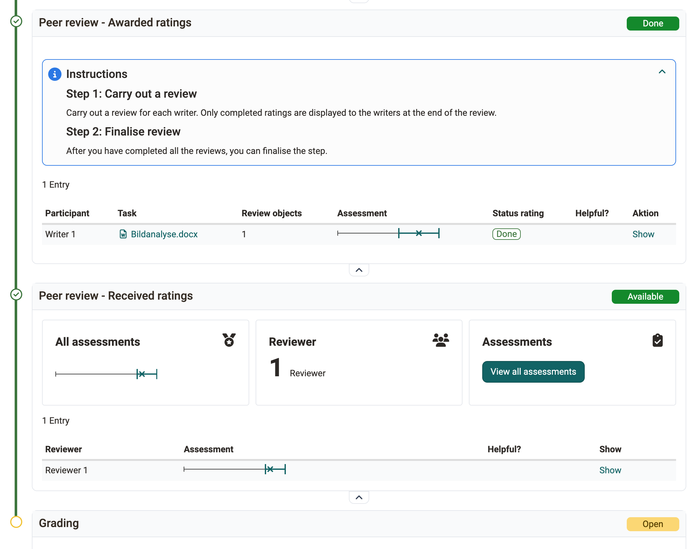
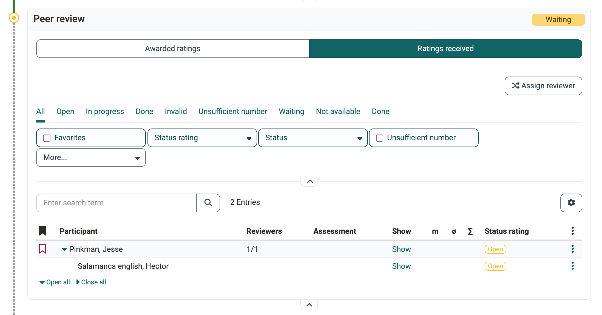
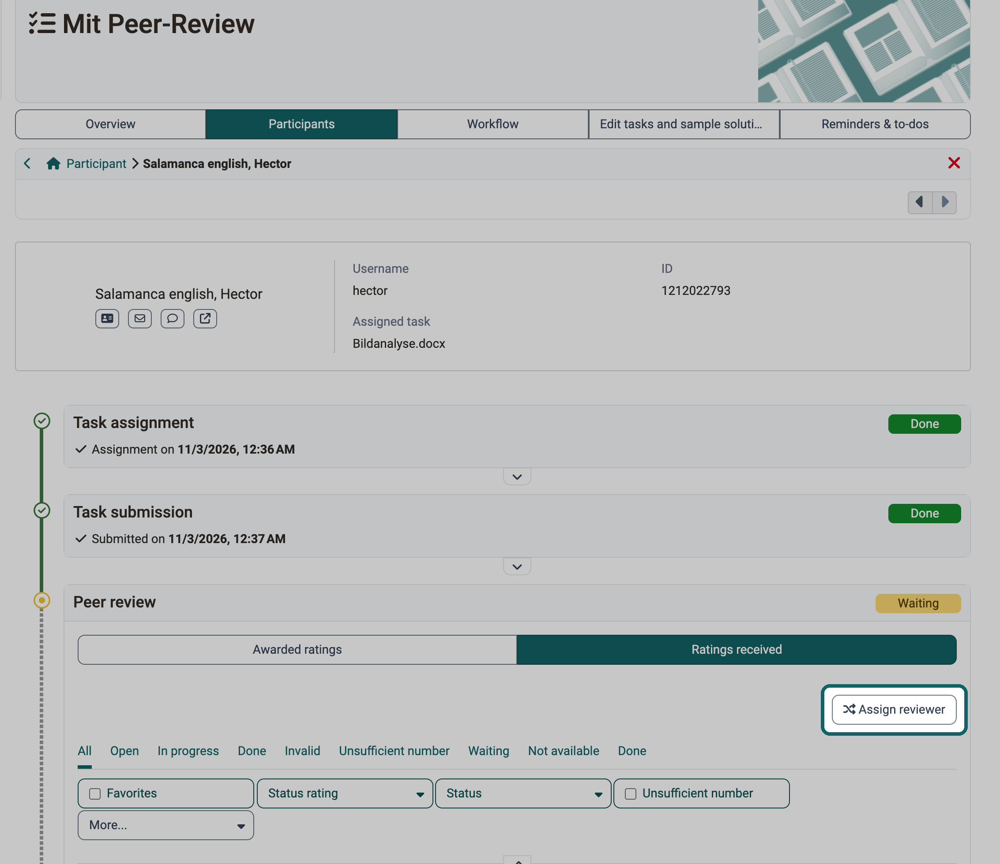
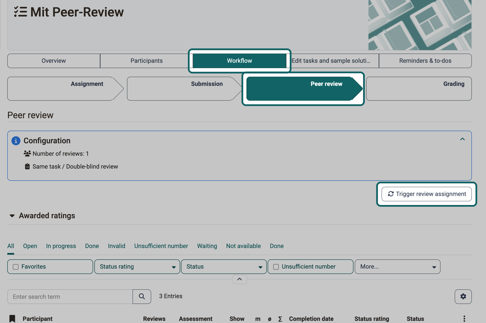

# Task with peer review {: #task_peer_review}

In a peer review, the participants of a task assess each other. This page is intended for all three roles of the [course element "Task"](index.md): course owners set up the peer review in the course editor, participants carry out the reviews, and coaches accompany the reviews and complement them with reviews of their own or a rubric assessment.

The peer review is a type of feedback. Course owners select it in the tab "Workflow" under "Feedback" with the option "With peer review", see [Set up a task](Task_Setup.md#workflow_feedback).

## Rules of a peer review [:octicons-tag-16:{ title="from Release 19.0 (OO-7680)" }](https://track.frentix.com/issue/OO-7680) {: #coach_task_peer_review_rules}

In a peer review, the participants in a course give each other feedback or an assessment. The feedback can be of a general nature, for example in a text field, or also include an assessment with points.

Not every person has to assess the submissions of all others. Course owners define how many reviews each person completes.

They also define which names are visible, from the double-blind review with anonymous names to the open review, see [Form of the review](#peer_review_form).

As a coach, you monitor the mutual reviews and intervene if necessary.

[To the top of the page ^](#task_peer_review)

## Settings in the tab "Revisions and feedback" {: #peer_review_settings}

If the option "With peer review" was selected in the tab "Workflow", you define in the tab "Revisions and feedback" the rules by which other participants give feedback. The reviewers give their feedback in a [form](../Form_Element_Rubric.md), usually with the help of a rubric. As the course owner, you provide this review form.

If grading is also switched on in the tab "Workflow" and the points for the peer review are to be taken over automatically from the form, the form must contain at least one rubric element. OpenOlat only awards points automatically via a rubric element.

{ class="shadow lightbox" title="Course editor, course element Task, tab Revisions and feedback · 2026.11.02" }

### Rubric assessment - Peer review {: #peer_review_rubric}

A suitable rubric form is required for peer reviews. As long as none is chosen, the area shows "No rubric form chosen.". With "Select" you take over an existing form, with "Create" you create a new one, with "Import" you import a form. Here you will find a [sample form](../assets/Example_PeerReview_v1_de.zip) (zip file for importing into your OpenOlat).

Coaches can additionally fill out this form themselves, with "Create your own review". Independently of this, they assess the task with the "Rubric assessment" if course owners switch it on in the "Grading" tab. The rubric assessment can use a different rubric form.

* Coaches can thus, for example, create a review if a participant has received too few reviews.
* If a review is marked as "not valid", coaches fill out a form as a replacement if needed.
* The form of the rubric assessment may contain different criteria than the form of the peer review. In this case, it is also useful for coaches to use both forms.

!!! info "Important"

    Course owners define in the "Grading" tab under "Total score from" which points count: "Rubric assessment", "Rubric peer review", "Submitted reviews" or a combination of these. Take this setting into account when you plan a peer review. See also [How do I perform a peer review? >](../../../manual_how-to/peer_review/peer_review.md)

**Further information**

[Sample form for peer review (zip file for import into your OpenOlat) >](../assets/Example_PeerReview_v1_de.zip) 
[How do I create a form learning resource? >](../../../manual_how-to/create_a_form/create_a_form.md) 
[How do I perform a peer review? >](../../../manual_how-to/peer_review/peer_review.md)

Under "Settings - Peer review" you define the procedure with the following fields.

### Form of the review {: #peer_review_form}

Here you define which names are visible: 
\- Double-blind review: All names are anonymous (except coaches). 
\- Single-blind review: The name of the reviewer is anonymous. 
\- Open review: All names are visible.

### Assignment {: #peer_review_assignment}

Here you determine which tasks the reviewers receive for review: 
\- **Same task**: For example, if a person has drawn and worked on task 1, they will only be given task 1 to review. They do not then have to familiarize themselves with another topic. 
\- **Other task**: The review concerns a different task than the one you have drawn yourself. If several reviews are to be done, they all concern the same task. 
\- **Random task**: The reviewers are given random tasks to review.

### Relationship {: #peer_review_relationship}

If "Mutual review" is selected, participants can assess each other, but do not have to.

### Number of reviews {: #peer_review_number}

Here you specify how many reviews are planned for each participant. You can choose 1 to 5 reviews, the default is 3. Depending on the number of participants, the actual number of reviews to be completed may vary. Ideally, the number of reviews to be completed corresponds to the number of reviews you receive from others.

### Quality feedback for reviewer {: #peer_review_quality_feedback}

Here you give participants the opportunity to give their reviewers feedback after receiving a review. Whether the review received was helpful, they indicate with the thumb symbol or with stars.

### Form of feedback {: #peer_review_feedback_form}

This field appears when "Quality feedback for reviewer" is switched on. Choose which symbols participants use to give the reviewers this feedback: "Helpful - Yes/No" or "Star rating". **"Helpful - Yes/No"** with thumbs up and thumbs down has proven itself.

### Trigger of automatic review assignment {: #peer_review_permissions}

This field is in the area "Rights". Authors see all participants of a course, but coaches may only see their coached group. 
In order for coaches to be able to view the reviews of the supervised participants, reviews must be assigned within their groups. (Only then can coaches follow all reviews). 
If the automatic review assignment is triggered, coaches will only see their group, but review assignments will be assigned among all participants. Coaches will then see that a coached person has received a review from someone in the other group. However, the name of the person who did the review is not visible.  
In order for coaches as well as course owners to be able to trigger the automatic review assignment, select the option "Coach" under "Trigger of automatic review assignment".

[To the top of the page ^](#task_peer_review)

---

## Carry out a peer review {: #process_task_make_reviews}

If a peer review is set up for the task, you receive review tasks as a participant: you assess the documents submitted by other course members. Whose documents you assess is determined automatically by OpenOlat, or coaches assign them to you.

{ class="shadow lightbox" title="Course element Task, participants' view · 2026.11.03" }

Once you have completed all reviews, finish the step with the button "Complete review".

[To the top of the page ^](#task_peer_review)

## View results of a peer review {: #process_task_view_reviews}

In the steps "Peer review - Awarded ratings" and "Peer review - Ratings received" you see as a participant which ratings you have given and which you have received.

{ class="shadow lightbox" title="Course element Task, participants' view · 2026.11.03" }

[To the top of the page ^](#task_peer_review)

---

## Supervise peer review {: #coach_task_peer_review_supervise}

Course owners define the procedure of the peer review. Your options as a coach depend on it:

* In the tab "Workflow", the step "Peer review" shows the status of all peer reviews, with the lists "Awarded ratings" and "Ratings received".
* In the tab "Participants" you open a person. In the step "Peer review", the tabs "Awarded ratings" and "Ratings received" show their reviews with status.
* You also assign reviewers manually, see [Manual assignment of peer reviewers](#coach_task_peer_review_assign_manually).

{ class="shadow lightbox" title="Course element Task, coach view, detail view of a person · 2026.11.03" }

!!! note "Note"

    Coaches only see groups in which they themselves are members. If members of other groups review, the evaluations of these participants are not fully visible to coaches.

[To the top of the page ^](#task_peer_review)

## Review by coach {: #coach_task_peer_review_by_coach}

As a coach, you create a review of your own as soon as a person has submitted, even before the submission deadline expires.

The "Peer review time period" that course owners set in the "Workflow" tab does not apply to coaches: they create their own review also before the start and after the end of the period. To do so, open the person, in the step "Peer review" the tab "Ratings received", and in the row of the person under "More actions" the entry "Create your own review".

[To the top of the page ^](#task_peer_review)

## Manual assignment of peer reviewers {: #coach_task_peer_review_assign_manually}

If you as a coach want to determine who receives a review from whom, you assign the reviewers yourself.

{ class="shadow lightbox" title="Course element Task, coach view, tab Participants · 2026.11.03" }

In the tab "Ratings received" the button is called "Assign reviewer", in the tab "Awarded ratings" it is called "Assign reviews".

A manual assignment is also possible in the table. To do this, click on the three-dot menu in the row of the person.

[To the top of the page ^](#task_peer_review)

## Automatic assignment of peer reviewers {: #coach_task_peer_review_assign_automatically}

OpenOlat also assigns peer reviewers automatically, according to the set rules, for example the number of reviews per person. Manual assignments that coaches have already made are taken into account by OpenOlat in the remaining assignments.

Course owners or coaches trigger the automatic assignment in the tab "Workflow" with the button "Trigger review assignment".

{ class="shadow lightbox" title="Course element Task, coach view, tab Workflow · 2026.11.03" }

!!! info "Important"

    In order for coaches to be able to trigger the automatic review assignment, course owners must have selected the option "Coach" under [Trigger of automatic review assignment](#peer_review_permissions) in the tab "Revisions and feedback".

!!! info "Important"

    The button "Trigger review assignment" remains available after an assignment, because participants can still join later or receive an extension.

[To the top of the page ^](#task_peer_review)

## Close peer review {: #coach_task_peer_review_close}

When participants have done all their reviews, they submit the reviews with "Complete review". Only then do they count. The other participants are assessed only with completed reviews.

Once the peer review time period has expired, participants can no longer create reviews.

If participants have started reviews but not completed them, coaches cannot collect these reviews. The reason: coaches cannot know whether a review that has not been completed should already be final and what quality it has at the current time.

Coaches cannot complete the reviews for everyone. They wait until the peer review time period has expired.

After a peer review, no revision with a second review is possible.

[To the top of the page ^](#task_peer_review)

## Coach participates in peer review {: #coach_task_peer_review_reviewer_participates}

Coaches can participate in the peer review in the same way as participants. They then use the same criteria, and their review counts like the reviews of the other participants.

**Example 1:** 
A reviewer is absent due to illness, and a coach steps in as reviewer. This way everyone receives the same number of reviews.

**Example 2:** 
A coach sees that a reviewer has created a review incorrectly or poorly. She marks this review as invalid and creates a review herself, so that the assessed person receives the same number of reviews again.

**Example 3:** 
The peer review has produced two completely contradictory reviews. A coach therefore adds a mediating or corrective review. Unlike in the rubric assessment, he uses the same assessment grid as the participants.

[To the top of the page ^](#task_peer_review)

## Rubric assessment by coaches [:octicons-tag-16:{ title="from Release 19.0 (OO-7682)" }](https://track.frentix.com/issue/OO-7682) {: #coach_task_peer_review_expert}

If the "Rubric assessment" is switched on in the "Grading" tab, coaches assess the task in addition to the peer review with a rubric form of their own.

It works as in the [course element "Assessment"](../Course_Element_Assessment.md#rubric-assessment), with a stored [rubric form](../Forms_in_Rubric_Scoring.md). This form can differ from the form of the peer reviewers.

[To the top of the page ^](#task_peer_review)

## Task assessment {: #coach_task_peer_review_evaluate}

The results of a peer review do not have to be included in the assessment, reviews and peer reviews without an assessment are also possible. Course owners define in the "Grading" tab under ["Total score from"](Task_Setup.md#grading) which points count:

* "Rubric assessment": the points from the rubric assessment by coaches,
* "Rubric peer review": the points from the peer reviews the person has received,
* "Submitted reviews": points for the reviews the person has submitted.

Combinations are possible. If only "Rubric assessment" is selected, the peer reviews are not included in the assessment.

[To the top of the page ^](#task_peer_review)

## Further information {: #further_information}

**Mentioned on this page** 
[Course Element "Task" >](index.md) 
[Set up a task >](Task_Setup.md) 
[The form element rubric >](../Form_Element_Rubric.md) 
[How do I perform a peer review? >](../../../manual_how-to/peer_review/peer_review.md) 
[How do I create a form learning resource? >](../../../manual_how-to/create_a_form/create_a_form.md) 
[Course Element "Assessment" >](../Course_Element_Assessment.md) 
[Forms in Rubric Scoring >](../Forms_in_Rubric_Scoring.md)

**Further reading** 
[Work on a task (participants) >](Task_Participants.md) 
[Supervise a task >](Task_Coaching.md)

[To the top of the page ^](#task_peer_review)
