# Aufgabe einrichten {: #create_task}

Diese Seite richtet sich an Kursbesitzer:innen. Sie beschreibt, wie Sie den [Kursbaustein "Aufgabe"](index.de.md) im Kurseditor einrichten, Tab für Tab in der Reihenfolge der Oberfläche.

Sie erstellen und konfigurieren die Aufgabe wie alle Kursbausteine im Kurseditor. Im Lernpfadkurs hat der Kursbaustein dort elf Tabs, von "Titel und Beschreibung" bis "Erinnerungen & To-dos"; im herkömmlichen Kurs stehen an der Stelle von "Lernpfad" die Tabs "Sichtbarkeit" und "Zugang". Welche Tabs Sie bearbeiten können, bestimmen die Schritte, die Sie im Tab "Workflow" einschalten. Den Tab "Badges" zeigt der Kurseditor zusätzlich, wenn im Kurs Badges vergeben werden.

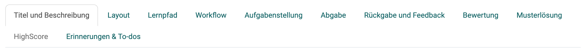{ class="shadow lightbox" title="Kurseditor, Kursbaustein Aufgabe · 2026.11.06" }

!!! note "Quick Links: Aufgabe einrichten"

    * [Tab Titel und Beschreibung](#title)  Allgemeine Angaben über den Kursbaustein
    * [Tab Layout](#layout) Allgemeine Einstellungen im Layout
    * [Tab Lernpfad](#learningpath) Soll die Aufgabe freiwillig, Pflicht oder nur für bestimmte Personengruppen sein?
    * [Tab Workflow](#workflow) Hier bestimmen Sie, welche Schritte die Aufgabe enthalten soll.
    * [Tab Aufgabenstellung](#assignment) Erstellung oder Upload der Aufgabenstellung, Zuweisung verschiedener Aufgaben oder Ziehung, usw.
    * [Tab Abgabe](#submission) Definition der erwarteten Einsendungen (mit Vorlage?, als Audio-/Videoaufnahme?, usw.)
    * [Tab Rückgabe und Feedback](#revisions) Rückgabedokumente beim Feedback durch Betreuende, Verweis auf die Einstellungen des Peer-Reviews
    * [Tab Bewertung](#grading)  Konfiguration der Punktevergabe, Kriterium für Bestanden, Berücksichtigung in der Kursbewertung usw.
    * [Tab Musterlösung](#sample) Z.B. Bereitstellung einer pdf-Datei.
    * [Tab HighScore](#highscore) Visualisierung der Resultate, falls Punkte vergeben werden.
    * [Tab Erinnerungen & To-dos](#reminders) Vorbereitung automatischer Erinnerungsmails und To-dos
    * [Tab Badges](#tab-badges) Erstellung von Badges für die Bearbeitung/Erledigung der Aufgabe

## Tab "Titel und Beschreibung"  {: #title}

Die Angaben über den Kursbaustein entsprechen denen, wie sie in allen Kursbausteinen enthalten sind.

[zum Seitenanfang ^](#create_task)

## Tab "Layout"  {: #layout}

Die Optionen zum Layout entsprechen denen, wie sie in allen Kursbausteinen enthalten sind.

[zum Seitenanfang ^](#create_task)

---

## Tab "Lernpfad" {: #learningpath}

!!! info "Herkömmliche Kurse"

    Herkömmliche Kurse verfügen nicht über den Tab "Lernpfad" und haben stattdessen die Tabs "Sichtbarkeit" und "Zugang", inklusive Expertenmodus.

Definieren Sie, ob die Bearbeitung der Aufgabe obligatorisch oder freiwillig ist oder ob der Kursbaustein nicht angezeigt (ausgenommen) werden soll. Obligatorische Aufgaben werden bei der Fortschrittsanzeige berücksichtigt, freiwillige nicht.

Das "Freigabedatum" verwenden Sie, wenn der Kursbaustein erst ab einem bestimmten Datum geöffnet und gestartet werden soll. Der Baustein selbst erscheint aber bereits in der Kursstruktur.

Die Zeitangabe unter "Zu bearbeiten bis" bezieht sich auf die Frist für das Abholen bzw. den Start des Kursbausteins Aufgabe, nicht auf den Abgabetermin für den Dateiupload (siehe [Tab "Workflow"](#workflow)).

Unter "Bearbeitungszeit (Minuten)" tragen Sie ein, wie lange Teilnehmende für die Aufgabe voraussichtlich brauchen. Der Eintrag ist vor allem dann wichtig, wenn sich der Fortschritt im Kurs nach der Bearbeitungszeit der Kursbausteine richtet. Diese Einstellung liegt in den [Kurseinstellungen](../Course_Settings.de.md) unter: 
`Kurs > Administration > Einstellungen > Tab "Durchführung"`

Im Tab "Lernpfad" wird auch definiert, welches Kriterium erfüllt sein muss, damit die Aufgabe als "erledigt" gilt. Folgende Optionen stehen zur Wahl:

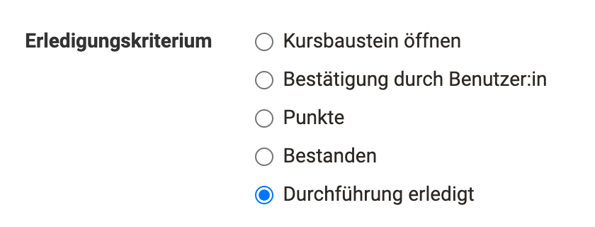{ class="shadow lightbox" title="Kurseditor, Kursbaustein Aufgabe, Tab Lernpfad · 2026.11.02" }

* **Kursbaustein öffnen**: Die Person hat den Kursbaustein geöffnet.
* **Bestätigung durch Benutzer:in**: Die Person hat die Lesebestätigung angeklickt.
* **Punkte**: Die Person hat bei der Bearbeitung der Aufgabe mindestens die angegebene Punktzahl erreicht.
* **Bestanden**: Die Person hat die im Tab "Bewertung" konfigurierten Anforderungen an "Bestanden" erfüllt, oder eine betreuende Person hat die Aufgabe manuell auf bestanden gesetzt.
* **Durchführung erledigt**: Die Person hat alle Schritte des Workflows durchlaufen.

[zum Seitenanfang ^](#create_task)

## Tab "Workflow"  {: #workflow}

Im Tab "Workflow" legen Sie fest, aus welchen Schritten die Aufgabe besteht. Soll eine konkrete Aufgabenstellung im Kursbaustein hinterlegt werden, oder finden die Teilnehmenden die Aufgabe woanders? Sollen sie ein Dokument abgeben? Soll es ein Feedback von Betreuenden oder ein Peer-Review geben, und dürfen die Teilnehmenden ihre Abgabe überarbeiten? Soll eine Musterlösung bereitstehen? Soll eine Bewertung mit Punkten oder Bestanden möglich sein? Sollen bestimmte Teilnehmende von bestimmten Betreuenden bewertet werden? Schalten Sie die Schritte ein, die Sie benötigen, und konfigurieren Sie danach die zugehörigen Tabs.

!!! tip "Tipp"

    Dies ist der erste Tab des Kursbausteins, den Sie konfigurieren sollten. Wählen Sie hier die konkreten Funktionen aus, die Sie benötigen. Anschliessend sind die passenden Tabs aktiv/inaktiv und können weiter konfiguriert werden.

!!! warning "Achtung"

    Nachträgliche Änderungen am Workflow wirken sich auf alle Teilnehmenden aus, auch wenn diese den Workflow bereits begonnen haben.

    Bei Änderungen am Workflow, z.B. dem Entfernen der Aufgabenstellung, wird bei allen Teilnehmenden des Kurses dieser Bestandteil des Workflows entfernt. Die Information über bereits gewählte Aufgaben ist dann nicht mehr sichtbar. Wird der Bestandteil des Workflows wieder eingefügt, ist diese Information aber wieder zugänglich.

    Wird jedoch z.B. die Aufgabenstellung nachträglich hinzugefügt und ein/e Teilnehmer:in ist im persönlichen Workflow bereits weiter fortgeschritten, so muss nachträglich keine Aufgabe mehr ausgewählt werden.

Folgende Optionen stehen Ihnen zur Verfügung:

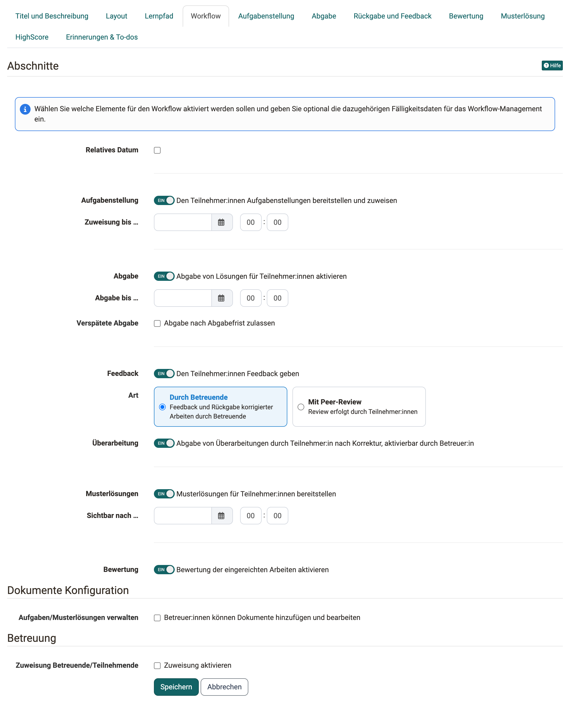{ class="shadow lightbox" title="Kurseditor, Kursbaustein Aufgabe, Tab Workflow · 2026.11.02" }

### Relatives Datum {: #workflow_relative_dates}

Statt Kalenderdaten einzutragen, können Sie auch mit _relativen Daten_ arbeiten. Legen Sie fest, wie viele Tage nach dem ersten Kursbesuch oder nach der Einschreibung / Buchung die Aufgabenstellung geöffnet bleibt. Alle eingestellten Zeitvorgaben können auch individuell angepasst werden, z.B. wenn eine teilnehmende Person aufgrund bestimmter Umstände eine Verlängerung benötigt. Dies gilt für alle Prozessschritte. Wenn Sie das Abgabedatum verlängern, wird die Aufgabe neu eröffnet. Auch ein Datum für eine verspätete Abgabe ist möglich.

=== "Mit fixem Datum"

    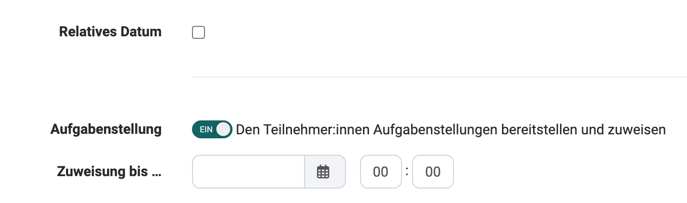{ class="shadow lightbox" title="Tab Workflow, Abschnitt Aufgabenstellung · 2026.11.02" }

=== "Mit relativem Datum"

    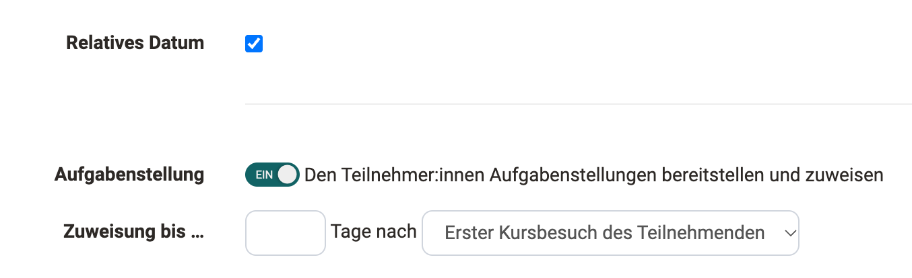{ class="shadow lightbox" title="Tab Workflow, Abschnitt Aufgabenstellung · 2026.11.02" }

Die Umstellung auf relative Daten betrifft die Eingabefelder für "Aufgabenstellung", "Abgabe" und "Musterlösungen".

### Aufgabenstellung {: #workflow_assignment}

Mit diesem Schalter stellen Sie den Teilnehmenden Aufgabenstellungen bereit und weisen sie zu. Die Aufgabenstellung ist bis zum Datum unter "Zuweisung bis …" verfügbar. Die Aufgaben selbst hinterlegen Sie danach im [Tab "Aufgabenstellung"](#assignment).

### Abgabe {: #workflow_submission}

Mit diesem Schalter geben Teilnehmende ihre Lösung im Kursbaustein ab. Die Abgabe ist bis zum Datum unter "Abgabe bis …" möglich.

Ist "Abgabe nach Abgabefrist zulassen" aktiviert und unter "Letzte Abgabemöglichkeit bis …" ein Termin hinterlegt, können Teilnehmende ihre Lösung noch bis zu diesem Termin einreichen. Teilnehmende sehen den normalen und den verspäteten Abgabetermin, solange diese in der Zukunft liegen. Die verspätete Abgabe sehen auch Betreuer:innen und Kursbesitzer:innen.

### Feedback {: #workflow_feedback}

Unter "Art" wählen Sie, wer das Feedback gibt: "Durch Betreuende" oder "Mit Peer-Review", also durch die anderen Teilnehmer:innen. Beim Peer-Review legen Sie zusätzlich den "Peer-Review-Zeitraum" fest. Wie Sie das Peer-Review einrichten und wie es abläuft, beschreibt die Seite [Aufgabe mit Peer-Review](Task_Peer_Review.de.md).

### Überarbeitung {: #workflow_revision}

Hier erlauben Sie, dass Teilnehmer:innen nach der Korrektur eine Überarbeitung abgeben. Ob eine Überarbeitung nötig ist, entscheiden die Betreuer:innen bei jeder Abgabe. Der Schalter erscheint, wenn das Feedback eingeschaltet ist und unter "Art" die Option "Durch Betreuende" gewählt ist.

### Musterlösungen {: #workflow_sample_solution}

Eine Musterlösung kann für alle Teilnehmenden oder nur diejenigen, die die Aufgabe bearbeitet haben, ab dem eingetragenen Datum bereitgestellt werden. Die Auswahl "Sichtbar für …" erscheint erst, wenn unter "Sichtbar nach …" ein Kalenderdatum eingetragen ist oder die Aufgabe freiwillig ist.

### Bewertung {: #workflow_grading}

Mit diesem Schalter aktivieren Sie den [Tab "Bewertung"](#grading), in dem Sie die Details der Bewertung konfigurieren.

### Dokumente Konfiguration [:octicons-tag-16:{ title="ab Release 16.0 (OO-5490)" }](https://track.frentix.com/issue/OO-5490) {: #workflow_documents_configuration}

Dieser Bereich erscheint nur, wenn "Aufgabenstellung" oder "Musterlösungen" eingeschaltet ist, denn dann werden Dokumente hochgeladen. Unter "Aufgaben/Musterlösungen verwalten" erlauben Sie mit "Betreuer:innen können Dokumente hinzufügen und bearbeiten", dass neben Kursbesitzer:innen auch Betreuer:innen Dokumente hinzufügen und bearbeiten.

### Betreuung {: #workflow_coaching}

Im Bereich "Betreuung" aktivieren Sie eine teilnehmerabhängige Betreuung: Jeder teilnehmenden Person ist dann eine bestimmte betreuende Person zugewiesen.

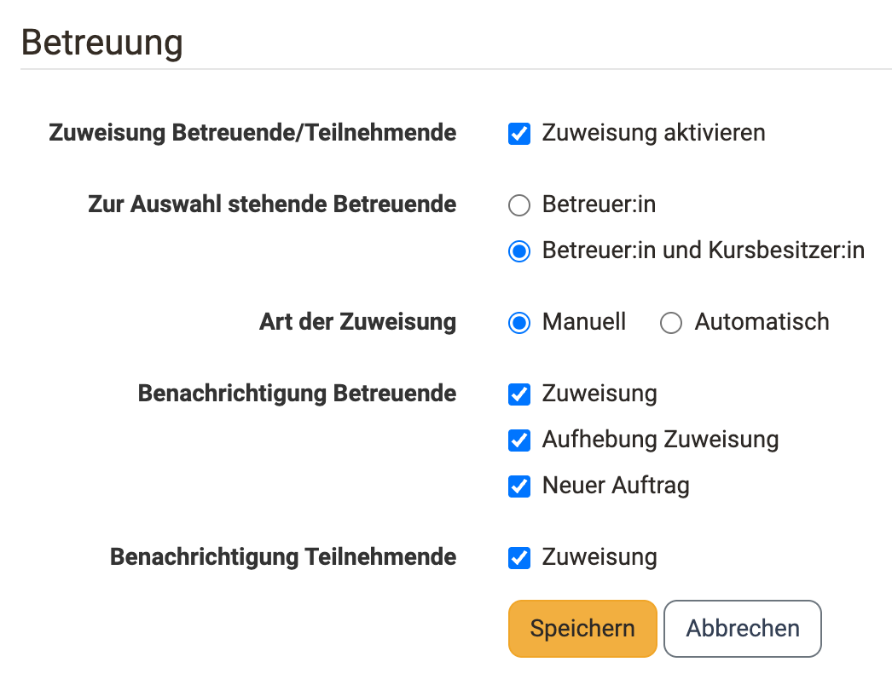{ class="shadow lightbox" title="Tab Workflow, Abschnitt Betreuung · 2026.11.06" }

* **Zuweisung Betreuende/Teilnehmende** 
Mit "Zuweisung aktivieren" blenden Sie die weiteren Optionen zur Betreuung ein. Die Personen ordnen Sie danach bei geschlossenem Kurseditor zu, siehe [Tabelle "Zuweisung Betreuende/Teilnehmende"](#coach_assignment_table).

* **Zur Auswahl stehende Betreuende** 
Hier wählen Sie zwischen "Betreuer:in" und "Betreuer:in und Kursbesitzer:in". Bei der zweiten Option stehen auch Kursbesitzer:innen für die Betreuung der Teilnehmer:innen zur Wahl.

* **Art der Zuweisung** 
Hier legen Sie fest, ob Sie die betreuenden Personen "Manuell" zuweisen oder OpenOlat sie "Automatisch" zuweist.

* **Benachrichtigung Betreuende** 
Wählen Sie hier, in welchen Fällen Betreuende eine Benachrichtigung per Mail erhalten: "Zuweisung", "Aufhebung Zuweisung" und "Neuer Auftrag".

* **Benachrichtigung Teilnehmende** 
Wählen Sie hier, ob Teilnehmende über die Zuweisung zu einer betreuenden Person per Mail informiert werden.

!!! warning "Achtung"

    Wenn unter den Kursmitgliedern keine Person die Rolle Betreuer:in hat und gleichzeitig Kursbesitzer:innen keine Betreuungsaufgaben wahrnehmen, dann kann keine Betreuerzuweisung stattfinden. Ob Kursbesitzer:innen Betreuungsaufgaben wahrnehmen, legen Sie oben unter "Zur Auswahl stehende Betreuende" fest.

### Tabelle "Zuweisung Betreuende/Teilnehmende" [:octicons-tag-16:{ title="ab Release 17.2.1 (OO-6698)" }](https://track.frentix.com/issue/OO-6698) {: #coach_assignment_table}

Die Personen ordnen Kursbesitzer:innen bei geschlossenem Kurseditor zu: `Kurs > "Titel des Kursbausteins" > Tab "Teilnehmer:innen" > Button "Zuweisung Betreuende/Teilnehmende"`.

Die Tabelle ist eine Matrix: Jede Zeile ist eine teilnehmende Person, jede Spalte eine zur Auswahl stehende betreuende Person, dazu die Spalte "Nicht zugewiesen". Sie setzen die Zuordnung, indem Sie in der Zeile den Punkt in der gewünschten Spalte wählen. Hinter jedem Namen steht in Klammern, wie viele Personen dieser Betreuerin oder diesem Betreuer aktuell zugewiesen sind. So erkennen Sie eine ungleiche Verteilung auf einen Blick. Gespeichert ist die Zuordnung erst mit "Zuweisung übernehmen".

Über "Nicht zugewiesene zufällig zuweisen" verteilt OpenOlat alle noch offenen Personen automatisch. Die Reiter "Alle" und "Nicht zugewiesen" sowie die Filter "Teilnehmer:innen" und "Betreuer:in" grenzen die Liste ein. Gehören dem Kurs Gruppen oder Curriculum-Elemente an, kommt der Filter "Gruppen" hinzu.

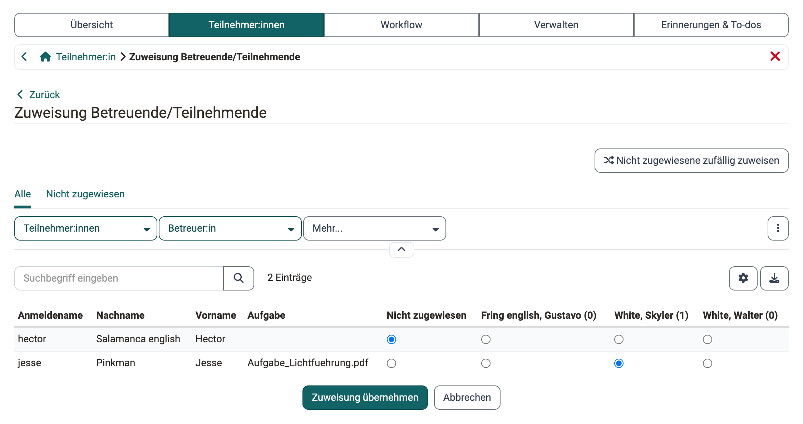{ class="shadow lightbox" title="Kursbaustein Aufgabe, Tab Teilnehmer:innen, Zuweisung Betreuende/Teilnehmende · 2026.11.03" }

!!! note "Hinweis"

    Betreuende sehen den Button "Zuweisung Betreuende/Teilnehmende" nicht. Die Zuordnung ist Kursbesitzer:innen vorbehalten; Betreuende erkennen ihre eigene Zuordnung in der Spalte "Betreuer:in" der Teilnehmerliste.

Zwei Funktionen unterstützen die Arbeit mit grossen Listen:

* **Export**: Über das Export-Symbol rechts über der Tabelle laden Sie die aktuelle Tabellenansicht als Excel-Datei herunter, zum Beispiel als Nachweis der Zuordnung.
* **Filter speichern**: Eine eingestellte Filterkombination sichern Sie über das Drei-Punkte-Menü rechts neben den Filtern mit "Filter speichern" unter einem eigenen Namen. Der gespeicherte Filter erscheint danach als eigener Reiter und steht beim nächsten Aufruf der Tabelle wieder bereit. [:octicons-tag-16:{ title="ab Release 21.0.2 (OO-9601)" }](https://track.frentix.com/issue/OO-9601)

Der Button erscheint nur beim Kursbaustein Aufgabe und nur, wenn die Zuweisung Betreuende/Teilnehmende aktiviert ist. Bei der [Gruppenaufgabe](../Course_Element_Grouptask.de.md) ergibt sich die Zuordnung aus der Betreuung der Gruppe.

!!! info "Hinweis"

    Die im Tab Workflow angezeigten und durch die Autor:innen wählbaren Optionen können Systemadministrator:innen in der System-Administration vorkonfigurieren: `Administration > Module > Kursbausteine`

[zum Seitenanfang ^](#create_task)

---

## Tab "Aufgabenstellung"  {: #assignment}

!!! info "Voraussetzung"

    Im Tab "Workflow" muss zunächst die "Aufgabenstellung" eingeschaltet sein, damit Sie die konkrete Aufgabenstellung im Tab "Aufgabenstellung" bereitstellen können.

**a) Aufgabe hochladen**

Sie können eine oder mehrere zuvor erstellte Aufgaben-Dateien hochladen. Jede hochgeladene Aufgabe gilt dann als eine zu bearbeitende Alternative. Werden für die Bearbeitung einer Aufgabe mehrere ergänzende Dateien benötigt, sollten Sie alle benötigten Dateien als Zip-Datei bündeln und diese Zip-Datei als Aufgabendatei hochladen.

Generell sollte jede Aufgaben-Datei einen passenden Titel und eventuell eine kurze Beschreibung umfassen.

**b) Dateien unterschiedlicher Formate erstellen**

Neben dem Upload können Dateien auch direkt in OpenOlat erstellt werden. Welche Formate genau zur Verfügung stehen, hängt davon ab, welche Editoren Systemadministrator:innen in der System-Administration aktiviert haben. In der Regel steht mindestens ein HTML-Editor zur Verfügung. Aber auch die Erstellung von Word, Excel, PowerPoint sowie Diagrammen oder Whiteboards ist möglich. Zusätzlich können eine spezifische Video- und auch eine Audio-Aufgabe erstellt werden.

Wird eine Aufgabe mit dem internen HTML-Editor erstellt, können Sie ebenfalls mehrere Dateien (z.B. Bilder oder PDFs) zur Verfügung stellen, in dem Sie diese im HTML-Editor hochladen und dann in der HTML-Seite verlinken bzw. direkt anzeigen. So erstellte Aufgaben werden von den Teilnehmenden dann im .zip Format heruntergeladen. Wird der HTML-Editor verwendet, wird automatisch der hinterlegte Titel auch als Dateiname übernommen. Dies kann aber jederzeit wieder geändert werden.

!!! info "Mehrere Dateien"

    Bitte beachten: Werden mehrere Dateien im Tab Aufgabenstellung hinterlegt, werden diese als mehrere verschiedene Aufgabenstellungen betrachtet. Es handelt sich _nicht_ um eine Aufgabe mit mehreren ergänzenden Dateien.

Im Feld "Art der Zuweisung" bestimmen Sie, ob einer teilnehmenden Person alle zur Verfügung stehenden Aufgaben zur Auswahl angeboten werden ("Benutzer:in wählt die Aufgabe manuell") oder ob OpenOlat ihr eine Aufgabe per Zufallsauswahl zuweist ("Automatische Zuweisung einer Aufgabe").

Wählen Sie im Feld "Typ der Ziehung", ob mehrere Teilnehmende die gleiche Aufgabe lösen können oder ob jede teilnehmende Person eine andere Aufgabe lösen soll. Wenn die Aufgabe manuell gewählt wird, können Sie im Feld "Vorschau" weiter festlegen, ob die Teilnehmenden vor der Wahl einer Aufgabe diese einsehen dürfen. Wenn bei "Typ der Ziehung" jede Person eine andere Aufgabe lösen soll, müssen mindestens so viele Aufgaben hinterlegt werden, wie es Teilnehmende gibt, die diese Aufgabe lösen sollen.

!!! tip "Tipp"

    Wenn der Kursbaustein nur _eine_ Aufgabe beinhaltet ist eine manuelle Wahl wenig sinnvoll. Nutzen Sie in diesem Fall am besten die automatische Zuweisung.

Im Feld "Mitteilung an Benutzer:in" hinterlegen Sie für alle Teilnehmenden allgemeine Hinweise zur Bearbeitung der Aufgaben.

Wählt eine teilnehmende Person bei der manuellen Auswahl aus Versehen die falsche Aufgabenstellung, können Kursbesitzer:innen ihr im [Bewertungswerkzeug](../Assessment_tool_overview.de.md) mit "Daten von Aufgabe zurücksetzen" das Zurücksetzen erlauben: 
`Kurs > Administration > Bewertungswerkzeug > "Titel des Kursbausteins" > "Name der Person"`

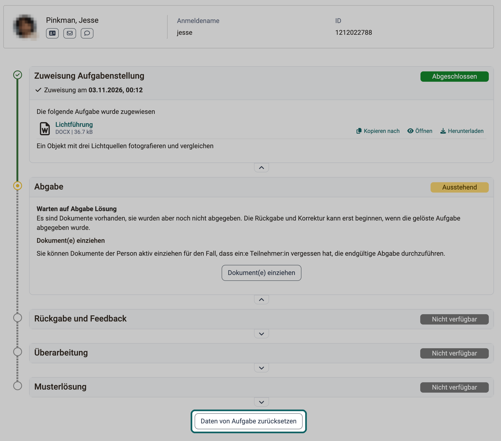{ class="shadow lightbox" title="Bewertungswerkzeug, Kursbaustein Aufgabe, Person · 2026.11.03" }

Die Wahl ändert sich dabei _nicht automatisch_. Die teilnehmende Person erhält aber die Möglichkeit, ihre bisherigen Schritte mit "Daten zurücksetzen" rückgängig zu machen.

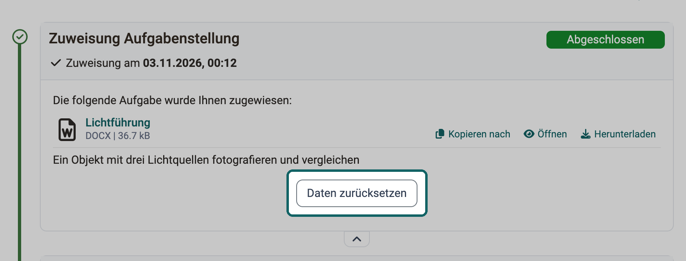{ class="shadow lightbox" title="Kursbaustein Aufgabe, Sicht der Teilnehmenden · 2026.11.03" }

[zum Seitenanfang ^](#create_task)

---

## Tab "Abgabe"  {: #submission}

Hier definieren Sie Art und Umfang der Einsendemöglichkeiten für die Teilnehmenden.

!!! info "Voraussetzung"

    Im Tab "Workflow" muss

    * "Abgabe" aktiviert worden sein, damit Sie diese nun einrichten können.

    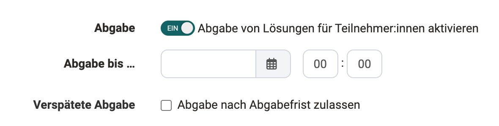{ class="shadow lightbox" title="Tab Workflow, Abschnitt Abgabe · 2026.11.02" }

Danach aktivieren Sie mindestens eine der beiden Möglichkeiten: Dokumente hochladen oder den OpenOlat Editor für die Abgabe nutzen.

Im Tab "Abgabe" stehen folgende Optionen zur Wahl:

**"Dokumente hochladen (z.B. PDF)"**: Teilnehmende laden ausserhalb von OpenOlat erstellte Dokumente hoch und geben sie ab.

**"Abgabe mit OpenOlat Editor"**: Teilnehmende erstellen Dokumente direkt im Kursbaustein. Standardmässig steht dafür ein HTML-Editor zur Verfügung. Sind weitere Dokument-Editoren in OpenOlat eingebunden, können sie auch Dokumente in weiteren Formaten wie Word oder Excel erstellen, ebenso draw.io-Diagramme.

Aktivieren Sie "Aufgabe ist Vorlage für die Abgabe", wenn die Teilnehmenden die hinterlegte Aufgabendatei als Basis für ihre Bearbeitung nutzen sollen, beispielsweise wenn die Aufgabenstellung eine auszufüllende vorstrukturierte Tabelle beinhaltet.

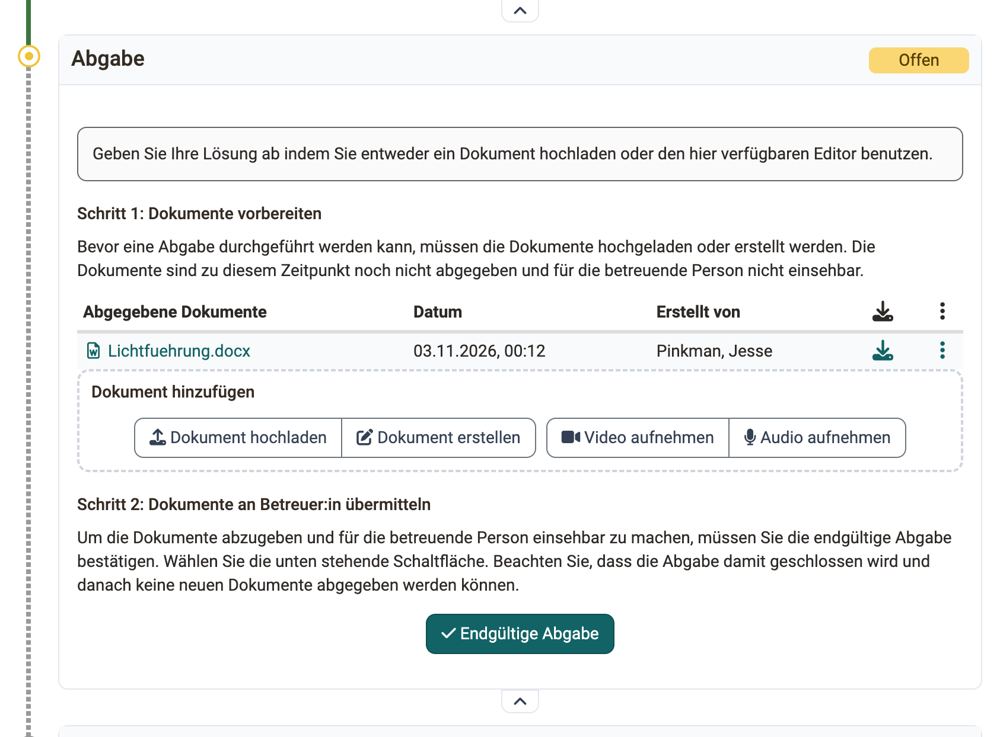{ class="shadow lightbox" title="Schritt Abgabe, Sicht der Teilnehmenden · 2026.11.03" }

**"Videoaufnahmen zulassen"**: Teilnehmende nehmen zusätzlich Videos per Webcam auf und reichen sie ein. Unter "Max. Länge der Aufzeichnung (in Sek.)" begrenzen Sie die Dauer, unter "Videoqualität" wählen Sie die Qualitätsstufe.

**"Audioaufnahmen zulassen"**: Teilnehmende nehmen zusätzlich Audios mit dem Audio-Recorder auf und geben sie ab. Auch hier begrenzen Sie die Dauer unter "Max. Länge der Aufzeichnung (in Sek.)".

Unter "Min. Anzahl von Dokumenten" und "Max. Anzahl von Dokumenten" legen Sie fest, wie viele Dokumente eine Abgabe enthalten muss oder darf. Soll es keine Einschränkung geben, lassen Sie die Felder frei.

Aktivieren Sie die E-Mail-Bestätigung, damit Personen, die eine Aufgabe abgegeben haben, eine Nachricht erhalten. Den vorformulierten Text der E-Mail passen Sie bei Bedarf an.

[zum Seitenanfang ^](#create_task)

---

## Tab "Rückgabe und Feedback"  {: #revisions}

!!! info "Voraussetzung"

    Im Tab "Workflow" muss

    * das Feedback eingeschaltet sein.
    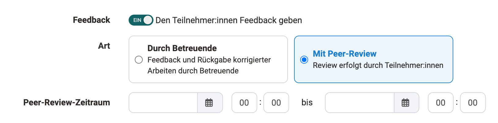{ class="shadow lightbox" title="Tab Workflow, Abschnitt Feedback · 2026.11.02" }
    * Je nach Wahl wer das Feedback geben soll, erscheinen im Tab "Rückgabe und Feedback" unterschiedliche Optionen

**Rückgabe und Feedback durch Betreuer:innen**

Wurde im Tab "Workflow" die Option "Durch Betreuende" gewählt, legen Sie im Tab "Rückgabe und Feedback" unter "Rückgabe Konfiguration" die minimale und die maximale Anzahl von Rückgabedokumenten fest, die die Teilnehmenden während der Schritte "Rückgabe und Feedback" und "Überarbeitung" abgeben dürfen.

Wurde die Option "Mit Peer-Review" gewählt, beschreibt die Seite [Aufgabe mit Peer-Review](Task_Peer_Review.de.md#peer_review_settings) die Einstellungen im Tab "Rückgabe und Feedback".

[zum Seitenanfang ^](#create_task)

---

## Tab "Bewertung"  {: #grading}

Hier legen Sie fest, _wie_ die Teilnehmenden bewertet werden. Soll es Punkte geben? Soll es ein Bestanden/Nicht bestanden für den Kursbaustein geben? Soll die Punktebewertung mit einer Bewertungsskala verbunden werden, und wenn ja, mit welcher? Sollen Betreuende weitere individuelle Kommentare oder Dokumente bereitstellen können? Entscheiden Sie jeweils, was zu Ihrem Szenario passt.

Sind für die Aufgabe bereits Bewertungen vorhanden, zeigt OpenOlat in diesem Tab die Einstellungen unter "Konfiguration Bewertung" schreibgeschützt an. Bearbeitbar bleibt der Bereich "Bewertungsformular". Mit "Bearbeitungsmodus aktivieren" machen Sie die Einstellungen wieder bearbeitbar, siehe [Schreibschutz der Bewertungskonfiguration](../Course_Elements.de.md#assessment_config_read_only). [:octicons-tag-16:{ title="ab Release 21.1 (OO-9647)" }](https://track.frentix.com/issue/OO-9647)

Für die Bewertung kann auch ein Formular mit Rubrik verwendet werden. Die Punkte können dann aus dem Rubrik-Formular für die Bewertung des Kursbausteins übernommen werden. Das hier im Tab "Bewertung" eingebundene Rubrik-Formular ist zu unterscheiden von dem Rubrik-Formular, das im Tab "Rückgabe und Feedback" für Peer-Reviews verwendet wird.

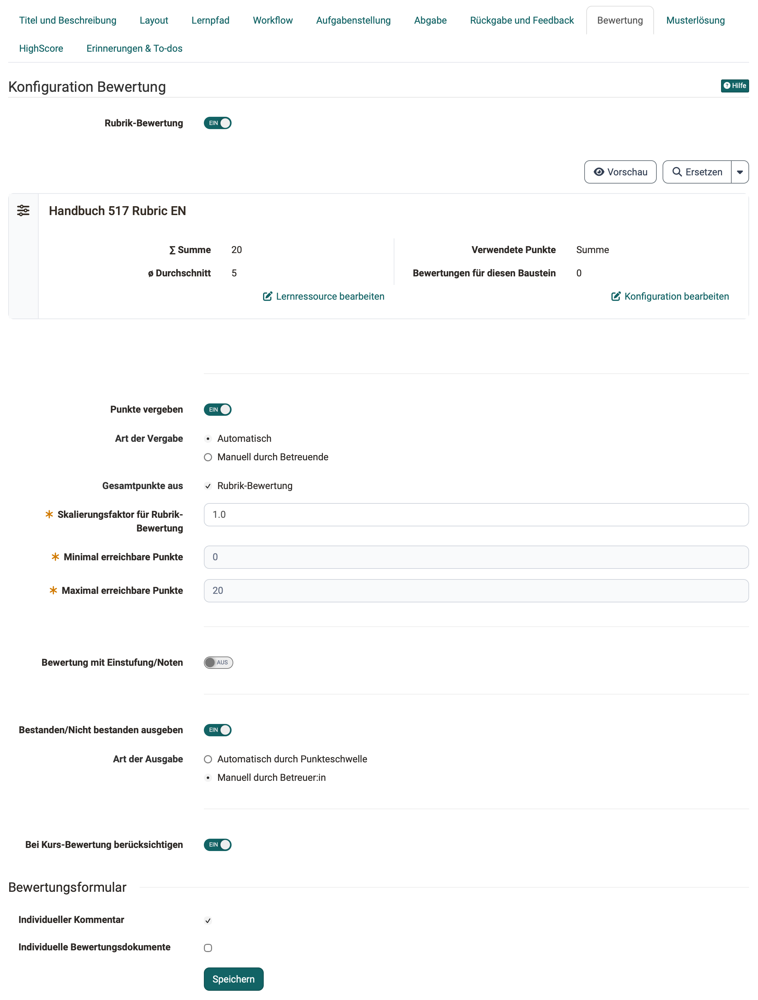{ class="shadow lightbox" title="Tab Bewertung der Aufgabe im Kurseditor · 2026.11.02" }

### Punkte vergeben

Im Feld "Art der Vergabe" legen Sie fest, ob OpenOlat die Punkte "Automatisch" aus den gewählten Quellen berechnet oder ob sie "Manuell durch Betreuende" eingetragen werden.

Wenn die Punktevergabe aktiviert wurde, müssen die minimale und die maximale Punktzahl angegeben werden. Zusätzlich können Sie dann auch die Option "Bewertung mit Einstufung/Noten" wählen und weiter konfigurieren. So können den jeweiligen Punkten bestimmte Bewertungsskalen wie Level, Noten, (Kompetenz-)Stufen oder Label zugeordnet werden. Die zur Verfügung stehenden Bewertungssysteme legen Systemadministrator:innen in der System-Administration fest: `Administration > e-Assessment > Einstufung/Noten`. Über den Button "Bewertungsskala bearbeiten" wählen Sie ein Bewertungssystem aus und passen die Punkte im Detail an. Ferner legen Sie fest, ob Betreuer:innen die berechnete Einstufung manuell zuordnen oder ob OpenOlat sie bei einer Punkteänderung automatisch anzeigt.

### Gesamtpunkte aus ...

Die Gesamtpunktzahl kann aus einer oder mehreren Quellen errechnet werden:

* **Rubrik-Bewertung**: Wird im Tab "Bewertung" ein Rubrik-Formular verwendet, können von dort Punkte übernommen werden.
* **Rubrik-Peer-Review**: Ein Peer-Review verwendet das Rubrik-Formular, das im Tab "Rückgabe und Feedback" eingebunden wird.
* **Abgegebene Reviews**: Für das Reviewen von anderen Teilnehmer:innen können der Person zusätzliche Punkte angerechnet werden (Punkte pro erledigtem Review, konfiguriert unterhalb dieser Auswahl, sobald die Option markiert wurde).

Für die beiden Rubrik-Quellen erscheint je ein Gewichtungsfeld: "Skalierungsfaktor für Rubrik-Bewertung" und "Skalierungsfaktor für Rubrik-Peer-Review". Damit bestimmen Sie, mit welchem Faktor die Punkte der jeweiligen Quelle in die Gesamtpunktzahl eingehen.

Welche Punkte aus dem Peer-Review in die Bewertung einfliessen, beschreibt die Seite [Aufgabe mit Peer-Review](Task_Peer_Review.de.md#coach_task_peer_review_evaluate).

### Bestanden/Nicht bestanden
Ist "Bestanden/Nicht bestanden ausgeben" eingeschaltet, wählen Sie unter "Art der Ausgabe" zwischen "Automatisch durch Punkteschwelle" und "Manuell durch Betreuer:in". Für die automatische Ausgabe müssen die Punktevergabe aktiviert und eine Punkteschwelle für das Bestehen angegeben sein.

### Bei Kurs-Bewertung berücksichtigen
Hier legen Sie fest, ob das Ergebnis dieses Kursbausteins in die Bewertung des gesamten Kurses einfliesst.

### Bewertungsformular {: #assessment_form}
Unter "Bewertungsformular" aktivieren Sie optional "Individueller Kommentar" und "Individuelle Bewertungsdokumente", sodass Betreuende noch weitere flexible Rückmeldungsmöglichkeiten haben.

[zum Seitenanfang ^](#create_task)

---

## Tab "Musterlösung" {: #sample}

Um allen Teilnehmenden eine Musterlösung zu den gestellten Aufgaben anzubieten, erstellen Sie entweder die Musterlösung direkt mit dem internen Editor oder Sie nehmen ein Video mit Ihrer Webcam auf oder Sie laden Dateien mit den Musterlösungen hoch.

!!! info "Voraussetzung"

    Im Tab "Workflow" muss

    * "Musterlösungen" aktiviert worden sein, damit Sie diese nun einrichten können.

    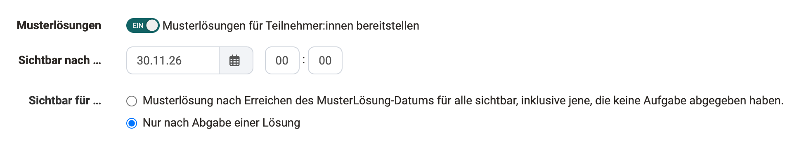{ class="shadow lightbox" title="Tab Workflow, Abschnitt Musterlösungen · 2026.11.02" }

Standardmässig sehen Teilnehmende die Musterlösung erst, wenn sie die vorherigen Schritte abgeschlossen haben. Gibt es ein Feedback durch Betreuende, ist das nach der Annahme ihrer Abgabe. Wählen Sie im Tab "Workflow" unter "Sichtbar für …" die Sichtbarkeit für alle, sehen auch Personen ohne Abgabe die Musterlösung ab dem eingetragenen Datum.

!!! tip "Tipp"

    Sollen die Teilnehmenden vorab bereits Hilfestellungen zur Bearbeitung der Aufgabe erhalten, laden Sie diese zusammen mit der Aufgabenstellung als ZIP-Datei hoch oder nutzen Sie das Feld "Mitteilung an Benutzer:in" im [Tab "Aufgabenstellung"](#assignment).

[zum Seitenanfang ^](#create_task)

---

## Tab "HighScore"  {: #highscore}

Sofern für die Aufgabe Punkte vergeben werden, können Sie diese mit den HighScore-Optionen visualisieren.

Voraussetzung ist, dass für die Aufgabe im Tab "Bewertung" die Vergabe von Punkten aktiviert wurde. Erst dann wird der Tab "HighScore" aktiv und kann konfiguriert werden. Sie bestimmen hier,

* welche Elemente angezeigt werden,
* ob die Darstellung anonym sein soll und
* ab welchem Zeitpunkt die Highscore-Liste sichtbar sein soll.

Weitere Informationen zu diesem Tab, der in den meisten bewertbaren Kursbausteinen zur Verfügung steht, finden Sie auf der Seite [Kursbausteine](../Course_Elements.de.md).

[zum Seitenanfang ^](#create_task)

---

## Tab "Erinnerungen & To-dos" [:octicons-tag-16:{ title="ab Release 18.2 (OO-7040)" }](https://track.frentix.com/issue/OO-7040) {: #reminders}

Mit der Erinnerungsfunktion können Sie [Erinnerungen](../Course_Reminders.de.md) in Form einer E-Mail an Kursmitglieder versenden und automatische [To-dos](../Course_todos.de.md) für die Aufgabe generieren. To-dos werden den Teilnehmenden im persönlichen Menü unter "[To-dos](../../personal_menu/To-Dos.de.md)" hinterlegt.

Wird die automatische Erstellung von To-dos aktiviert, sehen die Teilnehmenden unter `Mein Kurs > To-dos` den aktuellen Stand (Schritt) des Workflows der entsprechenden Aufgabe und erkennen so rasch, ob und welcher Schritt gerade von ihnen erwartet wird. Darüber hinaus erscheinen diese To-dos auch bei den persönlichen To-dos in den persönlichen Werkzeugen.

Mit den To-dos behalten die Teilnehmenden den Überblick über ihre Aufgaben. Weitere Informationen finden Sie auf der Seite [To-dos: Grundlagen](../../basic_concepts/To_Dos_Basics.de.md).

!!! note "Hinweis"

    Ob auch Betreuende To-dos bearbeiten dürfen, legen Sie in den Kurseinstellungen mit der Checkbox "To-dos bearbeiten" fest: 
    `Kurs > Administration > Einstellungen > Tab "Optionen"`

[zum Seitenanfang ^](#create_task)

---

## Tab "Badges" {: #tab-badges}

Ist in den Kurseinstellungen "Badges vergeben" eingeschaltet, zeigt der Kurseditor zu diesem Kursbaustein den Tab "Badges", und Sie können einen eigenen Badge für diesen Kursbaustein erstellen. Die Einstellung finden Sie unter: 
`Kurs > Administration > Einstellungen > Tab "Bewertung" > Abschnitt "Badges"`

[Zum Seitenanfang ^](#create_task)

## Weiterführende Informationen {: #further_information}

**Auf dieser Seite erwähnt** 
[Kursbaustein "Aufgabe" >](index.de.md) 
[Kurseinstellungen >](../Course_Settings.de.md) 
[Aufgabe mit Peer-Review >](Task_Peer_Review.de.md) 
[Kursbaustein "Gruppenaufgabe" >](../Course_Element_Grouptask.de.md) 
[Bewertungswerkzeug - Übersicht >](../Assessment_tool_overview.de.md) 
[Kursbausteine im Überblick >](../Course_Elements.de.md) 
[Erinnerungen >](../Course_Reminders.de.md) 
[To-dos im Kurs >](../Course_todos.de.md) 
[Persönliche Werkzeuge: To-dos >](../../personal_menu/To-Dos.de.md) 
[To-dos: Grundlagen >](../../basic_concepts/To_Dos_Basics.de.md)

**Weiterführend** 
[Aufgabe bearbeiten (Teilnehmende) >](Task_Participants.de.md) 
[Aufgabe betreuen >](Task_Coaching.de.md)

[Zum Seitenanfang ^](#create_task)
