# Set up a task {: #create_task}

This page is intended for course owners. It describes how you set up the [course element "Task"](index.md) in the course editor, tab by tab in the order of the user interface.

You create and configure the task in the course editor, like all course elements. In a learning path course, the course element has eleven tabs there, from "Title and description" to "Reminders & to-dos"; in a conventional course, the tabs "Visibility" and "Access" take the place of "Learning path". Which tabs you can edit depends on the steps you switch on in the tab "Workflow". The course editor additionally shows the tab "Badges" if badges are awarded in the course.

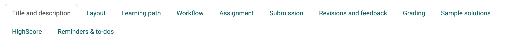{ class="shadow lightbox" title="Course editor, course element Task · 2026.11.02" }

!!! note "Quick Links: Set up a task"

    * [Tab Title and description](#title)  General information about the course element
    * [Tab Layout](#layout)  General settings in the layout
    * [Tab Learning path](#learningpath)  Should the task be voluntary, mandatory or only for certain groups of people?
    * [Tab Workflow](#workflow)  Here you determine which steps the task should contain.
    * [Tab Assignment](#assignment)  Creation or upload of the task, assignment of different tasks or drawing, etc.
    * [Tab Submission](#submission)  Definition of expected submissions (with template?, as audio/video recording?, etc.)
    * [Tab Revisions and feedback](#revisions) Return documents for feedback by coaches, reference to the settings of the peer review
    * [Tab Grading](#grading)  Configuration of the grading, criterion for passing, consideration in the course evaluation, etc.
    * [Tab Sample solutions](#sample)  E.g. provision of a pdf file.
    * [Tab HighScore](#highscore)  Visualization of the results if points are awarded.
    * [Tab Reminders & to-dos](#reminders)  Preparation of automatic reminder emails and to-dos
    * [Tab Badges](#tab-badges) Creation of badges for the processing/completion of the task

## Tab "Title and description"  {: #title}

The information about the course element is the same as in all course elements.

[To the top of the page ^](#create_task)

## Tab "Layout"  {: #layout}

The layout options are the same as those contained in all course elements.

[To the top of the page ^](#create_task)

---

## Tab "Learning path"  {: #learningpath}

!!! info "Traditional courses"

    Traditional courses do not have the "Learning path" tab and instead have the "Visibility" and "Access" tabs, including expert mode.

Here you define whether working on the task is mandatory or optional, or whether the course element is not displayed (excluded). Mandatory tasks are taken into account in the progress display, optional ones are not.

You use the "Release date" if the course element is to be opened and started only from a certain date. However, the course element itself already appears in the course structure.

The time entered under "Due date" refers to the deadline for picking up or starting the course element Task, not to the deadline for file upload (see [tab "Workflow"](#workflow)).

Under "Learning time (minutes)" you enter how long participants are expected to need for the task. The entry is especially important if the progress in the course depends on the learning time of the course elements. You find this setting in the [course settings](../Course_Settings/index.md) under: 
`Course > Administration > Settings > Tab "Execution"`

The "Learning Path" tab also defines which criterion must be met for the task to be considered "completed". The following options are available:

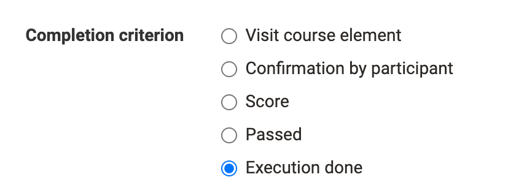{ class="shadow lightbox" title="Course editor, course element Task, tab Learning path · 2026.11.02" }

* **Visit course element**: The person has opened the course element.
* **Confirmation by participant**: The person has clicked on the confirmation of reading.
* **Score**: The person has achieved at least the specified score while completing the task.
* **Passed**: The person has fulfilled the "passed" requirements configured in the "Grading" tab, or a coach has manually set the task to passed.
* **Execution done**: The person has run through all steps of the workflow.

[To the top of the page ^](#create_task)

## Tab "Workflow"  {: #workflow}

In the "Workflow" tab, you define which steps the task consists of. Should a specific task be stored in the course element, or do the participants find the task elsewhere? Should they submit a document? Should there be feedback from coaches or a peer review, and may participants revise their submission? Should a sample solution be available? Should an assessment with points or passed be possible? Should certain participants be assessed by certain coaches? Switch on the steps you need, and then configure the corresponding tabs.

!!! tip "Tip"

    This is the first tab of the course element that you should configure. Select the functions you require here. The matching tabs are then active/inactive and can be configured further.

!!! warning "Attention"

    Subsequent changes to the workflow affect all participants, even if they have already started the workflow.

    When changes are made to the workflow, e.g. removing the assignment, this workflow component is removed for all participants in the course. The information about already selected tasks is then no longer visible. However, if the workflow component is inserted again, this information will be accessible again.

    However, if the assignment is added later and a participant is already further along in their personal workflow, no assignment needs to be selected afterwards.

The following options are available to you:

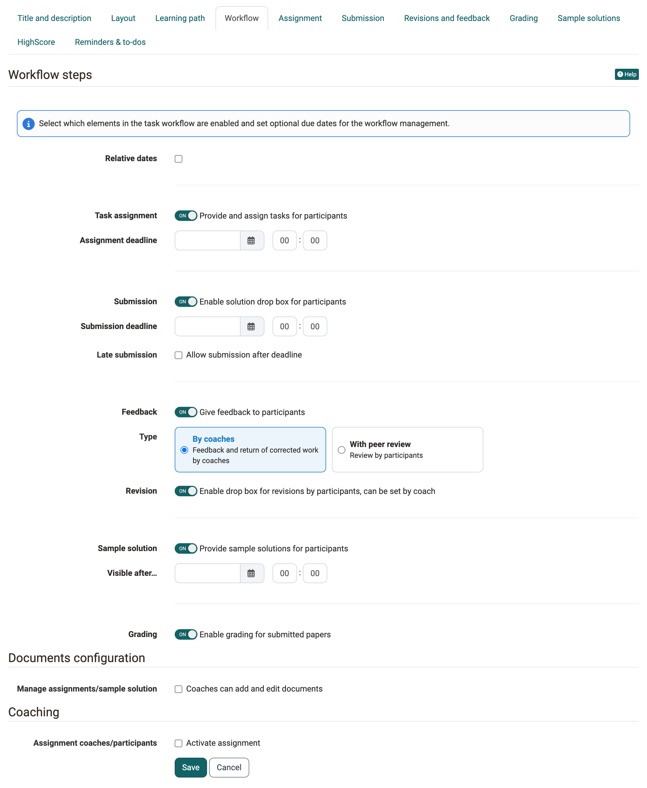{ class="shadow lightbox" title="Course editor, course element Task, tab Workflow · 2026.11.02" }

### Relative dates {: #workflow_relative_dates}

Instead of entering calendar dates, you can also work with _relative dates_. Specify how many days after the first course launch or the enrollment the task assignment remains open. All set times can also be adjusted individually, e.g. if a participant needs an extension due to certain circumstances. This applies to all process steps. If you extend the submission date, the task is reopened. A late submission date is also possible.

=== "With fixed date"

    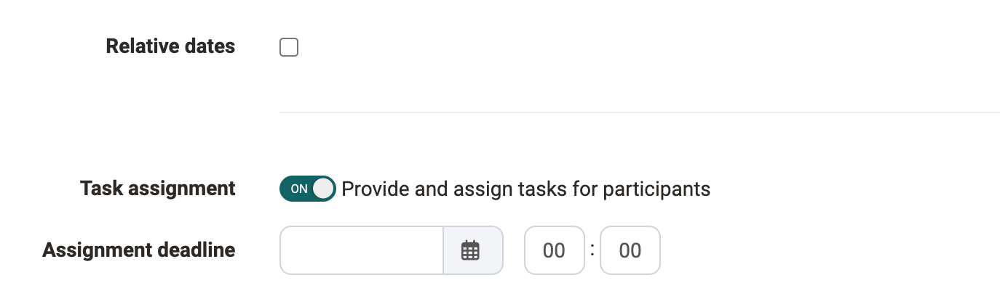{ class="shadow lightbox" title="Tab Workflow, section Task assignment · 2026.11.02" }

=== "With relative date"

    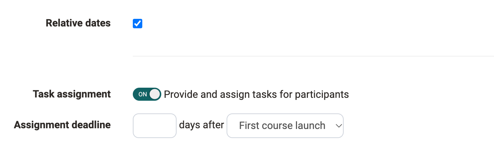{ class="shadow lightbox" title="Tab Workflow, section Task assignment · 2026.11.02" }

The changeover to relative dates affects the input fields for "Task assignment", "Submission" and "Sample solution".

### Task assignment {: #workflow_assignment}

With this switch you provide the participants with tasks and assign them. The task assignment is available until the date under "Assignment deadline". You then store the tasks themselves in the [tab "Assignment"](#assignment).

### Submission {: #workflow_submission}

With this switch participants submit their solution in the course element. Submission is possible until the date under "Submission deadline".

If "Allow submission after deadline" is activated and a date is set under "Last submission until…", participants can still submit their solution up to this date. Participants see the normal and the late submission deadline as long as they are in the future. Coaches and course owners also see the late submission.

### Feedback {: #workflow_feedback}

Under "Type" you choose who gives the feedback: "By coaches" or "With peer review", i.e. by the other participants. With peer review you also set the "Peer review time period". How you set up the peer review and how it works is described on the page [Task with peer review](Task_Peer_Review.md).

### Revision {: #workflow_revision}

Here you allow participants to submit a revision after the correction. Whether a revision is needed is decided by the coaches for each submission. The switch appears if feedback is switched on and the option "By coaches" is selected under "Type".

### Sample solution {: #workflow_sample_solution}

A sample solution can be provided for all participants or only those who have completed the task from the date entered. The selection "Visible for …" only appears when a calendar date is entered under "Visible after…" or the task is optional.

### Grading {: #workflow_grading}

With this switch you activate the [tab "Grading"](#grading), in which you configure the details of the assessment.

### Documents configuration [:octicons-tag-16:{ title="from Release 16.0 (OO-5490)" }](https://track.frentix.com/issue/OO-5490) {: #workflow_documents_configuration}

This area only appears if "Task assignment" or "Sample solution" is switched on, because documents are uploaded then. Under "Manage assignments/sample solution" you allow with "Coaches can add and edit documents" that coaches as well as course owners add and edit documents.

### Coaching {: #workflow_coaching}

In the area "Coaching" you activate participant-dependent coaching: each participant is then assigned a specific coach.

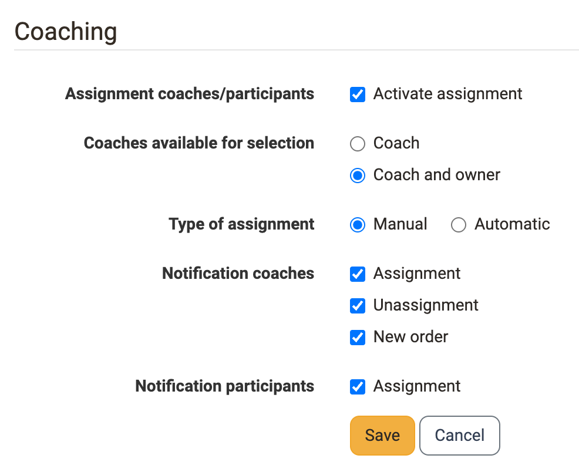{ class="shadow lightbox" title="Tab Workflow, section Coaching · 2026.11.02" }

* **Assignment coaches/participants** 
With "Activate assignment" you display the other options for coaching. You then assign the persons when the course editor is closed, see [table "Assignment coaches/participants"](#coach_assignment_table).

* **Coaches available for selection** 
Here you choose between "Coach" and "Coach and owner". With the second option, course owners are also available for coaching the participants.

* **Type of assignment** 
Here you define whether you assign the coaches "Manual" or OpenOlat assigns them "Automatic".

* **Notification coaches** 
Select here in which cases coaches receive a notification by e-mail: "Assignment", "Unassignment" and "New order".

* **Notification participants** 
Select here whether participants should be informed by e-mail about the assignment to a coach.

!!! warning "Attention"

    If no person has the role of coach among the course members and at the same time course owners do not perform any coach tasks, then no coach assignment can take place. Whether course owners perform coach tasks is set above under "Coaches available for selection".

### Table "Assignment coaches/participants" [:octicons-tag-16:{ title="from Release 17.2.1 (OO-6698)" }](https://track.frentix.com/issue/OO-6698) {: #coach_assignment_table}

Course owners assign the persons when the course editor is closed: `Course > "Title of the course element" > Tab "Participants" > Button "Assignment coaches/participants"`.

The table is a matrix: each row is a participant, each column a coach available for selection, plus the column "Not assigned". You set the assignment by choosing the radio button in the desired column of the row. Behind every name, brackets state how many people are currently assigned to that coach. This makes an uneven distribution visible at a glance. The assignment is only saved with "Apply assignment".

Via "Randomly assign unassigned", OpenOlat distributes all people still open automatically. The tabs "All" and "Not assigned" as well as the filters "Participants" and "Coach" narrow down the list. If the course has groups or curriculum elements, the filter "Groups" is added.

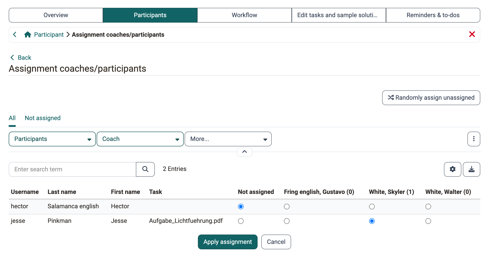{ class="shadow lightbox" title="Course element Task, tab Participants, Assignment coaches/participants · 2026.11.03" }

!!! note "Note"

    Coaches do not see the button "Assignment coaches/participants". The assignment is reserved for course owners; coaches recognise their own assignment in the column "Coach" of the participant list.

Two functions support the work with large lists:

* **Export**: via the export symbol above the table on the right, you download the current table view as an Excel file, for example as proof of the assignment.
* **Save filter**: you store a set filter combination via the three-dot menu on the right next to the filters with "Save filter" under a name of your own. The stored filter then appears as a tab of its own and is available again the next time the table is opened. [:octicons-tag-16:{ title="from Release 21.0.2 (OO-9601)" }](https://track.frentix.com/issue/OO-9601)

The button appears only for the course element Task and only if the assignment of coaches and participants is activated. For the [group task](../Course_Element_Grouptask.md), the assignment follows from the coaching of the group.

!!! info "Note"

    System administrators can preconfigure the options displayed in the Workflow tab and selectable by the author in the system administration: `Administration > Modules > Course elements`

[To the top of the page ^](#create_task)

---

## Tab "Assignment"   {: #assignment}

!!! info "Requirement"

    In the tab "Workflow", "Task assignment" must first be switched on so that you can provide the specific task in the tab "Assignment".

**a) Upload files**

You can upload one or more task files created beforehand. Each uploaded task then counts as an alternative to be worked on. If several complementary files are needed for one task, bundle all required files as a zip file and upload this zip file as the task file.

In general, each task file should have a suitable title and possibly a short description.

**b) Create files in different formats**

Create files directly in OpenOlat. Exactly which formats are available depends on which editors system administrators have activated in the system administration. In most cases, at least one HTML editor is available. But it is also possible to create Word, Excel, PowerPoint and diagrams or whiteboards. In addition, a specific video task or an audio task can also be created.

If a task is created with the internal OpenOlat HTML editor, multiple files such as images or PDF files can be provided by first uploading them in the HTML editor and then linking them in the corresponding html page. Such a task will then be downloaded in .zip file format as well. If the HTML editor is used, the stored title is automatically used as the file name. However, this can be changed at any time.

!!! info "Multiple files"

    Please note: If multiple files are stored in the Task tab, they will be considered as multiple different tasks. It is _not_ a task with several complementary files.

In the field "Type of assignment" you determine whether a participant is offered all available tasks for selection ("Selection of task by user") or whether OpenOlat assigns a task by random selection ("Automatic task assignment").

In the field "Type of sampling", select whether several participants can solve the same task or whether each participant should solve a different task. If the task is selected manually, you can also specify in the "Preview" field whether the participants can view the task before selecting it. If each participant is to solve a different task for "Type of sampling", at least as many tasks must be entered as there are participants who are to solve this task.

!!! tip "Tip"

    If the course element contains only one task, manual selection is not very useful. In this case, it is best to use the automatic assignment.

In the field "Message for users" you provide general information for all participants on working on the tasks.

If a participant chooses the wrong task by mistake during manual selection, course owners can allow them to reset it in the [assessment tool](../Assessment_tool_overview/index.md) with "Reset data of task": 
`Course > Administration > Assessment tool > "Title of the course element" > "Name of the person"`

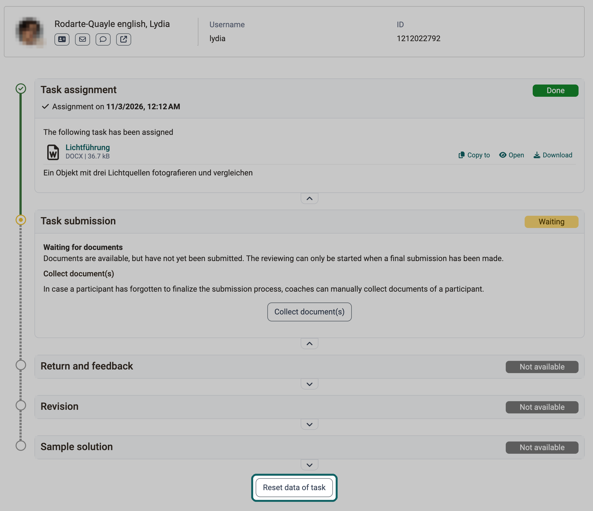{ class="shadow lightbox" title="Assessment tool, course element Task, person · 2026.11.03" }

The choice does _not change automatically_. The participant gets the opportunity to undo their previous steps with "Reset task".

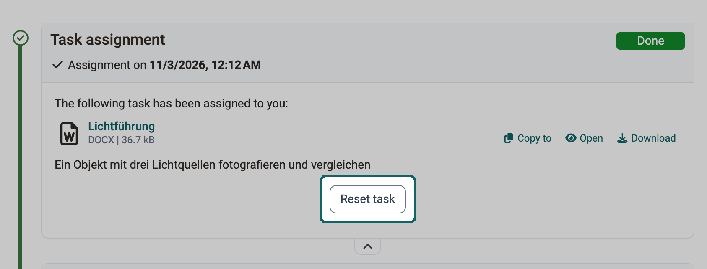{ class="shadow lightbox" title="Course element Task, participants' view · 2026.11.03" }

[To the top of the page ^](#create_task)

---

## Tab "Submission"  {: #submission}

Here you define the type and scope of the submission options for the participants.

!!! info "Requirements"

    In the tab "Workflow"

    * "Submission" must be activated so that you can set it up now.

    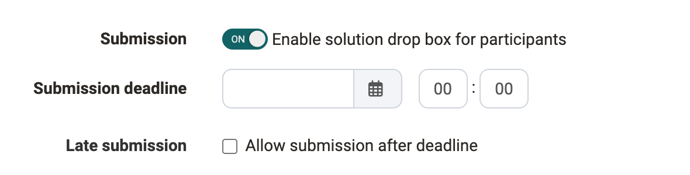{ class="shadow lightbox" title="Tab Workflow, section Submission · 2026.11.02" }

Then activate at least one of the two options: uploading documents or using the OpenOlat editor for the submission.

The following options are available in the "Submission" tab:

**"Upload files (e.g. PDF)"**: Participants upload documents created outside of OpenOlat and submit them.

**"Submit with OpenOlat editor"**: Participants create documents directly in the course element. By default, an HTML editor is available for this. If other document editors are integrated in OpenOlat, they can also create documents in other formats such as Word or Excel, as well as draw.io diagrams.

Activate "Assignment is template for submission" if participants are to use the stored task file as the basis for their work, for example if the task contains a pre-structured table to be filled in.

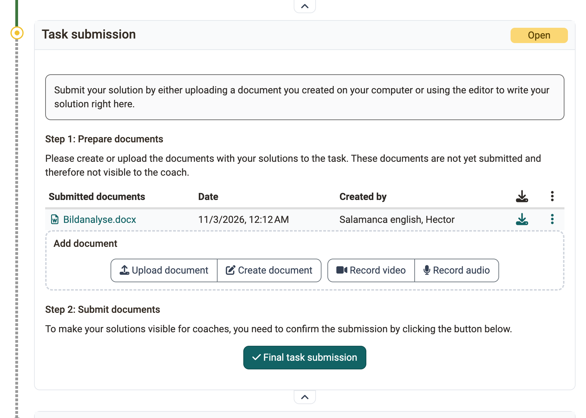{ class="shadow lightbox" title="Step Task submission, participants' view · 2026.11.03" }

**"Allow video recordings"**: Participants additionally record videos via webcam and submit them. Under "Max. length of recording (in sec)" you limit the duration, under "Video quality" you choose the quality level.

**"Allow audio recordings"**: Participants additionally record audios with the audio recorder and submit them. Here, too, you limit the duration under "Max. length of recording (in sec)".

Under "Min. number of documents" and "Max. number of documents" you define how many documents a submission must or may contain. If there is to be no restriction, leave the fields blank.

Activate the e-mail confirmation so that people who have submitted a task receive a message. You adapt the pre-formulated text of the e-mail if required.

[To the top of the page ^](#create_task)

---

## Tab "Revisions and feedback"  {: #revisions}

!!! info "Requirements"

    In the tab "Workflow"

    * "Feedback" must be switched on.
    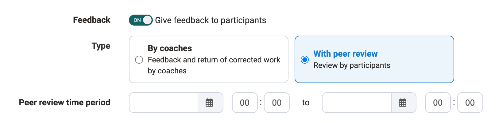{ class="shadow lightbox" title="Tab Workflow, section Feedback · 2026.11.02" }
    * Depending on who is providing the feedback, different options appear in the tab "Revisions and feedback".

**Revisions and feedback by coaches**

If the option "By coaches" was selected in the tab "Workflow", you define in the tab "Revisions and feedback" under "Revision configuration" the minimum and maximum number of return documents that participants are allowed to submit during the steps "Return and feedback" and "Revision".

If the option "With peer review" was selected, the page [Task with peer review](Task_Peer_Review.md#peer_review_settings) describes the settings in the tab "Revisions and feedback".

[To the top of the page ^](#create_task)

---

## Tab "Grading"  {: #grading}

Here you define _how_ the participants are assessed. Should there be points? Should there be a passed/not passed for the course element? Should the point evaluation be linked to a rating scale, and if so, with which? Should coaches be able to provide further individual comments or documents? Decide in each case what suits your scenario.

If assessments already exist for the task, OpenOlat displays the settings under "Grading configuration" in this tab as read-only. The area "Assessment form" remains editable. With "Enable edit mode" you make the settings editable again, see [Read-only assessment configuration](../Course_Elements/index.md#assessment_config_read_only). [:octicons-tag-16:{ title="from Release 21.1 (OO-9647)" }](https://track.frentix.com/issue/OO-9647)

A form with a rubric can also be used for the assessment. The points can then be taken from the rubric form for the assessment of the course element. The rubric form included here in the "Grading" tab is to be distinguished from the rubric form used in the "Revisions and feedback" tab for peer reviews.

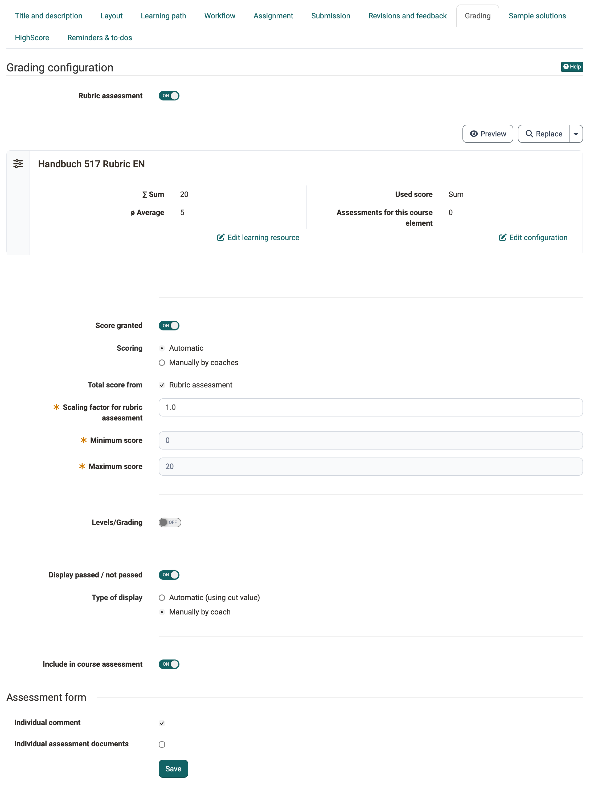{ class="shadow lightbox" title="Tab Grading of the task in the course editor · 2026.11.02" }

### Awarding points

In the field "Scoring" you define whether OpenOlat calculates the points "Automatic" from the selected sources or whether they are entered "Manually by coaches".

If scoring has been activated, the minimum and maximum number of points must be specified. You can then also select the "Assessment with grading/marks" option and configure it further. The respective points can be assigned specific evaluation scales such as levels, grades, (competence) levels or labels. System administrators define the available rating systems in the system administration: `Administration > e-Assessment > Levels/Grading`. Via the "Edit rating scale" button you select a rating system and adjust the points in detail. You also define whether coaches assign the calculated classification manually or whether OpenOlat displays it automatically when the points change.

### Total score from ...

The total score can be calculated from one or more sources:

* **Rubric assessment**: If a rubric form is used in the "Grading" tab, points can be transferred from there.
* **Rubric peer review**: A peer review uses the rubric form, which is included in the "Revisions and feedback" tab.
* **Submitted reviews**: Additional points can be awarded to the person for reviewing other participants (points per completed review, configured below this selection as soon as the option has been selected).

For both rubric sources, one weighting field each appears: "Scaling factor for rubric assessment" and "Scaling factor for rubric peer review". With them you determine the factor with which the points of the respective source enter the total score.

Which points from the peer review are included in the grading is described on the page [Task with peer review](Task_Peer_Review.md#coach_task_peer_review_evaluate).

### Passed/Failed
If "Display passed / not passed" is switched on, you choose under "Type of display" between "Automatic (using cut value)" and "Manually by coach". For the automatic display, scoring must be activated and a cut value for passing must be specified.

### Include in course assessment
Here you define whether the result of this course element is included in the assessment of the entire course.

### Assessment form {: #assessment_form}
Under "Assessment form" you optionally activate "Individual comment" and "Individual assessment documents" so that coaches have even more flexible feedback options.

[To the top of the page ^](#create_task)

---

## Tab "Sample solutions"  {: #sample}

To offer all participants a sample solution for the tasks set, you either create the sample solution directly with the internal editor, record a video with your webcam, or upload files with the sample solutions.

!!! info "Requirements"

    In the tab "Workflow"

    * "Sample solutions" must be activated in order to be configurated.

    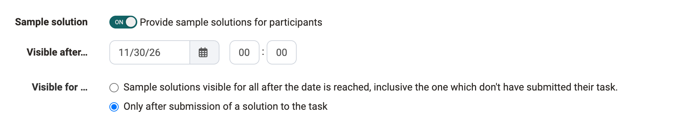{ class="shadow lightbox" title="Tab Workflow, section Sample solution · 2026.11.02" }

By default, participants only see the sample solution once they have completed the previous steps. If there is feedback by coaches, this is after their submission has been accepted. If you choose visibility for all in the tab "Workflow" under "Visible for …", persons without a submission also see the sample solution from the date entered.

!!! tip "Tip"

    If the participants are to receive help with the task in advance, upload it together with the task as a ZIP file or use the field "Message for users" in the [tab "Assignment"](#assignment).

[To the top of the page ^](#create_task)

---

## Tab "HighScore" {: #highscore}

If points are awarded for the task, you can visualize them with the HighScore options. 

The prerequisite is that the awarding of points has been activated for the task in the "Grading" tab. Only then does the tab "HighScore" become active and can be configured. Here you determine

* which elements are displayed,
* whether the display should be anonymous and
* from which point in time the high score list should be visible.

For more information on this tab, which is available in most assessable course elements, see the page [Types of Course Elements](../Course_Elements/index.md).

[To the top of the page ^](#create_task)

---

## Tab "Reminders & to-dos" [:octicons-tag-16:{ title="from Release 18.2 (OO-7040)" }](https://track.frentix.com/issue/OO-7040) {: #reminders}

With the reminder function, you can send [Reminders](../Course_Reminders.md) to course members in the form of an e-mail and generate automatic [To-dos](../Course_todos.md) for the task. To-dos are stored for participants in the personal menu under "[To-dos](../../personal_menu/To-Dos.md)".

If the automatic creation of to-dos is activated, participants can see the current status (step) of the workflow of the corresponding task under `My course > To-dos` and thus quickly recognize whether and which step is currently expected of them. In addition, these to-dos also appear among the personal to-dos in the user tools.

With the to-dos, participants keep track of their tasks. Further information can be found on the page [To-dos: basics](../../basic_concepts/To_Dos_Basics.md).

!!! note "Note"

    Whether coaches are also allowed to edit to-dos, you define in the course settings with the checkbox "Edit to-dos": 
    `Course > Administration > Settings > Tab "Options"`

[To the top of the page ^](#create_task)

---

## Tab "Badges" {: #tab-badges}

If "Award badges" is switched on in the course settings, the course editor shows the tab "Badges" for this course element, and you can create a badge of its own for this course element. You find the setting under: 
`Course > Administration > Settings > Tab "Assessment" > Section "Badges"`

[To the top of the page ^](#create_task)

## Further information {: #further_information}

**Mentioned on this page** 
[Course Element "Task" >](index.md) 
[Course Settings >](../Course_Settings/index.md) 
[Task with peer review >](Task_Peer_Review.md) 
[Course Element "Group Task" >](../Course_Element_Grouptask.md) 
[Assessment tool - overview >](../Assessment_tool_overview/index.md) 
[Course elements at a glance >](../Course_Elements/index.md) 
[Course Reminders >](../Course_Reminders.md) 
[To-dos in the course >](../Course_todos.md) 
[User tools: To-dos >](../../personal_menu/To-Dos.md) 
[To-dos: basics >](../../basic_concepts/To_Dos_Basics.md)

**Further reading** 
[Work on a task (participants) >](Task_Participants.md) 
[Supervise a task >](Task_Coaching.md)

[To the top of the page ^](#create_task)
