# Course Element "Test" {: #course_element_test}

## Profile

Name | Test
---------|----------
Icon | :o_icon_o_iqtest_icon:
Available since | Release 7.1 or earlier
Functional group | Assessment
Purpose | Course element for integration of a learning resource test into a course
Assessable | yes
Specialty / Note |

With the course element "Test" you integrate an OpenOlat learning resource "Test" into your course. In a course, a test serves to assess performance or as a quiz and includes various question types.

Depending on the question type, participants tick one or more answers, move elements by drag and drop, enter texts or numbers, add files or create markers and simple drawings. Depending on the question type, OpenOlat evaluates the answers automatically, or coaches correct them manually.

!!! note "Question Types"
    Overview of all available question types. 
    [Question types](../learningresources/Test_question_types.md)

A course can also contain several tests for different purposes. OpenOlat records the results of the participants on a personalized basis.

OpenOlat uses the IMS QTI 2.1 format for tests. This allows you to exchange tests with other test systems and learning management systems that also support this standard.

The two main tabs in which you define the settings for your test are "Test configuration" and "Options".

!!! warning "Attention"

    If you replace the test in the course element, OpenOlat collects ongoing and suspended test runs of the participants and marks them as invalid. What happens to finished test runs and existing assessments is described in the section [Changes to tests and self-tests](#changes).

!!! note "Note"

    There are two different course elements for tests in OpenOlat: "Test" and ["Self-test"](../learningresources/Course_Element_Self_Test.md). In contrast to the test, the self-test saves the test results anonymously. Self-tests are suitable for practice purposes, and participants complete them as often as they like. In addition, OpenOlat automatically shows the results of self-tests once they are finished.

    The handling of self-tests is otherwise identical to the handling of the tests.

Further information on the learning resource Test: [Create tests](../learningresources/Test.md)

[To the top of the page ^](#course_element_test)

---

## Test configuration {: #config}

Course owners, learning resource managers and administrators as well as persons with the right "Course editor" open the course editor. Open the course, go to the course editor and add a course element "Test" or select an already added course element "Test". You will now see the following tabs:

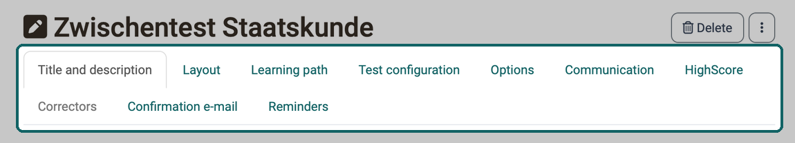{ class="shadow lightbox" title="Course element Test in the course editor · 2026.10.01" }

The tabs "Title and description" and "Layout" are the same for all course elements. The "Correctors" tab is only active if the option "Manual by correctors" is selected in the "Correction" section. The "Badges" tab is added if awarding badges is enabled in the course.

### Tab "Learning path" [:octicons-tag-16:{ title="from Release 15.0 (OO-4206)" }](https://track.frentix.com/issue/OO-4206) {: #tab_learning_path}

In the Learning path tab, you define under "Execution" whether the test is "Mandatory" or "Optional" in the learning path course, or whether the course element does not appear at all ("Excluded"). With "Enable exceptions", a different execution applies to certain persons or groups. You also define a "Release date", a date under "Due date" and the expected "Learning time (minutes)", with "Relative dates" also relative to an event such as the first course visit. The fields of this tab are described on the page [Learning path course - Course editor](Learning_path_course_Course_editor.md).

The following options are also available for tests under "Completion criterion": "Visit course element", "Confirmation by participant", "Score", "Passed" and "Test finished".

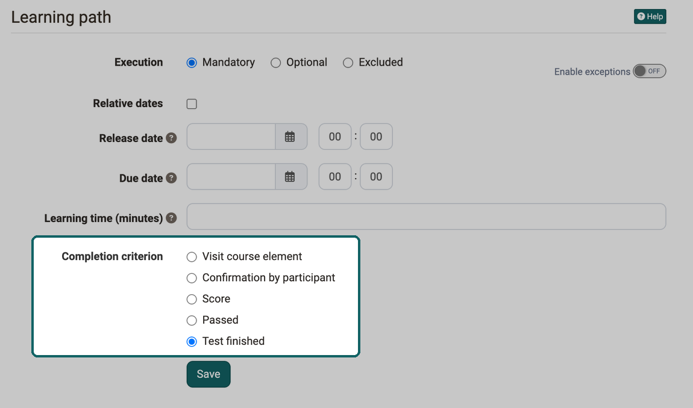{ class="shadow lightbox" title="Learning path tab of the course element Test · 2026.10.01" }

Only when the selected condition is met does OpenOlat show the participants the progress in the learning path display and in the progress percentage.

[Beginning of test configuration section ^](#config) 
[To the top of the page ^](#course_element_test)

### Tab "Test configuration" {: #tab_configuration}

If assessments already exist for the test, OpenOlat displays the settings under "Grading configuration" in this tab as read-only: "Levels/Grading" and "Include in course assessment". With "Enable edit mode" you make them editable again, see [Read-only assessment configuration](Assessment.md#assessment_config_read_only). The read-only mode only exists in the course element "Test", not in the self-test and not in the questionnaire. [:octicons-tag-16:{ title="from Release 21.1 (OO-9647)" }](https://track.frentix.com/issue/OO-9647)

If you have not yet selected a test, a corresponding message will appear in the "Test configuration" tab. You can now "Select" or "Import" an existing test or "Create" a new test. 

!!! tip "Existing Learning Resource"
    If a test learning resource is already inserted and you want to replace it, follow the instructions in the section [Changes to tests and self-tests](#changes).

Click on "Select" to assign a test to the course element. The following dialog also offers the options for creating and importing. Here you select or create the test that you assign to the course element "Test". You then define further settings, for example the type of correction or the display of the test results.

If the course element is already linked to a test, the tab "Test configuration" shows the name of the test and further information. With "Edit learning resource", you edit the test.

Via the "Preview" button, you open a preview of the test; via the "Replace" button, you replace the test by selecting, creating or importing another test. If test results already exist for the test, you receive a message when replacing it, and OpenOlat creates an archive file that you can save.

You configure an added test in more detail as follows. The tab shows the settings in this order: at the top "Relative dates" and "Set assessment period", below that the legend "Grading configuration", below that "Correction" and finally the legend "Report".

#### Set assessment period {: #assessment_period}

During the test period, the test can be started. As soon as the "Until" time is reached, OpenOlat ends the test automatically, even if the defined time limit has not yet run out. If "Relative dates" is switched on, you set a relative date instead of a fixed date, for example x days after the first course visit. How the test period and the assessment mode work together is shown in [How do the times of an exam fit together?](../../manual_how-to/exam_preparation/exam_preparation.md#exam_times)

If nothing is activated here, the test is accessible at all times, provided there is no restriction elsewhere, for example under "Visibility" for conventional courses or through a sequential order for learning path courses.

#### Section Grading configuration {: #section_test}

Under the legend "Grading configuration" you define whether OpenOlat assesses the test with levels/grading and whether it counts towards the course assessment. If assessments already exist, the message with the button "Enable edit mode" appears here.

##### Levels/Grading {: #grading}

Select one of the given rating scales, for example grades, levels or emojis, and adjust the details if required. Also decide whether OpenOlat assigns the level automatically and shows it to the participants or whether coaches assign it manually.

##### Include in course assessment {: #include_in_course_assessment}

If you switch off this toggle, the test is not taken into account in the course assessment of a learning path course. This setting is not available for a conventional course.

!!! note "Learning Path Course"
    Concept and progress calculation in the learning path course. 
    [Learning path course](../learningresources/Learning_path_course.md)

##### Scaling factor for course assessment {: #score_scaling}

The field appears if the course assessment adds up the points with weighting and "Include in course assessment" is switched on. OpenOlat multiplies the points of the test by this factor for the course assessment. More about this under [Course assessment with points: Sum with weighting](Course_Settings_Assessment.md#evaluation_with_points_weighting).

#### Section Correction {: #section_correction}

Under "Correction" you define who corrects the test runs and when the participants see their assessment.

##### Correction {: #correction_mode}

The correction is either automatic or manual. As soon as the test contains a question type to be evaluated manually, for example free text, a manual correction is mandatory. With automatic correction, OpenOlat corrects all questions directly, the result is visible to the participants immediately.

!!! note "Question Types"
    Overview of all available question types, including manually evaluated types. 
    [Question types](Test_question_types.md)

In case of manual correction, the visibility of the result is limited and the coach or corrector has to complete the correction manually. Questions to be edited manually include free text, upload file and draw. However, manual correction can also be set if required when the test consists only of automatically evaluable question types.

Three options are available:

* **Automatic**: OpenOlat corrects all questions directly.
* **Manual by course coach/owner**: The coaches or owners of the course do the correction.
* **Manual by correctors**: The correctors from the correction workflow of the learning resource Test do the correction. They can correct a test without being a member or even a coach of the course. This selection also activates the "Correctors" tab, and you can see who is assigned to the test as a corrector.

!!! info "Important"

    The option "Manual by correctors" is available if the [correction workflow](Test_settings.md#correction-workflow) is switched on in the learning resource Test. Correctors are managed independently of the course element, directly on the Test learning resource, and apply across courses. If the correction workflow is switched on and another option is selected, the "Correction" section shows a hint: with this setting no grading assignments are generated, "Manual by correctors" is recommended.

##### Release assessment {: #release_assessment}

The field appears with the two manual options. With "Released", the participants see the assessment directly after the manual correction; with "Not released", only once you release the assessment.

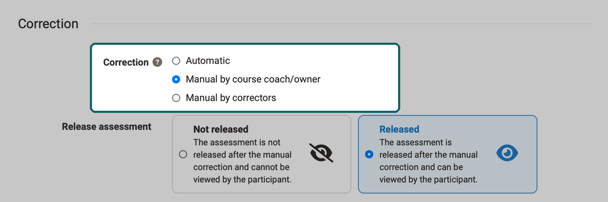{ class="shadow lightbox" title="Correction section in the Test configuration tab · 2026.10.02" }

The correction options and the release are also described on the page [Tests at course level](Tests_at_course_level.md#correction).

#### Section Report {: #section_report}

Here you define whether and in what form the participants see their test results and their performance status. If you select nothing here, the participants do not receive any information.

##### Show performance summary on test homepage {: #show_score_info}

If this option is selected, the participants see the points and further performance information such as success status, number of solution attempts and the level reached on the rating scale on the start page of the test.

In addition to the performance summary, OpenOlat can also show the participants the specific test evaluation, permanently on the test homepage and directly after processing.

##### Show assessment on test homepage {: #show_results_on_homepage}

In this drop-down list you define whether and under which conditions the test evaluation appears on the start page of the test. With "Always", the results are available immediately after the test is finished; with "No", they do not appear at all. With the other options you define with "From" and "Until" in which period the results appear: only if the test was not passed, only if it was passed, with different periods for both cases or with a common period.

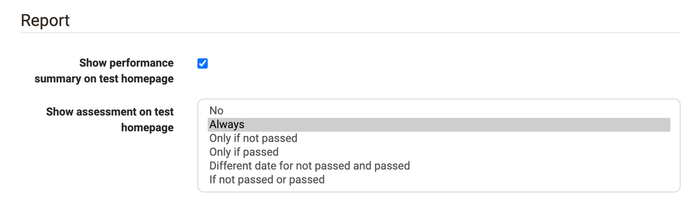{ class="shadow lightbox" title="Report section in the Test configuration tab · 2026.10.01" }

##### Show results after test has been submitted {: #show_results_on_finish}

If this checkbox is activated, the participants see the test evaluation directly after submitting.

##### Overview results {: #results_overview}

Here you select in which form the results appear. The selection applies to both displays. The field appears as soon as "Show results after test has been submitted" is activated or an option other than "No" is selected under "Show assessment on test homepage".

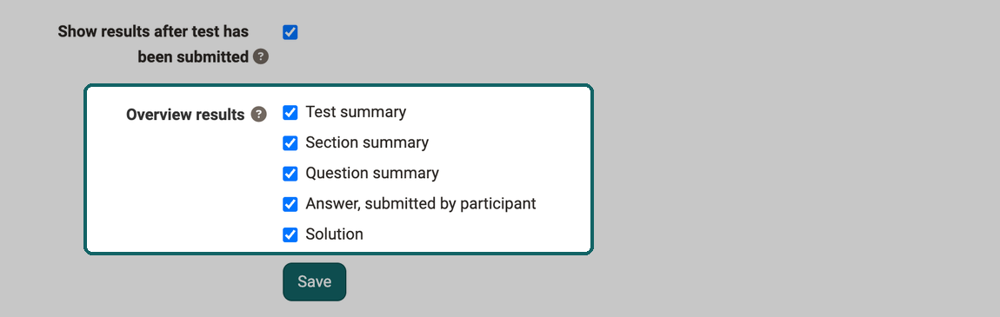{ class="shadow lightbox" title="Report section in the Test configuration tab · 2026.10.01" }

* **Test summary**: shows, among other things, the percentage achieved, the time taken to complete the test, the number of questions worked on, the score achieved and the status.
* **Section summary**: is only relevant if a test also contains sections.
* **Question summary**: shows the title of the question and the points achieved in each case or the matching percentage value, but not the question itself.
* **Answer, submitted by participant**: shows the question, all answer options and the choice of the participants, but no rating of whether the answer is correct or incorrect. If this is desired, combine the option with other feedback options.
* **Solution**: contains the correct answers.

!!! note "Section Level"
    Description of the section configuration in the test editor. 
    [Section level](Configure_tests.md#section)

Depending on the combination of display options, the participants receive different types of feedback.

[Beginning of test configuration section ^](#config) 
[To the top of the page ^](#course_element_test)

### Tab "Options" {: #tab_options}

If you include a test in a course, OpenOlat takes over the settings from the configuration of the learning resource "Test" by default (see "[Test Settings](Test_settings.md)" and "[Configure Test](Configure_tests.md)"). Therefore, in the "Options" tab, "Apply configuration from learning resource" is preselected, and the tab shows the settings of the learning resource Test.

If you want to change the settings for the test included in the course, select "Customize configuration" and adjust the settings. For example, you define a time limit, restrict the number of solution attempts or allow guests to take the test. In addition, you configure various display options.

If the "Show question title" option is not selected but menu navigation is enabled, the navigation shows only anonymized titles instead of the actual titles.

!!! info "Important"

    These adjustments in the test have no effect on the configuration of the test learning resource itself.

In addition, you set up an information text (HTML page) for the test, which the participants see on the start page of the test above the start button. To do this, click on "Create", "Select" or "Import" in the "Information text (HTML)" section of the "Options" tab.

Activate "Allow links in the entire storage folder." if you want to link to other HTML files or graphics in the information text, for example. However, with this setting experienced participants can also gain insight into the entire storage folder of the course.

[Beginning of test configuration section ^](#config) 
[To the top of the page ^](#course_element_test)

### Tab "Communication" [:octicons-tag-16:{ title="from Release 16.2.0 (OO-5966)" }](https://track.frentix.com/issue/OO-5966) {: #tab_communication}

Here you define whether participants may send live chat requests to the coaches or owners of the course during the test. This is only useful if coaches observe the test execution during a defined test period, for example in online examinations or synchronous admission examinations by test.

[Beginning of test configuration section ^](#config) 
[To the top of the page ^](#course_element_test)

### Tab "HighScore" [:octicons-tag-16:{ title="from Release 11.3 (OO-2133)" }](https://track.frentix.com/issue/OO-2133) {: #tab_highscore}

Here you activate and configure a highscore overview for a test. This overview compares the test results of the participants and ranks the individual result in comparison.

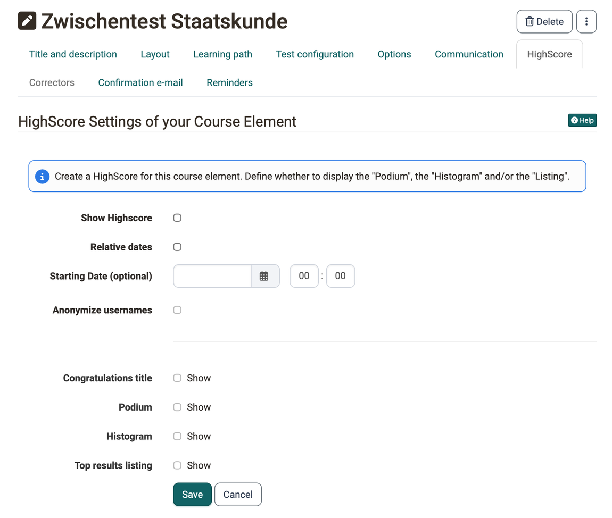{ class="shadow lightbox" title="HighScore tab of the course element Test · 2026.10.01" }

First activate "Show Highscore". Under "Starting Date (optional)" you define from when the highscore appears. With "Relative dates" you specify this date relative to an event, for example the first course visit. With "Anonymize usernames", the participants appear in the highscore without first and last names.

Below, you select what is displayed: "Congratulations title", "Podium", "Histogram" and "Top results listing". At least one display option must be activated. For the listing, you also define whether all or only the top users appear and how many.

!!! note "Highscore"
    More information on the topic of high scores. 
    [Learn more](../learningresources/Course_Elements.md#highscore)

[Beginning of test configuration section ^](#config) 
[To the top of the page ^](#course_element_test)

### Tab "Correctors" [:octicons-tag-16:{ title="from Release 15.0 (OO-4442)" }](https://track.frentix.com/issue/OO-4442) {: #tab_correctors}

The tab is active if the option "Manual by correctors" is selected in the "Correction" section; otherwise it is greyed out. It shows the configuration of the correction workflow and the correctors entered in the learning resource Test. Via the link to the learning resource of the test, you change these details.

[Beginning of test configuration section ^](#config) 
[To the top of the page ^](#course_element_test)

### Tab "Confirmation e-mail" [:octicons-tag-16:{ title="from Release 17.2.0 (OO-6672)" }](https://track.frentix.com/issue/OO-6672) {: #tab_email_confirmation}

Activate the "Confirmation e-mail" if the participants should receive a confirmation after submitting the test. On request, a copy of the e-mail also goes to the owners of the course, the assigned coaches or external e-mail addresses.

For the e-mail text, you use the template and a preset subject with the title of the course element. Alternatively, you change both: select the option "Own text" under "Template" to edit or completely change the text.

In the e-mail text, you also use variables such as name or score.

!!! note "Variables in mailing texts"
    More information on using variables in mailing texts. 
    [Learn more](Course_Element_EMail.md#use-of-variables)

[Beginning of test configuration section ^](#config) 
[To the top of the page ^](#course_element_test)

### Tab "Reminders" [:octicons-tag-16:{ title="from Release 16.0.0 (OO-5447)" }](https://track.frentix.com/issue/OO-5447) {: #tab_reminders}

Here you configure reminders by e-mail according to certain criteria.

!!! note "Reminders"
    More information about sending reminders. 
    [Learn more](../learningresources/Course_Reminders.md)

[Beginning of test configuration section ^](#config) 
[To the top of the page ^](#course_element_test)

### Tab "Badges" [:octicons-tag-16:{ title="from Release 18.0 (OO-7003)" }](https://track.frentix.com/issue/OO-7003) {: #tab_badges}

If owners of the course have activated the awarding of badges under `Course > Administration > Settings > Tab "Assessment" > Section "Badges"`, the course editor shows the tab "Badges" for this course element. There you create a badge specifically for this course element.

!!! note "Badges"
    More information on the topic of badges and how they are awarded. 
    [Badges](../learningresources/OpenBadges.md)

[Beginning of test configuration section ^](#config) 
[To the top of the page ^](#course_element_test)

---

## Compare tests and self-tests {: #compare_test_self-test}

Attribute | :fontawesome-solid-square-pen: Test | :fontawesome-solid-square-pen: Self-test
------|------|------
 Purpose of use | Assessment test, test with assessment option by the teacher, standard test | Exercise, self-assessment, no insight by teacher
 Fabrication with | [Test editor](Test_editor_QTI_2.1.md) | [Test editor](Test_editor_QTI_2.1.md)
 Question types QTI 2.1 | All [Question types](Test_question_types.md) possible | All [Question types](Test_question_types.md) possible, but only automatically assessable question types can be used for points.
 Integration with course element | Test | Self-test
 Number of views by course participants | configurable | unlimited
 Results | appear in the [Assessment tool](../learningresources/Assessment_tool_overview.md) as well as in the test statistics and can be viewed by coaches | do _not_ appear in the [Assessment tool](../learningresources/Assessment_tool_overview.md) and in the test statistics and are not personalized for coaches and owners to view
 Data archiving | Yes, personalized | Yes, anonymized. However, personal allocation or feedback is not possible.

!!! tip "Tip"

    Sometimes it makes sense to use the "Test" type, even if you actually want to provide participants with a self-test. With a test, you support the participants individually as needed and also give feedback on manually assessable question types. In addition, teachers receive feedback on the quality and effect of their questions.

[To the top of the page ^](#course_element_test)

---

## Changes to tests and self-tests {: #changes}

!!! warning "Attention"

    Once a test or self-test is included in a course, you can change it only to a very limited extent under "Edit learning resource". Therefore, if possible, include a test in a course only when it is completely finished.

Why is that? If you could still add questions in an embedded test or mark other answers as correct, not all participants would have the same conditions. In addition, results already saved could no longer be uniquely assigned to a version of the test file. Therefore, editing of already included tests and self-tests is severely limited.

If you nevertheless need to change a test for valid reasons, you have the following option:

### Replacing tests that have already been edited [:octicons-tag-16:{ title="from Release 19.1.10 (OO-8400)" }](https://track.frentix.com/issue/OO-8400) {: #tab_replace_tests}

If you want to change a test retrospectively, for example add new questions or correct incorrect answers, first copy the Test learning resource in the authoring area and edit the copy. Then integrate it into the desired course.

To do this, open the relevant course element in the course editor, switch to the "Test configuration" tab and click on "Replace". Select the prepared copy of the test.

In the next step, two options are available:

* **Controlled replacement**: All previous runs and evaluations become invalid, OpenOlat resets the evaluation form. You also receive the previous results as a ZIP download.

* **Replace only**: OpenOlat replaces the test. Finished test runs remain valid, existing assessments remain unchanged. OpenOlat collects ongoing and suspended test runs and marks them as invalid.

Before the replacement, a dialog informs you of the effects, which you explicitly confirm.

**Example:**
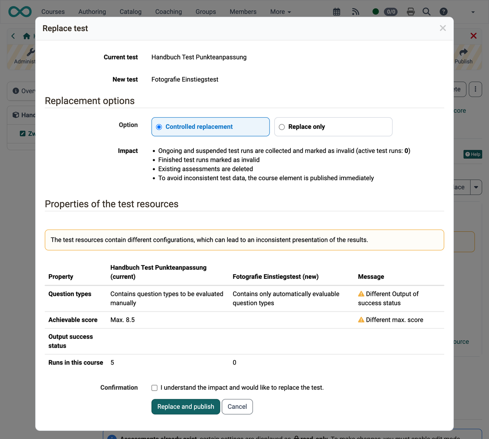{ class="shadow lightbox" title="Replace test dialog · 2026.10.01" }

After the replacement, the link "Show history" also appears next to the "Replace" button.

!!! note "Test History"
    Details on the history of replaced test learning resources. 
    [Test history](#history)

[To the top of the page ^](#course_element_test)

---

## View and assess tests {: #assess}

Anyone who wants to correct and assess completed tests finds all test runs of the course in the assessment tool. Coaches and owners of the course have access to it: `Course > Administration > Assessment tool`. Navigate to the desired course element "Test". The "Participants" tab shows all participants with their processing status for this course element, and in the "Status" column you see whether an assessment is required. The overview already shows open assessments under "Open reviews".

!!! note "Assessment Tool"
    Central interface for assessing, grading and managing the assessments of the participants. 
    [Assessment tool](../learningresources/Assessment_tool_overview.md)

Alternatively, you view and manage the results of a specific test in the course with the course editor closed, directly at the respective course element "Test". To do this, switch to the "Participants" tab. As an owner of the course, you have access to further tabs there, such as "Preview", "Communication", "Reminders" and "Badges". Some of these tabs are also available to coaches.

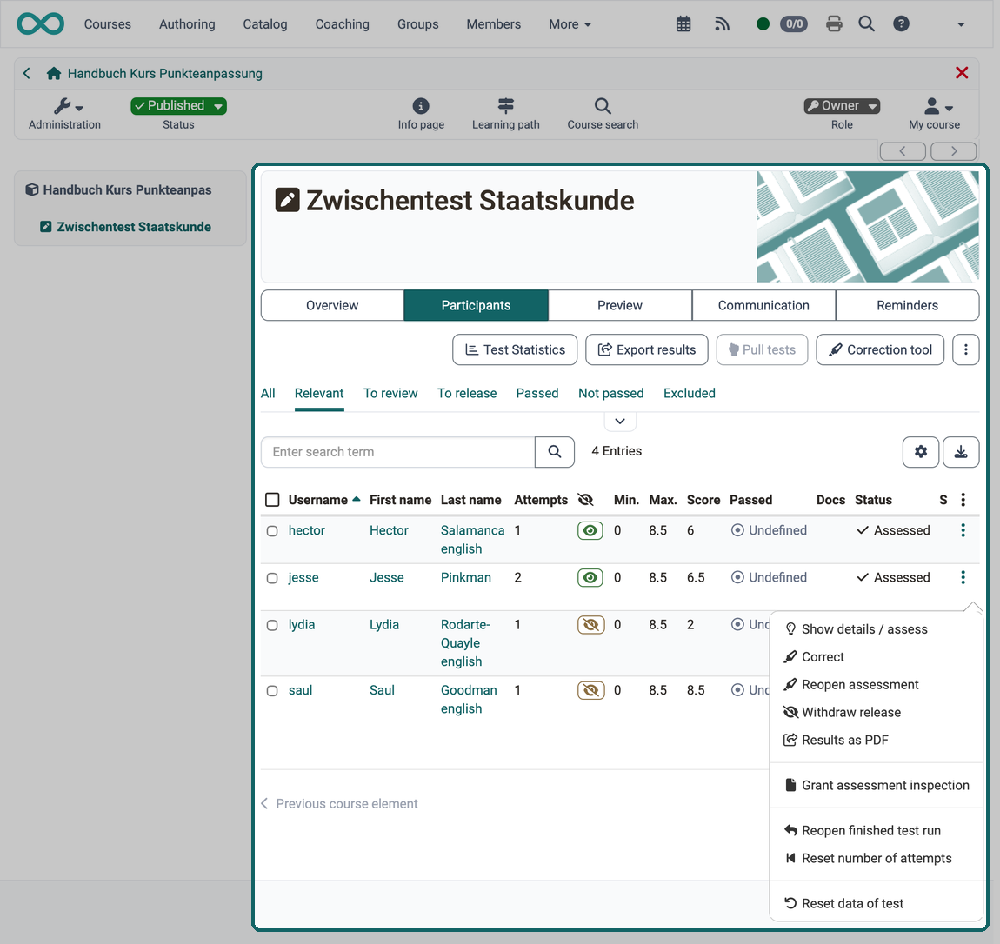{ class="shadow lightbox" title="Participants tab of the course element Test · 2026.10.01" }

If correctors are entered for a test, they assess the test runs via the Coaching Tool.

!!! note "Coaching Tool"
    Cross-course assessment by correctors. 
    [Coaching Tool](../area_modules/Coaching.md)

[To the top of the page ^](#course_element_test)

---

## Test history {: #history}

Anyone who has replaced the test learning resource of a course element keeps the previous results, sees the history of the assignments and can still open the statistics of every test learning resource used.

**A)** If you replace the test learning resource in a controlled manner, OpenOlat automatically saves the test results achieved so far with this course element (the test results with the previous learning resource) and exports them as a ZIP file. The export also contains an Excel file with the test results of the individual participants.

**B)** An overview at the "Replace" button shows when which test learning resource was replaced in the course element. Click on the small arrow next to the button and then on "Show history".

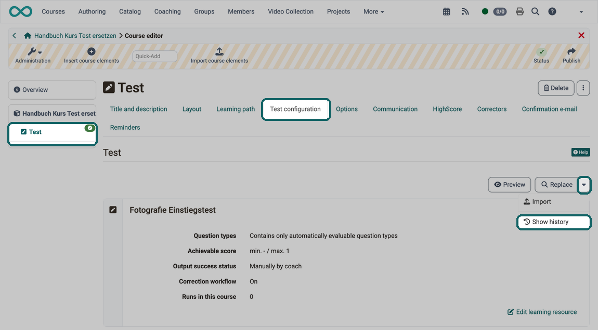{ class="shadow lightbox" title="Test configuration tab in the course editor · 2026.10.01" }

The dialog "History of the test resources" shows for each test learning resource:

* **Assigned on**: when the test learning resource was assigned to the course element.
* **Assigned by**: who assigned it.
* **Runs in this course**: how often the test learning resource was completed in this course. The runs can come from different people who have each taken the test once, or from one person who has completed it several times. Each completion counts as a run.

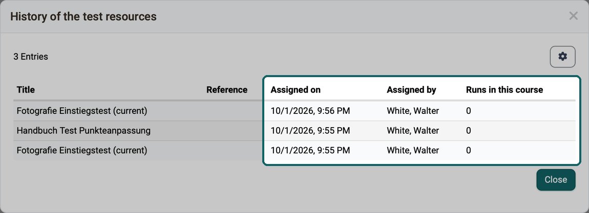{ class="shadow lightbox" title="History of the test resources dialog · 2026.10.01" }

**C)** If you replace the test learning resource, OpenOlat also creates new test statistics with the new test learning resource. As a coach, select the course element "Test" and the "Participants" tab as usual. There you find the "Test Statistics" button.

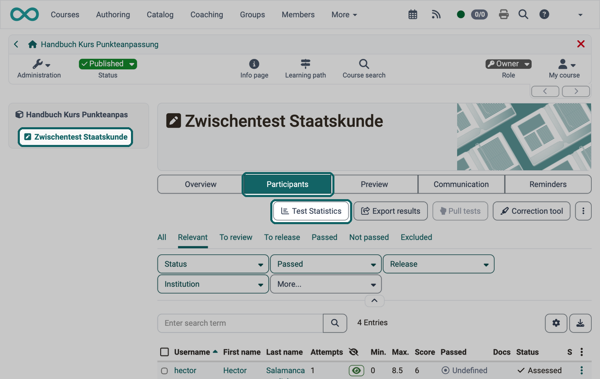{ class="shadow lightbox" title="Participants tab of the course element Test · 2026.10.01" }

If participants in this course have worked on more than one of the test learning resources used, a selection appears at the top right of the test statistics with which you switch between the statistics of the different test versions (test learning resources used).

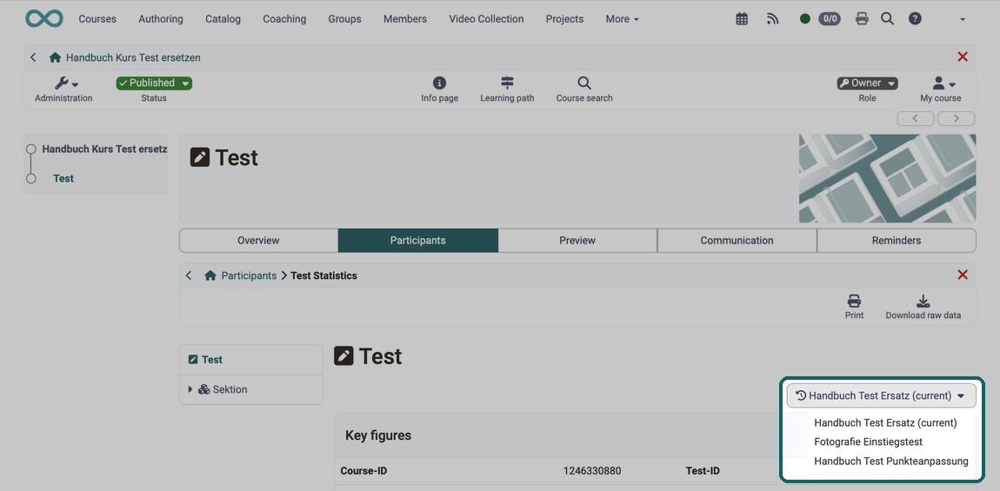{ class="shadow lightbox" title="Test statistics in the course element Test · 2026.10.02" }

!!! note "Note"

    With "Replace only", the existing assessments remain unchanged. Use this option with caution. If, for example, 12 points can now be achieved and previously only 10, a maximum of 10 points is still entered in the course. Such entries lead to confusion and must be corrected manually.

[To the top of the page ^](#course_element_test)

---

## Archiving test results [:octicons-tag-16:{ title="from Release 17.1.0 (OO-6466)" }](https://track.frentix.com/issue/OO-6466) {: #archive}

Anyone who wants to back up the test results of a course collectively, for example together with the results of other assessable course elements, archives them in the course archiving: `Course > Administration > Archiving & Reporting`.

!!! note "Archiving & Reporting"
    Course-wide archiving function for all assessable course elements. 
    [Archiving & Reporting](../learningresources/Course_Archiving.md)

There you download the course results of all assessable course elements (including tests). Alternatively, you select only the results of specific tests and save only those. To do this, select `Course > Administration > Archiving & Reporting > Course archiving > Create archive`. In the wizard, select the archive type "Partial archive" and select the desired test elements in the step "Select course elements". In the step "Settings", choose either "Standard settings" or "Customised" for "Course elements" to adjust the archiving options.

OpenOlat creates a ZIP file that is available in the course archiving area for a certain period of time, for example 10 days. There you copy, download or delete it. In the wizard step "Settings", with "Customised" selected, there are two variants for the course element "Test" under "Export":

* **Standard**: The export contains detailed test results for each participant in the form of an HTML document and an Excel file with the raw data.
* **"Advanced – with PDF"**: The option creates the same ZIP file and also adds PDF files with the detailed results for each participant. Please note: Depending on the number of PDF files, creating this ZIP file may take some time.

If the test contains essay questions and the option "Advanced – with PDF" is selected, you can activate the setting "Separate PDF file for each essay question" below under "Additional option". OpenOlat then places the answer to each essay question in the archive as a separate PDF file. [:octicons-tag-16:{ title="from Release 19.1.27 (OO-8964)" }](https://track.frentix.com/issue/OO-8964)

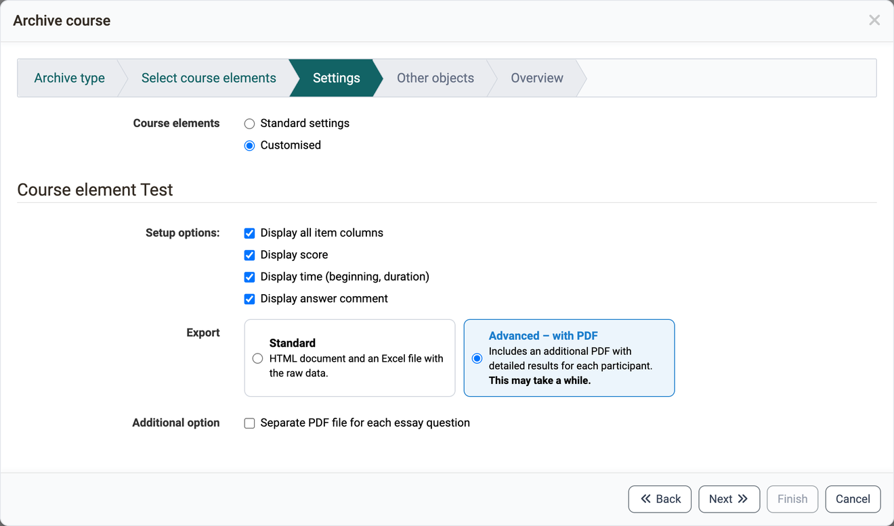{ class="shadow lightbox" title="Settings step in the Archive course dialog · 2026.10.01" }

Course archiving does not offer the option "All PDF files in one folder". In the archive, each PDF file is located in the folder of the participant, named after the person, course element and test. You get the PDF files collected in one folder via the "Export results" button in the "Participants" tab of the course element. How the files are named and stored there is described on the page [Export tests](Test_export.md#pdf_files). [:octicons-tag-16:{ title="from Release 21.1 (OO-9600)" }](https://track.frentix.com/issue/OO-9600)

You can also download the raw data of tests via the test statistics: `Course > Administration > Test statistics`. There you will also find the graphical evaluation.

!!! note "Test Statistics"
    Raw data and graphical evaluation of test results. 
    [Test Statistics](../learningresources/Statistics_Test.md)

[To the top of the page ^](#course_element_test)

---

## Working with tests {: #work_with_tests}

### Application examples

Tests are suitable for the following scenarios, among others:

* **Final assessment**: Review of acquired knowledge after a learning or training phase or an online course

* **Pre-test**: Assessment of current knowledge before the start of the course in order to identify existing gaps and determine the focus of the course

* **Interest test**: Self-assessment of one's own level of knowledge and identification of personal preferences and interests

* **Answer-specific feedback**: Tests as individual feedback providers with intensive use of the OpenOlat feedback functions

* **Quiz game**: Playful knowledge assessment in the form of quizzes, quests, storytelling, etc.

* **Online exam**: Conducting exam-relevant online or e-exams

### How to edit a test (Learners perspective) [:octicons-tag-16:{ title="from Release 20.3.0 (OO-8321)" }](https://track.frentix.com/issue/OO-8321) {: #participate_as_learner}

As a learner, you work through a test question by question and can see at any time what has already been answered. Click on "Start test" to begin. Answer the questions displayed and then click "Submit answer" for each question. If the left navigation is visible, it shows which questions you have already answered (filled dot), which you have only looked at (highlighted circle) and which you have not opened at all (grey circle). Using the icon to the right of a question, you add a personal marking as a reminder to review the question later.

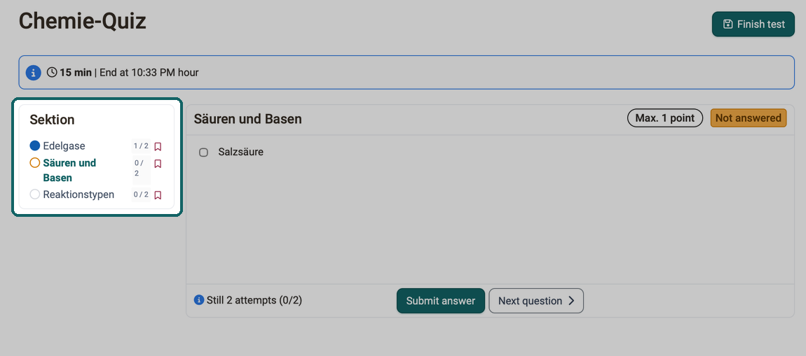{ class="shadow lightbox" title="Test from the participants' view · 2026.10.01" }

Depending on the setting, you navigate further using the "Next question" button or a link in the left-hand navigation, or OpenOlat shows the next question automatically. Whether you can skip questions or see the progress of answers also depends on the configuration by the teachers. Depending on the configuration, you interrupt the test and continue later, or you cancel it completely without saving results.

Work on a test in only one browser window. If the test is interrupted or completed in another window, the window that is still open reports "Test interrupted" or "Test completed" at the next input, with the text "Any input in this window will no longer be saved, as the test has already been completed or interrupted. Please close it now." [:octicons-tag-16:{ title="from Release 21.0.3 (OO-9707)" }](https://track.frentix.com/issue/OO-9707)

If the number of solution attempts is limited for a question, a section, or the entire test, OpenOlat shows the remaining number directly next to the question, for example "Still 2 attempts (1/3)". In the left navigation, each question shows the number of attempts used and possible, for example "1 / 2"; the remaining number appears there as a tooltip.

When you have finished editing and want to complete the test, click on the "Finish test" button. OpenOlat asks once again for confirmation. If you confirm, OpenOlat saves the test, and it is visible to the teachers.

If a test consists of several [test parts](Configure_tests.md#testpart), you work on them one after the other and finish each one separately. A finished test part is submitted: its answers are saved, and you do not return to it. At the beginning, OpenOlat shows the page "Begin test" with the number of parts, for example "This test consists of up to 2 parts.", and the button "Enter Test".

* The menu on the left only shows the sections and questions of the current test part. If menu navigation is switched off in the course element, the button "Test question menu" leads to the page "Test part question menu" with these questions.
* At the top right, the button "Finish test part" is shown instead of "Finish test". Depending on the setting of the test, it only appears when all questions of the test part have been answered.

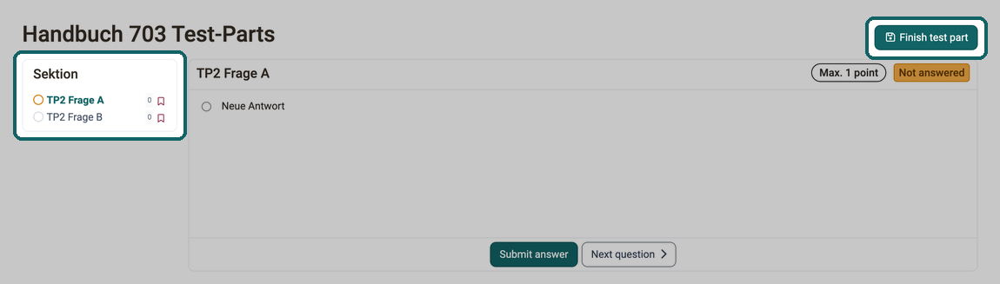{ class="shadow lightbox" title="Test with several test parts from the participants' view · 2026.10.07" }

* After clicking "Finish test part", OpenOlat asks: "Finish / Are you sure? This will commit your answers for this test part." With "Ok" you submit the test part.
* If a review is provided, the page "Test part complete" appears next. Under "Review your responses" you can view your answers, but you can no longer change them. With "Close test part" and the confirmation "Advance test part" you go to the next test part. Without review, you go directly to the next test part.
* In the last test part, the button is also called "Finish test part", the confirmation has the title "Finish test". With the confirmation, the whole test is completed.

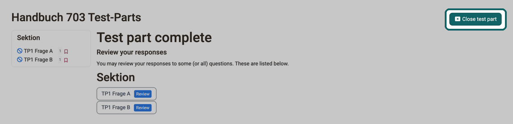{ class="shadow lightbox" title="Page Test part complete · 2026.10.07" }

Whether, how and when you see the results and the performance summary depends on the test configuration.

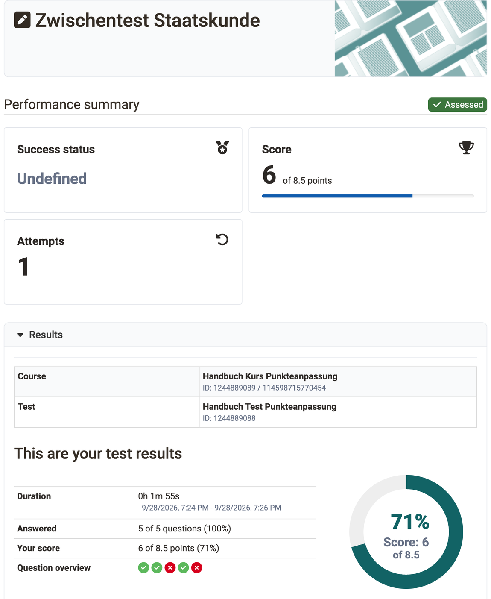{ class="shadow lightbox" title="Performance summary of a test from the participants' view · 2026.10.01" }

If you have more attempts available to process the test, you can run through the test again with "Start test". Previous runs will be retained.

[To the top of the page ^](#course_element_test)

---

## Further information {: #further_information}

**Mentioned on this page** 
[Test question types >](Test_question_types.md) 
[Course Element "Self-test" >](Course_Element_Self_Test.md) 
[Creating Tests >](Test.md) 
[Learning path course - Course editor >](Learning_path_course_Course_editor.md) 
[Assessment >](Assessment.md) 
[How do I prepare an online exam? >](../../manual_how-to/exam_preparation/exam_preparation.md) 
[Learning path course - Overview >](Learning_path_course.md) 
[Course Settings - Tab Assessment >](Course_Settings_Assessment.md) 
[Test settings - Administration >](Test_settings.md) 
[Tests at course level >](Tests_at_course_level.md) 
[Configure tests >](Configure_tests.md) 
[Types of Course Elements >](Course_Elements.md) 
[Course Element "E-Mail" >](Course_Element_EMail.md) 
[Course Reminders >](Course_Reminders.md) 
[Badges >](OpenBadges.md) 
[Test editor QTI 2.1 >](Test_editor_QTI_2.1.md) 
[Assessment tool - overview >](Assessment_tool_overview.md) 
[Coaching - Overview >](../area_modules/Coaching.md) 
[Course administration - Archiving & Reports >](Course_Archiving.md) 
[Export tests >](Test_export.md) 
[Test statistics >](Statistics_Test.md)

**Further reading** 
[Test question configuration >](Configure_test_questions.md) 
[Assessing tests >](Assessing_tests.md) 
[Coaching - Assessment Orders >](../area_modules/Coaching_Assessment_Orders.md)

[To the top of the page ^](#course_element_test)
