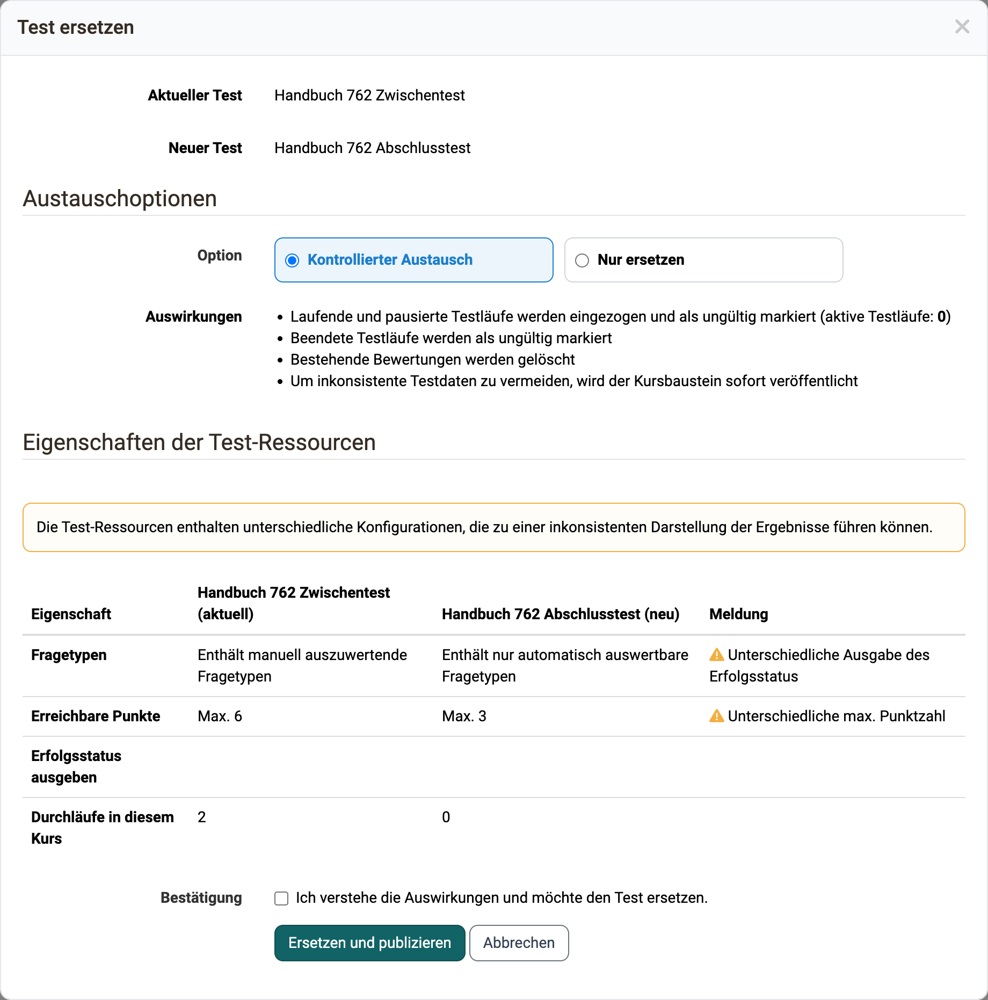
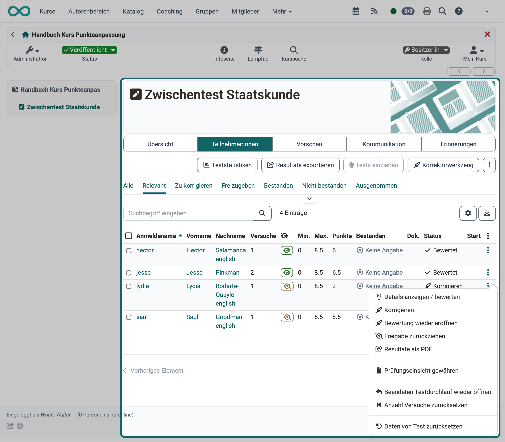
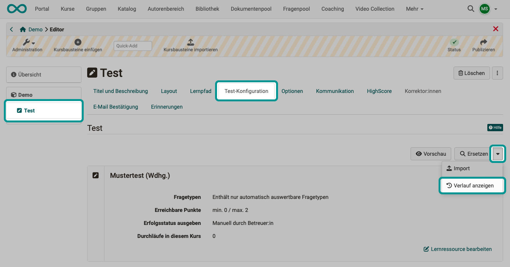
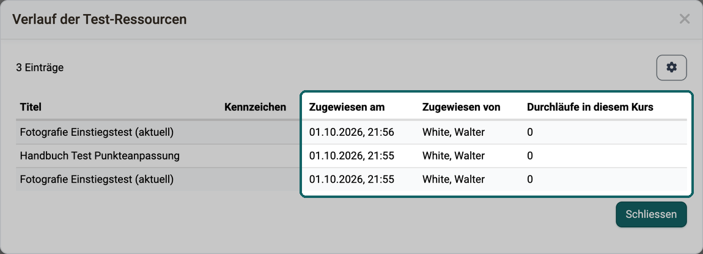
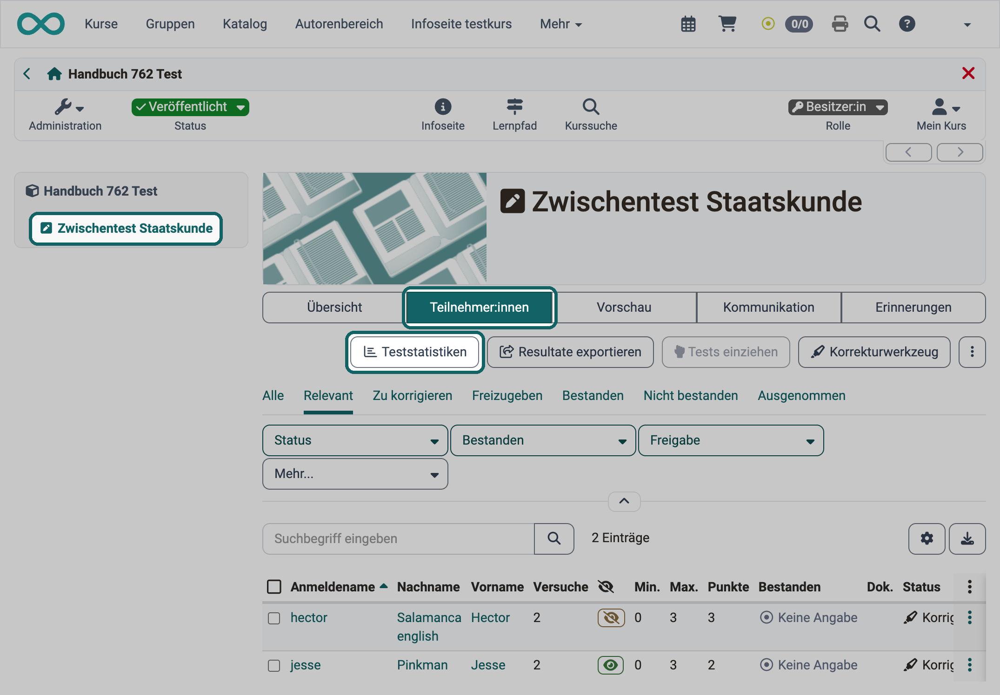
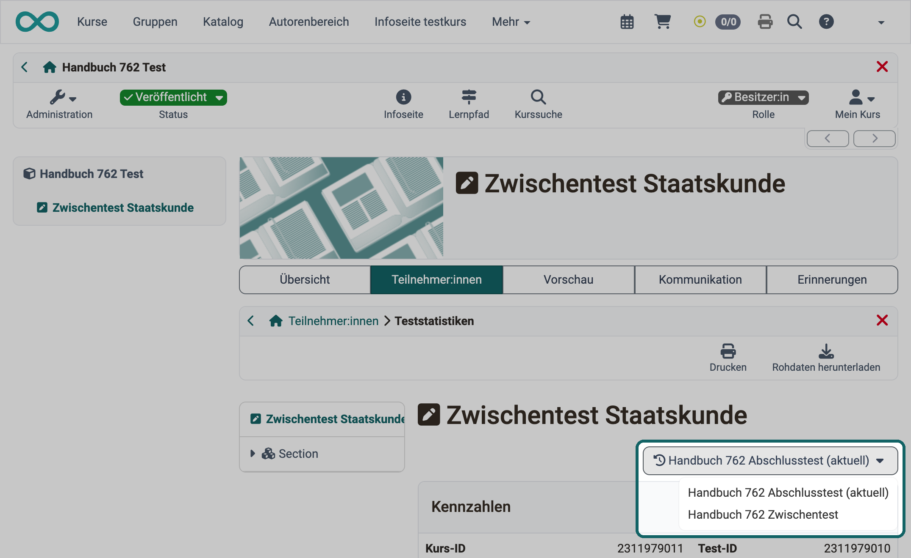
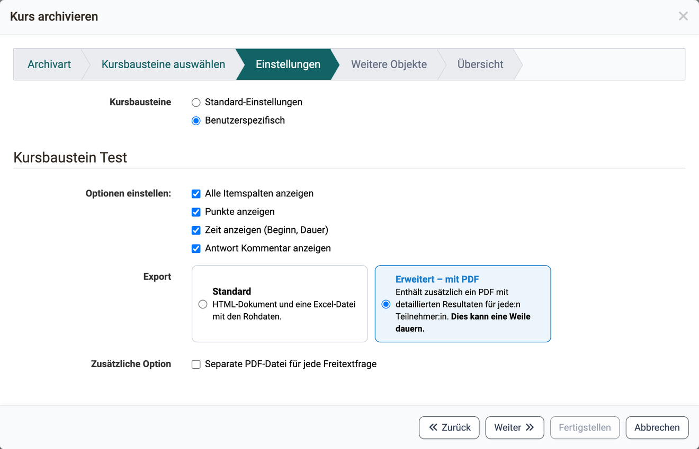

# Tests auswerten und verwalten {: #test_results}

Teilnehmende haben einen Test bearbeitet, und nun geht es um Korrektur, Bewertung und Sicherung der Ergebnisse, oder ein Fehler im Test muss behoben werden. Diese Seite richtet sich an Kursbesitzer:innen und Betreuer:innen. Sie beschreibt, was folgt, sobald ein Test im [Kursbaustein "Test"](index.de.md) eingebunden ist: Tests ändern und austauschen, Testläufe einsehen und bewerten, die Test-Historie nachverfolgen und Testergebnisse archivieren. Wie Sie den Kursbaustein im Kurseditor einrichten, beschreibt die Seite [Test einrichten](Test_Setup.de.md).

## Änderungen an Tests und Selbsttests {: #changes}

!!! warning "Achtung"

    Sobald ein Test oder Selbsttest in einen Kurs eingebunden ist, lässt er sich unter "Lernressource bearbeiten" nur noch sehr eingeschränkt ändern. Binden Sie einen Test deshalb möglichst erst in einen Kurs ein, wenn er vollständig fertiggestellt ist.

Warum ist das so? Könnten Sie in einem eingebundenen Test noch Fragen hinzufügen oder andere Antworten als korrekt markieren, hätten nicht alle Teilnehmenden die gleichen Voraussetzungen. Zudem liessen sich bereits gespeicherte Resultate nicht mehr eindeutig einer Version der Testdatei zuordnen. Deshalb ist das Editieren bereits eingebundener Tests und Selbsttests stark eingeschränkt.

Müssen Sie einen Test aus triftigen Gründen trotzdem ändern, haben Sie folgende Möglichkeit:

### Bereits bearbeitete Tests austauschen [:octicons-tag-16:{ title="ab Release 19.1.10 (OO-8400)" }](https://track.frentix.com/issue/OO-8400) {: #tab_replace_tests}

Wollen Sie einen Test nachträglich ändern, zum Beispiel neue Fragen hinzufügen oder fehlerhafte Antworten korrigieren, kopieren Sie zunächst die Lernressource Test im Autorenbereich und bearbeiten die Kopie. Binden Sie diese anschliessend im gewünschten Kurs ein.

Öffnen Sie dazu im Kurseditor den betreffenden Kursbaustein, wechseln Sie in den Tab "Test-Konfiguration" und klicken Sie auf "Ersetzen". Wählen Sie die vorbereitete Kopie des Tests aus.

Im nächsten Schritt stehen zwei Optionen zur Wahl:

* **Kontrollierter Austausch**: Alle bisherigen Durchläufe und Bewertungen werden ungültig, OpenOlat setzt das Bewertungsformular zurück. Die bisherigen Ergebnisse erhalten Sie zusätzlich als ZIP-Download.

* **Nur ersetzen**: OpenOlat tauscht den Test aus. Beendete Testläufe bleiben gültig, bestehende Bewertungen bleiben unverändert. Laufende und pausierte Testläufe zieht OpenOlat ein und markiert sie als ungültig.

!!! warning "Achtung"

    Mit "Nur ersetzen" bleiben die bestehenden Bewertungen unverändert. Verwenden Sie diese Variante mit Vorsicht. Sind zum Beispiel neu 12 Punkte erreichbar und bisher nur 10, sind im Kurs weiterhin maximal 10 Punkte eingetragen. Solche Angaben führen zu Verwirrung und müssen manuell korrigiert werden.

Vor dem Austausch informiert Sie ein Dialog über die Auswirkungen, die Sie ausdrücklich bestätigen.

**Beispiel:**
{ class="shadow lightbox" title="Dialog Test ersetzen im Kurseditor, Tab Test-Konfiguration · 2026.11.03" }

Nach dem Austausch erscheint beim Button "Ersetzen" auch der Link "Verlauf anzeigen". Was er zeigt, beschreibt der Abschnitt [Test-Historie](#history).

[Zum Seitenanfang ^](#test_results)

---

## Tests einsehen und bewerten {: #assess}

Wer bearbeitete Tests korrigieren und bewerten will, findet alle Testläufe des Kurses im [Bewertungswerkzeug](../Assessment_tool_overview/index.de.md). Zugriff darauf haben Betreuer:innen und Besitzer:innen des Kurses: `Kurs > Administration > Bewertungswerkzeug`. Navigieren Sie zum gewünschten Kursbaustein "Test". Der Tab "Teilnehmer:innen" zeigt alle Teilnehmenden mit ihrem Bearbeitungsstand zu diesem Kursbaustein, und in der Spalte "Status" erkennen Sie, ob eine Bewertung erforderlich ist. Offene Bewertungen zeigt bereits die Übersicht unter "Offene Bewertungen".

Alternativ sehen und verwalten Sie die Ergebnisse eines bestimmten Tests auch im Kurs bei geschlossenem Kurseditor direkt beim jeweiligen Kursbaustein "Test". Wechseln Sie dafür in den Tab "Teilnehmer:innen". Als Besitzer:in des Kurses stehen Ihnen dort weitere Tabs wie "Vorschau", "Kommunikation", "Erinnerungen" und "Badges" zur Verfügung. Betreuer:innen sehen ebenfalls "Vorschau" und "Kommunikation", den Tab "Erinnerungen" nicht und den Tab "Badges" nur, wenn der Kurs Betreuer:innen die Vergabe von Badges erlaubt.

{ class="shadow lightbox" title="Tab Teilnehmer:innen des Kursbausteins Test · 2026.11.02" }

Sind für einen Test Korrektor:innen eingetragen, bewerten diese die Testläufe kursübergreifend im [Coaching](../../area_modules/Coaching/index.de.md) unter "Bewertungsaufträge".

[Zum Seitenanfang ^](#test_results)

---

## Test-Historie {: #history}

Wer die Test-Lernressource eines Kursbausteins ausgetauscht hat, behält die früheren Ergebnisse, sieht den Verlauf der Zuweisungen und kann die Statistik jeder verwendeten Test-Lernressource weiterhin aufrufen.

**A)** Tauschen Sie die Test-Lernressource kontrolliert aus, speichert OpenOlat die bisher mit diesem Kursbaustein erzielten Testergebnisse (die Testergebnisse mit der bisherigen Lernressource) automatisch und exportiert sie als ZIP-Datei. Der Export enthält auch eine Excel-Datei mit den Testergebnissen der einzelnen Teilnehmer:innen.

**B)** Wann welche Test-Lernressource im Kursbaustein ausgetauscht wurde, zeigt eine Übersicht beim Button "Ersetzen". Klicken Sie auf den kleinen Pfeil neben dem Button und dann auf "Verlauf anzeigen".

{ class="shadow lightbox" title="Tab Test-Konfiguration im Kurseditor" }

Der Dialog "Verlauf der Test-Ressourcen" zeigt je Test-Lernressource:

* **Zugewiesen am**: wann die Test-Lernressource dem Kursbaustein zugewiesen wurde.
* **Zugewiesen von**: wer sie zugewiesen hat.
* **Durchläufe in diesem Kurs**: wie oft die Test-Lernressource in diesem Kurs bearbeitet wurde. Die Durchläufe können von verschiedenen Personen stammen, die den Test je einmal bearbeitet haben, oder von einer Person, die ihn mehrfach bearbeitet hat. Jede Bearbeitung zählt als Durchlauf.

{ class="shadow lightbox" title="Dialog Verlauf der Test-Ressourcen · 2026.10.01" }

**C)** Tauschen Sie die Test-Lernressource aus, legt OpenOlat auch eine neue Teststatistik mit der neuen Test-Lernressource an. Als Betreuer:in wählen Sie wie gewohnt den Kursbaustein "Test" und den Tab "Teilnehmer:innen". Dort steht der Button "Teststatistiken".

{ class="shadow lightbox" title="Tab Teilnehmer:innen des Kursbausteins Test · 2026.11.03" }

Haben Teilnehmende in diesem Kurs mehr als eine der verwendeten Test-Lernressourcen bearbeitet, erscheint in den Teststatistiken rechts oben eine Auswahl, mit der Sie zwischen den Statistiken der verschiedenen Testversionen (verwendeten Test-Lernressourcen) wechseln.

{ class="shadow lightbox" title="Teststatistiken im Kursbaustein Test · 2026.11.03" }

[Zum Seitenanfang ^](#test_results)

---

## Testergebnisse archivieren [:octicons-tag-16:{ title="ab Release 17.1.0 (OO-6466)" }](https://track.frentix.com/issue/OO-6466) {: #archive}

Wer die Testergebnisse eines Kurses gesammelt sichern will, etwa zusammen mit den Resultaten anderer bewertbarer Kursbausteine, archiviert sie in der [Kursarchivierung](../Course_Archiving/index.de.md): `Kurs > Administration > Archivierung & Reports`.

Dort laden Sie die Kursresultate aller bewertbaren Kursbausteine (unter anderem Tests) herunter. Alternativ wählen Sie nur die Ergebnisse bestimmter Tests aus und speichern nur diese. Wählen Sie dafür `Kurs > Administration > Archivierung & Reports > Kursarchivierung > Archiv erstellen`. Wählen Sie im Wizard die Archivart "Teilarchiv" und markieren Sie im Schritt "Kursbausteine auswählen" den oder die gewünschten Test-Bausteine. Im Schritt "Einstellungen" wählen Sie bei "Kursbausteine" entweder "Standard-Einstellungen" oder "Benutzerspezifisch", um die Archivierungsoptionen anzupassen.

OpenOlat erstellt eine ZIP-Datei, die im Bereich Kursarchivierung für eine bestimmte Zeit bereitliegt, zum Beispiel 10 Tage. Dort laden Sie die Datei herunter, kopieren oder löschen sie. Im Wizard-Schritt "Einstellungen" gibt es bei der Auswahl "Benutzerspezifisch" beim Kursbaustein "Test" unter "Export" zwei Varianten:

* **Standard**: Der Export enthält detaillierte Testresultate für jede:n Teilnehmer:in in Form eines HTML-Dokuments und einer Excel-Datei mit den Rohdaten.
* **"Erweitert – mit PDF"**: Die Option erzeugt die gleiche ZIP-Datei und ergänzt zusätzlich PDF-Dateien mit den detaillierten Ergebnissen für jede:n Teilnehmer:in. Achtung: Je nach Anzahl der PDF-Dateien kann die Erstellung dieser ZIP-Datei einige Zeit dauern.

Enthält der Test Freitextfragen und ist die Option "Erweitert – mit PDF" gewählt, können Sie darunter unter "Zusätzliche Option" die Einstellung "Separate PDF-Datei für jede Freitextfrage" aktivieren. OpenOlat legt dann die Antwort jeder Freitextfrage als eigene PDF-Datei im Archiv ab. [:octicons-tag-16:{ title="ab Release 19.1.27 (OO-8964)" }](https://track.frentix.com/issue/OO-8964)

{ class="shadow lightbox" title="Schritt Einstellungen im Dialog Kurs archivieren" }

Die Option "Alle PDF-Dateien in einem Ordner" bietet die Kursarchivierung nicht an. Im Archiv liegt jede PDF-Datei im Ordner der Teilnehmer:in, benannt nach Person, Kursbaustein und Test. Gesammelt in einem Ordner erhalten Sie die PDF-Dateien über den Button "Resultate exportieren" im Tab "Teilnehmer:innen" des Kursbausteins. Wie die Dateien dort heissen und abgelegt werden, steht auf der Seite [Tests exportieren](../Test_export.de.md#pdf_files). [:octicons-tag-16:{ title="ab Release 21.1 (OO-9600)" }](https://track.frentix.com/issue/OO-9600)

Die Rohdaten von Tests können Sie zudem über die [Teststatistiken](../Statistics_Test.de.md) herunterladen: `Kurs > Administration > Teststatistiken`. Dort finden Sie auch die grafische Auswertung.

[Zum Seitenanfang ^](#test_results)

---

## Weiterführende Informationen {: #further_information}

**Auf dieser Seite erwähnt** 
[Kursbaustein "Test" >](index.de.md) 
[Test einrichten >](Test_Setup.de.md) 
[Bewertungswerkzeug - Übersicht >](../Assessment_tool_overview/index.de.md) 
[Coaching - Übersicht >](../../area_modules/Coaching/index.de.md) 
[Kurs-Administration: Archivierung & Reports >](../Course_Archiving/index.de.md) 
[Tests exportieren >](../Test_export.de.md) 
[Teststatistiken >](../Statistics_Test.de.md)

**Weiterführend** 
[Tests bewerten >](../Assessing_tests.de.md) 
[Coaching - Bewertungsaufträge >](../../area_modules/Coaching_Assessment_Orders.de.md)

[Zum Seitenanfang ^](#test_results)
