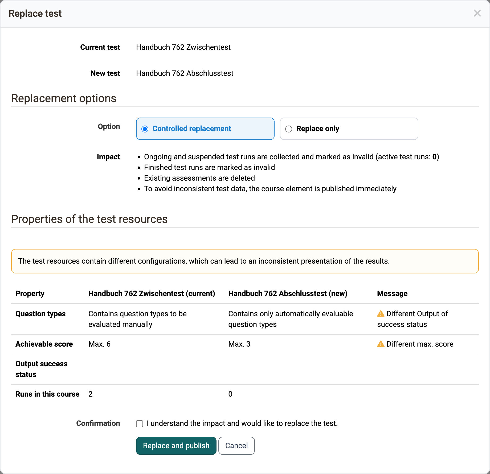
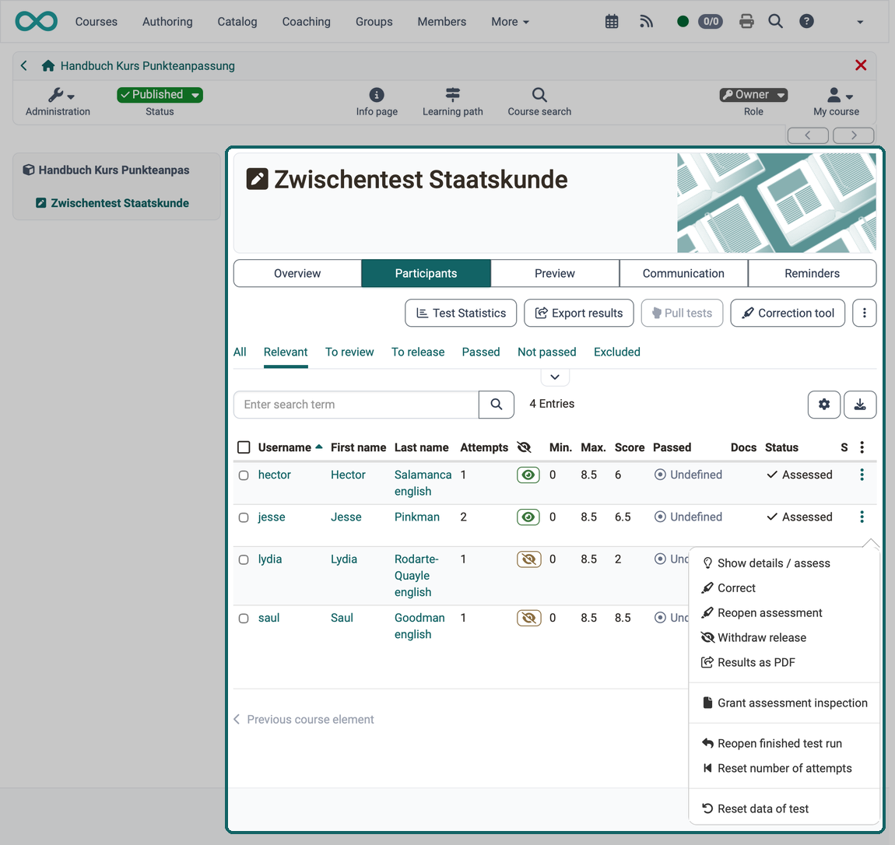
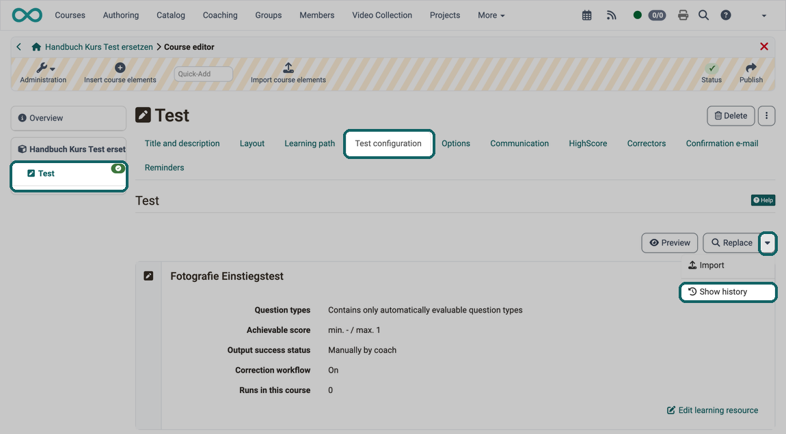
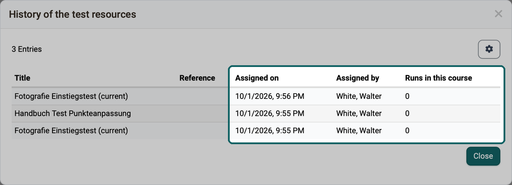
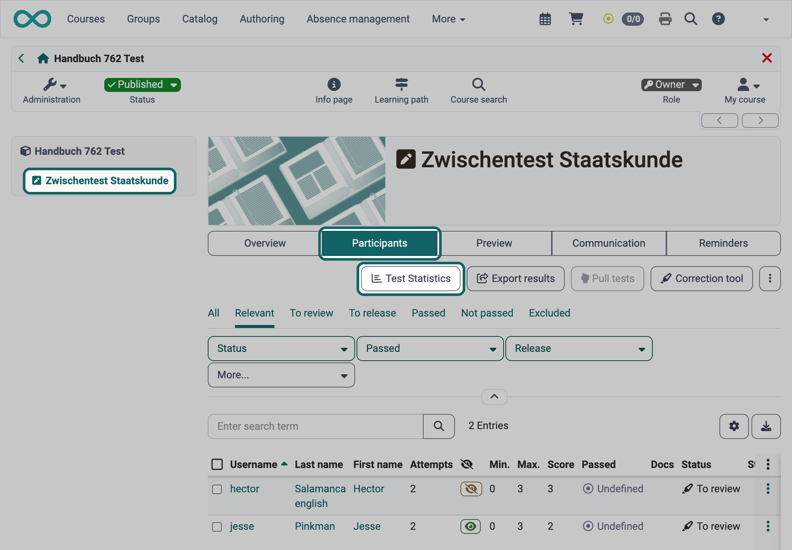
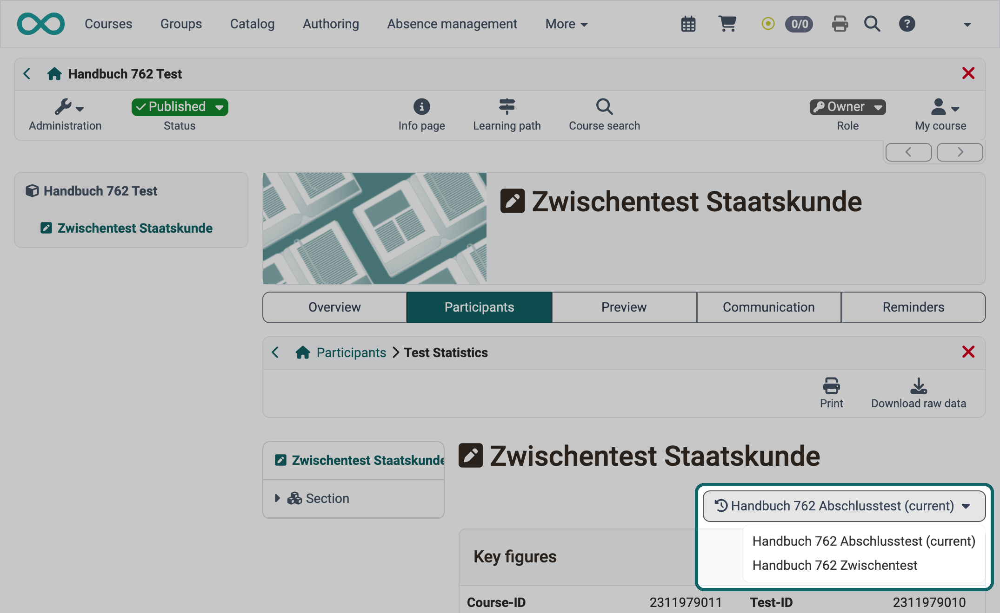
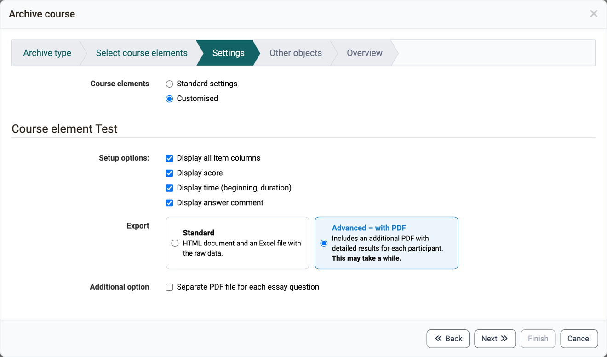

# Evaluate and manage tests {: #test_results}

Participants have worked on a test, and now the results need to be corrected, assessed and secured, or an error in the test must be fixed. This page is intended for course owners and coaches. It describes what follows once a test is included in the [course element "Test"](index.md): changing and replacing tests, viewing and assessing test runs, tracing the test history and archiving test results. How you set up the course element in the course editor is described on the page [Set up a test](Test_Setup.md).

## Changes to tests and self-tests {: #changes}

!!! warning "Attention"

    Once a test or self-test is included in a course, you can change it only to a very limited extent under "Edit learning resource". Therefore, if possible, include a test in a course only when it is completely finished.

Why is that? If you could still add questions in an embedded test or mark other answers as correct, not all participants would have the same conditions. In addition, results already saved could no longer be uniquely assigned to a version of the test file. Therefore, editing of already included tests and self-tests is severely limited.

If you nevertheless need to change a test for valid reasons, you have the following option:

### Replacing tests that have already been edited [:octicons-tag-16:{ title="from Release 19.1.10 (OO-8400)" }](https://track.frentix.com/issue/OO-8400) {: #tab_replace_tests}

If you want to change a test retrospectively, for example add new questions or correct incorrect answers, first copy the Test learning resource in the authoring area and edit the copy. Then integrate it into the desired course.

To do this, open the relevant course element in the course editor, switch to the "Test configuration" tab and click on "Replace". Select the prepared copy of the test.

In the next step, two options are available:

* **Controlled replacement**: All previous runs and evaluations become invalid, OpenOlat resets the evaluation form. You also receive the previous results as a ZIP download.

* **Replace only**: OpenOlat replaces the test. Finished test runs remain valid, existing assessments remain unchanged. OpenOlat collects ongoing and suspended test runs and marks them as invalid.

!!! warning "Attention"

    With "Replace only", the existing assessments remain unchanged. Use this option with caution. If, for example, 12 points can now be achieved and previously only 10, a maximum of 10 points is still entered in the course. Such entries lead to confusion and must be corrected manually.

Before the replacement, a dialog informs you of the effects, which you explicitly confirm.

**Example:**
{ class="shadow lightbox" title="Replace test dialog in the course editor, Test configuration tab · 2026.11.03" }

After the replacement, the link "Show history" also appears next to the "Replace" button. What it shows is described in the section [Test history](#history).

[To the top of the page ^](#test_results)

---

## View and assess tests {: #assess}

Anyone who wants to correct and assess completed tests finds all test runs of the course in the [assessment tool](../Assessment_tool_overview.md). Coaches and owners of the course have access to it: `Course > Administration > Assessment tool`. Navigate to the desired course element "Test". The "Participants" tab shows all participants with their processing status for this course element, and in the "Status" column you see whether an assessment is required. The overview already shows open assessments under "Open reviews".

Alternatively, you view and manage the results of a specific test in the course with the course editor closed, directly at the respective course element "Test". To do this, switch to the "Participants" tab. As an owner of the course, you have access to further tabs there, such as "Preview", "Communication", "Reminders" and "Badges". Coaches also see "Preview" and "Communication", but not the "Reminders" tab, and the "Badges" tab only if the course allows coaches to award badges.

{ class="shadow lightbox" title="Participants tab of the course element Test · 2026.10.01" }

If correctors are entered for a test, they assess the test runs across courses in [Coaching](../../area_modules/Coaching.md) under "Assessment orders".

[To the top of the page ^](#test_results)

---

## Test history {: #history}

Anyone who has replaced the test learning resource of a course element keeps the previous results, sees the history of the assignments and can still open the statistics of every test learning resource used.

**A)** If you replace the test learning resource in a controlled manner, OpenOlat automatically saves the test results achieved so far with this course element (the test results with the previous learning resource) and exports them as a ZIP file. The export also contains an Excel file with the test results of the individual participants.

**B)** An overview at the "Replace" button shows when which test learning resource was replaced in the course element. Click on the small arrow next to the button and then on "Show history".

{ class="shadow lightbox" title="Test configuration tab in the course editor · 2026.10.01" }

The dialog "History of the test resources" shows for each test learning resource:

* **Assigned on**: when the test learning resource was assigned to the course element.
* **Assigned by**: who assigned it.
* **Runs in this course**: how often the test learning resource was completed in this course. The runs can come from different people who have each taken the test once, or from one person who has completed it several times. Each completion counts as a run.

{ class="shadow lightbox" title="History of the test resources dialog · 2026.10.01" }

**C)** If you replace the test learning resource, OpenOlat also creates new test statistics with the new test learning resource. As a coach, select the course element "Test" and the "Participants" tab as usual. There you find the "Test Statistics" button.

{ class="shadow lightbox" title="Participants tab of the course element Test · 2026.11.03" }

If participants in this course have worked on more than one of the test learning resources used, a selection appears at the top right of the test statistics with which you switch between the statistics of the different test versions (test learning resources used).

{ class="shadow lightbox" title="Test statistics in the course element Test · 2026.11.03" }

[To the top of the page ^](#test_results)

---

## Archiving test results [:octicons-tag-16:{ title="from Release 17.1.0 (OO-6466)" }](https://track.frentix.com/issue/OO-6466) {: #archive}

Anyone who wants to back up the test results of a course collectively, for example together with the results of other assessable course elements, archives them in the [course archiving](../Course_Archiving.md): `Course > Administration > Archiving & Reporting`.

There you download the course results of all assessable course elements (including tests). Alternatively, you select only the results of specific tests and save only those. To do this, select `Course > Administration > Archiving & Reporting > Course archiving > Create archive`. In the wizard, select the archive type "Partial archive" and select the desired test elements in the step "Select course elements". In the step "Settings", choose either "Standard settings" or "Customised" for "Course elements" to adjust the archiving options.

OpenOlat creates a ZIP file that is available in the course archiving area for a certain period of time, for example 10 days. There you download, copy or delete the file. In the wizard step "Settings", with "Customised" selected, there are two variants for the course element "Test" under "Export":

* **Standard**: The export contains detailed test results for each participant in the form of an HTML document and an Excel file with the raw data.
* **"Advanced – with PDF"**: The option creates the same ZIP file and also adds PDF files with the detailed results for each participant. Please note: Depending on the number of PDF files, creating this ZIP file may take some time.

If the test contains essay questions and the option "Advanced – with PDF" is selected, you can activate the setting "Separate PDF file for each essay question" below under "Additional option". OpenOlat then places the answer to each essay question in the archive as a separate PDF file. [:octicons-tag-16:{ title="from Release 19.1.27 (OO-8964)" }](https://track.frentix.com/issue/OO-8964)

{ class="shadow lightbox" title="Settings step in the Archive course dialog · 2026.10.01" }

Course archiving does not offer the option "All PDF files in one folder". In the archive, each PDF file is located in the folder of the participant, named after the person, course element and test. You get the PDF files collected in one folder via the "Export results" button in the "Participants" tab of the course element. How the files are named and stored there is described on the page [Export tests](../Test_export.md#pdf_files). [:octicons-tag-16:{ title="from Release 21.1 (OO-9600)" }](https://track.frentix.com/issue/OO-9600)

You can also download the raw data of tests via the [test statistics](../Statistics_Test.md): `Course > Administration > Test statistics`. There you will also find the graphical evaluation.

[To the top of the page ^](#test_results)

---

## Further information {: #further_information}

**Mentioned on this page** 
[Course Element "Test" >](index.md) 
[Set up a test >](Test_Setup.md) 
[Assessment tool - overview >](../Assessment_tool_overview.md) 
[Coaching - Overview >](../../area_modules/Coaching.md) 
[Course administration - Archiving & Reports >](../Course_Archiving.md) 
[Export tests >](../Test_export.md) 
[Test statistics >](../Statistics_Test.md)

**Further reading** 
[Assessing tests >](../Assessing_tests.md) 
[Coaching - Assessment Orders >](../../area_modules/Coaching_Assessment_Orders.md)

[To the top of the page ^](#test_results)
