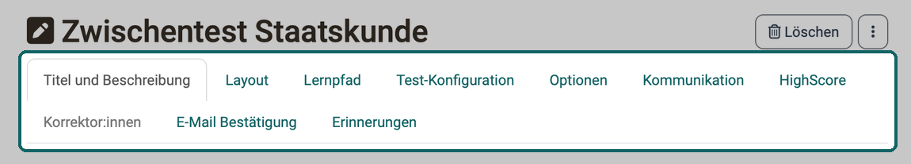
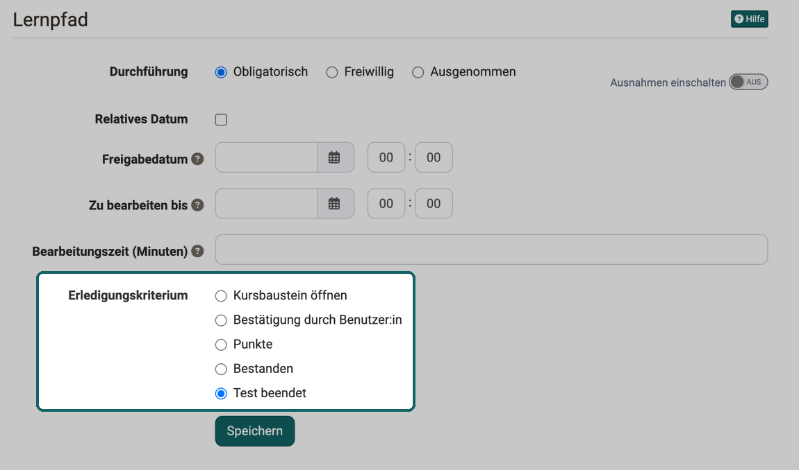
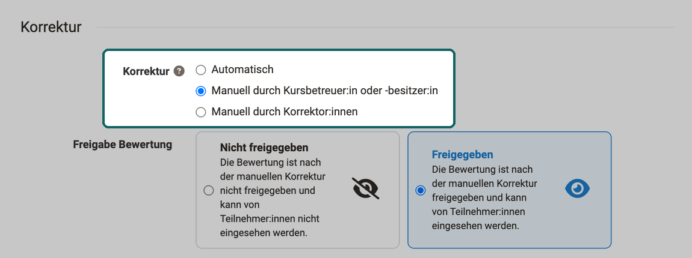
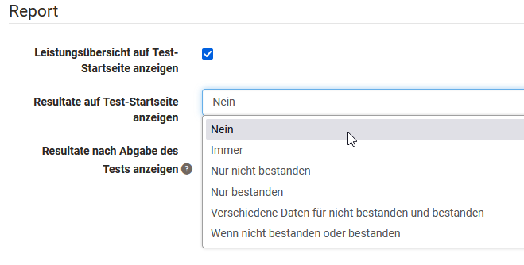
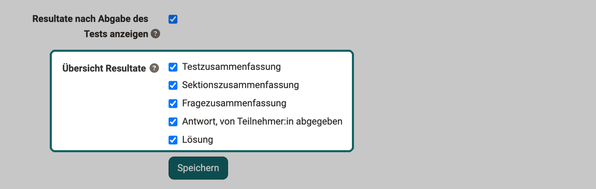
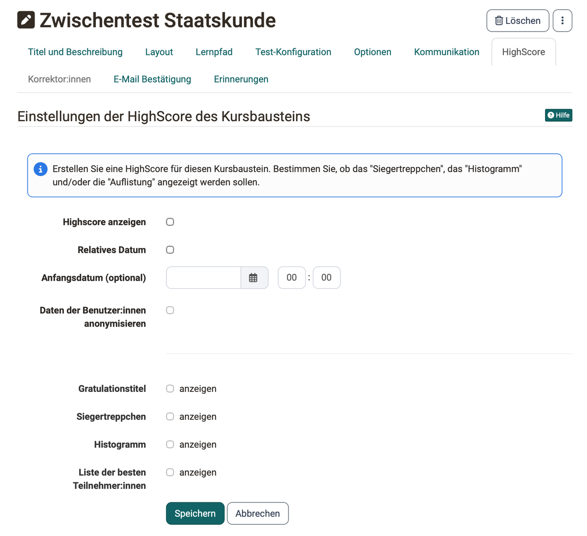

# Test einrichten {: #config}

Sie haben einen Test in Ihren Kurs eingebunden und legen nun fest, welchen Test der Kursbaustein zeigt, wann Teilnehmende ihn bearbeiten, wer korrigiert und welche Resultate sie danach sehen. Diese Seite richtet sich an Kursbesitzer:innen und beschreibt die Einstellungen des [Kursbausteins "Test"](index.de.md) im Kurseditor, Tab für Tab in der Reihenfolge der Oberfläche. Was folgt, sobald der Test im Kurs eingebunden ist, vom Austauschen eines Tests bis zum Archivieren der Ergebnisse, beschreibt die Seite [Tests auswerten und verwalten](Test_Results.de.md).

Den Kurseditor öffnen Besitzer:innen des Kurses, Lernressourcenverwalter:innen und Administrator:innen sowie Personen mit dem Recht "Kurseditor". Öffnen Sie den Kurseditor über `Kurs > Administration > Kurseditor`. Fügen Sie einen Kursbaustein "Test" hinzu oder wählen Sie einen bereits hinzugefügten Kursbaustein "Test". Sie sehen nun die folgenden Tabs:

{ class="shadow lightbox" title="Kursbaustein Test im Kurseditor · 2026.10.01" }

Die Tabs "Titel und Beschreibung" sowie "Layout" sind bei allen Kursbausteinen gleich. Der Tab "Korrektor:innen" ist nur aktiv, wenn im Abschnitt "Korrektur" die Option "Manuell durch Korrektor:innen" gewählt ist. Der Tab "Badges" kommt hinzu, wenn im Kurs die Vergabe von Badges aktiviert ist.

## Tab "Lernpfad" [:octicons-tag-16:{ title="ab Release 15.0 (OO-4206)" }](https://track.frentix.com/issue/OO-4206) {: #tab_learning_path}

Im Tab "Lernpfad" legen Sie unter "Durchführung" fest, ob der Test im Lernpfadkurs "Obligatorisch" oder "Freiwillig" ist oder ob der Kursbaustein gar nicht erscheint ("Ausgenommen"). Mit "Ausnahmen einschalten" gilt für bestimmte Personen oder Gruppen eine andere Durchführung. Zudem legen Sie ein "Freigabedatum", ein Datum unter "Zu bearbeiten bis" sowie die voraussichtliche "Bearbeitungszeit (Minuten)" fest, mit "Relatives Datum" auch relativ zu einem Ereignis wie dem ersten Kursbesuch. Die Felder dieses Tabs beschreibt die Seite [Lernpfadkurs - Kurseditor](../Learning_path_course_Course_editor.de.md).

Des Weiteren stehen für Tests unter "Erledigungskriterium" folgende Optionen zur Verfügung: "Kursbaustein öffnen", "Bestätigung durch Benutzer:in", "Punkte", "Bestanden" und "Test beendet".

{ class="shadow lightbox" title="Tab Lernpfad des Kursbausteins Test · 2026.10.01" }

Erst wenn die gewählte Bedingung erfüllt ist, zeigt OpenOlat den Teilnehmenden den Fortschritt in der Lernpfadanzeige und in der Fortschrittsprozentzahl an.

[Zum Seitenanfang ^](#config)

## Tab "Test-Konfiguration" {: #tab_configuration}

Sind für den Test bereits Bewertungen vorhanden, zeigt OpenOlat in diesem Tab die Einstellungen unter "Konfiguration Bewertung" schreibgeschützt an: "Bewertung mit Einstufung/Noten" und "Bei Kurs-Bewertung berücksichtigen". Mit "Bearbeitungsmodus aktivieren" machen Sie sie wieder bearbeitbar, siehe [Schreibschutz der Bewertungskonfiguration](../Course_Elements.de.md#assessment_config_read_only). Den Schreibschutz gibt es nur im Kursbaustein "Test", nicht im Selbsttest und nicht im Fragebogen. [:octicons-tag-16:{ title="ab Release 21.1 (OO-9647)" }](https://track.frentix.com/issue/OO-9647)

Wenn Sie noch keinen Test ausgewählt haben, erscheint im Tab "Test-Konfiguration" ein entsprechender Hinweis. Sie können nun einen vorhandenen Test "Auswählen" oder "Importieren" oder einen neuen Test "Erstellen".

!!! tip "Bestehende Lernressource"
    Ist bereits eine Test-Lernressource eingefügt und wollen Sie diese austauschen, beachten Sie die Hinweise auf der Seite [Tests auswerten und verwalten](Test_Results.de.md#changes) im Abschnitt "Änderungen an Tests und Selbsttests".

Klicken Sie auf "Auswählen", um dem Kursbaustein einen Test zuzuordnen. Im folgenden Dialog stehen auch die Optionen zum Erstellen und Importieren zur Wahl. Hier wählen oder erstellen Sie den Test, den Sie dem Kursbaustein "Test" zuordnen. Anschliessend legen Sie weitere Einstellungen fest, zum Beispiel die Art der Korrektur oder die Darstellung der Testresultate.

Ist der Kursbaustein bereits mit einem Test verbunden, zeigt der Tab "Test-Konfiguration" den Namen des Tests und weitere Angaben dazu. Mit "Lernressource bearbeiten" bearbeiten Sie den Test.

Über den Button "Vorschau" öffnen Sie eine Vorschau des Tests, über den Button "Ersetzen" tauschen Sie den Test aus, indem Sie einen anderen Test wählen, erstellen oder importieren. Liegen für den Test bereits Testresultate vor, erhalten Sie beim Austauschen einen Hinweis, und OpenOlat erstellt eine Archivdatei, die Sie speichern können.

Einen hinzugefügten Test konfigurieren Sie wie folgt genauer. Der Tab zeigt die Einstellungen in dieser Reihenfolge: zuoberst "Relatives Datum" und "Testzeitraum festlegen", darunter die Legende "Konfiguration Bewertung", darunter "Korrektur" und zuletzt die Legende "Report".

### Testzeitraum festlegen [:octicons-tag-16:{ title="ab Release 12.3 (OO-3146)" }](https://track.frentix.com/issue/OO-3146) {: #assessment_period}

Während des Testzeitraums lässt sich der Test starten. Sobald die "bis-Zeit" erreicht ist, beendet OpenOlat den Test automatisch, auch wenn die definierte Zeitbeschränkung noch nicht abgelaufen ist. Ist "Relatives Datum" eingeschaltet, legen Sie statt eines fixen Datums ein relatives Datum fest, zum Beispiel x Tage nach dem ersten Kursbesuch. Wie Testzeitraum und Prüfungsmodus zusammenwirken, zeigt [Wie hängen die Zeiten einer Prüfung zusammen?](../../../manual_how-to/exam_preparation/exam_preparation.de.md#exam_times)

Ist hier nichts aktiviert, ist der Test jederzeit zugänglich, sofern an anderer Stelle keine Einschränkung besteht, zum Beispiel unter "Sichtbarkeit" bei herkömmlichen Kursen oder durch eine sequenzielle Reihenfolge bei Lernpfadkursen.

### Abschnitt Konfiguration Bewertung {: #section_test}

Unter der Legende "Konfiguration Bewertung" legen Sie fest, ob OpenOlat den Test mit Einstufung/Noten bewertet und ob er in die Kurs-Bewertung einfliesst. Sind bereits Bewertungen vorhanden, steht hier der Hinweis mit dem Button "Bearbeitungsmodus aktivieren".

#### Bewertung mit Einstufung/Noten {: #grading}

Wählen Sie eine der vorgegebenen Bewertungsskalen, zum Beispiel Noten, Niveaustufen oder Emojis, und passen Sie bei Bedarf die Details an. Entscheiden Sie auch, ob OpenOlat die Stufe automatisch zuordnet und den Teilnehmenden anzeigt oder ob Betreuer:innen sie manuell zuordnen.

#### Bei Kurs-Bewertung berücksichtigen {: #include_in_course_assessment}

Schalten Sie diesen Schalter aus, bleibt der Test bei der Kurs-Bewertung in einem Lernpfadkurs unberücksichtigt. Bei einem herkömmlichen Kurs ist diese Einstellung nicht vorhanden.

!!! note "Lernpfadkurs"
    Konzept und Fortschrittsberechnung im Lernpfadkurs. 
    [Lernpfadkurs](../Learning_path_course.de.md)

#### Skalierungsfaktor für Kurs-Bewertung {: #score_scaling}

Das Feld erscheint, wenn die Kurs-Bewertung die Punkte mit Gewichtung zusammenzählt und "Bei Kurs-Bewertung berücksichtigen" eingeschaltet ist. OpenOlat multipliziert die Punkte des Tests für die Kurs-Bewertung mit diesem Faktor. Mehr dazu unter [Kursbewertung mit Punkten: Summe mit Gewichtung](../Course_Settings_Assessment.de.md#evaluation_with_points_weighting).

### Abschnitt Korrektur {: #section_correction}

Unter "Korrektur" legen Sie fest, wer die Testläufe korrigiert und wann die Teilnehmenden ihre Bewertung sehen.

#### Korrektur {: #correction_mode}

Die Korrektur läuft entweder automatisch oder manuell. Sobald der Test einen manuell auszuwertenden Fragetyp enthält, zum Beispiel Freitext, ist eine manuelle Korrektur zwingend. Bei der automatischen Korrektur korrigiert OpenOlat alle Fragen direkt, das Resultat ist sofort für die Teilnehmenden sichtbar.

!!! note "Fragetypen"
    Übersicht aller verfügbaren Fragetypen, inkl. manuell auszuwertender Typen. 
    [Fragetypen](../Test_question_types.de.md)

Bei einer manuellen Korrektur ist die Sichtbarkeit des Ergebnisses eingeschränkt, und die Betreuer:in oder Korrektor:in ergänzt die Korrektur manuell. Zu den manuell zu bearbeitenden Fragen gehören Freitext, Datei hochladen und Zeichnen. Eine manuelle Korrektur stellen Sie bei Bedarf auch ein, wenn der Test nur aus automatisch auswertbaren Fragetypen besteht.

Drei Optionen stehen zur Auswahl:

* **Automatisch**: OpenOlat korrigiert alle Fragen direkt.
* **Manuell durch Kursbetreuer:in oder -besitzer:in**: Die Korrektur übernehmen die Betreuer:innen oder Besitzer:innen des Kurses.
* **Manuell durch Korrektor:innen**: Die Korrektur übernehmen die Korrektor:innen aus dem Korrektur-Workflow der Lernressource Test. Sie korrigieren einen Test, ohne Mitglied oder Betreuer:in des Kurses zu sein. Mit dieser Wahl aktiviert OpenOlat auch den Tab "Korrektor:innen", der zeigt, wer dem Test als Korrektor:in zugeordnet ist.

!!! info "Wichtig"

    Die Option "Manuell durch Korrektor:innen" steht zur Auswahl, wenn in der Lernressource Test der [Korrektur-Workflow](../Test_settings.de.md#correction-workflow) eingeschaltet ist. Korrektor:innen werden unabhängig vom Kursbaustein direkt an der Lernressource Test verwaltet und gelten kursübergreifend. Ist der Korrektur-Workflow eingeschaltet und eine andere Option gewählt, zeigt der Abschnitt "Korrektur" einen Hinweis: Mit dieser Einstellung entstehen keine Korrekturaufträge, empfohlen ist "Manuell durch Korrektor:innen".

#### Freigabe Bewertung {: #release_assessment}

Das Feld erscheint bei den beiden manuellen Optionen. Mit "Freigegeben" sehen die Teilnehmenden die Bewertung direkt nach der manuellen Korrektur, mit "Nicht freigegeben" erst, wenn Sie die Bewertung freigeben.

{ class="shadow lightbox" title="Abschnitt Korrektur im Tab Test-Konfiguration · 2026.10.01" }

Die Korrektur-Optionen und die Freigabe beschreibt auch die Seite [Tests auf Kursebene](../Tests_at_course_level.de.md#correction).

### Abschnitt Report {: #section_report}

Hier legen Sie fest, ob und in welcher Form die Teilnehmenden ihre Testergebnisse und ihren Leistungsstatus sehen. Wählen Sie hier nichts aus, erhalten die Teilnehmenden keinerlei Informationen.

#### Leistungsübersicht auf Test-Startseite anzeigen {: #show_score_info}

Wenn diese Option angewählt ist, sehen die Teilnehmenden auf der Startseite des Tests die Punkte und weitere Leistungsinformationen wie Erfolgsstatus, Anzahl der Lösungsversuche und die erreichte Stufe der Bewertungsskala.

Neben der Leistungsübersicht zeigt OpenOlat den Teilnehmenden auf Wunsch auch die konkrete Testauswertung an, dauerhaft auf der Test-Startseite und direkt nach der Bearbeitung.

#### Resultate auf Test-Startseite anzeigen {: #show_results_on_homepage}

In dieser Auswahlliste legen Sie fest, ob und unter welchen Bedingungen die Testauswertung auf der Startseite des Tests erscheint. Bei "Immer" stehen die Resultate direkt nach Beenden des Tests zur Verfügung, bei "Nein" erscheinen sie gar nicht. Bei den übrigen Optionen legen Sie mit "Von" und "Bis" fest, in welchem Zeitraum die Resultate erscheinen: nur bei nicht bestandenem Test, nur bei bestandenem Test, mit verschiedenen Zeiträumen für beide Fälle oder mit einem gemeinsamen Zeitraum.

{ class="shadow lightbox" title="Abschnitt Report im Tab Test-Konfiguration" }

#### Resultate nach Abgabe des Tests anzeigen {: #show_results_on_finish}

Ist dieses Kontrollkästchen aktiviert, sehen die Teilnehmenden die Testauswertung direkt nach der Abgabe.

#### Übersicht Resultate {: #results_overview}

Hier wählen Sie, in welcher Form die Ergebnisse erscheinen. Die Auswahl gilt für beide Anzeigen. Das Feld erscheint, sobald "Resultate nach Abgabe des Tests anzeigen" aktiviert oder unter "Resultate auf Test-Startseite anzeigen" eine andere Option als "Nein" gewählt ist.

{ class="shadow lightbox" title="Abschnitt Report im Tab Test-Konfiguration · 2026.10.01" }

* **Testzusammenfassung**: zeigt unter anderem die erreichte Prozentzahl, die Bearbeitungsdauer, die Anzahl der bearbeiteten Fragen, die erreichte Punktzahl und den Status.
* **Sektionszusammenfassung**: ist nur relevant, wenn ein Test auch Sektionen enthält.
* **Fragezusammenfassung**: zeigt den Titel der Frage und die jeweils erreichten Punkte oder den passenden Prozentwert, aber nicht die Fragestellung selbst.
* **Antwort, von Teilnehmer:in abgegeben**: zeigt die Frage, alle Antwortoptionen und die Wahl der Teilnehmenden, allerdings keine Bewertung, ob die Antwort richtig oder falsch ist. Ist dies gewünscht, kombinieren Sie die Option mit weiteren Feedback-Optionen.
* **Lösung**: enthält die korrekten Antworten.

!!! note "Sektion Ebene"
    Beschreibung der Sektionen-Konfiguration im Testeditor. 
    [Sektion Ebene](../Configure_tests.de.md#section)

Je nach Kombination der Anzeigeoptionen erhalten die Teilnehmenden unterschiedliche Arten von Feedback.

[Zum Seitenanfang ^](#config)

## Tab "Optionen" {: #tab_options}

Binden Sie einen Test in einen Kurs ein, übernimmt OpenOlat standardmässig die Einstellungen aus der Konfiguration der Lernressource Test (siehe [Test Einstellungen](../Test_settings.de.md) und [Test konfigurieren](../Configure_tests.de.md)). Im Tab "Optionen" ist deshalb "Konfiguration von Lernressource übernehmen" vorausgewählt, und der Tab zeigt die Einstellungen der Lernressource Test an.

Wollen Sie die Einstellungen für den im Kurs eingebundenen Test ändern, wählen Sie "Konfiguration anpassen" und passen die Einstellungen an. Beispielsweise definieren Sie eine Zeitbeschränkung, schränken die Anzahl der Lösungsversuche ein oder erlauben Gästen, den Test zu absolvieren. Darüber hinaus konfigurieren Sie verschiedene Darstellungsoptionen.

Ist die Option "Fragetitel anzeigen" nicht markiert, die Menü-Navigation aber erlaubt, zeigt die Navigation statt der wirklichen Titel nur anonymisierte Titel.

!!! info "Wichtig"

    Diese Anpassungen im Test haben keine Auswirkungen auf die Konfiguration der Lernressource Test selbst.

Zusätzlich richten Sie für den Test einen Informationstext (HTML-Seite) ein, den die Teilnehmenden auf der Startseite des Tests oberhalb der Start-Schaltfläche sehen. Klicken Sie dafür im Tab "Optionen" im Bereich "Informationstext (HTML-Seite)" auf "Erstellen", "Auswählen" oder "Import".

Aktivieren Sie "Verlinkung in gesamtem Ablageordner zulassen", wenn Sie im Informationstext zum Beispiel auf andere HTML-Dateien oder Grafiken verlinken möchten. Mit dieser Einstellung können versierte Teilnehmer:innen aber auch Einsicht in den gesamten Ablageordner des Kurses erhalten.

[Zum Seitenanfang ^](#config)

## Tab "Kommunikation" [:octicons-tag-16:{ title="ab Release 16.2.0 (OO-5966)" }](https://track.frentix.com/issue/OO-5966) {: #tab_communication}

Hier legen Sie fest, ob Teilnehmende während des Tests live Anfragen per Chat an die Betreuer:innen oder Besitzer:innen des Kurses senden dürfen. Das ist nur sinnvoll, wenn während eines definierten Testzeitraums auch betreuende Personen die Testdurchführung beobachten, zum Beispiel bei Online-Prüfungen oder synchronen Zulassungsprüfungen per Test.

[Zum Seitenanfang ^](#config)

## Tab "HighScore" [:octicons-tag-16:{ title="ab Release 11.3 (OO-2133)" }](https://track.frentix.com/issue/OO-2133) {: #tab_highscore}

Hier aktivieren und konfigurieren Sie für einen Test eine Highscore-Übersicht. Diese Übersicht vergleicht die Testergebnisse der Teilnehmenden und ordnet das individuelle Ergebnis im Vergleich ein.

{ class="shadow lightbox" title="Tab HighScore des Kursbausteins Test · 2026.10.01" }

Aktivieren Sie zuerst "Highscore anzeigen". Unter "Anfangsdatum (optional)" legen Sie fest, ab wann die Rangliste erscheint. Mit "Relatives Datum" geben Sie dieses Datum relativ zu einem Ereignis an, zum Beispiel zum ersten Kursbesuch. Mit "Daten der Benutzer:innen anonymisieren" erscheinen die Teilnehmenden in der Rangliste ohne Vor- und Nachnamen.

Darunter wählen Sie, was angezeigt wird: "Gratulationstitel", "Siegertreppchen", "Histogramm" und "Liste der besten Teilnehmer:innen". Mindestens eine Anzeigeoption muss aktiviert sein. Für die Liste legen Sie zusätzlich fest, ob alle oder nur die besten Teilnehmer:innen erscheinen und wie viele.

!!! note "Highscore"
    Weitere Informationen zum Thema Highscore. 
    [Mehr erfahren](../Course_Elements.de.md#highscore)

[Zum Seitenanfang ^](#config)

## Tab "Korrektor:innen" [:octicons-tag-16:{ title="ab Release 15.0 (OO-4442)" }](https://track.frentix.com/issue/OO-4442) {: #tab_correctors}

Der Tab ist aktiv, wenn im Abschnitt "Korrektur" die Option "Manuell durch Korrektor:innen" gewählt ist, sonst ist er ausgegraut. Er zeigt die Konfiguration des Korrektur-Workflows und die Korrektor:innen, die in der Lernressource Test eingetragen sind. Über den Link zur Lernressource des Tests ändern Sie diese Angaben.

[Zum Seitenanfang ^](#config)

## Tab "E-Mail Bestätigung" [:octicons-tag-16:{ title="ab Release 17.2.0 (OO-6672)" }](https://track.frentix.com/issue/OO-6672) {: #tab_email_confirmation}

Aktivieren Sie die E-Mail Bestätigung, wenn die Teilnehmenden nach Abgabe des Tests eine Bestätigung erhalten sollen. Eine Kopie der E-Mail geht auf Wunsch auch an die Besitzer:innen des Kurses, die zuständigen Betreuer:innen oder an externe E-Mail-Adressen.

Für den Text der E-Mail verwenden Sie die Vorlage und einen voreingestellten Betreff mit dem Titel des Kursbausteins. Alternativ ändern Sie beides: Wählen Sie dazu bei "Vorlage" die Option "Eigener Text", um den Text zu bearbeiten oder komplett zu ändern.

Im Text der E-Mail verwenden Sie auch Variablen wie Name oder Punktezahl.

!!! note "Variablen in Mailing-Texten"
    Weitere Informationen zur Verwendung von Variablen in Mailing-Texten. 
    [Mehr erfahren](../Course_Element_EMail.de.md#einsatz-von-variablen)

[Zum Seitenanfang ^](#config)

## Tab "Erinnerungen" [:octicons-tag-16:{ title="ab Release 16.0.0 (OO-5447)" }](https://track.frentix.com/issue/OO-5447) {: #tab_reminders}

Hier konfigurieren Sie Erinnerungen per E-Mail nach bestimmten Kriterien.

!!! note "Erinnerungen"
    Weitere Informationen zum Versand von Erinnerungen. 
    [Mehr erfahren](../Course_Reminders.de.md)

[Zum Seitenanfang ^](#config)

## Tab "Badges" [:octicons-tag-16:{ title="ab Release 18.0 (OO-7003)" }](https://track.frentix.com/issue/OO-7003) {: #tab_badges}

Haben Besitzer:innen des Kurses unter `Kurs > Administration > Einstellungen > Tab "Bewertung" > Abschnitt "Badges"` die Vergabe von Badges aktiviert, zeigt der Kurseditor zu diesem Kursbaustein den Tab "Badges". Dort erstellen Sie einen Badge eigens für diesen Kursbaustein.

!!! note "Badges"
    Weitere Informationen zum Thema Badges und wie sie vergeben werden. 
    [Badges](../OpenBadges.de.md)

[Zum Seitenanfang ^](#config)

---

## Weiterführende Informationen {: #further_information}

**Auf dieser Seite erwähnt** 
[Kursbaustein "Test" >](index.de.md) 
[Tests auswerten und verwalten >](Test_Results.de.md) 
[Lernpfadkurs - Kurseditor >](../Learning_path_course_Course_editor.de.md) 
[Kursbausteine >](../Course_Elements.de.md) 
[Wie bereite ich eine Online-Prüfung vor? >](../../../manual_how-to/exam_preparation/exam_preparation.de.md) 
[Lernpfadkurs - Überblick >](../Learning_path_course.de.md) 
[Kurseinstellungen - Tab Bewertung >](../Course_Settings_Assessment.de.md) 
[Test Fragetypen >](../Test_question_types.de.md) 
[Test Einstellungen - Administration >](../Test_settings.de.md) 
[Tests auf Kursebene >](../Tests_at_course_level.de.md) 
[Test konfigurieren >](../Configure_tests.de.md) 
[Kursbaustein "E-Mail" >](../Course_Element_EMail.de.md) 
[Erinnerungen >](../Course_Reminders.de.md) 
[Badges >](../OpenBadges.de.md)

**Weiterführend** 
[Kursbaustein "Selbsttest" >](../Course_Element_Self_Test.de.md) 
[Testfragen konfigurieren >](../Configure_test_questions.de.md)

[Zum Seitenanfang ^](#config)
